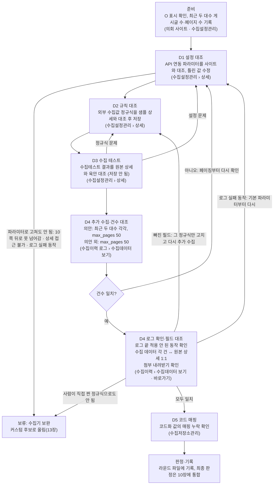

# 지방의회 수집기 설정 검증 SSOT

이 파일이 검증 기준과 기관별 최종 현황의 유일한 기준(SSOT)이다. 검증 기록은 라운드별 파일(`rounds/`)에 남기고, 라운드를 닫을 때 결과를 이 파일에 통합한다.

| 항목 | 내용 |
| --- | --- |
| 작성 | 최민규 |
| 기준일 | 2026-10-15 |
| 최종 통합 | ~~2026-10-15 — 9장 질문 답(사용자에게 하나씩 확인)·사전 허용·§G9 반영(R01 전, 라운드 통합 없음)~~ → 2026-10-17 — R04 충청북도의회·R07 단양군의회 통합(첫 라운드 통합, 11장 T12~T16) |
| 저장소 | https://github.com/choimingyu99/collector (공개) · 기준 브랜치 `dev` |
| 원본 | Claude 문서 "지방의회 수집기 설정 검증 스펙"(2026-10-15)을 옮겨 SSOT로 전환. 수정은 이 파일에서만 한다 |
| 사본(정본 아님) | Claude 문서(검토용), 바탕화면 Word `지방의회 수집기 설정 검증 스펙.docx`(구버전) |
| Claude 작업 방식 | `CLAUDE.md` |
| 참조 매뉴얼 | 최신 작업 매뉴얼(사용자 전달, 2026-10-15). 원문은 저장소에 두지 않는다(계정 정보 포함). 6장에 작업 순서 3.1~3.4.7을 옮겼다 |
| 참조 설명 | 2차 설명 회의 녹취(2026-10-15, 사용자 전달, 음성 인식 오류 가능). 원문은 저장소에 두지 않는다. 0~9장, 12장 G1·G6, 13장에 옮겼다. 인용의 발언자는 녹취의 '참석자 n' 표기를 따른다 |
| 화면 확인 | 2026-10-15 개발 수집기 화면과 화면의 자바스크립트를 읽어 확인(Claude, 버튼은 누르지 않음, 원주시의회 의안 설정 기준)하고, 사용자 화면 캡처 3장(수집 대상 및 수집 규칙 관리, 수집 규칙 JSON 입력 창)을 더했다. 14장, 12장 G7·G8에 옮겼다. 읽지 못한 화면은 14장에 '미확인'으로 적었다. 같은 날 사용자 요청으로 정규식 도구 창을 직접 열어 확인했다(14.7, §G9) |
| 운영 원칙 | 「round별로 관리하며」 「ssot는 통합으로 관리한다 이렇게 해도 되지」 (김경호 매니저, 2026-10-15, 사용자 전달) |

## 0. SSOT·라운드 운영 규칙

1. **SSOT는 이 파일 하나다.** 기준(1~9장), 기관별 현황(10장), 변경 이력(11장), 반복 함정(12장), 커스텀 대상(13장), 화면·버튼 조작표(14장), 표준 코드표(15장 — 2026-10-16 신설)는 여기서만 고친다.
2. **검증은 라운드 단위로 한다.** 라운드마다 `rounds/_라운드_템플릿.md`를 복사해 `rounds/Rnn_대상_목적.md`를 만들고, 그 라운드의 기록을 모두 그 파일에 적는다.
3. **통합(dev 머지)한 라운드 파일은 고치지 않는다.** 재검증·정정은 새 번호를 받고, 머리말 '원 라운드' 칸에 `Rxx`를 적는다.
4. **통합 순서**(라운드를 dev에 머지한 직후, 통합 담당): ① 10장 판정·건수·마지막 라운드 ② 9장 답(라운드) ③ 기준을 바꿔야 하면 1~8장을 취소선으로 정정 ④ 라운드의 '새 함정 후보'를 12장에 G번호로 등록하고, 이미 통과한 기관 중 해당할 수 있는 곳을 그 항목에 적는다. 라운드의 '커스텀 후보'는 13장에 올린다. 같은 사이트 틀(10장 '사이트 틀' 표)의 라운드끼리 고친 정규식·파라미터를 나란히 대조해, 한 라운드에서만 고친 결함은 다른 라운드를 재확인 대상으로 적는다(2026-10-16 보탬, §G29) ⑤ 11장 한 줄 ⑥ 0장 라운드 표 상태·지금 위치·머리말 최종 통합 ⑦ 옮겨 적은 값을 라운드 파일과 다시 대조한다.
5. **번호와 배정**: 통합 담당이 배정한다. 번호는 배정 순서일 뿐 실행·종료 순서가 아니다. 배정은 dev의 0장 라운드 표와 10장 담당 칸에 적고 push한다. 담당은 작업 전에 dev를 받아(pull) 자기 배정을 확인하고, 배정에 없는 기관의 설정은 고치지 않는다.
6. **문서 역할**: `CLAUDE.md` = Claude 작동 방식, `SSOT.md` = 기준·현황(유일한 정본), `rounds/Rnn_*.md` = 담당의 라운드 기록, `제안_문서정책_적용안.md` = 정책 도입 근거(보관용).
7. **작성 권한**: SSOT.md·CLAUDE.md·라운드 템플릿은 통합 담당(부재 시 부담당)이 dev에서만 고친다. 라운드 파일은 그 라운드 담당만 고친다. 템플릿을 바꾸면 버전을 올리고 11장에 한 줄 남긴다(12번 정책 개정 예외). 단 동결 전(v1 동결 이전)의 변경은 버전을 올리지 않고 11장에만 남긴다. 역할이 바뀌면 라운드 파일 머리말 '역할 변경' 칸에 날짜·이전→이후·지시 「…」를 적은 뒤부터 새 작성자가 잇는다.
8. **브랜치**:

   | 브랜치 | 의미 | 규칙 |
   | --- | --- | --- |
   | `main` | 초기 등록본. 운영 이관 확정용으로 남겨 둔다 | 지금은 손대지 않는다(dev → main 보류, 13번) |
   | `dev` | 통합본 | 라운드 브랜치를 머지하는 곳. SSOT.md는 dev에서 통합 담당만 고친다 |
   | `verify/r<NN>-<영문-kebab>` | 라운드 1개(담당 1명) | dev에서 분기. 자기 라운드 파일만 커밋하고 SSOT.md는 고치지 않는다 |

   브랜치 이름은 영문 kebab-case만 쓴다(예: `verify/r01-wonju-bill`). 파일명은 한글을 써도 된다. 재검증·정정 라운드도 새 번호로 새 브랜치를 딴다.
9. **dev 머지 기준** — 통합 담당이 머지 전에 확인하고, 하나라도 빠지면 머지하지 않고 담당에게 돌려보낸다.
   1. 라운드 파일에 빈칸이 없다(비면 '기록 없음' 또는 '미실시').
   2. 수집설정관리의 O 대상이 모두 진행 행이나 범위 밖 행에 있다.
   3. 건수 대조가 대수별(의안 외는 1~50페이지 범위 — 9장 8번 해석, 사람 확정 아님. 의안도 1~50페이지 범위이고 50쪽 이하인 대수는 그 대수 전체다 — 2026-10-16 통합 담당 결정 「의안도 50으로 바꿔야해」)로 따로 적혀 있다: 사이트 건수·사이트 실측 근거·기준 고정 시각·수집 시각·수집 건수·차이. 합산하지 않았다. 차이가 0이 아니면 사유가 있다(0이면 사유 칸은 '해당 없음').
   4. 설정 저장·추가 수집마다 실행 직전 데이터베이스 선택값, 전→후 값, 시각, 확인한 사람(사용자 사전 허용으로 한 것이면 '사전 허용(2026-10-15)', CLAUDE.md 1절)이 있다. 추가 수집은 ☐ 기존데이터 삭제가 해제였다는 확인도 있다(14.3). → 보탬(2026-10-16, R04·R07 5절): 2026-10-16 보탬(CLAUDE.md 1절)으로 받은 기관의 라운드는 사전 허용으로 한 동작의 '사람 확인'에 '사전 허용(2026-10-16)'을 쓴다. 사용자가 직접 누른 동작은 '사용자 직접', 사전 허용 밖의 동작을 사용자가 허용해 Claude가 한 것은 '사용자 허용(날짜, 이 동작)'을 쓴다 — 이 둘은 라운드와 상관없다(7장 기록 표기 — 사람 확정 아님).
   5. 의안의 마지막 저장값이 최근 대수·max_pages ~~0~~ → 50이다(대수는 9장 7번 답, max_pages는 2026-10-16 통합 담당 결정 「의안도 50으로 바꿔야해」). 의안 외는 max_pages가 50이다(9장 8번 답).
   6. 판정 값이 7장 목록 안에 있고, 잠정이면 '(잠정: 9장 n번)'이 붙어 있다.
   7. 라운드에서 만난 새 이슈가 '새 함정 후보'에 적혀 있다(없으면 '없음').
   8. 비밀번호·토큰·로그인 ID·개인 연락처가 없다.
   9. 라운드 브랜치가 SSOT.md를 고치지 않았고, 바뀐 파일이 그 라운드 파일 하나뿐이다(`git diff --name-only dev...<브랜치>` 결과가 그 라운드 파일 하나).
   10. 필드 대조(6장 8단계)가 기록돼 있다: 대조한 건 번호, 빠지거나 틀린 필드, 첨부 내려받기 결과, 로그의 실패 동작 유무. 빠진 필드는 정규식 수정·재수집 회차나 커스텀 사유로 이어져 있다. → 보탬(2026-10-17, R07·R09 — 사람 확정 아님): 정규식으로 못 고치는 틀린 필드는 9장 질문으로 잇고 판정에 '(잠정: 9장 n번)'을 붙여도 이 기준을 채운 것으로 본다(6장 8단계 보탬과 맞춤 — 단양 4800·4789, 9장 21·25번).
   11. 공통 수집기로 안 되는 기관·유형은 판정이 '보류: 수집기 보완'이고, 라운드 파일 '커스텀 후보'에 범위(대수·페이지)·사유가 적혀 있다(13장).
10. **이슈 축적**: 새 함정이 12장에 등록되면, 이미 통과한 기관 중 해당할 수 있는 곳을 재검증 라운드(새 번호, 새 브랜치)로 다시 확인한다. 이슈가 쌓일수록 앞서 끝난 기관에도 같은 기준이 적용된다. → 보탬(2026-10-16, 통합 담당 결정 「재발 방지 6가지를 dev에서 SSOT·템플릿에 넣고 11장에 기록해서 커밋해. push는 나중에 물어봐」): 함정만이 아니라 한 라운드에서 고친 정규식 결함도 같은 사이트 틀 기관에 다시 대조한다(0장 4번 ④, §G29). 수집기 배포(사용자·수집기 담당이 알려 준 것 — 8장 '수집기 배포 기록') 뒤에는, 그 전에 끝난 라운드 가운데 바뀐 기능에 걸리는 곳을 재확인 대상으로 적는다.
11. **본 검증 시작 조건**: R01 D4 ~~건수 대조~~ → 건수·필드 대조(2026-10-15, 2차 설명 회의로 D4에 필드 대조가 추가된 데 따른 정정 — 게이트에 필드 대조를 넣은 것은 사람 확정 아님. 완료의 뜻은 6장 10단계, 대조 범위는 9장 13번) 완료 + 라운드 템플릿 v1 동결. 동결은 통합 담당이 템플릿 머리말을 「v1 (동결 YYYY-MM-DD)」로 바꾸고 11장에 한 줄 남긴 뒤 dev에 push하는 것이다. 템플릿을 바꾸면 버전을 올리고, 이미 만든 라운드 파일은 원래 버전을 유지한다. → 예외(2026-10-16, 통합 담당 결정 「일단 커스텀으로 뺴고 원주는 넘어가고 … 해보자」): R01 머지(D4 완료)를 기다리지 않고 R04·R07을 시작한다. 템플릿은 같은 날 v1으로 동결했다(11장).
12. **정책 도입 예외**: 문서 정책 도입·개정은 라운드 없이 11장 '정책 도입' 행(사용자 결정 날짜, 지시 「…」)을 근거로 한다.
13. **보류**: 교차 확인(사용자 「일단은 코덱스 검증은 빼줘」, 2026-10-15), dev → main과 운영 확장(사용자 「운영 확장은 이후에 보는거고」, 2026-10-15). → 보탬(2026-10-16, 같은 결정): 사용자가 외부 검토(Codex 등)를 받아 오면 해당 라운드 파일 7절에 '외부 검토 의견'으로 적고, 지적마다 대응(확인 결과·고친 것·남긴 것)을 남긴다(첫 사례 R04·R07 7절). 정해진 교차 확인 절차는 여전히 보류다.
14. **태스크 순서**(2026-10-16, 사용자 「스펙 -> 계획하고 각 태스크를 시험작성 ->구현 -> 통과확인 -> 커밋 순서도 맞지?」 「그렇게해 이것도 이렇게 작업할거라고 문서에 적어두고」): 스펙(이 SSOT)과 계획(라운드 파일. 통합이면 라운드 파일의 반영 거리)을 정한 뒤, 일을 태스크로 나눠 태스크마다 아래 순서로 한다. 라운드 작업과 통합 작업 모두 같다.
    1. **확인 목록 작성**: 끝나면 참이어야 할 것과 없어야 할 것을 고치기 전에 적는다. 확인 목록은 점검 프로그램이 아니라 글로 쓴 목록이다(사용자 「일단 우리는 스크립트가 필요 없는거 아닌가? 잘 모르곘어서」 → 확인 목록 방식으로 정함, 2026-10-16).
    2. **고치기·실행**: 문서를 고치거나 화면 작업을 한다.
    3. **목록대로 확인**: 해당 자리를 찾아 읽고, 표 칸이 깨지지 않았는지와 비밀번호·토큰 같은 문자열이 없는지 본다. 하나라도 맞지 않으면 커밋하지 않고 2로 돌아간다.
    4. **커밋**: 태스크 하나에 커밋 하나다.
    - 확인 목록과 결과(항목 수, 통과·불통과)는 라운드 작업이면 라운드 파일의 그 단계 기록에, 통합 작업이면 11장의 그 행에 적는다.

| 라운드 | 대상 | 목적 | 담당 | 브랜치 | 파일 | 상태 | 종료(통합) |
| --- | --- | --- | --- | --- | --- | --- | --- |
| R01 | 강원특별자치도 원주시의회(33010) · 지방의회_의안 | 시범: 이 SSOT 절차를 끝까지 적용해 보정, 소요 시간 측정 | 최민규 | `verify/r01-wonju-bill` | `rounds/R01_원주시의회_의안_시범.md` | ~~진행 전~~ → 진행 중(2026-10-16 — 9대·10대 수집과 표본 대조, 9장 16~20번 답 대기) → 원주 9대 11쪽 이후는 커스텀으로 빼고 넘어간다(2026-10-16 통합 담당 결정 「일단 커스텀으로 뺴고 원주는 넘어가고」 — 13장). 라운드 파일 마무리·머지 대기 | |
| R02 | 강원특별자치도 춘천시의회 · 지방의회_의안 | 본 검증(R01 절차) | 최민규 | `verify/r02-chuncheon-bill` | `rounds/R02_춘천시의회_의안.md`(착수 때 만든다) | ~~배정 — R01 D4·템플릿 동결 뒤 시작(0장 11번)~~ → 보류(2026-10-16, 사용자 「이거 3개로해줘」 — 대상을 홍성·충북·단양으로 바꿈) | |
| R03 | 충청남도 서산시의회 · 지방의회_의안 | 본 검증(R01 절차). 회의록 O는 범위 밖(1장 후속 유형) | 최민규 | `verify/r03-seosan-bill` | `rounds/R03_서산시의회_의안.md`(착수 때 만든다) | ~~배정 — R01 뒤~~ → 보류(2026-10-16, 사용자 「이거 3개로해줘」) | |
| R04 | 충청북도의회(43001) · 지방의회_의안 · 지방정책정보 | 본 검증(R01 절차). 회의록 O는 범위 밖, 정책용역보고서 O는 제외(1장) | 최민규 | `verify/r04-chungbuk-bill-policy` | `rounds/R04_충청북도의회_의안_정책정보.md` | ~~배정 — R01 뒤~~ → 진행 중(2026-10-16 착수 — 의안. 지방정책정보는 수집 설정이 비어 있어(BBS 3개 모두 수집 대상 URL '-', 파라미터·정규식 없음) 검증할 값이 없다 — 10장) → 통합(2026-10-17 — 의안 수정 후 통과(잠정: ~~9장 26·28번~~ → 9장 26번 — 28번은 2026-10-17 답으로 풀림, 26번은 재검증 R08), 지방정책정보 보류: 정책 결정(잠정: 9장 23번) — 10장) | 2026-10-16(통합 2026-10-17 — 머지 ff92d95) |
| R05 | 세종특별자치시의회 · 지방의회_의안 · 지방정책정보 | 본 검증(R01 절차). 정책용역보고서 O는 제외(1장) | 최민규 | `verify/r05-sejong-bill-policy` | `rounds/R05_세종특별자치시의회_의안_정책정보.md`(착수 때 만든다) | ~~배정 — R01 뒤~~ → 보류(2026-10-16, 사용자 「이거 3개로해줘」) | |
| R06 | 충청남도 홍성군의회(41016) · 지방의회_의안 | 본 검증(R01 절차) | 최민규 | 없음(착수 안 함) | 없음 | 착수 불가(2026-10-16) — 수집설정관리에 홍성군의회 수집 설정이 없다(수집 ID 빈 값, 다섯 유형 모두 O 없음 — 10장). 설정을 새로 만드는 일은 기관·BBS 추가(14.6)라 사람이 정한다 | |
| R07 | 충청북도 단양군의회(43003) · 지방의회_의안 | 본 검증(R01 절차) | 최민규 | `verify/r07-danyang-bill` | `rounds/R07_단양군의회_의안.md` | 진행 중(2026-10-16 착수) → 통합(2026-10-17 — 의안 수정 후 통과(잠정: ~~9장 21·22·25·26·28번~~ → 9장 21·25·26번 — 22·28번은 2026-10-17 답으로 풀림, 26번은 재검증 R09) — 10장) | 2026-10-16(통합 2026-10-17 — 머지 904cb29) |
| R08 | 충청북도의회(43001) · 지방의회_의안 | 재검증(원 라운드 R04): D4 필드 대조를 6장 8단계 원래 방법(수집 데이터 탭 + 원본 상세 탭, 한 건씩)으로 다시 한다 — R04 표본 14건(12대 LOG 29015 8건·13대 LOG 29172 6건, 9장 26번 답) | 최민규 | `verify/r08-chungbuk-bill-recheck` | `rounds/R08_충청북도의회_의안_재검증.md`(착수 때 만든다) | 배정(2026-10-17, 9장 26번 답 「인정 안 함, 다시 대조」(사용자 선택)) — 착수 전 | |
| R09 | 충청북도 단양군의회(43003) · 지방의회_의안 | 재검증(원 라운드 R07): D4 필드 대조를 6장 8단계 원래 방법(수집 데이터 탭 + 원본 상세 탭, 한 건씩)으로 다시 한다 — R07 표본 14건(9대 LOG 29009 8건·10대 LOG 29019 6건, 9장 26번 답) | 최민규 | `verify/r09-danyang-bill-recheck` | `rounds/R09_단양군의회_의안_재검증.md`(착수 때 만든다) | 배정(2026-10-17, 9장 26번 답 「인정 안 함, 다시 대조」(사용자 선택)) — 착수 전 | |

R02~R05 배정 근거: 사용자가 다섯 곳을 주며 「잘된다면 R01제외하고 저 위에 다해야하고」(2026-10-15). '잘된다면'은 R01이 D4까지 끝나 템플릿을 동결하는 것으로 본다(0장 11번 — 해석, 사람 확정 아님). 기관 코드는 착수 때 수집이력 상세의 '기관코드'로 적는다. → 바꿈(2026-10-16, 통합 담당): 「일단 커스텀으로 뺴고 원주는 넘어가고 지금 내가 기존에 줬던 의회 3개에서 원주를 뺴고 해보자」 「이게 가능하면 다 돌리고 비고로 뺴면 되니까」에 이어 홍성군의회(41016)·충청북도의회(43001)·단양군의회(43003) 세 곳을 주며 「이거 3개로해줘」. 그래서 R04 충북은 그대로 착수하고 R06 홍성·R07 단양을 새로 배정했으며, R02 춘천·R03 서산·R05 세종은 보류한다. 사용자가 대상으로 준 기관은 배정이자 사전 허용이다(「아니 내가 지금까지 주는것들은 다 배정+사전 허용이야」, CLAUDE.md 1절). '비고로 빼면'은 커스텀 대상을 우리 문서(13장·라운드 파일)에 적는 것으로 본다(9장 14번 답 「우리 문서만」 — 해석, 사람 확정 아님). 기관 코드는 사용자가 준 값이다.

**지금 위치** (스냅샷 — 통합할 때만 고친다)
- 기준 시각: 2026-10-17, R04·R07 통합 뒤(11장 2026-10-17 T12~T16 행). 이전 스냅샷(2026-10-16 18시 무렵, 대상을 바꾼 뒤)은 git 이력에 있다
- 열린 라운드: R01 마무리 대기(브랜치 `verify/r01-wonju-bill`, 머지 전 — 원주 9대 11쪽 이후는 커스텀으로 뺐다, 13장). R04 충청북도의회·R07 단양군의회는 2026-10-17 통합했다(10장 — 의안 둘 다 수정 후 통과(잠정), 충북 지방정책정보 보류: 정책 결정(잠정)). R06 홍성군의회는 수집 설정이 없어 착수 불가(9장 24번). R02 춘천·R03 서산·R05 세종은 보류(0장 라운드 표). R08 충북·R09 단양 재검증(9장 26번 답 — D4 필드 대조를 원래 방법으로)은 배정, 착수 전(2026-10-17)
- 막힌 것: 기존데이터 삭제 오류·삭제 대상 건수(§G16·§G35 — 이미 있는 글은 ☐ 기존데이터 삭제 없이 ⛔ 전체수집한 회차의 LOG ID로 대조, 9장 17번), 같은 의안 중복(§G17 — 개발DB에 충북 501건·단양 1,560건이 5월 회차분부터 있고 같은 의안이 여러 벌, 운영 이관 전에 정리), 코드 변환(§G22 — 9장 20번, 원주·충북·단양 누락 후보 요청 전)
- 통합 대기: R01 라운드 파일(머지 전). 아직 옮기지 않은 것: 10장 원주 수집 건수와 10대·9대 1~10쪽 판정, R01 결정·질문의 9장 답 칸, 33010 재확인(§G29·§G31·§G33·§G34·§G35 — R01 머지 때)
- 물을 것: 통합 담당(사용자)에게 — ~~9장 22번(「고치고D만이긴한데」를 'D3까지, 다시 받지 않음'으로 읽은 것이 맞나 — 단양 판정 잠정), 26번(저장 HTML로 한 필드 대조를 인정하나 — 두 기관 판정 잠정), 28번(표본 첨부를 허용받은 3개만 받은 것으로 되나 — 두 기관 판정 잠정), 29번(수집 직전 재확인 생략)~~ → 2026-10-17 답 받음(9장 22·26·28·29번 — 26번은 재검증 R08·R09), 9장 21번(일괄 의안 번호 — DB 담당과), 23번(충북 지방정책정보 설정), 24번(홍성 설정 — 14.6). CLAUDE.md 맞출 거리(행동 규칙이라 사용자가 정함): (1) '사람 확인' 표기 — CLAUDE.md 1절은 '사전 허용(2026-10-15)'만 적고 SSOT 7장 기록 표기는 '사전 허용(2026-10-16)'·'사용자 직접'·'사용자 허용(날짜, 이 동작)'을 쓴다, (2) '전체 수집(… 기존 데이터를 지움)' 표현 — SSOT 8장·14.3·14.6은 ☐ 기존데이터 삭제를 체크했을 때만 지운다고 정정했다. 건별 허용 아래 Claude가 ⛔ 전체수집을 누른 사례(14.3)를 규칙으로 둘지, (3) 필드 대조 '탭 두 개' 절차와 9장 26번(답 전에는 CLAUDE.md 절차가 먼저 — 6장 8단계), (4) 멈춤 조건에 결과 요약 PARTIAL·EMPTY를 더할지([수집상황]이 DONE이어도 — 6장 6단계, §G31). 수집기 담당 쪽: 25번(줄바꿈), 27번([저장] 부작용), 18번 보탬(last_data 기준점 — 물을지는 통합 담당이 정함). 코드 매핑 관리자: 20번. 그 밖에 9장 10번(76개 목록, 나중에 받음), R01-Q5(HTML 주석 속 '본회의 보고일'을 수집할지 — §G28)
- 새 라운드 착수 때 먼저 볼 것: §G12(BBS 식별코드 빈 칸), §G3(대수 select 형식 — 이동형이면 list_url에 대수 값), §G10(사이트 [다음]의 종류·[끝] 유무와 대수별 쪽 수 — 한 쪽씩이고 [끝]이 없으면 11쪽 이후는 커스텀, 9장 16번), 6장 6단계(첫 [추가수집] 전에 D2·D3로 모든 컬럼을 맞춘다 — 고친 정규식은 이미 있는 글에 반영되지 않는다), max_pages 50·최근 두 대수(직전 → 최근, 3장), §G15(첨부는 화면 또는 childFileRows로 확인), §G16·§G20(☐ 기존데이터 삭제와 ⛔ 전체수집은 사람이 누른다), §G21(저장 직전·직후 재조회), §G13(확인창 스크립트), §G22·15장(D5 코드 매핑), 10장 '사이트 틀'(같은 틀이면 검증된 셀렉터·정규식에서 시작), §G29(빈 칸 시험 — 4장 통과 기준·정규식 꼴 점검), §G30(대수 select가 시작·끝 범위면 list_url에 그 대수), §G31([추가수집]이 'last_data 기준점'에서 멈추면 ☐ 해제 ⛔ 전체수집으로 다시 받고 그 회차 LOG ID로 대조), §G34(첫 [저장] 앞뒤 규칙 컬럼·파라미터 키 수), §G35(삭제 대상 건수는 회차 건수로 설명되지 않을 수 있다), 9장 26~29번(답 전 처리 — 필드 대조 방법·표본 첨부 범위·수집 직전 재확인)
- 새 세션이 먼저 읽을 것: `CLAUDE.md` 4절 순서(열린 라운드는 R01 마무리 대기뿐이다. 새 대상은 사용자가 준다 — 0장 배정 근거)
- 다음 통합: R01을 dev에 머지할 때(그때 33010 재확인 거리도 함께 본다)

## 1. 목적과 범위

개발 수집기에 이미 들어 있는 수집 설정이 실제 의회 사이트와 맞는지 이 문서 기준으로 검증하고, 빠진 데이터가 없음을 ~~건수로~~ → 건수와 필드 대조로(2026-10-15, 2차 설명 회의) 확인한 뒤 운영으로 옮긴다. 기존 테스트는 데이터가 들어오는지까지만 봐서 누락을 잡지 못했고, 이 스펙은 그 빈틈을 ~~건수 대조(D4)로~~ → 건수·필드 대조(D4)로(2026-10-15, 2차 설명 회의) 막는다.

| 구분 | 내용 |
| --- | --- |
| 1차 대상 | 등록 기관 344개(2026-10-15 수집설정관리 기준) 중 우선순위 76개. 목록은 담당 매니저가 확정 |
| 목표 시점 | 회의 기준 이번 주 안, 수집 테이블 적재까지 |
| 수집 유형 | 지방의회_의안·지방정책정보 먼저. 지방의회_회의록·5분 자유발언은 오픈 일정에 따라 후속. 정책용역보고서는 기관 1곳뿐이라 제외 |
| 대상 항목 | 수집설정관리 목록에서 O 표시된 기관·유형만. O가 없으면 건너뜀 |
| 작업 성격 | 신규 입력이 아니라 본사 테스트 때 넣어둔 설정의 검증·수정 |
| 비범위 | 수집기 기능 개발, 수집 주기 설정(일괄 세팅 예정), 회의록 AI 커스텀 수집, 운영 DB 이관 실행. 공통 수집기로 안 되는 기관의 커스텀 파이썬 작성은 13장 목록이 쌓인 뒤 따로 정한다(2026-10-15, 2차 설명 회의 — 범위 밖 처리는 사람 확정 아님) |
| 1차 완료 | 대상마다 D1~D4 통과. 의안은 최근 두 대수 각각 수집 건수 = ~~사이트 게시글 수~~ → 1~50페이지 게시글 수(50쪽 이하인 대수는 그 대수 전체 — 2026-10-16 통합 담당 결정 「의안도 50으로 바꿔야해」), 의안 외는 ~~지정 페이지 범위~~ → 1~50페이지 건수 일치(2026-10-15, 9장 8번 답의 해석 — 사람 확정 아님, R01-결6) (5장). 건수가 맞고 필드 대조에서 빠지거나 틀린 필드가 없어야 한다(2026-10-15, 2차 설명 회의, 6장 8단계). 공통 수집기로 안 되는 기관·유형은 커스텀 대상(13장)으로 빼고 1차 완료에서 제외한다(사람 확정 아님) |

## 2. 검증 사이클 개요

~~건수가 사이트와 맞아야 기관·유형 하나가 끝난다.~~ → 건수가 사이트와 맞고 필드 대조에서 빠진 값이 없어야 기관·유형 하나가 끝난다(2026-10-15, 2차 설명 회의).

수집테스트 결과가 원본과 다르면 원인에 따라 D1(설정) 또는 D2(정규식)로 돌아가 고치고, D4에서 건수가 다르면 D1의 페이징부터 다시 본다. D6(서비스 화면 비교)은 접속이 가능할 때 기록 전에 한다. 그림의 의안 외 값: ~~10페이지 이내~~ → max_pages 50(2026-10-15, 9장 8번 답). 그림의 의안 값: ~~max_pages 0~~ → 50(2026-10-16, 통합 담당 결정 「의안도 50으로 바꿔야해」). 건수가 맞은 뒤에는 수집 데이터를 원본과 필드 단위로 1:1 대조하고, 빠진 필드가 있으면 그 정규식만 고쳐 다시 수집한다. 파라미터·정규식을 고쳐도 공통 수집기로 안 되는 경우는 커스텀 대상(13장)으로 뺀다(2026-10-15, 2차 설명 회의 — 그림에 로그 확인·필드 대조 단계와 그 갈래를 더하고, D1 → 보류 갈래 라벨을 ~~현재 파라미터로 표현 불가~~ → '파라미터로 고쳐도 안 됨: …'으로 정정). 같은 갈래의 ~~'다음' 버튼 없음~~ → '10쪽 뒤로 못 넘어감'으로 고쳤다(2026-10-16, R01 실측 — '다음' 버튼이 없는 대수는 모두 수집됐고 막힌 것은 11쪽 이후다, §G1·§G10).

## 3. 수집 설정(API 연동 파라미터) 검증 기준

API 연동 파라미터는 목록의 페이지 이동, 검색(리스트 URL이 검색을 제공할 때), 상세 화면 이동에 쓰인다. 모든 파라미터는 실제 사이트의 목록·상세 페이지에서 도출하고, 아래 통과 기준을 모두 만족해야 D1 통과다.

- **셀렉터 표기**: CSS 표기를 쓴다. `.`은 클래스, `#`은 아이디다(2026-10-15, 2차 설명 회의 「점이 클래스고 샵이 아이디예요」 참석자 2, 녹취). 아이디·클래스가 없는 요소(form·input 태그 등)는 name 속성으로 지정한다. 예: `form[name="myform"]`(「그 네임을 지정해줘」 참석자 2, 녹취). 수집기 설정에 이미 들어 있는 `##`·`\"` 표기는 §G5 실측(D3 반환 대수, D4 1회차 건수·로그) 전에는 바꾸지 않는다. 실측에서 1회차 수집 건수가 직전 대수 사이트 건수와 다르고 그 원인이 대수 선택·검색으로 보이면(로그에 그 동작이 적용 안 됨으로 찍히거나 최근 대수 목록이 수집됨) 표준 표기(예: `select#select_daesu`, `form[name="myform"]`)로 바꿔 사람 확인 뒤 한 번 시험하고(§G6), 그래도 안 되면 커스텀 후보로 뺀다(사람 확정 아님).
- **공통 수집기의 전제**: 수집기는 ~~'다음' 버튼을 눌러 다음 페이지로 가고~~ → 목록의 쪽을 넘길 수 있고(넘기는 방법은 아래 '페이지 넘김 실측', 2026-10-16), 목록에서 상세 페이지까지 들어갈 수 있다는 전제로 만들어졌다. 이 전제가 깨지는 기관·대수는 파라미터로 고치지 못하면 커스텀 대상(13장)이다(2026-10-15, 2차 설명 회의 — 「상세 페이지까지 들어갈 수 있다는 전제하에 만든 거라서」 참석자 5, 녹취).
- **페이지 넘김 실측**(2026-10-16, R01 — 해석이고 수집기 코드는 보지 않았다, 사람 확정 아님): 원주 10대(8쪽, 어느 쪽에도 [다음] 없음)는 [추가수집] 한 번에 77건이 모두 들어왔다(§G1). 원주 9대는 1~10쪽(100건)까지만 들어오고 11쪽으로 넘어가지 않았다. 원주의 [다음]은 한 쪽씩(1→2) 넘기고 [끝]이 없다. 같은 사이트 틀(`#pagingNew`)인 칠곡은 [다음]이 다음 묶음(→11쪽)이고 [끝]이 있다. 그래서 수집기는 번호 영역(paging_selector) 안의 번호로 묶음 안을 넘기고, 묶음이 끝나면 [다음]으로 다음 묶음에 가는 것으로 본다. [다음]이 한 쪽씩이고 [끝]이 없는 사이트는 10쪽에서 멈춘다(§G10). list_url에 쪽 번호를 넣는 방법도 안 된다(§G11). 수집API관리의 의안 API 파라미터는 14개이고, 쪽 번호나 URL 틀을 받는 칸은 없다(수집API관리 파라미터 정의 읽기, 2026-10-16). → 보탬(2026-10-16, R04·R07 실측): [다음]이 '다음 10 페이지' 묶음 이동(1→11, 10→11, 25→31, 50→51)이고 [끝]이 실제 마지막 쪽을 가리키는 bill.do형(10장 '사이트 틀')은 11~50쪽도 모두 넘어갔다 — 충청북도의회(43001) 12대(139쪽)는 1~50쪽 500건(LOG 29015 — 의안번호 1384~885, 빠짐·중복 없음), 충청북도 단양군의회(43003) 9대(61쪽)는 1~50쪽 500건(LOG 29009 — 4902~4360). [끝]이 50쪽 뒤(139쪽·61쪽)를 가리켜도 max_pages 50에서 멈췄다(500건 = 50쪽분). [다음]·[끝]이 없는 10쪽 이하 대수(단양 10대 7쪽)도 번호로 모두 넘어갔다(LOG 29019 63건, §G1). 위 해석(묶음 안은 번호로, 묶음 끝에서 [다음]으로)과 맞는다. 그래서 [다음]이 묶음 이동이고 [끝]이 있는 사이트는 §G10에 걸리지 않는다고 본다(해석 — 수집기 코드는 보지 않았다, R04·R07 4절 D1·7절). [다음]이 묶음 이동인데 [끝]이 없거나, 한 쪽 이동인데 [끝]이 있는 사이트는 아직 실측이 없다.
- **고치는 곳**: 셀렉터가 틀리면 수집설정관리 상세의 API 연동 파라미터에서 고친다. 수집이력 로그에 적용 안 된 동작이 찍혀도 먼저 이 파라미터를 고친다(§G6).

 ~~셀렉터 표기(`##`, `\"`)와 페이징 방식은 수집기 해석 규칙이 확정되면 갱신한다(9장 1~4번).~~ → 셀렉터 표기(`##`, `\"`)는 R01 D3 수집테스트와 D4 1회차(9대) 건수로 실측해 정한다(2026-10-15, 9장 1번 답 안 됨에 따른 대체 — 사람 확정 아님, R01-결7). ~~페이지 넘김 방식은 파이썬 수집 코드 쪽이라 보류하고(2026-10-15, 9장 2번 답), 누락은 D4 건수로 잡는다(사람 확정 아님).~~ → 수집기는 '다음' 버튼으로 페이지를 넘기고, '다음' 버튼이 없을 때의 예외 처리는 아직 없다. 그런 기관·대수는 §G1 해결(셀렉터 수정)을 한 번 시험한 뒤에도 안 되면 커스텀 대상(13장)으로 뺀다(2026-10-15, 2차 설명 회의, 9장 2번 답 — 시험 단계는 사람 확정 아님, R01-결8). → 보탬(2026-10-16, R01 실측): '다음' 버튼이 없는 10쪽 이하 대수는 번호로 모두 넘어갔다(원주 10대 77건, §G1). 막히는 것은 [다음]이 한 쪽씩이고 [끝]이 없는 사이트의 11쪽 이후다(§G10, 위 '페이지 넘김 실측').

| 파라미터 | 의미 | 통과 기준 | 주의 |
| --- | --- | --- | --- |
| 수집 대상 URL (상세 '수집 정보 설정'의 startUrl) | 이 설정이 수집하는 게시판 주소. 기관마다 다르다(10장 표 아래) | 사이트에서 열면 대상 게시판(의안·정책자료 등) 목록이 나오고, list_url과 같은 게시판이다 | 검증은 이 주소의 사이트 화면과 대조한다(2026-10-15 사용자 「수집 대상 url있으니까 저거랑 검증해야해」). 이 칸은 고치지 않는다 — 틀려 보이면 멈추고 묻는다(14.3 4번). [연결테스트]는 연결(HTTP 200)만 본다 |
| list_url (리스트 URL) | 목록 시작 페이지 | 열면 대상 게시판 목록이 나온다 | 게시판 종류(의안·정책자료 등)가 맞는지. 수집 대상 URL과 다르면 그 까닭을 적는다. 대수 select가 고르는 즉시 주소를 옮기는 형식이면 list_url에 대수 값(예: `?s_daesu=9`)을 붙인다(§G3, 2026-10-16 R01 실측). 쪽 번호(`page=N`)는 붙여도 수집 때 1쪽으로 돌아간다(§G11). → 보탬(2026-10-16, R04 실측): 대수 select가 시작·끝 두 개인 범위 검색 사이트(충청북도의회(43001) — 시작 `select#th_sch`(begin_th)·끝 `select#th_sch2`(end_th, 기본값 최근 대수 13))는 시작만 고르면 끝 대수까지 섞인다(`?begin_th=12&end_th=13` → 156쪽, 1쪽은 13대 글). 그래서 list_url에 시작·끝을 같은 대수로 붙이고(`?begin_th=12&end_th=12` → 139쪽, 12대만) rasmbly_numpr와 같은 [저장]에서 함께 바꾼다(R04-결2 — 사람 확정 아님. D3 viewId 6210, LOG 29015 13대 글 0, LOG 29172 12대 글 0으로 확인). numpr_select_selector를 끝 select로 바꾸면 범위 오류 알림이 뜬다고 봤다(R04 4절 D1 사이트 분석 — 수집기로 시험하지 않음) — §G30 |
| list_class (리스트 태그 영역) | 목록 데이터 영역 | 목록 페이지에서 1개 매칭, 그 안 모든 행에서 상세 링크 추출 | 공지·상단 고정 글이 섞이는지 |
| view_url (상세 URL) | 상세 페이지 기본 주소 | view_id 값을 붙이면 상세가 열린다 | 검색 조건 파라미터 없이도 열리는지. 상세 페이지까지 접근하지 못하는 사이트(녹취상 Playwright로 못 열고 셀레니움으로 직접 클릭해 들어가야 하는 곳)는 공통 수집기로 수집하지 못해 커스텀 대상이다(2026-10-15, 2차 설명 회의 — 「플레이라이트로 못 따는 게 있어」 「셀레니움으로 직접 클릭해서 들어가는 구조로」 참석자 2, 「상세 페이지까지 접근을 못하면 다 커스텀 빼야지」 참석자 5, 녹취, 13장). URL로 열리지 않고 클릭으로만 들어가는 상세가 여기에 해당한다고 본다(해석 — 사람 확정 아님). view_url에 상세 표시 파라미터가 빠지면 thid를 붙여도 목록이 열린다(§G9, 원주). → 보탬(2026-10-16, R01 실측): 원주는 view_url `billList.html`(원래 값)로도 본 수집과 [수집테스트]의 상세 값이 모두 들어왔다. §G9는 정규식 도구 창에만 해당한다 |
| view_id_param (view_id 값) | 상세를 구분하는 파라미터 이름 | 목록 모든 행에서 값이 추출된다 | 링크가 자바스크립트 함수 호출인 사이트 |
| view_class (상세 태그 영역) | 상세 데이터 영역 | 수집할 필드가 모두 **첫 번째 매칭** 영역 안에 있다 | ~~여러 개 매칭되면 수집기가 어느 것을 쓰는지~~ → 수집기는 첫 번째 매칭만 쓴다(2026-10-15, 9장 3번 답). 필드가 두 번째 이후 영역에 있으면 둘을 감싸는 부모 셀렉터로 바꾸는 것이 후보다(§G2, R01 D2·D3에서 확정 — 사람 확정 아님). → 실측(2026-10-16, R01): 원주는 `div.bill-view`로 바꾸자 처리사항까지 수집됐다(§G2) |
| paging_selector (페이징 셀렉터) | 페이지 번호 영역 | 목록 페이지에서 1개 매칭 | 수집기는 이 영역 안의 번호로 묶음 안의 쪽을 넘기는 것으로 본다(2026-10-16 R01 실측의 해석 — 3장 '페이지 넘김 실측') |
| next_btn_selector (다음 버튼 셀렉터) | 다음 페이지로 넘기는 요소 | 마지막 전 모든 페이지에서 다음 페이지로 이동, 마지막 페이지에서 매칭 없음 | 페이지가 적으면 '다음' 버튼이 없는 사이트가 있다. ~~페이지 넘김 방식은 파이썬 수집 코드 쪽이라 보류(9장 2번) — D4 건수로 누락을 확인한다(§G1)~~ → 수집기는 '다음' 버튼으로만 넘기고 버튼이 없을 때의 예외 처리가 없다. D4 건수가 첫 페이지에서 멈추면 §G1 해결 순서를 따르고, 안 되면 커스텀 대상(13장)이다(2026-10-15, 2차 설명 회의, 9장 2번 답). → 보탬(2026-10-16, R01 실측): [다음]은 다음 번호 묶음으로 가는 데 쓰이는 것으로 본다(해석). D1에서 사이트의 [다음]이 묶음 이동인지 한 쪽 이동인지 본다. 한 쪽 이동이고 [끝]이 없으면 10쪽에서 멈추고, 이 셀렉터를 바꿔도 풀리지 않았다(§G10). → 보탬(2026-10-16, R04·R07 실측): [다음]이 묶음 이동이고 [끝]이 있는 bill.do형(충북 `a.num_right`, 단양 `.num_right`)은 셀렉터를 그대로 두어 11~50쪽도 넘어갔다(3장 '페이지 넘김 실측') |
| end_btn_selector (마지막 페이지 셀렉터) | 마지막 페이지 이동 요소 | 있으면 1개 매칭, 없으면 빈 값 | [끝]이 없는 사이트(원주)는 넣을 요소가 없다. 11쪽 링크를 넣어 본 회차도 11쪽으로 가지 않았다(2026-10-16 R01, §G10). → 보탬(2026-10-16 16:42): 수집기는 이 셀렉터가 가리키는 쪽을 끝 쪽으로 잡는 것으로 보인다 — 원주 1쪽에서 [다음](→ 2쪽)을 가리키게 하자 2쪽 20건에서 끝났다(§G10, 추정) |
| max_pages (최대 페이지 수집수) | 수집할 최대 페이지 수 | 의안은 ~~0 고정(무제한)~~ → 50(2026-10-16, 통합 담당 결정 「의안도 50으로 바꿔야해」), 의안 외는 ~~10페이지 이내~~ → 50(2026-10-15, 9장 8번 답) | 1이면 첫 페이지만 수집된다. 0이나 빈 값은 전체 수집이라 쓰지 않는다(수집API관리의 파라미터 설명 '0 또는 공백 입력 시 전체 수집', 사용자 「최대페이지 수집수를 0으로 하면 전체 수집이니까 이 값은 비워두지 말고 우리가 정한 정책으로 해야해」 2026-10-16) |
| rasmbly_numpr (대수) | 수집할 대수 | 최근 두 대수를 직전→최근 순서로 각각 추가 수집해, 설정이 최근 대수로 남게 한다(2026-10-16 통합 담당 확인 「그리고 대수는 최신과 최신 이전으로 하는거고」) | 한 번에 하나만 입력된다. 대수는 의회마다 달라 사이트에서 확인. 비우면 전체 대수를 수집하므로 비우지 않는다(수집API관리의 파라미터 설명 '비워두면 전체 대수 수집', 사용자 「대수의 파라미터를 넣지 않거나 최대페이지 수집수를 0으로 하면 전체 수집이니까」 2026-10-16) |
| search_form_selector (검색폼 셀렉터) | 대수 검색 폼 | 1개 매칭 | |
| numpr_select_selector (대수 검색 셀렉터) | 대수 선택 요소 | 1개 매칭, 선택하면 해당 대수 목록으로 바뀐다 | 기본값이 최근 대수라 선택이 실패해도 같아 보인다. 직전 대수로 확인. 수집기는 option의 **value**로 대수를 고른다(2026-10-15, 9장 4번 답 — 번호 해석은 사람 확정 아님, §G3). → 보탬(2026-10-16, R07 실측): 사이트 기본 목록이 최근 대수가 아니라 '전체'인 사이트(충청북도 단양군의회(43003) — 기본 목록 2,545건)는 대수 선택이 실패해도 1~50쪽 500건이 같은 건수로 들어와 건수로는 실패가 보이지 않는다(§G4 변형). 1회차의 첫 글·의안번호 범위·다른 대수 글 수를 함께 본다(R07-결3 — 사람 확정 아님. 단양 9대는 D3 첫 글 4902, LOG 29009 4902~4360·10대 글 0으로 확인). 대수 select가 시작·끝 범위인 사이트는 list_url 행(R04-결2, §G30) |
| search_btn_selector (검색 버튼 셀렉터) | 검색 실행 버튼 | 1개 매칭 | 선택 즉시 페이지가 바뀌는 사이트가 있다 |
| timeout (페이지 수집 대기 시간) | 페이지 로딩 대기 시간(ms) | 수집 중 시간 초과가 없다 | → 보탬(2026-10-16, R04·R07 실측): 충북·단양은 첫 [저장] 전 저장값에 이 키가 없었고, 저장 뒤 20000이 생겼다. 표에 없는 ssl_mode(값 null)도 함께 생겼다(§G34) |

## 4. 수집 규칙(정규식) 검증 기준

검증 대상은 수집설정관리 상세의 '수집 대상 및 수집 규칙 관리'에 DB 컬럼 기준으로 노출되는 외부 수집값 컬럼뿐이며, 정규식이 걸린 컬럼은 기존 값과 상관없이 모두 다시 검증한다. 내부 코드·시스템 생성 컬럼은 대상이 아니다.

- **통과 기준**: 샘플마다 후처리 결과가 원본 화면의 값과 같고, 날짜는 지정 형식(예: yyyy-MM-dd)으로 나온다. → 보탬(2026-10-16, 통합 담당 결정 — 재발 방지): **빈 칸 시험**도 통과 기준이다. 표본마다 그 컬럼의 원본 칸 값을 비운 HTML을 만들어 정규식을 돌리고, 빈 값(또는 매칭 없음)이 나와야 통과다 — 다른 칸·다른 블록의 값을 끌어오면 불통과다. 표본이 모두 맞아도 빈 칸 시험에 걸리면 고친다(R04는 고치고 R07은 그대로 두어 판단이 갈렸던 것을 막는다, §G29).
- **샘플**: 대수별로 첫·중간·마지막 페이지에서 상세 1건씩, 최근·직전 대수를 합쳐 최소 6건. ~~정규식 팝업으로 열 수 없는 샘플은 D3 수집테스트 결과나 D4 뒤 '수집데이터 보기'의 값을 원본 상세와 대조하고, 그 D2 결과에 '(잠정: 9장 5번)'을 붙인다. 대체 방법도 없으면 판정을 '보류: 정책 결정'으로 둔다.~~ → 샘플은 정규식 도구 창의 '상세 고유값 (thid)'에 넣고 [고유값으로 조회]로 불러온다(2026-10-15, 9장 5번, 14.7. 입력칸과 버튼은 화면 확인, 상세가 실제로 불러와지는지는 **미확인** — 원주는 목록 화면이 왔다, §G9). 창이 상세 영역을 찾지 못하면 view_url부터 D1에서 고친다(§G9). 고친 뒤에도 창으로 상세를 불러오지 못하는 샘플은 D3 수집테스트 결과나 D4 뒤 '수집데이터 보기'의 값을 원본 상세와 대조하고, 그 D2 결과에 '(잠정: 9장 5번)'을 붙인다(사람 확정 아님). 같은 표본을 6장 8단계 필드 대조에도 쓴다(9장 13번 답의 표본 크기에 맞춘 것 — 사람 확정 아님).
- **값이 드문 필드**(예: 철회일자): 샘플에 값이 없으면 사이트에서 그 값이 있는 상세를 찾아 1건 이상 검증한다. 끝내 못 찾으면 같은 형식의 다른 필드 규칙에 맞춰 두고 '샘플 없음'으로 기록한다. → 보탬(2026-10-16, R04 실측 — 사람 확정 아님): '샘플 없음'인 컬럼은 그 칸에 값을 넣은 합성 HTML로 정규식이 값을 잡는지도 본다(빈 칸 시험의 반대). 충북 위원회 보고일(CMIT_REPORT_DE) 저장값은 패턴 오타(대괄호 하나 더)로 값이 있어도 늘 빈 값이었는데, 이 시험으로 찾았다(R04 4절). 값 있는 표본이 없어 같은 꼴로만 맞춘 컬럼은 §G29 재확인 대상에 적는다.
- **도구**: 처리유형을 '정규식'으로 고르고 우측 '선택' 버튼을 누른다. 수집 대상 엘리먼트 선택 → 정규식 생성 → 수정 후 검증 → 캡처원문·기존 후처리 결과 확인 → 처리값에 적용 → 선택한 곳에 들어갔는지 확인 순서로 하고, 컬럼을 모두 마치면 저장한다. ~~팝업이 첫 페이지만 불러오는지는 확인이 필요하다(9장 5번).~~ → 창에 thid를 넣어 원하는 글을 조회하는 칸이 있다(상세가 실제로 불러와지는지는 **미확인**, §G9). 창의 요소는 14.7(2026-10-15 화면 확인). 위 순서 가운데 정규식 생성·수정 후 검증·캡처원문·기존 후처리 결과 요소는 그날 창에서 보이지 않았다(미확인).
- **정규식 패턴 JSON 입력**: AI(Claude 포함)가 만든 패턴은 '정규식 패턴 JSON 입력'으로 넣고 모두 적용한 뒤 저장한다. 그 뒤 추가 수집은 6장 5단계(D3 수집테스트)를 거쳐 6단계 순서(max_pages ~~0~~ → 50 — 2026-10-16 통합 담당 결정, 직전 → 최근 대수)로만 하고, 8단계 필드 대조로 확인한다(2026-10-15, 2차 설명 회의 「정규식 패턴 제이슨 입력 누른 다음에 다 적용하고 그다음에 저장 버튼까지 누르고 다시 돌아가서 다시 추가 수집하고」 참석자 1, 녹취). 넣기 전에 기존 정규식을 라운드 파일 5절 '전' 칸에 먼저 적는다. ~~JSON 입력이 다른 컬럼을 덮는지 R01에서 실측되기 전에는 외부 수집값 컬럼 전부의 기존 정규식을 적고, 저장 뒤 고치지 않은 컬럼이 그대로인지 확인해 적는다. 버튼 위치와 JSON 형식, 고치지 않는 컬럼을 JSON에서 빼도 되는지는 R01에서 실측해 통합 때 여기에 적는다.~~ → 버튼 위치와 누르는 순서, JSON 형식은 14.4에 적었다. 창은 화면 표의 지금 규칙(저장하지 않은 수정 포함)으로 채워져 열리므로, 상세를 새로 연 뒤 아무것도 고치기 전에 창을 열어 그 내용을 그대로 복사해 '전'에 남긴다(JSON 표기, 14.4 4번). [적용]은 JSON에 있는 컬럼만 바꾸고(그 컬럼의 기존 규칙 행은 지우고 다시 만든다) 없는 컬럼은 그대로 두며, 저장은 맨 아래 [저장]으로 따로 한다(2026-10-15 화면 자바스크립트 확인 — R01에서 [적용] 뒤 표를 보고 한 번 더 확인). → 실측(2026-10-16, R04·R07): [적용] 뒤 창을 다시 열어 47컬럼을 대조하니 JSON에 넣은 컬럼만 바뀌고 나머지는 그대로였다(R04 18:19 고칠 15줄만 넣음 — 15개·나머지 32개, R07 18:22 8개·39개, R07 19:31 ITNC_DE 한 줄만 넣음 — 1개·46개, 각 5절). 다만 [저장] 뒤에는 저장된 규칙 컬럼 목록이 화면 표의 47개로 바뀌었다(14.3 7번 [저장] 보탬·§G34 — 원인은 해석). 저장 뒤 고치지 않은 컬럼이 그대로인지 확인해 적는다.
- **고치는 순서**: 필드 대조에서 하나라도 빠지거나 틀리면 그 컬럼 정규식만 고치고 나머지 컬럼은 그대로 둔다 → 그래도 안 되면 사람이 그 컬럼 정규식을 직접 짠다 → 그래도 안 되면 커스텀 대상(13장)으로 뺀다(2026-10-15, 2차 설명 회의 「안 되는 정규식만 고쳐서 딴 건 그대로 두고」 「그래도 안 된다 그러면 이제 손으로 코딩하면서」 「그래도 안 되면 이제 그것도 하」 참석자 2, 녹취 — '손으로 코딩'은 AI가 아니라 사람이 정규식을 직접 짜는 것으로, 끊긴 마지막 말은 하드 코딩(커스텀)으로 봄. 해석 — 사람 확정 아님). 수집 데이터를 손으로 고치는 것이 아니며, '수집데이터 보기'의 저장은 누르지 않는다(6장 8단계). → 보탬(2026-10-16): 빈 칸 시험에 걸린 컬럼은 표본에서 틀린 컬럼과 같이 고칠 컬럼에 넣는다(위 통과 기준).
- **작성·검증 기준 보탬**(2026-10-16 — R01 실측과 다른 팀 기록(사용자가 전달한 다른 팀 작업 프롬프트)에서 가져옴, 사람 확정 아님. 아래 정규식은 원주 예이고 다른 사이트에 그대로 맞는다는 보장은 없다):
  1. **블록 경계**: 위원회·본회의처럼 같은 항목명이 블록마다 되풀이되면, 블록 이름 뒤에서 다음 블록을 넘지 않게 막는다(R01 위원회 4칸: `위원회[\s\S]{0,100}?처리사항(?:(?!처리사항)[\s\S])*?<strong>항목</strong>\s*([^<]*)`, 항목 = 회부일·상정일·처리일·결과 — 위원회 칸에 본회의 값이 들어가던 것을 고침, R01-결19).
  2. **빈 값**: 빈 값이 정상인 칸은 `([^<]*)`처럼 빈 값을 허용하고, 그 칸 안에서만 잡아 다음 칸 값을 끌어오지 않게 한다(R01 위원회 4칸, 다른 팀 기록 — 날짜 칸이 비었을 때 다음 항목의 날짜).
  3. **실제 표기**: '처리일'과 '의결일', '의안명'과 '제목'처럼 그 사이트의 실제 항목명을 쓴다. 값이 ``·`<a>`로 한 번 더 감싸인 항목이 있는지 본다(다른 팀 기록).
  4. **첨부**: 첨부 이름·URL은 링크 글자가 파일 이름(확장자)인 다운로드 링크만 잡는다. 확장자는 긴 것부터 쓴다(hwpx 다음 hwp — 짧은 쪽이 먼저면 .hwpx가 .hwp로 잘린다). 첨부가 여러 개면 이름과 URL의 개수·순서가 맞는지 본다(R01-결19·결22, §G27).
  5. **회기**: '제9대 제265회'처럼 대수와 붙은 칸에서 숫자만 뽑는다(R01: `<strong>제안\s*대수\s*/\s*대수</strong>\s*[^<]*?제\s*(\d+)\s*회`, R01-결23).
  6. **글자 그대로**: 의안번호 같은 번호 칸은 앞자리 0까지 같은지 본다(다른 팀 기록). 수집기는 `&amp;`를 `&`로 바꿔 저장한다(R01 수집테스트 응답). 링크가 상대경로면 수집된 값이 열리는 주소인지 본다. → 실측(2026-10-16, R04·R07): bill.do형의 상대경로 첨부 URL(`/kr/bill/download.do?uid=…`)은 수집기가 절대주소(`https://council.chungbuk.kr/kr/bill/download.do?uid=10902` 꼴)로 바꿔 넣었고, 첨부 이름의 `&middot;`는 '·'로 들어갔다(R04 4절 D3·3절 168, R07 4절 첨부 행). 그 절대주소를 사이트에서 열어 보지는 않았다 — 표본 첨부는 수집기 내려받기로 확인했다(6장 8단계 '첨부파일', R04·R07 3절).
  7. **주석·숨김**: HTML 주석·숨긴 영역의 값을 가린다(§G27·§G28 — R01-결22·R01-Q5, 다른 팀 기록). 원문에 없는 값은 추측해 채우지 않는다(다른 팀 기록).
  8. **표본**: 빈 칸이 있는 건, 첨부가 여러 개인 건, 위원회와 본회의 결과가 다른 건을 넣는다. 검증 건수는 계획한 수가 아니라 실제로 확보해 대조한 수로 적는다(다른 팀 기록). → 보탬(2026-10-16, R04·R07 — 사람 확정 아님): 블록 순서가 다른 건(충북 uid 6091·6115·6128은 본회의 블록이 먼저 — R04 4절 D1), 여러 줄 값(주요 내용)이 있는 건, 일괄 의안(의안번호가 '4800 - 4809'처럼 범위 — 단양)도 넣는다(R04·R07 4절 표본·7절). 여러 줄 값의 줄바꿈 빠짐은 정규식으로 고칠 수 없다고 봤고(단양 4800·4789 — R07 4절, 9장 25번), 일괄 의안 번호는 지금 앞 번호만 들어간다(R07-결2, 9장 21번). 정책 범위(1~50쪽) 밖 상세도 넣어 과적합을 본다(R04 5391 — 약 82쪽, R07 1968·1947 — 58·61쪽, 사람 확정 아님).
  9. **정규식 창 대신**: 정규식 도구 창이 상세를 불러오지 못하면(§G9) 사이트 상세 HTML에 같은 정규식을 돌려 표본과 대조하고, [수집테스트]로 확인한다(R01 4절 표본 6건).
  10. **정규식 꼴 점검**(2026-10-16 — 재발 방지, 라운드 템플릿 v1.1 4절): 컬럼마다 (가) 값을 잡는 부분이 항목명 바로 뒤 그 칸(`</th>\s*<td…>`) 안에 묶여 있다 — 항목명과 값 사이를 `[\s\S]*?`로 건너뛰지 않는다 (나) 위원회·본회의처럼 되풀이되는 블록 항목은 블록 경계로 막혀 있다(보탬 1) (다) 빈 칸 시험에서 빈 값이 나온다(통과 기준) (라) 첨부는 이름·URL 개수·순서가 맞다(보탬 4). 같은 사이트 틀(10장 표)이면 그 틀의 검증된 정규식과 나란히 놓고 다른 점을 적는다(§G29).
- **기록**: 컬럼마다 원본 값, 후처리 결과, 샘플 상세 URL을 라운드 파일에 적는다.

## 5. 검증 Depth와 통과 기준

1차 완료는 D1~D4 통과이며, 빠진 데이터는 ~~D4 건수 대조에서~~ → D4 건수·필드 대조에서(2026-10-15, 2차 설명 회의) 잡힌다. 건수 대조는 빠진 글을, 필드 대조는 글 안에서 빠지거나 틀린 값(§G2 같은 경우)을 잡는다. 검증을 맡길 때는 'D1~D4'처럼 Depth 범위로 지정한다.

| Depth | 이름 | 확인 내용 | 통과 기준 | 남길 증거 | 구분 |
| --- | --- | --- | --- | --- | --- |
| D1 | 설정 대조 | API 연동 파라미터를 실제 사이트와 대조 (3장) | 모든 셀렉터가 기대 개수로 매칭, URL이 열림 | 셀렉터별 매칭 개수, 수정 전→후 | 필수 |
| D2 | 규칙 대조 | 외부 수집값 정규식을 샘플 상세와 대조 (4장) | 샘플 전부 후처리 결과 = 원본 | 컬럼별 원본 값·후처리 결과 | 필수 |
| D3 | 수집 테스트 | 수집테스트 실행, 결과 육안 점검 | 반환 샘플의 필드 = 원본 상세. → 보탬(2026-10-16): 반환 데이터가 실제로 있어야 한다(결과 창 '총 1건', 응답의 viewId·의안번호). 'result ok'만으로 통과로 보지 않는다(§G23). 원본에 정규식을 돌린 D2 결과와 서버 [수집테스트] 결과는 따로 적는다(사람 확정 아님) | 테스트 결과 화면 | 필수 |
| D4 | ~~건수 대조~~ → 건수·필드 대조(2026-10-15, 2차 설명 회의) | 추가 수집 후 ~~수집이력 › 상세 › 수집데이터 보기로~~ → 수집이력 로그(상세 › 수집데이터 보기)로(2026-10-15, 9장 6번 답) 확인. 이어서 로그의 실패 동작을 보고, 수집 데이터 각 건을 원본 상세와 필드 단위로 1:1 대조하고 첨부를 내려받아 본다(6장 8단계) | 의안: 최근 두 대수 각각 수집 건수 = ~~사이트 게시글 수~~ → 1~50페이지 게시글 수(50쪽 이하인 대수는 그 대수 전체 — 2026-10-16 통합 담당 결정). 의안 외: ~~지정한 페이지 범위의 게시글 수와 일치~~ → 1~50페이지 게시글 수와 일치(2026-10-15, 9장 8번 답의 해석 — 사람 확정 아님, R01-결6). 그리고 대조한 건의 필드 = 원본, 첨부 내려받기 됨, 로그에 적용 안 된 동작 없음 | 대수별 사이트 건수·수집 건수, 대조한 건 번호·빠지거나 틀린 필드·첨부 결과, 로그의 실패 동작 줄 | 필수 |
| D5 | 코드 매핑 | 코드화 컬럼의 사이트 값 목록을 수집저장소관리의 코드 변환 설정과 대조 | 매핑 누락 0, 누락은 목록으로 보고 | 누락 값 목록 | 권장 |
| D6 | 서비스 화면 | 검색 반영 후 개발 서비스 화면을 원본과 비교 | 샘플 의안이 원본과 같은 내용으로 보임 | 화면 캡처 | 선택 |

D4에서 건수가 다르면 D1의 페이징(next_btn_selector, max_pages)부터 다시 본다. 필드가 빠지거나 틀리면 그 컬럼 정규식(D2)만 고쳐 다시 추가 수집하고 다시 대조한다(4장 '고치는 순서'). 공통 수집기로 안 되면 커스텀 대상(13장)으로 뺀다. D6은 개발 서비스 화면에 접속할 수 있을 때만 한다.

## 6. 기관·유형별 검증 절차

기관·유형 1건은 아래 순서로 처리하고, 단계마다 결과를 라운드 파일에 바로 적는다(기록 항목은 7장). 순서는 머리말 '참조 매뉴얼'(2026-10-15)의 작업 순서를 옮긴 것이다. 파라미터를 고치면 반드시 저장하고, 저장과 추가 수집은 되돌리기 어려우므로 확인 후 누른다. 단계마다 누르는 버튼과 누르지 않는 버튼은 14장에 화면별로 적었다.

1. **준비(기준 건수 먼저 고정)**: 수집설정관리 검색창에 기관명을 넣고 검색해, 점검할 유형에 O가 있는지 확인한다. 상세의 '수집 대상 URL'을 읽어 사이트에서 연다(3장 — 기관마다 주소가 다르다, 2026-10-15). 그 화면에서 최근 두 대수의 게시글 수와 페이지 수를 근거(목록 URL·대수 선택값)·기준 고정 시각과 함께 적는다. 이 값은 추가 수집 전에 적고, 수집 직전에 다시 확인한다. → 보탬(2026-10-16, R04 실측 — 세는 법은 사람 확정 아님): 목록에 총 건수 표시가 없으면 (마지막 쪽 − 1) × 쪽당 건수 + 마지막 쪽 행 수로 센다(충청북도의회(43001) 12대 138×10 + 1 = 1,381건, 13대 17×10 + 3 = 173건). 1~50쪽 범위 건수는 1쪽 첫 글·50쪽 마지막 글의 의안번호와 함께 적는다(12대 500건, 1384~885). 사이트 부하를 줄이려고 R04는 건수를 셀 때 12대 1·25·50·139쪽, 13대 1·10·18쪽만 열었다(R04 3절, CLAUDE.md 1절 — D1에서 시작 대수만 고른 목록 `?begin_th=12&end_th=13`(156쪽)과 표본 상세는 따로 열었다, R04 4절). 수집 직전 재확인을 하지 않고 의안번호가 이어지는 것으로 갈음한 R04·R07의 처리는 9장 29번이다. → 답(2026-10-17, 9장 29번 「번호가 이어지면 갈음 가능」(사용자 선택)): 수집 건수가 기준 고정 값과 같고 의안번호가 빈틈 없이 이어지면 수집 직전 재확인을 생략해도 된다. 번호가 비거나 건수가 다르면 그 대수를 다시 센다.
2. **상세 진입**: 기관의 상세 페이지에서 의정정보 탭(의안, 회의록 등)으로 점검할 유형을 연다. 목록의 유형 칸 'O'로 열고(~~'O'가 여는 설정이 검증 대상인지는 9장 15번 — 원주는 답 전에 저장·추가수집하지 않는다, R01-결11~~ → 'O'가 여는 설정이 검증 대상이다 — 2026-10-15, 9장 15번 답. 답은 원주 의안 bill(수집 ID 28)에 대한 것이고, 다른 기관에도 같게 보는 것은 해석이다. 다른 기관도 설정이 둘인지는 묻지 않았다 — 사람 확정 아님), BBS 목록에서 점검할 BBS가 선택돼 있는지 본다(14.2·14.3). → 보탬(2026-10-16): 상세의 기관(코드)·수집 ID·보드타입(의안은 bill)이 10장 수집 대상 URL 표와 맞는지 보고 라운드 파일 2절에 적는다. 다르거나 billTemp면 멈춘다(다른 팀 기록에도 같은 기준 — 「기관ID, 수집ID, 게시판 유형이 맞는지 확인해줘」). BBS 식별코드가 비어 있으면 §G12를 따른다. → 보탬(2026-10-16, R04·R07 2절): 수집이력 상세의 기관코드는 앞에 0을 붙인 6자리로 찍힌다(충청북도의회 043001 — LOG 29003, 충청북도 단양군의회 043003 — LOG 29007). 사용자가 준 기관 코드(43001·43003)와 같은 기관으로 본다(해석 — 사람 확정 아님).
3. **D1 API 연동 파라미터**: 3장 기준으로 대조하고, 틀린 값은 고쳐 전→후를 적는다.
4. **D2 수집 대상·수집 규칙**: 외부 수집값 컬럼마다 4장 순서로 정규식을 세팅·검증하고, 모두 마치면 저장한다. AI가 만든 패턴은 4장 '정규식 패턴 JSON 입력'으로 넣는다(버튼 순서는 14.4).
5. **D3 수집테스트**: 상세 페이지에 다시 들어가 수집테스트를 누르고, 결과를 원본 상세와 육안 대조한다. [수집테스트]는 저장된 설정으로 도므로 고친 뒤에는 먼저 [저장]한다(14.3). 다르면 원인에 따라 3단계(D1) 또는 4단계(D2)부터 반복한다.
6. **D4 추가 수집(의안)**: max_pages를 ~~0으로~~ → 50으로(2026-10-16, 통합 담당 결정 「의안도 50으로 바꿔야해」), 대수를 직전 대수로 저장하고 추가 수집한다(최근 두 대수 — 「그리고 대수는 최신과 최신 이전으로 하는거고」, 2026-10-16). 이어서 대수를 최근 대수로 저장하고 다시 추가 수집한다. 이 순서면 설정이 최근 대수로 남는다(9장 7번).
   - 1회차 수집이 끝난 것을 수집이력으로 확인한 뒤에만 대수를 바꿔 저장한다. 첨부파일이 많은 기관은 결과가 늦게 뜬다(8장 '실행 주의'). '끝났다'고 볼 표시(상태 값·종료 시각 등)는 R01에서 실측해 통합 때 여기에 적는다. 후보는 [추가수집]을 누른 탭의 [수집상황] '완료(DONE)'와 수집 건수, 수집이력의 데이터 수신시각이다(14.3·14.5 — 2026-10-15 화면 확인, 이것을 완료 표시로 쓰는 것은 사람 확정 아님). [추가수집]을 누르기 직전마다 ☐ 기존데이터 삭제가 해제인지 본다(14.3). 완료 표시가 없거나 판단이 안 되면 대수를 바꾸지 않고 사람에게 묻는다. 대수를 바꾸기 전에 1회차의 수집 건수(로그의 건수 줄)와 로그 끝의 실패 동작(8단계 '로그의 실패 동작')을 먼저 본다. 건수가 직전 대수 사이트 건수와 다르거나 실패 동작이 있으면 2회차로 넘어가지 않고 8단계 처리(3장 파라미터 수정, §G4·§G5·§G6)부터 한다(2026-10-15, 사람 확정 아님). → 실측(2026-10-16, R01): 수집이력 상세에 데이터 수신시각이 찍히고 결과 요약(`responseSummaryRaw`)이 `status SUCCESS · message 수집 완료`이면 끝난 것으로 본다(LOG 27975·28523·28682). [수집상황]의 '완료(DONE)'는 결과 요약이 PARTIAL·EMPTY일 때도 떴으므로 그것만으로 판단하지 않는다(R01 회차 0, 12:30 회차). 결과 요약이 `EMPTY · 1단계_리스트수집 · 리스트 수집 결과 0건`이면 새 글이 없었던 것일 수 있다(§G17). → 실측(2026-10-16, R04·R07): (가) 결과 요약이 `PARTIAL · 206 · 추가수집 완료 (last_data 기준점 도달)`(interrupted true)이면 [추가수집]이 끝까지 받지 않고 멈춘 것이다 — 충청북도의회(43001) 12대 44건(LOG 29003 — DB에 이미 있는 1340 앞), 충청북도 단양군의회(43003) 10대 4건(LOG 29018 — DB에 없는 4961 '본회의 휴회의 건' 앞). 기준점은 직전 회차의 맨 앞 글이고 의안명 같은 내용으로 맞춰 보는 것으로 보인다(해석 — 수집기 코드 미확인, §G31·R04·R07 7절 새 함정 후보: 4961은 직전 회차 맨 앞 글 4902와 이름이 같고, 충북 13대 LOG 29172는 직전 회차 맨 앞 글 1384와 같은 이름의 글이 없어 173건을 끝까지 받았다). 이 해석대로면 같은 이름의 글이 회기마다 되풀이되는 사이트에서는 대수를 바꾼 2회차도 일찍 멈출 수 있다(해석). 결과 요약이 PARTIAL이면 [수집상황]이 DONE이어도 일부완료로 보고, 대수를 바꾸지 않고 사람에게 묻는다(R04는 18:30에 사용자에게 직접 물음 — 사람 확정 아님). R04·R07은 그 대수를 셋째 항목 (3)의 ☐ 해제 ⛔ 전체수집으로 다시 받았다 — 충북 12대(LOG 29015)는 사용자가, 단양 10대(LOG 29019)는 사용자 허용으로 Claude가 눌렀다((3)의 '사람이 누르고'와 다름 — 14.3 ⛔ 전체수집, 9장 17번). (나) EMPTY(`1단계_리스트수집 · 리스트 수집 결과 0건`)가 설정 문제인지 이미 있는 글 때문인지는, D3 [수집테스트]의 첫 글이 그 대수 첫 글인지와 개발DB에 그 의안이 이미 있는지(수집데이터 관리 목록 검색 — 읽기만)로 가른다(단양 9대 LOG 29007 — D3 첫 글 4902는 맞고 5월 회차분이 여러 벌, R07 3절 — 사람 확정 아님). (다) [수집상황] DONE을 본 PC 시각과 데이터 수신시각(서버 시각)은 그날 시계 차(서버가 PC보다 약 26초 빠름 — R04·R07 5절, §G18) 때문에 앞뒤를 가르지 못할 수 있다(LOG 29003, R04 3절). 끝난 것은 위 R01 실측대로 데이터 수신시각과 결과 요약 status·message로 본다.
   - 어떤 재수집을 한 뒤에도 마지막 저장은 최근 대수·max_pages ~~0~~ → 50(2026-10-16 통합 담당 결정)이다(9장 7번 ~~답 전까지 잠정~~ → 답 「최근 대수가 맞고」(2026-10-15)).
   - 같은 대수를 다시 수집하면 그 회차에 새로 수집하는 것으로 보고, D4는 그 회차 수집 건수로 대조한다(9장 12번 답의 해석 — R01에서 실측 확인). → 실측(2026-10-16, R01 — 해석): 9대를 다시 [추가수집]하면 이미 있는 1~10쪽 글은 들어오지 않았고 빈 칸(회기)도 채워지지 않았다. 10대에서는 다른 회차(10-15)에 들어간 79~70이 다시 들어와 2건씩 됐다. ☐ 기존데이터 삭제 없이 ⛔ 전체수집을 하면 같은 의안이 한 번 더 들어간다(§G17). 그래서 (1) 고친 정규식은 이미 있는 글에 반영되지 않으므로 첫 [추가수집] 전에 D2·D3로 모든 컬럼을 맞추고, (2) D4는 그 회차의 LOG ID 건으로 대조하며 의안번호 중복을 본다. (3) 이미 있는 글을 다시 받으려면 ~~☐ 기존데이터 삭제 + ⛔ 전체수집을 사람이 누른다(§G16·§G20).~~ → ☐ 기존데이터 삭제를 해제한 채 ⛔ 전체수집을 사람이 누르고, 그 회차 LOG ID 건을 사이트와 대조한다(2026-10-17 정정 — 근거는 2026-10-16 9장 17번 답 「17번은 추가수집말고 전체 수집으로해서 실제 url과 데이터를 비교해서 맞게 잘 확인하면 되는거고」(사용자) — '삭제 없이'는 9장 17번 답 칸의 정리, §G16·§G20). R04·R07 사례(사람이 누른 회차와, 사용자가 허용해 Claude가 누른 회차)는 14.3 ⛔ 전체수집. 삭제가 실패하면 어떻게 할지는 사람이 정한다 — R01은 삭제 없이 ⛔ 전체수집하고 새 LOG ID 건으로 검수했다(사용자 「일단 오류는 냅두고 BBS 코드만 바꿔서 수집하면 되는걸로 가자 그리고 데이터 검증하면 되니까」 — BBS 식별코드는 '변경 불가'라 LOG ID로 가름). → 실측(2026-10-16, R04·R07): ☐ 해제 상태의 ⛔ 전체수집으로 같은 대수를 다시 받은 회차는 앞 회차·5월 회차분과 별개로 그 회차에 모두 새로 넣었다(LOG 29015 500건·29009 500건·29019 63건 — dataCount가 사이트 건수와 같음). D4는 그 회차 LOG ID 건으로 대조했고, 이 실측으로 그 회차 판정에 '(잠정: 9장 12번)'을 붙이지 않았다(R04·R07 3절 — 해석, 사람 확정 아님). 앞 회차 건과는 같은 의안이 겹친다(§G17 — 운영 이관 전에 정리).
   - 8단계 필드 대조 뒤 정규식이나 파라미터를 고쳤으면 이 순서(직전 → 최근)로 다시 추가 수집하고, 새 회차로 건수·필드를 다시 대조한다. 앞 회차 데이터는 고치기 전 설정으로 들어갔기 때문이다(사람 확정 아님, R01-결10). → 예외(2026-10-16, 9장 22번 답 「고치고D만이긴한데」(사용자) — 'D3까지, 다시 받지 않음'으로 읽은 것은 해석, 사람 확정 아님, R07-결6): 단양 발의일(ITNC_DE)은 표본 17/17이 맞고 빈 칸 시험(R07의 '합성 시험')에서만 걸려, 필드 대조 뒤 칸에 묶은 꼴로 고쳐 [저장]·[수집테스트]까지 하고 다시 받지 않았다(R07 5절 19:31~19:32). 이미 받은 값은 일부만 사이트와 맞춰 봤다 — 확인한 63건(9대 LOG 29009 500건 중 40건·10대 LOG 29019 63건 중 23건)은 모두 같았고, 그 목록 76행에 빈 발의일이 없었다. 나머지는 맞춰 보지 않았다(R07 7절·9절 미검증). 그 회차는 옛 정규식으로 들어간 값이고, 판정이 이 예외에 기댄다는 것을 라운드 파일 8절에 적는다(R07 8절). 다른 경우에도 다시 받지 않을지는 그때 사람이 정한다. 'D3까지, 다시 받지 않음'으로 읽은 뜻은 2026-10-17 사용자가 확인했다(9장 22번 「맞아, 다시 안 받음」)(예외는 여기까지 — 아래는 원래 항목). 건수(페이징) 문제로 next_btn_selector를 바꿔 멈춘 대수만 다시 수집해 보는 경우는 §G1 해결을 따른다(바꾼 값을 남기면 다른 대수도 다시 수집, 되돌리면 다시 수집하지 않음).
   - 기관을 넘길 때 현재 저장값(대수·max_pages)을 라운드 파일에 1줄로 남긴다.
7. **D4 추가 수집(의안 외)**: 회의록·지방정책정보·5분 자유발언은 대수 정보가 없을 수 있어, max_pages를 ~~10 이내로~~ → 50으로(2026-10-15, 9장 8번 답) 저장하고 추가 수집한다. D4는 1~50페이지 게시글 수와 대조한다(9장 8번 해석 — 사람 확정 아님, R01-결6).
8. **D4 건수 확인·필드 대조**(2026-10-15, 2차 설명 회의로 필드 대조 추가): ~~수집이력 → 상세 → 우측 상단 '수집데이터 보기'에서 수집 건수를 사이트 게시글 수와 대조한다. 그 화면에서 건수를 볼 수 없으면(9장 6번) 내부망 PC에서 `_temp` 테이블을 조회해 대수별 건수를 '내부망 조회 전사(조회: 이름·시각)'로 적는다. 조회 테이블·조건은 R01에서 실측해 통합 때 여기에 적는다.~~ → 수집이력 → 상세에서 로그와 우측 상단 '수집데이터 보기'로 수집 건수를 확인해 사이트 게시글 수와 대조한다. 건수는 수집이력의 로그에 뜬다(2026-10-15, 9장 6번 답 「수집이력에서 로그가 뜨니까 확인하면 돼」). ~~로그의 어느 줄을 건수로 볼지는 R01에서 실측해 통합 때 여기에 적는다.~~ → 실측(2026-10-16, R01): 수집이력 목록·상세의 '데이터 건수'가 결과 요약의 `dataCount`와 같다(LOG 27975 100, LOG 28523·28682 77, LOG 28691 20). 결과 요약은 상세의 숨은 칸(`responseSummaryRaw`)에 JSON으로 있다(`result` — code·interrupted·message·status·dataCount, `log` — 실패 단계 목록). 실패 단계는 `log`에 적힌다(예: `1단계_리스트수집 · 리스트 수집 결과 0건`, `필터_전체오류`). 데이터가 있는 회차도 `log`가 빈 목록일 수 있다.
   - **수집이력 찾기**: 수집이력에서 기관명으로 검색한다. 방금 수집했으면 목록 맨 위에 뜬다(「수집했으면 상단에 떠 있으니까」 참석자 2, 녹취). 같은 기관의 회차가 여러 개면 수집 시각·대수로 대조할 회차 행을 골라 라운드 파일 3절 '수집 시각'과 맞춘 뒤, 기관명을 눌러 상세로 들어간다. 정기 수집 행이 섞여 맨 위 행이 우리 회차가 아닐 수 있으므로, [수집상황]의 req_id와 상세의 REQ ID가 같은 행으로 고른다(확인 안 되면 [추가수집]을 누른 시각의 API 요청시각으로, 14.5, §G7).
   - **로그의 실패 동작**: 상세 맨 아래 로그를 끝까지 본다. 페이지는 수집됐어도 '필터 버튼 클릭'처럼 적용되지 않은 동작이 찍힐 수 있다. 그러면 그 동작의 기본 파라미터(3장)를 고쳐 다시 추가 수집하고, 그래도 안 되면 커스텀 후보로 뺀다(「기본 파라미터에서 수정해야 되는데 기본 파라미터도 안 된다 그러면」 「하드 코딩이」 참석자 2, 녹취, §G6, 13장). 실패 줄은 그대로 라운드 파일에 옮겨 적는다.
   - **수집기 배포 기준**(2026-10-16 보탬 — 재발 방지): 회차마다 그 회차 전에 받은 마지막 수집기 배포 소식(시각·내용 — 8장 '수집기 배포 기록', 없으면 '받은 소식 없음')을 라운드 파일 3절 로그 표 결과 칸에 적는다. 배포가 그 회차 뒤에 있으면 0장 10번대로 재확인 대상인지 본다. 설정이 같아도 수집기 코드가 바뀌면 결과가 달라질 수 있다(외부 검토 — R01 진행 중 두 번 바뀜).
   - **필드 대조**: ~~수집이력 상세에서 요청 URL을 누르고 '수집데이터 보기'를 연다.~~ → 수집이력 목록에서 고른 회차 행(요청 URL 칸 등 아무 칸)을 눌러 상세를 열고, 상세의 [수집데이터 보기](위·아래 두 곳 중 하나)를 누른다. 상세의 요청 URL은 수집 서버 주소라 누르지 않는다. '수집데이터 보기' 화면 구성은 미확인이다(2026-10-15 화면 확인, 14.5 — 녹취의 '요청 URL 누르고'를 목록에서 행을 누르는 것으로 본 것은 해석, 사람 확정 아님). 번호를 하나씩 눌러 그 건의 값을 원본 상세와 1:1로 대조한다. 원본은 그 건의 상세 링크(제목의 URL·'바로가기')로 다른 브라우저나 탭에 열어 두 화면을 나란히 본다(「1 대 1 비교해 보는 거예요」 「눈으로 확인해야 돼」 참석자 2, 녹취). 수집 대상 컬럼(4장, '수집 대상 및 수집 규칙 관리'의 외부 수집값 컬럼) 기준으로, 수집된 값이 원본 값과 같은지, 원본에 값이 있는데 수집값이 비어 있는 컬럼이 없는지 본다. 원본에는 있지만 수집 대상 컬럼이 없는 항목(예: §G2 처리사항이 수집 대상이 아닐 때)은 빠진 필드로 보지 않고 라운드 파일 7절 이슈에 적는다(사람 확정 아님). → 실측(2026-10-16, R01): [수집데이터 보기]는 수집데이터 관리 목록(`M06_dataMngrList.do?…&logId=n` — 그 회차 건만)을 연다. 열은 번호·수집 날짜·의안번호·제목·지방의회 ID이고, 행을 누르면 건별 화면(`M06_dataMngrView.do?no=…&dataType=bill`)이 열린다. 건별 화면의 값은 입력칸에 있고, 칸마다 수집성공·수집실패·미수집 배지가 붙는다(값이 있어도 '수집실패' 배지가 붙는 경우가 있다 — 뜻 미확인). 빈 수집값은 §G28로 가린다. → 보탬(2026-10-16, R04·R07 — 사람 확정 아님): 수집값의 날짜는 yyyyMMdd(정규식 결과 2026-09-16 → 20260916)로, 빈 값은 빈 글자로 들어오므로 형식을 맞춰 비교한다. 정규식으로 못 고치는 차이(줄바꿈 빠짐 등)는 '틀림 — 줄 구분 빠짐(글자는 같음, 잠정: 9장 n번)'처럼 적고 9장 질문으로 잇는다(R07 3절 — 9장 25번, §G33). 원본 상세를 다시 열지 않고 D2 때 받아 둔 사이트 HTML로 대조한 R04·R07의 방법은 9장 26번이다. 답 전에는 새 라운드도 CLAUDE.md 1절 절차(수집 데이터 탭과 원본 상세 탭 두 개, 원본은 한 건씩)로 대조하고, 이 방법으로 대조한 판정에는 '(잠정: 9장 26번)'을 붙인다(10장 — R04·R07). → 답(2026-10-17, 9장 26번 「인정 안 함, 다시 대조」(사용자 선택)): 저장 HTML 대조는 기준으로 쓰지 않는다. R04·R07 표본은 재검증 R08·R09에서 원래 방법으로 다시 대조한다. → 보탬(2026-10-17, R08·R09 실측): 다시 대조했다 — 충북 14/14 일치, 단양 12/14 일치(4800·4789는 9장 21·25번 차이 그대로). 하는 법: 회차 목록(`M06_dataMngrList.do?schOpt1=기관코드&dataType=bill&logId=n`)을 바로 열어 의안번호로 레코드 no를 찾고, 건별 화면을 수집 데이터 탭에, 원본 상세(uid 주소 — 건별 화면 URL 칸의 uid와 같음)를 원본 상세 탭에 한 건씩 연다. 건별 화면은 칸 이름표가 틀린 곳이 있어(§G37) 컬럼은 입력칸 name으로 가린다. 두 탭의 화면 글자를 도구로 읽어 맞춘 것은 R08-결1·R09-결1이다(받아들인 근거는 9장 26번 답 칸 — 해석). 원본에는 있지만 수집 컬럼이 없는 항목('발의 의원'·'관련 회의록')은 9장 30번.
   - **첨부파일**: 첨부가 있는 건은 수집 데이터의 첨부를 내려받아 열리는지(내용이 뜨는지)와 파일 확장자를 본다(「첨부 파일도 이제 BI 아닌지 확장도 잘 보고」 「다운로드 해 보고 잘 된다. 이거 뜨면 되는 거잖아요」 참석자 2, 녹취 — 'BI 아닌지'는 뜻을 알 수 없음. 확장자를 원본 상세의 첨부 표시와 대조하는 것은 해석, 사람 확정 아님). 내려받기는 건별로 사람 확인을 받은 뒤 한다(CLAUDE.md 1절). ~~첨부를 수집된 모든 건에서 내려받을지는 9장 13번에 함께 묻고, 답 전에는 대수별 4장 샘플 건(첫·중간·마지막 페이지)의 첨부만 내려받는다. 나머지 건의 첨부 칸은 '미실시'로 적고 판정에 '(잠정: 9장 13번)'을 붙인다(사람 확정 아님).~~ → 표본 건(아래 '대조 범위')의 첨부만 내려받는다(2026-10-15, 9장 13번 답). 내려받은 파일은 `evidence/Rnn/`에만 두고 저장소에 올리지 않는다. → 보탬(2026-10-16, R01): 건별 화면의 첨부 표는 화면 스크립트가 그리므로 화면에서 보거나 HTML 속 `childFileRows`를 센다(§G15). 서버에 파일이 있는지는 다운로드 주소(`M06_dataMngrFileDownload.do`)에 HEAD 요청으로 크기만 볼 수 있다(내려받기 아님). 첨부가 여러 개면 의안 파일 이름·URL 칸에는 목록 글자(`["…", "…"]`)로 한 칸에 들어가고, 첨부 표에는 행이 개수만큼 생긴다(원주 49·1159·1160 등). 첨부 URL이 뷰어 주소인지도 본다(§G25). → 보탬(2026-10-16, R04·R07 — 외부 검토 ②를 받아 Claude가 더한 확인, 사람 확정 아님): 내려받은 첨부는 정상 파일인지와 함께 그 의안의 파일인지 본다. 파일 형식(HWP는 OLE·'HWP Document File' 머리·BodyText 스트림, HWPX는 ZIP·mimetype `application/hwp+zip`·`Contents/section0.xml`)과, 파일 안 미리보기·본문 글에 그 의안명이 있는지 본다(충북 1384·892·173, 단양 4893·4933·4965 — 모두 그 의안의 파일). 두 라운드는 사용자가 파일명·크기를 보고 허용한 표본 3개씩만 수집기(R07은 `M06_dataMngrFileDownload.do`)에서 브라우저 안으로 받았고 디스크에 저장하지 않았다(사용자 「… 내려받아서 브라우저 안에서 확인해. 디스크에는 저장하지 마」, 2026-10-16). 한글 프로그램으로 열어 보기와 사이트 원본 파일과의 바이트 대조는 두 라운드 모두 하지 않았다(R04 3절·9절, R07 3절 — 수집기에서만 받음). 허용 받지 않은 표본 첨부·둘째 파일은 칸마다 '내려받기 미실시'로 적고 라운드 파일 9절 미검증에 남긴다(0장 9번 10 — 11장 T12a). 표본 첨부를 다 내려받지 않은 것이 5장 D4 통과 기준('첨부 내려받기 됨')을 채우는지는 정해지지 않았다(사람 확정 아님 — 9장 28번). 답 전에는 그 판정에 '(잠정: 9장 28번)'을 붙인다(10장, 7장 잠정 판정 보탬). → 답(2026-10-17, 9장 28번 「기관당 3개면 충분」(사용자 선택)): 첨부는 기관당 3개(대수마다 1~2개)를 건별 허용으로 받으면 5장 D4 '첨부 내려받기 됨'을 채운다. 둘째 파일과 나머지 표본 첨부는 칸마다 '내려받기 미실시'로 적는다.
   - **'저장'은 누르지 않는다**: '수집데이터 보기'의 저장은 주무관이 손으로 고칠 때 쓰는 것이다(「원래 저장이 필요 없는데 주무관님이 가끔씩 수정할 게 있으면」 참석자 2, 녹취). 한 건을 다 보면 뒤로 가기로 돌아가 다음 번호로 간다.
   - **대조 범위**: ~~수집된 모든 건이다(「수집된 모든 건수에 대한 번호를 클릭해서」 참석자 1, 녹취). 전수인지 표본인지는 9장 13번 답 전까지 잠정이며(R01-결9), 전수를 못 마치면 대조한 건 번호와 남은 건수를 적고 판정에 '(잠정: 9장 13번)'을 붙인다.~~ → 대수별 표본 3건(첫·중간·마지막 페이지에서 1건씩)이고, 값이 드문 필드나 첨부가 있는 건을 따로 더한다(2026-10-15, 9장 13번 답 「표본만」 「대수별 3건」(사용자 선택)). 4장 정규식 샘플과 같은 건을 쓴다(사람 확정 아님). 이 화면에 모든 컬럼이 보이지 않을 수 있고, DB 대조는 지금 하지 않는다(「여기서도 안 보이는 게 있어요」 「디비 비관은 안 한다 했죠」 참석자 2, 녹취 — '비관'은 '비교'로 봄). 보이지 않는 컬럼은 '화면에 없음'으로 적는다.
   - **빠진 필드**: 한 건이라도 필드가 빠지거나 틀리면 바로 다시 수집하지 않고, 그 회차 대조를 대수별 4장 샘플 범위(첫·중간·마지막 페이지 건)까지 이어 보고 빠지거나 틀린 컬럼을 모은다. 그다음 4장 '고치는 순서'대로 그 컬럼들의 정규식만 고쳐 저장하고, 5단계(D3 수집테스트)로 먼저 확인한 뒤 6단계 순서로 한 번 다시 추가 수집해 다시 대조한다(사람 확정 아님 — 「한 개라도 부족하다. 그럼 다시 정규식 새로 만들어야 돼」 참석자 2, 녹취).
9. **D5 코드 매핑**: 처리결과·의안종류 등 코드화 컬럼 값이 수집저장소관리의 코드 변환에 있는지 확인한다. 담당은 코드 변환을 직접 저장하지 않고, 누락 값 목록을 코드 매핑 관리자에게 요청한다(8장 '외부 확인처'). → 방법(2026-10-16, R01): 건별 화면의 표준코드 칸(select)은 `data-parent-code`(코드 그룹)와 `data-current-val`(들어간 코드)을 가진다. 원문 값과 들어간 코드를 짝지어 모으고, 15장 코드표(수집기 `_getCodeListByPcode.ajax`와 같음)에 없는 코드나 '분류불가'로 간 원문 값을 누락 목록으로 만든다(§G22 — 원주는 의안종류 대부분이 코드 목록에 없는 BKI901).
10. **판정·기록**: 7장 판정 값으로 결론을 적는다. D6은 접속이 가능할 때 이 단계 전에 한다. 건수가 다르면 판정 전에 D1 페이징부터 다시 확인한다. 필드 대조까지 끝나야 판정한다. 끝났다는 것은 ~~수집된 모든 건을 대조했거나, 전수를 못 마쳤으면 대수별로 4장 샘플 범위(첫·중간·마지막 페이지 건)와 첨부가 있는 건 1건 이상을 포함해 대조하고 대조한 번호·남은 건수를 적은 것이다(뒤의 경우 판정에 '(잠정: 9장 13번)').~~ → 8단계 '대조 범위'의 표본(대수별 3건과 따로 더한 건)을 모두 대조하고 번호를 적은 것이다(2026-10-15, 9장 13번 답). '화면에 없음' 컬럼은 빠진 필드로 보지 않고 라운드 파일 9절 '미검증'에 적는다(사람 확정 아님). 0장 11번의 '건수·필드 대조 완료'도 이 뜻이다. 공통 수집기로 안 되면 판정을 '보류: 수집기 보완'으로 하고 라운드 파일 '커스텀 후보'에 사유를 적는다(13장).

## 7. 판정 기준과 결과 기록 양식

기관·유형마다 아래 판정 중 하나로 결론을 낸다. 단계별 기록은 라운드 파일에 남기고, 최종 판정만 10장 현황표에 통합한다.

| 판정 | 의미 |
| --- | --- |
| 통과 | 수정 없이 D1~D4 통과 |
| 수정 후 통과 | 값을 고친 뒤 D1~D4 통과, 전→후 기록 |
| 보류: 수집기 보완 | ~~현재 파라미터로 표현할 수 없음 (자바스크립트 함수 페이징, POST로만 열리는 상세 등)~~ → 공통 수집기(현재 파라미터·정규식)로 수집할 수 없어 커스텀 대상(13장)으로 뺌: '다음' 버튼이 없고 next_btn_selector를 고쳐도 안 넘어감(§G1), 상세가 URL로 열리지 않음(클릭으로만 들어감, POST로만 열림 등), 로그의 실패 동작이 파라미터로 안 고쳐짐(§G6), 사람이 직접 짠 정규식으로도 필드를 못 뽑음(4장 '고치는 순서'), 자바스크립트 함수 페이징 등(2026-10-15, 2차 설명 회의). 일부 대수만 해당해도 이 판정으로 두고 범위는 13장에 적는다(사람 확정 아님, R01-결8) |
| 보류: 정책 결정 | 건수 통제 등 정책이 정해지지 않음. → 보탬(2026-10-16, R04): 수집 설정이 비어 있어(수집 대상 URL '-', 파라미터·정규식 없음) 검증할 값이 없고 설정을 채울지 사람이 정해야 할 때도 쓴다(충청북도의회(43001) 지방정책정보 — 잠정: 9장 23번. 이 판정 값을 고른 것은 해석, 사람 확정 아님) |
| 보류: 사이트 문제 | 접속 불가, 차단, 캡차 |
| 대상 아님 | O 표시 없음 |

- **미검증**은 판정 전 값이다(10장 초기값, 라운드 파일 판정 칸의 판정 전 값). 판정이 아니므로 머지 전에 위 판정 중 하나로 바꾼다.
- **잠정 판정**: 9장의 답이 아직 없는 기준에 기대어 판정했으면 판정 뒤에 '(잠정: 9장 n번)'을 붙인다. 9장 답이 1~8장 기준을 바꾸면 통합 담당이 영향받는 기관 목록을 9장 답 칸에 적고 재검증 라운드를 배정한다. → 보탬(2026-10-17, R04·R07 통합 — 사람 확정 아님): 라운드 판정에 없던 잠정이라도, 판정이 기댄 방법·범위가 9장 질문으로 남았거나, 답은 있어도 판정이 기댄 그 답의 뜻이 '해석 — 사람 확정 아님'으로 적혀 있으면(단양 22번 — R07-결6) 통합 담당이 10장 판정에 붙이고 11장에 적는다(충청북도의회(43001)·충청북도 단양군의회(43003) 의안 — 9장 26·28번, 단양 22번). D2 결과에만 붙은 '(잠정: 9장 5번)'은 같은 컬럼을 D4 필드 대조로 맞춰 봤으면 판정으로 옮기지 않는다 — 그 D4 대조 방법은 26번이 다룬다. 판정이 기댄 방법이라도, 결과(수집 건수가 기준 고정 값과 같고 의안번호가 이어짐)로 영향이 없다고 본 질문은 붙이지 않는다(9장 29번 — 수집 직전 재확인 생략, 2026-10-17 통합 때 판단). → 보탬(2026-10-17, 9장 22·26·28·29번 답): 22·28번 잠정은 답으로 풀었고, 26번은 '인정 안 함, 다시 대조'라 재검증 R08·R09까지 잠정으로 둔다. 29번은 '갈음 가능'으로 답이 나와 위 처리와 같다.
- 운영 이관 대상 조건은 운영 확장을 정할 때 함께 정한다(0장 13번).

| 기록 항목 | 적는 내용 |
| --- | --- |
| 기관·유형 | 기관명, 수집 유형, O 여부 |
| 대수 | 최근 대수, 직전 대수 |
| 사이트 건수 | 대수별 총 건수와 확인 일시 |
| 수집 건수 | 대수별 수집이력 건수 |
| Depth 결과 | 준비·D1~D6 각각 통과·수정·실패·미실시 |
| 수정 내역 | 파라미터·컬럼별 전→후 값 |
| 필드 대조 | 대조한 건 번호, 빠지거나 틀린 필드, 첨부 내려받기 결과, 로그의 실패 동작 줄 |
| 커스텀 후보 | 공통 수집기로 안 되는 범위(대수·페이지)와 사유, 시도한 것 |
| 판정 | 위 판정 값 중 하나 |
| 이슈·요청 | 내용과 요청 대상 |
| 담당·일시 | 이름, 날짜 |

**기록 표기** — 라운드 파일과 이 문서에서 같은 뜻은 같은 말로 쓴다.

| 표기 | 쓰는 때 |
| --- | --- |
| 「…」 | 사람의 발언·지시를 그대로 옮길 때(날짜와 발언자를 함께) |
| 기록 없음 | 확인했지만 남은 기록이 없을 때 |
| 미실시 | 하지 않은 단계 |
| 해당 없음 | 적을 내용이 원래 없을 때(차이 0인 행의 사유 등) |
| 착수 전 | 라운드를 시작하기 전이라 아직 채울 수 없는 칸 |
| 요청 전 | 9장 질문을 아직 보내지 않았을 때 |
| 답 안 됨 | 질문을 보냈지만 취지가 통하지 않아 답을 받지 못했을 때 |
| 보류 | 사람 지시로 질문·기준을 당분간 다루지 않을 때(지시 「…」를 함께 적는다) |
| Rnn 전 | 라운드 시작 전에 받은 답·정정의 라운드 칸(예: R01 전) |
| 발언자 기록 없음 | 「…」를 옮겼지만 실제로 말한 사람을 모를 때 |
| (참석자 n, 녹취) | 「…」가 회의 녹취(음성 인식)에서 온 것이고 발언자를 녹취의 '참석자 n'으로만 알 때. 원래 말과 다를 수 있어 뜻이 갈리는 말은 해석을 함께 적는다 |
| 화면에 없음 | 필드 대조에서 '수집데이터 보기' 화면에 그 컬럼이 보이지 않을 때 |
| 사전 허용(2026-10-15) | 라운드 파일 5절 '사람 확인' 칸에서, 건별로 묻지 않고 사용자 사전 허용(「저장·추가수집도 자동」(사용자 선택), 「아예 너가 자동화으로 나한테 결과문서만 던져야한다니까」)으로 [저장]·[추가수집] 등을 했을 때(CLAUDE.md 1절) |
| 사전 허용(2026-10-16) | 라운드 파일 5절 '사람 확인' 칸에서, 사용자가 2026-10-16에 대상으로 준 기관(「아니 내가 지금까지 주는것들은 다 배정+사전 허용이야」(사용자, 2026-10-16), CLAUDE.md 1절 보탬)의 라운드(R04·R07)에서 사전 허용 범위의 버튼([저장]·[추가수집]과 같은 순서 안의 [수집테스트]·[적용] 등)을 묻지 않고 눌렀을 때. 날짜를 2026-10-16으로 적는 것은 R04·R07 5절의 정리다(사람 확정 아님) |
| 사용자 직접 | 라운드 파일 5절 '사람 확인' 칸에서, 사용자가 직접 누른 동작을 적을 때(예: ⛔ 전체수집 — R04 LOG 29015, R07 LOG 29009). 그때의 화면 상태(☐ 해제 등)를 사용자에게서 들었으면 '실행 직전 확인' 칸에 '(사용자 전달)'을 붙인다 |
| 사용자 허용(날짜, 이 동작) | 라운드 파일 5절 '사람 확인' 칸에서, 사전 허용 밖의 동작을 사용자가 허용해 Claude가 한 번 했을 때(예: R07 5절 18:51:05 ⛔ 전체수집 — 「브라우저 띄어서 너가 직접해 허용해줄게」(사용자, 2026-10-16)). 그 허용을 다른 동작·다른 회차로 넓혀 쓰지 않는다(R07 5절 '사람 확인' 칸의 '이 동작' 표기를 통합 때 규칙으로 옮김 — 14.3 ⛔ 전체수집의 'R07의 해석'과 같은 것, 사람 확정 아님) |
| 맞음 · 틀림 · 부분 | 사전 분석 예상을 실측과 대조한 결과 |
| 사후 작성(작성: 이름) | 일이 끝난 뒤 기억·로그로 채운 기록 |
| 전사(작성: 이름) | 다른 문서·화면에서 옮겨 적은 값 |
| 내부망 조회 전사(조회: 이름·시각) | 내부망 PC에서 조회해 옮긴 값 |
| 사람 확정 아님 | 담당이나 Claude가 정했고 사람이 확정하지 않은 결정 |
| (사전 분석, 미실측) | 수집 전에 사이트만 보고 예상한 내용 |
| (잠정: 9장 n번) | 9장 답이 없는 기준에 기댄 판정 |
| 답 대기(요청 시각·요청 대상) | 질문을 보냈고 답이 아직 없을 때 |
| ~~옛 서술~~ → 새 서술(날짜, Rnn, 지시자) | 1~9장·12장·13장을 정정할 때. 10장 현황값은 덮어쓴다 |

## 8. 작업 환경과 제약

설정 작업은 국회 인터넷망 유선 LAN PC에서 개발 수집기와 의회 사이트를 함께 띄워 하고, DB 확인은 내부망 PC에서 따로 한다.

| 항목 | 내용 |
| --- | --- |
| 서버·메뉴 | 개발 수집기 `http://10.201.38.157:8080/` → 로그인 → 사이트 이동 → 지방의정포털 수집기. 수집설정관리(수집 설정·파라미터·정규식), 수집이력(수집데이터 보기), 수집저장소관리(관계 설정·파이프라인: 코드 변환 등 후가공) |
| 작업 DB | 화면 상단 '데이터베이스 선택'이 의정포털 개발DB인지 확인한다(2026-10-15 확인, 9장 9번 ~~답 전까지 잠정~~ → 답으로 확정(2026-10-15)). 작업 중에는 바꾸지 않는다. 선택값이 다르거나 판단이 안 되면 저장·수집을 멈추고 사람에게 묻는다 |
| 기관 검색 | 수집설정관리 검색창에 기관명 입력 → 검색. 주소 `M03_list_crawling.do?schStr=기관명`으로도 열린다 |
| 작업 PC | 국회 인터넷망 유선 LAN, 고정 IP(네트워크 관리 쪽에서 배정). 와이파이와 접속 범위가 다를 수 있어 연결 후 확인한다 |
| 접속 범위 | 개발 수집기 GUI·의회 사이트 가능, 개발 DB 불가. DB는 내부망 PC에서 `_temp` 테이블을 조회한다 |
| 로그인 | 공용 계정으로 각자 직접 로그인한다. 로그인 ID·비밀번호는 문서에 적지 않는다 |
| AI 사용 | 국회망에서 AI 서비스가 막힐 수 있다(이전에 GPT 사용 불가). 2026-10-15 현재 작업 PC에서는 Claude·개발 수집기·의회 사이트가 함께 열린다. 막히면 사이트 분석은 접속되는 곳에서 해 결과표로 넘긴다 |
| 운영 이관 | 개발 DB 설정을 운영 DB로 export 또는 INSERT. 개발·운영 키 차이는 보정 쿼리로 맞춘다. 수집 데이터는 옮기지 않으므로 운영에서 대수별 추가 수집을 다시 한다 |
| 수집기 구조 | 의안·지방정책정보·정책용역보고서는 파이썬 수집 코드 하나로 통합돼 있다(2026-10-15, 2차 설명 회의 「이 3개는 한 파이썬 8로 통합해 놨어요」 참석자 2, 녹취 — '8'은 음성 인식 오류로 봄). 공통 수집기로 안 되는 기관은 그 기관 전용 파이썬(하드 코딩)을 따로 만든다. 나중 일이고, 우리 쪽에서 만드는 것으로 들린다(「그것도 이제 저희가 작업하는 건가요?」 참석자 1, 「그것도 이제 추가해야죠. 네. 나중에」 참석자 2, 녹취 — 해석, 사람 확정 아님). 지금은 예외 처리 없이 공통으로 되는 것부터 수집하고, 안 된 것은 따로 추려 목록으로 남긴다(「안 된 애들은 이제 별도로 다 추려가지고」 참석자 3, 녹취, 13장) |
| 실행 주의 | 매뉴얼대로 추가 수집만 쓴다. 전체 수집은 해당 대수의 기존 데이터를 지우고 다시 넣으므로(→ 실측 2026-10-16: ☐ 기존데이터 삭제를 체크했을 때만 지우고, 체크 없이는 같은 의안을 더한다 — §G17), 기관 단위 전체 수집도 쓰지 않는다. 목록 상단의 일괄 수집·일괄 대수 설정·전체 수집(첫 페이지)은 여러 기관에 한꺼번에 적용될 수 있어 쓰지 않는다. 필요해 보이면 멈추고 사람에게 묻는다. 첨부파일이 많은 기관은 수집이력에 결과가 늦게 뜬다. 수집이력 '수집데이터 보기'의 저장은 누르지 않는다(주무관 수동 수정용, 6장 8단계). 필드 대조로 원본 상세를 열 때는 한 건씩 열고 닫아 사이트에 부하를 주지 않는다. [추가수집] 전에는 ☐ 기존데이터 삭제가 해제인지 본다. 누르지 않는 버튼 전체는 14.6에 있다. → 보탬(2026-10-16): R01에서는 사용자 지시로 ☐ 기존데이터 삭제 + ⛔ 전체수집과, 삭제 없는 ⛔ 전체수집을 사람이 직접 눌렀다(§G16·§G17·§G20). 쓸지는 그때 사람이 정한다 → 보탬(2026-10-16, R04·R07): 삭제 없는 ⛔ 전체수집을 사용자가 누른 회차와, 사용자 허용으로 Claude가 누른 회차가 있다 — 14.3 ⛔ 전체수집 |
| 수집기 배포 기록 | 사용자·수집기 담당이 알려 준 수집기 배포를 적는다(2026-10-16 신설 — 배포 시각을 받을 다른 길이 없다, 0장 10번·6장 8단계). ① 2026-10-16 15시 무렵 이전 — 첨부 다운로드 수정(사용자 전달 「파이썬 수정해서 첨부파일 다운로드 받을 수 있게 고쳤습니다. 확인부탁드립니다」, R01 3절) ② 2026-10-16 16시 무렵 이전 — 기존데이터 삭제·전체수집 수정(사용자 전달 「추가적으로 기존데이터 삭제 누르고 전체수집하는거 수정해서 배포된 상태야」, R01 3절). 그 뒤(R04·R07 회차 18:20~19:32)에는 받은 소식 없음. → 보탬(2026-10-17): R08·R09 대조(2026-10-17 16시 무렵·17:21~17:25)까지도 받은 소식 없음 |
| 외부 확인처 | 질문·요청을 받는 곳(라운드 역할이 아니다): 수집기 담당(수집기 동작·표기), 기능 개발자(수집기 GUI 기능), 담당 매니저(대상·정책), 코드 매핑 관리자(수집저장소관리 코드 변환), DB 담당(운영 이관 쿼리). 요청은 메신저로 하고 요청 시각을 라운드 파일 7절에 적는다. 실제 이름은 사용자에게 확인한다 |
| Claude 작업 규칙 | `CLAUDE.md` 1절을 따른다 |
| 저장소 | https://github.com/choimingyu99/collector — 공개 저장소다. 비밀번호·토큰·계정 정보는 어떤 파일에도 쓰지 않고, 화면 캡처(`evidence/`)는 올리지 않는다 |

## 9. 미확정 사항

아래 질문의 답에 따라 3~6장 기준(9~11번은 1·8·10장, 14번은 13장, 15번은 6·14장, 16번은 3·13장, 17·18번은 6·14장, 19번은 6장, 20번은 6장 9단계·15장, 21·25번은 4장·6장 8단계, 22번은 4장·6장 6단계, 23·24번은 1장·10장, 26번은 6장 8단계, 27번은 4장·14.3, 28번은 5장 D4·6장 8단계·10단계, 29번은 0장 9번 3·6장 1단계, 30번은 6장 8단계)이 바뀌므로, 답이 나오기 전까지 해당 기준은 잠정이다. 답이 나오면 '답(라운드)' 칸에 `Rnn · 날짜 · 「인용」` 형식으로 적고 관련 장을 고친다. 기준이 바뀌면 영향받는 기관 목록을 덧붙인다(없으면 표 아래에 한 줄로 '없음'을 적어도 된다).

| # | 질문 | 영향 | 확인처 | 답(라운드) |
| --- | --- | --- | --- | --- |
| 1 | `select##select_daesu`의 `##`, `form[name=\"myform\"]`의 `\"`는 수집기에서 어떤 표기인가 | D1 셀렉터 판정 | 수집기 담당 | 답 안 됨 · 2026-10-15 · 「정확히 너가 무슨말하는지 모르겠다」(발언자 기록 없음, 사용자 전달). 질문 취지가 이해되지 않음. 다시 묻는 대신 R01 D3 수집테스트와 D4 1회차(9대) 건수로 실측해 정한다(사람 확정 아님, R01-결7, §G5). **추가 답(부분)** · R01 전 · 2026-10-15 · 2차 설명 회의 「점이 클래스고 샵이 아이디예요」 「그 네임을 지정해줘」(참석자 2, 녹취): `#`은 아이디, `.`은 클래스, 아이디·클래스가 없으면 name 속성으로 지정한다(3장 '셀렉터 표기'). `##`도 회의에서 물었으나(「샵이랑 샵 샵이 뭔지 물어봤거든요」 참석자 1, 녹취) 답은 `#`=아이디·`.`=클래스라는 CSS 뜻뿐이었다. 그래서 `##`·`\"`가 수집기에서 무엇인지는 답이 없는 것으로 보고(해석 — 사람 확정 아님) 위 실측을 그대로 한다(R01-결7) |
| 2 | 페이지를 번호로 넘기나, '다음' 버튼으로 넘기나 | '다음' 버튼이 없는 사이트의 누락 (R01 사전 분석) | 수집기 담당 | ~~보류 · 2026-10-15 · 「이거는 파이썬 쪽이라 일단 냅두라」 「아마 파이썬 코드에 있을수도 있다」(발언자 기록 없음, 사용자 전달). 질문에서 뺀다. 누락은 D4 건수로 잡는다(사람 확정 아님, §G1).~~ → 답 · R01 전 · 2026-10-15 · 2차 설명 회의 「다음 버튼 눌러가지고 다음 페이지 가게끔 해놨잖아요」(참석자 3) 「네 맞아요」 「하드 코딩으로 만들든지 아니면 이 다음 버튼이 없어도 돌아가게 하든지」 「그걸 넣어줘야 돼요. 다음 버튼이 없는 경우 예외 처리에서」(참석자 2) 「그게 지금 없어가지고 일단은 뭐 그냥 빼고 진행할 거긴 한데」(참석자 3) 「이 문제랑 상세 페이지 접근 못하는 문제랑 그냥 다 커스텀으로 뺐거든요」(참석자 5, 이상 녹취): '다음' 버튼으로 넘긴다. 버튼이 없을 때의 예외 처리는 아직 없어, 지금은 그런 기관·대수를 커스텀 대상으로 뺀다. 공통 수집기에 예외 처리를 넣을지는 녹취에서 정해지지 않았다. 3장·§G1 정정, 13장. 보탬 · R01 진행 중 · 2026-10-16 · 실측(해석): '다음' 버튼이 없는 10쪽 이하 대수(원주 10대)는 모두 수집됐고, [다음]이 한 쪽씩인 원주 9대는 10쪽에서 멈췄다 — 3장 '페이지 넘김 실측', §G1·§G10. 보탬 · R04·R07 · 2026-10-16 · 실측: [다음]이 묶음 이동이고 [끝]이 있는 bill.do형(충북 12대·단양 9대)은 11~50쪽도 넘어갔다 — 3장 '페이지 넘김 실측' 보탬, §G10 보탬(발생 기관 아님) |
| 3 | view_class가 여러 개 매칭되면 첫 번째만 쓰나 | 상세 필드 누락 (R01 사전 분석) | 수집기 담당 | R01 전 · 2026-10-15 · 「첫번째만 쓰고」(발언자 기록 없음, 사용자 전달). 3장 view_class 정정, §G2 |
| 4 | 대수는 option의 value와 text 중 무엇으로 고르나 | 대수 검색 실패 | 수집기 담당 | R01 전 · 2026-10-15 · 「value로 쓰고」(발언자 기록 없음, 사용자 전달. 전달 번호는 5번이었으나 질문 내용상 4번 답으로 봄 — ~~사람 확정 아님~~ → 사용자 확인 2026-10-15 「4번 답이 맞는데」, R01-결4). 3장 numpr_select_selector 보강, §G3. 보탬 · R04·R07 · 2026-10-16 · 실측: 단양은 list_url에 대수를 붙이지 않고 `select#th_sch` option value 9·10으로 그 대수만 받았다(9대 D3 첫 글 4902·LOG 29009에 10대 글 0, 10대 D3 첫 글 4965·LOG 29019에 9대 글 0 — R07-결3·R07 3절). 충북은 대수 select가 시작·끝 범위라 list_url로 걸렀다(§G30, R04-결2) |
| 5 | 정규식 '선택' 팝업이 첫 페이지 말고 특정 상세도 불러올 수 있나 | D2 중간·마지막 페이지 샘플과 드문 필드 검증 방법 | 기능 개발자 | ~~답 대기(2026-10-15 전달된 '5번' 답은 4번 답으로 봄, R01-결4)~~ → R01 전 · 2026-10-15 · 「이건 너가 눌러서 확인해봐」(사용자) → 화면 확인(Claude, 원주 의안 bill의 '의안_종류_이름' 규칙 행 [선택]): 창 '목록·상세 영역 선택'에 '상세 고유값 (thid)' 입력칸과 [고유값으로 조회]가 있다(14.7). 상세가 실제로 뜨는지는 view_url을 고친 뒤 R01 D2에서 확인한다(미확인). 지금 view_url로는 `billList.html?thid=4490`(목록 화면)이 불러와져 상세 영역을 찾지 못했다(§G9). 4장 '샘플'·'도구' 정정. 보탬 · R04·R07 · 2026-10-16 · 미실측: 두 라운드 모두 정규식 도구 창을 열지 않았다. R01에서 창이 상세를 불러오지 못한 것(§G9)을 사유로 들었다. 4장 '샘플'은 창으로 먼저 불러 보고 못 불러올 때 대체하게 하므로 그 순서와 다르다. 대신 사이트 상세 HTML의 view_class 첫 매칭에 정규식을 돌려 표본(충청북도의회(43001) 15건·충청북도 단양군의회(43003) 17건)과 대조하고(4장 보탬 9), D3 [수집테스트]와 D4 필드 대조(표본 14건씩)를 따로 했다. 두 라운드의 D2 결과는 '(잠정: 9장 5번)'이고 판정에는 이 번호의 잠정이 없다(4장 '샘플'은 D2 결과에 붙인다 — R04·R07 2절 D2 칸·4절 D2 머리·8절·9절). 두 사이트는 view_url에 uid만 붙여 상세가 열리므로(R04·R07 4절 D1) 창이 상세를 불러오는지 시험해 볼 수 있는 곳으로 보인다 — bill.do형(10장 '사이트 틀') 다음 라운드의 확인 거리(해석 — 사람 확정 아님). 판정이 기댄 D4 필드 대조(원본 상세 탭 대신 같은 저장 HTML로 비교)는 26번이 다룬다(10장 판정의 잠정 — 2026-10-17 통합, 7장 잠정 판정 보탬). → R08·R09(2026-10-17)가 원래 방법으로 다시 대조를 마쳐 26번 잠정을 풀었다(26번 답 칸) |
| 6 | '수집데이터 보기'에서 수집 건수를 바로 볼 수 있나 | D4 증거 수집 방법 | 수집기 담당 | R01 전 · 2026-10-15 · 「수집이력에서 로그가 뜨니까 확인하면 돼」(발언자 기록 없음, 사용자 전달). 5장 D4·6장 8단계 정정 |
| 7 | 추가 수집 후 남겨 둘 대수는 최근 대수가 맞나 (6장 6단계) | 증분 수집·운영 이관 설정값 | 담당 매니저 | R01 전 · 2026-10-15 · 「최근 대수가 맞고」(발언자 기록 없음, 사용자 전달). 0장 9번·6장 6단계 잠정 해제. 보탬 · R01 진행 중 · 2026-10-16 · 「그리고 대수는 최신과 최신 이전으로 하는거고」(통합 담당): 최근 두 대수(직전 → 최근)를 다시 확인. 같은 때 의안 max_pages를 0에서 50으로 바꿨다(「의안도 50으로 바꿔야해」 — 3장·6장 6단계) |
| 8 | 의안 외 유형은 10페이지 이내 수집이므로, D4를 지정 범위 건수로 판정해도 되나 | 의안 외 D4 기준 | 담당 매니저 | R01 전 · 2026-10-15 · 「50페이지로하고」(발언자 기록 없음, 사용자 전달). 의안 외 max_pages 50, D4는 1~50페이지 게시글 수와 대조(해석 — ~~사람 확정 아님~~ → 사용자 확인 2026-10-15 「맞음」, R01-결6). 0장 9번·1·2·3·5·6장 정정 |
| 9 | 작업 DB는 의정포털 개발DB가 맞나 (2026-10-15 선택값) | 저장 위치 | 담당 매니저 | R01 전 · 2026-10-15 · 「도 맞고」(발언자 기록 없음, 사용자 전달). 8장 작업 DB 확정 |
| 10 | 76개 기관 목록과 우선순위 | 작업 배분 | 담당 매니저 | 답 대기 · 2026-10-15 · 「나중에 줄거고」(발언자 기록 없음, 사용자 전달). 같은 날 사용자가 다섯 곳(춘천·서산·충북·세종·원주)을 먼저 줬다 → R02~R05 배정(0장). 76개 전체 목록은 아직 |
| 11 | 개발→운영 키 보정 쿼리 | 운영 이관 | DB 담당 | 보류 · 2026-10-15 · 「이건 냅둬」(발언자 기록 없음, 사용자 전달) |
| 12 | 같은 대수를 다시 추가 수집하면 기존 데이터에 더하나, 중복을 거르나, 새 글만 넣나 | D4 비교 대상(회차 건수와 누적 건수 중 무엇과 비교할지) | 수집기 담당 | R01 전 · 2026-10-15 · 「새로 수집하는 형태래」(발언자 기록 없음, 사용자 전달). 해석(~~사람 확정 아님~~ → 사용자 확인 2026-10-15 「맞음」, R01-결5): 다시 수집하면 그 회차에 새로 수집한다 → D4는 그 회차 수집 건수로 대조. 재수집이 생기면 그 회차에서 실측으로 확인. 6장 6단계 보강. 보탬 · R01 진행 중 · 2026-10-16 · 실측(해석): 9대 재수집에서는 이미 있는 글이 들어오지 않았고, 10대에서는 다른 회차의 같은 글(79~70)이 다시 들어왔다 — 해석이 갈려 18번으로 다시 묻는다(§G17). 보탬 · R04·R07 · 2026-10-16 · 실측: ☐ 기존데이터 삭제 없이 ⛔ 전체수집으로 같은 대수를 다시 받은 세 회차 — 충청북도의회(43001) 12대 LOG 29015(500건), 충청북도 단양군의회(43003) 9대 LOG 29009(500건)·10대 LOG 29019(63건) — 는 기존 글과 별개로 그 회차 건을 새로 넣었다(dataCount = 사이트 건수, 같은 회차 안 중복 0). 충북 LOG 29015는 앞 회차 LOG 29003 44건·5월 회차분과, 단양 LOG 29009는 5월 회차분과, 단양 LOG 29019는 앞 회차 LOG 29018 4건과 중복이다(§G17). 두 라운드는 그 회차 LOG ID 건으로 대조하고 판정에 '(잠정: 9장 12번)'을 붙이지 않았다(R04·R07 3절·8절). 이 실측은 ⛔ 전체수집 회차의 것이다. [추가수집] 회차(LOG 29003 44건·29007 0건·29018 4건)는 이미 있는 글이나 'last_data 기준점'에서 멈췄으므로(29007은 §G17 보탬, 29003·29018은 18번 보탬) '새로 수집'이 [추가수집]에도 맞는지는 여전히 갈린다(해석 — 사람 확정 아님) |
| 13 | 필드 대조와 첨부 내려받기(6장 8단계)를 수집된 모든 건에 하나, 표본으로 하나 | D4 소요 시간, 사이트 부하(원주 9대만 1,161건), 첨부 내려받기 확인 횟수 | 담당 매니저 | ~~요청 전. 녹취상 필드 대조는 전수로 들려(「수집된 모든 건수에 대한 번호를 클릭해서」 참석자 1, 「의안 900개 중에 1개」 참석자 2, 녹취) 전수를 기준으로 하고, 답 전에 전수를 못 마친 판정에만 '(잠정: 9장 13번)'을 붙인다(6장 8단계 '대조 범위'·10단계, 해석 — 사람 확정 아님, R01-결9). 첨부는 답 전까지 대수별 4장 샘플 건만 내려받는다(사람 확정 아님)~~ → R01 전 · 2026-10-15 · 「표본만」 「대수별 3건」(사용자 선택): 필드 대조와 첨부 내려받기는 대수별 표본 3건(첫·중간·마지막 페이지에서 1건씩)으로 하고, 값이 드문 필드나 첨부가 있는 건을 따로 더한다. 6장 8·10단계 정정 |
| 14 | 공통 수집기로 안 되는 기관을 적어 두는 '비고'는 어디인가(수집설정관리의 비고 칸, 공유 목록 등) | 커스텀 대상 전달 방법(13장) | 담당 매니저 | ~~요청 전.~~ 녹취의 「비골 안에」(참석자 3) 「빅으로 빼야」(참석자 1) 「비그로 뺀 게 맞긴 해요」(참석자 2, 이상 녹취)는 '비고(란)'로 봄(해석 — 사람 확정 아님). ~~답 전까지는 13장과 라운드 파일 '커스텀 후보'에만 적고, 수집기 화면의 비고 칸은 고치지 않는다~~ → R01 전 · 2026-10-15 · 「우리 문서만」(사용자 선택): 13장과 라운드 파일 '커스텀 후보'에만 적고, 수집기 화면의 비고 칸은 고치지 않는다. 13장 정정 |
| 15 | 원주시의회 의안의 검증 대상 설정은 bill(수집 ID 28, 목록 'O'로 여는 '지방의회_의안' 탭)인가, billTemp(수집 ID 10028, '수집 유형 선택' 창의 '의안_검증')인가. billTemp는 `_temp` 테이블로 수집하는 검증용 설정인가. 다른 기관도 두 설정이 따로 있나 | 고칠 설정과 추가수집 대상, D4 대조 대상(14장) | 수집기 담당 | ~~요청 전.~~ 2026-10-15 화면 확인: 수집이력의 원주 의안 정기 수집 행(매시 2회, 본 최근 10행은 데이터 건수 0) 가운데 상세를 연 388번 행(LOG ID 25915)은 수집 ID 10028·billTemp였다. 같은 시각의 다른 한 행은 열어 보지 않았다(미확인). 목록의 'O'는 수집 ID 28·bill을 연다. ~~답 전에는 R01의 설정 저장·추가수집을 하지 않는다(R01-결11, 사람 확정 아님)~~ → R01 전 · 2026-10-15 · 「추가 수집이라는 버튼이 있잖아」, 확인 질문에 「맞음」(사용자): 목록 'O'로 여는 상세(bill, 수집 ID 28)에서 고치고 [저장]한 뒤 같은 화면의 [추가수집]을 누른다. billTemp 정기 수집은 건드리지 않는다. billTemp가 `_temp`로 가는지, 다른 기관도 둘인지는 묻지 않았다(필요해지면 다시 묻는다). R01-결11 해제, 14장 정정 |
| 16 | [다음]이 한 쪽씩이고 [끝]이 없는 사이트(원주·태안)에서 수집기는 마지막 쪽을 어떻게 정하나. 마지막 페이지 셀렉터가 가리키는 쪽을 끝으로 잡는 것으로 보인다(§G10 — 원주 9대 20건·10대 50건). 이런 사이트에서 11쪽 이후를 받으려면 어떻게 설정하나(쪽 번호 URL 넘김 지원 여부 포함, §G11) | 10쪽이 넘는 대수의 D4·커스텀 판정(3장 '페이지 넘김 실측', 13장) | 수집기 담당 | ~~요청 전 — 질문 문장은 R01 7절 R01-Q9 (1)(2026-10-16)~~ → 묻지 않고 커스텀으로 뺀다(2026-10-16 통합 담당 결정 「일단 커스텀으로 뺴고 원주는 넘어가고」 — 13장 원주 행). 셀렉터를 바꿔도 안 된 것을 사용자가 확인했다(「16번은위 이미지를 고쳐도 안된거였지?」 — R01 실측: next_btn 3가지·end_btn 2가지·list_url 쪽 번호 모두 11쪽으로 못 감, §G10·§G11). 같은 모양(한 쪽씩 [다음], [끝] 없음)의 사이트는 11쪽 이후를 같은 사유로 커스텀으로 뺀다(해석 — 사람 확정 아님) |
| 17 | 기존데이터 삭제가 '업데이트 실패: deleteDynamic'으로 실패한다(원주 대수 9는 세 번 실패, 대수 10은 됨). 자식(첨부) 행이 이미 없으면 실패하나, 실패할 때 자식 행만 지워지나. 원주 대수 10 삭제 대상 196건에는 무엇이 들어 있나 | 이미 있는 글을 다시 받는 방법, 데이터 손상(§G16) | 수집기 담당 | ~~요청 전 — R01-Q11·R01-Q9 (3)~~ → 묻지 않고 대체(2026-10-16, 사용자 「17번은 추가수집말고 전체 수집으로해서 실제 url과 데이터를 비교해서 맞게 잘 확인하면 되는거고」): 이미 있는 글을 다시 받을 때는 ☐ 기존데이터 삭제 없이 ⛔ 전체수집(사람이 누름)하고 그 회차 LOG ID 건을 사이트와 대조한다(6장 6단계). 같은 의안이 한 번 더 들어가므로(§G17) 중복 정리는 운영 이관 전에 한다(삭제 오류는 그대로 — §G16). 보탬 · R04·R07 · 2026-10-16 · 실측: 이 답대로 ☐ 기존데이터 삭제 없이 ⛔ 전체수집한 회차의 LOG ID 건으로 대조했다(회차와 들어간 건은 12번 보탬). 충청북도의회(43001) LOG 29015와 충청북도 단양군의회(43003) LOG 29009는 사용자가 눌렀고, 단양 LOG 29019는 사용자 허용(「브라우저 띄어서 너가 직접해 허용해줄게」, 2026-10-16 — 그 동작 한 번)으로 Claude가 눌렀다 — 이 답의 '사람이 누름'과 다르다(R07 5절 18:51:05). 누르기 전후에 읽은 삭제 대상 건수(확인창 문구·`_countDeleteExistData.ajax`)는 그 BBS로 들어간 회차 건수만으로는 설명되지 않았다: 충북 대수 12는 120건(18:31~18:38 — 그때까지 이 BBS(식별코드 1 — 18:19 칸에 입력, 18:20:06 저장)로 돈 것은 [수집테스트](18:20:52)와 LOG 29003 44건 — R04 5절, §G35), 단양 대수 10은 9건(18:51 — 그때까지 이 BBS로 돈 10대 회차는 [수집테스트](18:45:53)와 LOG 29018 4건 — R07 5절, §G35). 단양 대수 9는 0건이었다(18:35 — 5월분이 여러 벌 있고, LOG 29007은 0건, LOG 29009는 수집 중이었다). R07은 BBS 식별코드가 빈 때 들어간 글을 세지 않는 것으로 보았고(R07 7절 새 함정 후보 7행 — §G35), 확인창이 '첨부(자식) 데이터도 함께 삭제'라고 하므로 첨부 행까지 세는지도 가르지 않았다. 조회가 무엇을 세는지는 미확인이다(해석 — 사람 확정 아님). 건수가 예상과 다르면 [취소]한다(§G16 확인법·해결) |
| 18 | 추가수집은 무엇으로 '같은 글'을 가르나(9대는 이미 있는 글을 건너뜀, 10대 79~70은 다시 들어옴). 전체수집은 기존 글을 바꿔 넣지 않고 더하는 것이 맞나 | D4 건수·중복 판단(§G17), 12번 해석 | 수집기 담당 | ~~요청 전~~ → 묻지 않고 대체(2026-10-16, 사용자 「18번도 똑같고 bbs 식별코드 기반으로 pk값이 있으니까 이걸로 확인하면 되고」): D4는 그 회차의 LOG ID 건으로 대조한다. BBS 식별코드는 설정마다 하나이고 회차마다 같으므로(원주 2, 저장 뒤 '변경 불가') 회차 구분은 LOG ID로 한다(§G17 실측 — 해석, 사람 확정 아님). 보탬 · R04·R07 · 2026-10-16 · 실측(해석 — 수집기 코드 미확인): [추가수집]이 끝까지 받지 않고 결과 요약 `PARTIAL · 206 · 추가수집 완료 (last_data 기준점 도달)`로 멈춘 회차가 있다 — 충청북도의회(43001) 12대 LOG 29003 44건(1384~1341, 다음 글 1340은 DB에 있음), 충청북도 단양군의회(43003) 10대 LOG 29018 4건(4965~4962, 다음 글 4961은 DB에 없음). 4961 '본회의 휴회의 건'이 직전 회차(LOG 29009) 맨 앞 글 4902와 이름이 같아, 기준점은 직전 회차 맨 앞 글이고 의안명 같은 내용으로 맞춰 보는 것으로 보인다(R07 3절·7절). 직전 회차 맨 앞 글(1384)과 같은 이름이 목록에 없던 충북 13대 LOG 29172는 173건을 끝까지 받았다(R04 3절). 증상·확인법·해결은 §G31(R04·R07 7절 새 함정 후보 3행)을 따른다. 두 라운드는 모자란 대수를 ⛔ 전체수집(17번)으로 다시 받아 그 회차 LOG ID로 대조했다. 기준점을 수집기 담당에게 물을지는 통합 담당이 정한다(18번은 2026-10-16 묻지 않고 대체했고, R07 7절은 묻자고 적었다) |
| 19 | 첨부 다운로드 수정(사용자 전달 「파이썬 수정해서 첨부파일 다운로드 받을 수 있게 고쳤습니다. 확인부탁드립니다」, 2026-10-16)에서 무엇을 고쳤나. 고치기 전 회차에도 첨부 행이 있었다(§G15) | 첨부 확인 기준(6장 8단계) | 수집기 담당 | ~~요청 전~~ → 보류(2026-10-16, 사용자 「19번은 일단 넘어서」). 보탬 · R04·R07 · 2026-10-16 · 실측(보류는 그대로): 이 수정 배포(8장 '수집기 배포 기록') 뒤 회차(LOG 29015·29172·29009·29019)의 표본 첨부 3개씩을 수집기(R07은 `M06_dataMngrFileDownload.do` — R04는 주소 기록 없음)에서 받았고 모두 정상 파일이었다(형식·크기·파일 안 의안명 — R04·R07 3절, §G25 보탬) |
| 20 | 코드 변환에서 짝이 없는 원문 값이 코드 목록에 없는 BKI901(BIK901의 오타로 추정)로 들어가고, 위원회 '원안의결'은 BIR999(분류불가)로 간다. 짝을 넣어 줄 수 있나(누락 목록은 R01 3절 '10대 다시 받기와 코드 매핑') | D5 판정(§G22, 15장) | 코드 매핑 관리자 | 요청 전. 보탬 · R04·R07 · 2026-10-16 · 누락 후보 추가(건별 화면 표준코드 칸 `data-current-val` 읽기. 맞는 코드는 해석 — 코드 매핑 관리자 확인 전): 충청북도의회(43001) — 본회의 결과 '폐기' → BIR211 '부결(폐기)'(BIR212 '폐기'로 보임 — LOG 29003 6건·LOG 29015 표본). 충청북도 단양군의회(43003) — 의안종류 '예산/결산안' → BIK901 '기타'(BIK102 '예산안/결산안'으로 보임), 위원회·본회의 결과 '원안가결(원안채택)'·'수정가결(수정안채택)'·'기타' → BIR999 '분류불가'(BIR201·BIR202·BIR214로 보임 — LOG 29009·29019 표본). 두 기관 모두 결과 칸이 빈 글(처리 전) → BIR999(BIR301 '미처리(계류)'인지 함께 묻는다 — R04 LOG 29172 표본)이고, 최종결과 표준코드(LAST_RESULT_CL_STDCD)는 빈 값이다(원주와 같음). 두 기관의 '기타'는 15.2에 있는 BIK901로 들어가 원주의 BKI901은 보지 못했다. 나머지 원문 값(충북 조례안·예산안·결산안·동의안·승인안·규칙안·기타, 원안가결·수정가결·미처리·철회·부결 / 단양 조례안·기타·동의안·규칙안·의견제시·결의안)은 15장과 맞다(R04 4절 끝·R07 3절 끝 'D5 코드 매핑'). 요청은 아직 하지 않았다(R04·R07 2절 D5 '실패'·9절 이월) |
| 21 | 일괄 의안(여러 의안을 한 글로 올린 것)의 의안번호가 '4800 - 4809'처럼 범위다(단양). 지금 정규식은 앞 번호('4800')만 넣는다. 범위 글자를 그대로 넣을까 — 의안번호 칸의 DB 형식(숫자인지)도 확인이 필요하다 | 단양 의안 판정(R07 잠정), 같은 꼴 사이트의 BI_NO 정규식 | 통합 담당(사용자)·DB 담당 | 요청 전 — R07-Q1(2026-10-16). 답 전에는 앞 번호만 넣는다(R07-결2). 보탬 · R07 · 2026-10-16 · 실측: 단양 9대 LOG 29009 500건(의안번호 4902~4360)에서 번호가 빈 43개(4854·4853, 4809~4801, 4796~4790 등)는 일괄 의안의 범위 번호 안의 번호다(R07 3절). 앞 번호만 들어가므로 범위 안 번호로는 그 글을 찾을 수 없다(해석 — 사람 확정 아님). 보탬 · R09 · 2026-10-17 · 실측: 원래 방법으로 다시 대조해도 4800(원본 '4800 - 4809')·4789(원본 '4789 - 4796')는 앞 번호만 들어갔다(R09 3절 — R09는 이것도 '틀림'으로 적었다. R07은 R07-결2로 '그대로 둠'으로 적은 같은 사실) |
| 22 | 표본은 맞지만 빈 칸이면 다른 칸 값을 잡는 정규식(단양 발의일)을 고칠까. 고치면 SSOT 6장 6단계대로 다시 받아 대조해야 하나 | 4장 통과 기준, 6장 6단계 | 통합 담당(사용자) | R07 · 2026-10-16 · 「고치고D만이긴한데」 — 고치고 [수집테스트]까지, 다시 받지 않음으로 읽음(해석 — 사람 확정 아님, R07-결6). 빈 칸 시험은 4장 통과 기준·§G29로 옮겼다(11장 T11). 보탬 · R07 · 2026-10-16 · 실행: 발의일(ITNC_DE) 정규식을 칸에 묶은 꼴로 고쳐 19:31:50 [저장]하고 19:32:15 [수집테스트](viewId 2614, 발의일 20260916 — 원본과 같음)까지 했다(R07 5절, PC 시각). 다시 받지 않아 LOG 29009·29019의 발의일은 옛 정규식으로 들어간 값이다. 영향은 저장해 둔 목록 76행 가운데 수집 범위 63건(9대 40건·10대 23건)만 사이트 발의일과 맞춰 보았고 모두 같았다(76행 모두 사이트 발의일 있음 — R07 7절 외부 검토 행, §G29 해결). 나머지(9대 460건·10대 40건 — 라운드 수치에서 셈, R07 9절은 9대 '40건뿐'만 적음)는 미검증이다. '다시 받지 않음'은 6장 6단계 넷째 항목(고친 뒤 직전 → 최근으로 다시 수집 — R01-결10)과 다르고, 단양 판정은 이 답의 해석에 기댄다(R07-결6·8절 — 10장 판정에는 2026-10-17 통합 때 '(잠정: 9장 22번)'을 붙였다). → 확인(2026-10-17, 「맞아, 다시 안 받음」(사용자 선택 — 하나씩 물어 받음)): 'D3까지, 다시 받지 않음'으로 읽은 뜻이 맞다. 위의 '(해석 — 사람 확정 아님)'은 이 확인으로 풀리고, 단양 판정의 '잠정: 9장 22번'을 뺐다(10장). 6장 6단계 넷째 항목의 예외로 남는다. 보탬 · R09 · 2026-10-17 · 실측: 표본 14건의 발의일은 원래 방법으로 대조해도 모두 원본과 같았다(R09 3절). 14건 모두 R07이 목록으로 맞춘 63건의 쪽 안이라, 맞춰 보지 않은 9대 460·10대 40건은 그대로 미검증이다 |
| 23 | 충청북도의회 지방정책정보 BBS 3개(520·7·8)의 수집 설정이 비어 있다(수집 대상 URL '-', 파라미터·정규식 없음). 설정을 채울까, 누가 채우나 | 충북 지방정책정보 판정(보류: 정책 결정, R04 잠정), 1장 범위 | 통합 담당(사용자)·수집기 담당 | 요청 전 — R04(2026-10-16) |
| 24 | 충청남도 홍성군의회는 수집 설정이 없다(수집 ID 빈 값, 다섯 유형 모두 O 없음). 설정을 새로 만들까 — 기관·BBS 추가(14.6)라 사람이 정한다 | R06 착수, 10장 | 통합 담당(사용자)·수집기 담당 | 요청 전 — R06(2026-10-16) |
| 25 | 태그 제거(removeTags)를 거치면 여러 줄 값(단양 주요 내용)의 줄바꿈이 사라져 줄이 붙는다('…의원 발의4801 …'). 수집기에서 줄바꿈을 살릴 수 있나, 아니면 이대로 받아들이나 | 단양 의안 판정(R07 잠정), 6장 8단계 필드 대조 | 수집기 담당·통합 담당(사용자) | 요청 전 — R07(2026-10-16). 보탬 · R07 · 2026-10-16 · 실측: 단양 9대 LOG 29009의 일괄 의안 4800(uid 2459)·4789(uid 2455)에서 주요 내용(BI_OUTLINE)은 글자는 원본과 같고 ` ` 줄 경계가 빠져 다음 줄과 붙었다. `&nbsp;`는 공백 한 칸이 된다. 라운드는 태그 제거 동작이라 정규식으로는 못 고친다고 보았다(R07 3절 필드 대조 '틀림'·4절 '실패'). D3 표본 4902는 주요 내용이 빈 값이라 D3에서는 보지 못했다. 충청북도의회(43001) 상세에는 주요 내용 항목이 없어 해당 없다(R04 4절, §G28 나). 증상·확인법은 §G33(R07 7절 새 함정 후보 5행). 라운드가 검토하지 않은 대안: 그 컬럼의 removeTags를 끄고 정규식으로 ` `를 다루는 것(시험하지 않음 — 2026-10-17 통합 때 지적, 사람 확정 아님). 보탬 · R09 · 2026-10-17 · 실측: 원래 방법으로 다시 대조해도 4800·4789의 주요 내용은 줄 구분이 빠졌고, 원본의 연속 공백(&nbsp;)도 한 칸이 됐다(R09 3절). removeTags를 끄는 대안은 여전히 시험하지 않았다 |
| 26 | D4 필드 대조(6장 8단계)를 원본 상세를 다른 탭에 열어 나란히 보는 대신, D2 때 받아 둔 사이트 상세 HTML에 D2에서 화면 값과 같다고 확인한 정규식을 돌려 칸별 원본 값을 만들고 수집데이터 건별 화면(`M06_dataMngrView.do`)의 입력칸 값·첨부 행(`childFileRows`)과 브라우저 안에서 비교하는 방법(R04·R07 3절 '필드 대조 방법')으로 해도 되나. 사이트를 다시 열지 않아 부하는 적다. 다만 원본 값이 화면을 눈으로 본 값이 아니라 정규식으로 뽑은 값이고(6장 8단계 「눈으로 확인해야 돼」 참석자 2, 녹취), 원본을 받은 때(17:37~18:02)와 수집한 때(18:27~19:13) 사이에 원본이 바뀌면 놓친다 | 충청북도의회(43001)·충청북도 단양군의회(43003) D4 '통과'와 판정, 6장 8단계 '필드 대조', CLAUDE.md 1절 사이트 부하 | 통합 담당(사용자) | ~~요청 전~~ → R04·R07 · 2026-10-17 · 「인정 안 함, 다시 대조」(사용자 선택 — 하나씩 물어 받음): 저장 HTML 대조는 인정하지 않는다. 필드 대조는 6장 8단계 원래 방법(수집 데이터 탭 + 원본 상세 탭, 한 건씩)으로 하고, R04·R07 표본은 재검증 R08(충북)·R09(단양)에서 다시 대조한다. 그때까지 두 판정은 '(잠정: 9장 26번)'이다. 질문 때 기록 — R04·R07(2026-10-16). 두 라운드는 이 방법이 6장 8단계와 다르다고 적었고(사람 확정 아님), 두 판정은 이 방법으로 한 대조에 기대며 라운드 판정에는 잠정 표기가 없다(R04·R07 8절). 10장 판정에는 2026-10-17 통합 때 '(잠정: 9장 26번)'을 붙였다(7장 잠정 판정 보탬). → 재검증 끝(2026-10-17, R08·R09): 원래 방법(수집 데이터 탭 + 원본 상세 탭, 한 건씩 — 회차 목록 `M06_dataMngrList.do?…&logId=n`에서 의안번호로 레코드 no를 찾고, 원본은 uid 주소를 원본 탭에 한 건씩 열고, 컬럼은 입력칸 name으로 가림 — §G37)으로 같은 표본을 다시 대조했다 — 충청북도의회(43001) 14/14 일치, 충청북도 단양군의회(43003) 12/14 일치(4800·4789는 R07과 같은 차이 — 21·25번). 저장 HTML 대조 결과와 달라진 건은 없다. 두 탭의 화면 글자를 도구로 읽어 맞춘 것(R08-결1·R09-결1)은, 사용자가 R08 보고(화면 글자를 읽어 대조, 저장 HTML·정규식 안 씀)를 받은 뒤 「R09 단양 재검증을 R08과 같은 방법으로 진행해」(사용자, 2026-10-17)로 이어 받아, 방법을 받아들인 것으로 봤다(해석 — 사람 확정 아님). 그래서 두 판정의 '잠정: 9장 26번'을 풀었다(10장). 덧붙임: R04 3절은 1266을 '위원회 날짜 빈 값'으로 적었으나 회부일 2026-01-13이 있었다(R08 실측 — R04 글이 회부일을 빼고 쓴 것으로 보임, 해석) |
| 27 | [저장]하면 수집 규칙 컬럼 목록과 파라미터 키가 바뀐다 — 충청북도의회(43001) 53 → 47(정규식 없는 8개가 빠지고 BI_FILE_ID·BI_FILE_PATH가 생김), 충청북도 단양군의회(43003) 39 → 47(정규식 없는 8개가 생김), 파라미터 키 13 → 15(timeout 20000·ssl_mode null). 빠지거나 생긴 컬럼·키가 수집·저장에 영향이 있나(컬럼 이름은 R04 5절 18:20:06·R07 5절 18:22:58) | 저장한 기관의 수집 결과, 4장 '정규식 패턴 JSON 입력'(저장 뒤 고치지 않은 컬럼이 그대로인지), 14.3 7번 [저장] | 수집기 담당 | 요청 전 — R04 7절 새 함정 후보 5행·R07 7절 새 함정 후보 6행(2026-10-16 — §G34). 47은 수집 규칙 JSON 입력 창의 컬럼 수와 같아, 화면 표에 있는 칸으로 다시 저장하는 것으로 보인다(해석). 두 라운드 D3·D4 결과에는 차이가 보이지 않았다(영향 미확인) |
| 28 | D4 첨부 확인(5장 D4 '첨부 내려받기 됨', 6장 8단계 '첨부파일')은 표본 건(9장 13번 답 — 대수별 3건과 따로 더한 건)의 첨부를 모두 내려받아야 하나, 건별 사람 확인(CLAUDE.md 1절)으로 허용받은 일부로 되나. R04·R07은 허용받은 3개씩(충북 1384·892·173, 단양 4893·4933·4965 — 892·4893·4933의 둘째 파일은 받지 않음)만 내려받아 형식과 파일 안 의안명을 봤다. 대수별 첫·중간·마지막 표본 가운데 첨부를 받지 않은 건이 있다(충북 12대 25쪽 1141, 13대 10쪽 82·81·80 / 단양 9대 25쪽 4619·4616, 50쪽 4369) | 충청북도의회(43001)·충청북도 단양군의회(43003) D4 '통과'와 판정, 5장 D4 통과 기준, 6장 8단계·10단계 | 통합 담당(사용자) | ~~요청 전~~ → R04·R07 · 2026-10-17 · 「기관당 3개면 충분」(사용자 선택 — 하나씩 물어 받음): 첨부는 기관당 3개(대수마다 1~2개)를 건별 허용으로 받아 형식과 그 의안의 파일인지 보면 5장 D4 '첨부 내려받기 됨'을 채운다(6장 8단계 '첨부파일'). 두 판정의 '잠정: 9장 28번'을 뺐다(10장). 질문 때 기록 — R04·R07 3절·9절(2026-10-16). 허용은 표본 첨부 3개씩이었다(「… 내려받아서 브라우저 안에서 확인해. 디스크에는 저장하지 마」, 사용자, 2026-10-16 — R04·R07 3절 '필드 대조 방법'). 나머지 표본 첨부는 두 라운드 9절 미검증이고, 라운드 판정에는 잠정 표기가 없다(R04·R07 8절). 10장 판정에는 2026-10-17 통합 때 '(잠정: 9장 28번)'을 붙였다(7장 잠정 판정 보탬). 보탬 · R08·R09 · 2026-10-17: 재검증은 새로 내려받지 않고 첨부 이름·URL·첨부 행 개수와 순서를 14건씩 대조했다(모두 같음 — 이 답대로 기관당 3개 확인으로 갈음) |
| 29 | 사이트 건수를 [추가수집]·⛔ 전체수집 직전에 다시 세지 않고, 수집된 의안번호가 기준 고정 때 센 범위와 빠짐 없이 이어지는 것으로 갈음해도 되나(6장 1단계 '수집 직전에 다시 확인한다') | 6장 1단계, 0장 9번 3, 충청북도의회(43001)·충청북도 단양군의회(43003) 3절 건수 | 통합 담당(사용자) | ~~요청 전~~ → R04·R07 · 2026-10-17 · 「번호가 이어지면 갈음 가능」(사용자 선택 — 하나씩 물어 받음): 수집 건수가 기준 고정 값과 같고 의안번호가 빈틈 없이 이어지면 수집 직전 재확인을 생략해도 된다(6장 1단계). 질문 때 기록 — R04·R07(2026-10-16). 두 라운드는 기준을 고정한 뒤(충북 재확인 18:01, 단양 17:56) 수집 직전 재확인을 하지 않았다(수집은 충북 18:22~19:13, 단양 18:24~18:53 — 서버 시각). 충북 LOG 29015·29172와 단양 LOG 29009·29019 행에는 '수집값이 이어져 영향 없음으로 봄'이라 적었고, [추가수집]이 모자라게 끝난 회차(충북 LOG 29003, 단양 LOG 29007·29018) 행에는 사유가 없다. 판정에는 잠정을 붙이지 않았다 — 수집 건수가 기준 고정 값과 같고 의안번호가 이어져서다(2026-10-17 통합 때 판단 — 사람 확정 아님) |
| 30 | 원본 상세의 '발의 의원'(공동 발의 의원 목록)·'관련 회의록'은 대응 수집 컬럼이 없어 수집·대조하지 않는다. 수집 컬럼을 둘까 | 6장 8단계 필드 대조(원본에는 있지만 수집 대상 컬럼이 없는 항목), 의안 서비스 화면 | 통합 담당(사용자)·담당 매니저, 컬럼 추가는 수집기 담당 | 요청 전 — R08·R09 7절(2026-10-17 — 두 라운드가 같은 질문을 따로 적음). 지금은 빠진 필드로 보지 않는다(R04·R07 4절 '정규식 없는 컬럼'). 판정에는 영향이 없다 |

9장 답으로 바뀐 기준의 영향 기관: 없음(2026-10-15 현재 통과 기관 없음). → 보탬(2026-10-17, R04·R07 통합 — 해석, 사람 확정 아님): 이번 통합에서 9장 답으로 바뀐 기준은 6장 6단계 두 곳이다 — 셋째 항목 (3)을 17번 답(☐ 해제 ⛔ 전체수집)에 맞춰 정정했고, 넷째 항목에 22번 답의 예외(단양 발의일 — 고친 뒤 다시 받지 않음)를 더했다(11장 T14). 두 기관은 이미 이 기준대로 했다(R04·R07 5절, R07-결6). 통과 기관은 이번에 처음 생긴다 — 충청북도의회(43001)·충청북도 단양군의회(43003) 지방의회_의안(판정은 10장). 5번(정규식 창 — D2 잠정)·12·17·18번(⛔ 전체수집 회차를 LOG ID로 대조)·26번(필드 대조 방법)·27번([저장] 부작용 — 두 기관 모두 저장함)·28번(첨부 확인 범위)·29번(수집 직전 재확인)의 답으로 기준이 바뀌면 두 기관이, 21·22·25번의 답이 나오거나 바뀌면 단양이 영향 기관이다.

1~12번 답 칸의 '발언자 기록 없음'은 '수집기 관련 인원(이름 기록 없음)'이다(2026-10-15, 사용자 확인 「수집기 관련 인원이 했고」). 칸마다 고치지 않고 이 줄로 대신한다.

## 10. 기관별 현황 (통합)

라운드를 통합할 때마다 최종 판정과 건수를 이 표에 반영한다. 76개 목록이 확정되면 전부 올린다(9장 10번). 행은 코드×유형으로 구분하고, 기관 칸은 수집설정관리 표기 그대로 쓴다. 담당 칸은 배정 때 통합 담당이 적는다(0장 5번).

| 기관 | 코드 | 유형 | O | 담당 | 대수(최근/직전) | 사이트 건수 | 수집 건수 | 최종 판정 | 마지막 라운드 |
| --- | --- | --- | --- | --- | --- | --- | --- | --- | --- |
| 강원특별자치도 원주시의회 | 33010 | 지방의회_의안 | O | 최민규 | 10 / 9 | 77 / 1,161 (~~사전 분석, 미실측, 2026-10-15~~ → 2026-10-16 사이트 재확인 — 10대 77건 8쪽, 9대 1,161건 117쪽) | | 미검증 → 보류: 수집기 보완(9대 11쪽 이후 — 13장, 2026-10-16 통합 담당 결정. 10대와 9대 1~10쪽의 건수·필드 판정은 R01 머지 때) | ~~R01 진행 전~~ → R01 진행 중(2026-10-16, 판정·수집 건수는 R01 머지 때) |
| 강원특별자치도 원주시의회 | 33010 | 5분 자유발언 | O | 미배정 | | | | 미검증 | 후속 유형(R01 범위 밖) |
| 강원특별자치도 춘천시의회 | 착수 때 확인 | 지방의회_의안 | O | 최민규 | | | | 미검증 | R02 배정 → 보류(2026-10-16) |
| 충청남도 서산시의회 | 착수 때 확인 | 지방의회_의안 | O | 최민규 | | | | 미검증 | R03 배정 → 보류(2026-10-16) |
| 충청남도 서산시의회 | 착수 때 확인 | 지방의회_회의록 | O | 미배정 | | | | 미검증 | 후속 유형(R03 범위 밖) |
| 충청북도의회 | 43001 | 지방의회_의안 | O | 최민규 | 13 / 12 | 173 / 1,381(12대는 1~50쪽 범위 500건 — 의안번호 1384~885. 목록에 총 건수 표시가 없어 마지막 쪽 행 수로 셈, 2026-10-16 18:01 확인 — R04 3절) | 173(LOG 29172 [추가수집]) / 500(LOG 29015 ⛔ 전체수집 — 1회차 [추가수집] LOG 29003은 44건에서 멈춤, §G31) | 미검증 → 수정 후 통과(잠정: ~~9장 26번·28번~~ → 9장 26번 — 통합 때 더함, 7장 잠정 판정 보탬. 28번은 2026-10-17 답으로 풀었고, 26번은 답이 '인정 안 함, 다시 대조'라 재검증 R08까지 잠정. 라운드 8절 판정에는 잠정 없음) | ~~R04 배정 → 진행 중(2026-10-16)~~ → R04(2026-10-17 통합) → R08 배정(재검증 — 9장 26번 답, 2026-10-17) |
| 충청북도의회 | 43001 | 지방의회_회의록 | O | 미배정 | | | | 미검증 | 후속 유형(R04 범위 밖) |
| 충청북도의회 | 43001 | 지방정책정보 | O | 최민규 | 해당 없음 | 미실시(수집 설정 없음) | 미실시 | 미검증 → 보류: 정책 결정(잠정: 9장 23번 — R04 8절) | R04 배정 → 수집 설정이 비어 있다(BBS 3개 모두 수집 대상 URL '-', 파라미터·정규식 없음 — 2026-10-16 설정 읽기). 검증할 값이 없어 R04는 의안만 한다 → R04(2026-10-17 통합 — 설정을 채울지는 9장 23번) |
| 충청북도의회 | 43001 | 정책용역보고서 | O | 해당 없음 | | | | 대상 아님(1장 제외 유형) | 해당 없음 |
| 세종특별자치시의회 | 착수 때 확인 | 지방의회_의안 | O | 최민규 | | | | 미검증 | R05 배정 → 보류(2026-10-16) |
| 세종특별자치시의회 | 착수 때 확인 | 지방정책정보 | O | 최민규 | | | | 미검증 | R05 배정 → 보류(2026-10-16) |
| 세종특별자치시의회 | 착수 때 확인 | 정책용역보고서 | O | 해당 없음 | | | | 대상 아님(1장 제외 유형) | 해당 없음 |
| 충청남도 홍성군의회 | 41016 | 지방의회_의안 | 없음 | 최민규 | | | | 미검증 | R06 착수 불가 — 수집설정관리에 수집 설정이 없다(수집 ID 빈 값, 다섯 유형 모두 O 없음 — 2026-10-16 검색) |
| 충청북도 단양군의회 | 43003 | 지방의회_의안 | O | 최민규 | 10 / 9 | 63 / 603(9대는 1~50쪽 범위 500건 — 의안번호 4360~4902, 빈 번호 43개는 일괄 의안 범위 안 번호 §G32. 10대 목록 표시 '63 ~ 54 / 63', 2026-10-16 17:56 확인 — R07 3절) | 63(LOG 29019 ⛔ 전체수집 — [추가수집] LOG 29018은 4건에서 멈춤, §G31) / 500(LOG 29009 ⛔ 전체수집 — [추가수집] LOG 29007은 0건) | 미검증 → 수정 후 통과(잠정: ~~9장 21번·22번·25번·26번·28번~~ → 9장 21번·25번·26번 — 22·28번은 2026-10-17 답으로 풀었고, 26번은 답이 '인정 안 함, 다시 대조'라 재검증 R09까지 잠정. 22·26·28번은 통합 때 더함(22번은 답이 있으나 「고치고D만이긴한데」를 'D3까지, 다시 받지 않음'으로 읽은 것이 해석 — R07-결6), 7장 잠정 판정 보탬. 표본 14건 가운데 12건 일치, 4800·4789는 주요 내용 줄바꿈 빠짐 — R07 3절. 라운드 8절 '표본 14건 필드가 원본과 같다'·9절 '표본 14건 필드 대조 일치'는 이 뜻으로 읽는다) | ~~R07 진행 중(2026-10-16)~~ → R07(2026-10-17 통합) → R09 배정(재검증 — 9장 26번 답, 2026-10-17) |

**수집 대상 URL**(2026-10-15 화면 확인 — 수집설정관리 상세 '수집 정보 설정', 읽기만):

| 기관 | 유형 | 수집 ID | 수집 대상 URL |
| --- | --- | --- | --- |
| 강원특별자치도 원주시의회 | 지방의회_의안 | 28 | https://council.wonju.go.kr/content/minutes/billList.html |
| 강원특별자치도 춘천시의회 | 지방의회_의안 | 29 | https://kms.chuncheon.go.kr/content/billList.html |
| 충청남도 서산시의회 | 지방의회_의안 | 31 | https://lib.scc.go.kr/minutes/cnts/billList.html |
| 충청북도의회 | 지방의회_의안 | 35 | https://council.chungbuk.kr/kr/bill.do |
| 세종특별자치시의회 | 지방의회_의안 | 38 | https://council.sejong.go.kr/mnu/act/billList.do |
| 충청북도 단양군의회 | 지방의회_의안 | 36 | https://council.danyang.go.kr/kr/bill.do (2026-10-16 설정 읽기) |
| 충청남도 홍성군의회 | 해당 없음 | 없음 | 수집 설정 없음(2026-10-16 검색) |
| 충청북도의회 | 지방정책정보 | 35 | BBS 3개(520 · 7 · 8). ~~BBS마다 주소가 따로 있어 R04 착수 때 BBS별로 읽는다(미확인)~~ → 2026-10-16 설정 읽기: 세 BBS 모두 수집 대상 URL '-', 파라미터·정규식 없음 |
| 세종특별자치시의회 | 지방정책정보 | 38 | R05 착수 때 BBS별로 읽는다(미확인) |

**사이트 틀**(2026-10-16 신설 — 재발 방지. 같은 틀이면 검증된 셀렉터·정규식에서 시작하고, 통합 때 같은 틀 라운드끼리 고친 것을 대조한다 — 0장 4번 ④, §G29. 틀은 주소 꼴·셀렉터가 같은 것으로 묶은 해석이다, 사람 확정 아님):

| 틀 이름 | 알아보는 법(주소·셀렉터) | 기관 | 검증된 셀렉터·정규식 | 틀 안의 차이 |
| --- | --- | --- | --- | --- |
| bill.do형 | 목록 `…/kr/bill.do`, 상세 `…/kr/billview.do?uid=`, 상세 `table.normal_list` 한 개 안에 위원회·본회의 블록, 번호 `#pagingNav`, [다음] ~~`a.num_right`~~ → `.num_right`(저장값은 충북 `a.num_right`·단양 `.num_right` — 2026-10-17 정정)(다음 10쪽 묶음), [끝] `a.num_last`, 대수 `select#th_sch`, 첨부 `/kr/bill/download.do?uid=`. → 보탬(2026-10-17, R04·R07 4절 D1): `?uid=값`만으로 상세가 열림(§G24 아님), 상세 영역 안 HTML 주석 없음, 대수 option value가 대수 숫자(§G3 아님), 검색 폼 `form#search_form`·버튼 `button.btn.blue`, [다음] 묶음 이동(1→11·10→11·25→31·50→51)과 [끝]으로 11~50쪽도 넘어감(3장 '페이지 넘김 실측' — §G10 아님), 10쪽 이하 대수는 번호로 모두(§G1), 수집값의 첨부 URL은 절대주소 | 충청북도의회(43001) · 충청북도 단양군의회(43003) | ~~R04·R07 4절(D1)·5절 '후' JSON(R07은 R07-결6 발의일 포함 — 라운드 머지 전)~~ → `rounds/R04_충청북도의회_의안_정책정보.md` 4절 D1·5절 '후' JSON(15컬럼), `rounds/R07_단양군의회_의안.md` 4절 D1·5절 '후' JSON(8컬럼)과 '후' 보탬(19:31 발의일, R07-결6) — 2026-10-17 dev 머지. D2는 정규식 창 없이 저장 HTML로 대조했다(잠정: 9장 5번). 꼴 (가)·(나)가 남은 컬럼은 §G29 재확인 대상, 두 라운드가 고친 정규식의 차이는 §G29 보탬(같은 틀 대조) | 충북은 대수 select가 시작·끝 범위라 list_url에 `begin_th`·`end_th`를 붙인다(R04-결2, §G30). 단양은 목록 영역이 `table.board_list`이고 기본 목록이 전체 대수다(§G4 변형). 블록 항목명이 다르다(충북은 '소관위' 칸으로 블록을 가르고, 단양은 '>위원회</th>'·'>본회의</th>' 머리로 가른다). → 보탬(2026-10-17 통합 — R04·R07 3·4절): 충북은 목록 영역 `table.normal_list`, 기본 목록 최근 대수(13대 — §G4), 검색 폼 post, 목록에 총 건수 표시 없음(마지막 쪽 행 수로 셈), 대수 option을 화면 스크립트가 채움, 블록 순서가 건마다 다름(본회의가 먼저인 건 있음), 제안자 항목명이 '제안자'·'대표 발의자'로 갈림, 첨부에 바로보기 링크(§G27), 주요 내용 항목 없음. 단양은 검색 폼 get, 'n ~ m / 총' 건수 표시, 본회의 블록은 '회부일' 대신 '접수일', 주요 내용이 여러 줄(줄바꿈 빠짐 — §G33), 일괄 의안 범위 번호(§G32), 바로보기 링크 없음(통합 때 저장 HTML 17건 검색, 2026-10-17 — 라운드 기록 아님, §G27) |
| billList.html형 | 목록·상세 `…/billList.html`(상세 `?pg=vv&thid=`), 번호 `#pagingNew`, 상세 `div.bill-view` | 강원특별자치도 원주시의회(33010) · 칠곡(번호 틀만 같음 — R01 비교, 우리 미검증) | R01 5절(머지 전) | 원주는 [다음]이 한 쪽씩이고 [끝]이 없어 10쪽에서 멈춘다(§G10 — 13장). 칠곡은 [다음]이 묶음 이동이고 [끝]이 있다 |

## 11. 변경 이력

| 날짜 | 라운드 | 변경 내용 |
| --- | --- | --- |
| 2026-10-15 | — | Claude 문서 초안을 SSOT로 전환. 최신 작업 매뉴얼 반영, 라운드 운영 규칙(0장)·기관별 현황(10장) 추가. 시범 계획과 원주 사전 분석은 R01 파일로 이동 |
| 2026-10-15 | — | SSOT를 이 마크다운 파일로 확정. Claude 문서는 검토용 사본으로 표시 |
| 2026-10-15 | — | **정책 도입**: history-museum 라운드 문서 정책 1단계 적용 — `CLAUDE.md` 신설, 0장(브랜치·dev 머지 기준·이슈 축적·작성 권한·보류), 6장 1·6단계 보강, 7장 잠정 판정·기록 표기, 10장 담당 칸, 12장 반복 함정 신설, 라운드 템플릿 v1. 매니저 인용을 원문으로 정정. 근거(사용자, 2026-10-15): 브랜치·이슈 축적(0장 8·10번) 「어차피 git으로 통합 관리하는게 git 각각 브랜치 파서 하는게 맞는거 아닌가?」 「그 이슈들이 다른 사이트에서 벌어지지 않나는 보장이 없으니까」, dev 머지 기준(0장 9번) 「합치는것도 우리가 정한 기준으로 잘 돌아가야하니까」, 보류 2건은 0장 13번. 원문 전체는 `제안_문서정책_적용안.md` 0절. 같은 날 문서 교차 검토(결함 32건)를 반영해 9장 12번 추가, 6장 8·9단계·8장 작업 DB·실행 주의·외부 확인처 보강. git 저장소 시작(GitHub, 공개) |
| 2026-10-15 | R01 전 | **기준**: 9장 질문 답 반영(사용자 전달). 3번 「첫번째만 쓰고」 → 3장 view_class·§G2, 4번 「value로 쓰고」(전달 번호 5번, 4번으로 봄) → 3장 numpr_select·§G3, 6번 → 5장 D4·6장 8단계(수집이력 로그), 7번 → 잠정 해제, 8번 「50페이지로하고」 → 0장 9번·1·2·3·5·6장(의안 외 max_pages 50, 해석 포함), 9번 → 8장 작업 DB 확정, 12번 → 6장 6단계(회차 건수로 대조, 해석). 1번은 질문 취지가 이해되지 않아 R01 D3·D4 1회차 실측으로 대신(사람 확정 아님), 2·11번 보류, 5·10번 답 대기. 템플릿 1·3·5·9·10절(동결 전이라 버전 유지), R01 1·3·5·6·7·10절, 0장 7번·지금 위치, 7장 기록 표기, §G1·§G2·§G3·§G5도 고쳤다. 9장 답으로 바뀐 기준의 영향 기관: 없음(통과 기관 없음). 같은 날 답 반영 검토(결함 16건)를 반영했다 |
| 2026-10-15 | R01 전 | **기준**: 2차 설명 회의 녹취 반영(사용자 전달, 음성 인식 — 인용은 '참석자 n, 녹취'). 3장 셀렉터 표기(`.` 클래스, `#` 아이디, 없으면 name)·공통 수집기의 전제·view_url·next_btn_selector, 9장 1번 부분 답·2번 답('다음' 버튼으로 넘기고 예외 처리 없음 → 커스텀), 4장 정규식 패턴 JSON 입력·고치는 순서, D4를 건수·필드 대조로 확장(0장 11번·1·2·5장, 6장 4·6·8·10단계), 7장 '보류: 수집기 보완' 의미·기록 항목·기록 표기, 8장 수집기 구조·실행 주의('수집데이터 보기' 저장 금지), 0장 9번에 10·11 추가, 0장 1·4번에 13장, 9장 13·14번 추가, §G1 정정, §G6·13장 신설. 머리말 '참조 설명' 신설·최종 통합, 0장 지금 위치, 1장 비범위, 3장 '고치는 곳', 9장 머리 문단(14번은 13장), 12장 반영 범위, §G5 해결도 고쳤다. 템플릿 1~3·5·7·9·10절(동결 전이라 버전 유지), R01(머리말 '기준', 1~3·5~7·9·10절, 사전 분석, R01-결8~10 추가), CLAUDE.md 1~4절도 고쳤다. 같은 날 교차 검토(결함 54건, 겹침 포함)를 반영해 녹취 인용 보강, 그림의 커스텀 갈래, 10대 처리 순서, JSON 입력 전 값 기록, 첨부 내려받기 범위, D4 완료의 뜻(6장 10단계)을 고쳤다. 영향 기관: 없음(통과 기관 없음) |
| 2026-10-15 | R01 전 | **기준**: 화면·버튼 조작표(14장) 신설 — 사용자 요청 「정확히 이 검증할때 어떤 버튼을 명확히 눌러야하는지 알아야해 이게 제일 중요해」. 근거: 개발 수집기 화면·자바스크립트 읽기(버튼은 누르지 않음)와 사용자 화면 캡처 3장. 머리말 '화면 확인' 신설·최종 통합, 4장 JSON 입력 동작 정정('R01에서 실측' → 화면 확인값), 6장 머리말·2·4·5·6·8단계(필드 대조의 '요청 URL' 정정 포함)와 8장 실행 주의에 14장 연결, 0장 1번·9번 4(기존데이터 삭제 해제 확인)·지금 위치, 9장 머리 문단(15번은 6·14장)·15번(bill/billTemp, 막힘) 추가, 12장 반영 범위, §G5 증상·관련 보강, §G7·§G8 신설. 로그 줄·'수집데이터 보기' 화면과 bill/billTemp는 미확인으로 남겼다. 템플릿 3·5·10절(동결 전이라 버전 유지), R01(머리말 '기준', 1절 사전조건, 사전 분석, 3·5~7·10절, R01-결11), CLAUDE.md 1·3·4절도 고쳤다. 같은 날 교차 검토(결함 30건, 겹침 포함)를 반영해 ⛔ 전체수집 위치·확인창 없음, 기존데이터 삭제 0건이면 확인창 없음, JSON 줄의 다른 키 보존, 의안 2회 수집 순서, req_id로 회차 고르기, 미확인 범위를 고쳤다. 영향 기관: 없음(통과 기관 없음) |
| 2026-10-15 | R01 전 | **기준**: 사용자에게 9장 질문을 하나씩 물어 답을 받았다(사용자 「정확히 하나씩 나한테 무렁봐줘」). 15번 bill(수집 ID 28)이 검증 대상(R01-결11 해제), 13번 표본만·대수별 3건, 14번 우리 문서만, 4·8·12번 해석 확정, 5번은 사용자 요청으로 정규식 도구 창을 직접 열어 확인(14.7 신설), 1~12번 답한 사람은 수집기 관련 인원. 같은 확인에서 view_url로 상세 대신 목록이 열리는 것을 찾아 §G9 신설. 사용자 결정 「저장·추가수집도 자동」(사용자 선택)과 「아예 너가 자동화으로 나한테 결과문서만 던져야한다니까」로 [저장]·[추가수집]과 같은 순서 안의 [수집테스트]·[적용]·[처리값에 적용]·[수집상황]은 사전 허용 범위 라운드(R01, R01이 잘되면 R02~R05)에서 묻지 않는다(CLAUDE.md 1절, 7장 기록 표기, 0장 9번 4, 14장 머리). 머리말 최종 통합·화면 확인, 4장 샘플·도구, 6장 2·8·10단계, 9장 표 아래 답한 사람 줄, 12장 반영 범위, 13장 비고 칸, 14장 머리·14.3·14.4·14.5(우리 회차 고르기)·14.7, 0장 지금 위치, 3장 view_url도 고쳤다. 템플릿 3·5·10절(동결 전이라 버전 유지), R01(머리말 '기준', 1절 완료 정의·사전조건, 사전 분석, 3·5~7·10절, R01-결4·5·6·9·11), CLAUDE.md 1절도 고쳤다. 같은 날 교차 검토(결함 30건, 겹침 포함)를 반영해 정규식 창이 상세를 실제로 불러온 적은 없다는 점(미확인), D2 대체 경로 복원, 사전 허용·건별 확인 경계, 멈춤 조건을 고쳤다. 검토가 권한 사전 허용을 R01로 좁히라고 한 것은 사용자의 뒤이은 말(「잘된다면 R01제외하고 저 위에 다해야하고」)에 따라 R02~R05까지로 적었다. 영향 기관: 없음(통과 기관 없음) |
| 2026-10-15 | R01 전 | **배정**: 사용자가 다섯 곳을 줬다(「잘된다면 R01제외하고 저 위에 다해야하고」). R02 춘천시의회 의안, R03 서산시의회 의안, R04 충청북도의회 의안·지방정책정보, R05 세종특별자치시의회 의안·지방정책정보를 배정했다(0장 라운드 표, 10장 행·수집 대상 URL 표). 범위 밖: 서산·충북 회의록(후속 유형), 충북·세종 정책용역보고서(1장 제외). 3장에 '수집 대상 URL' 행을, 6장 1단계에 그 주소로 사이트를 연다는 기준을 더했다(「수집 대상 url있으니까 저거랑 검증해야해」). 9장 10번, 0장 지금 위치, CLAUDE.md 2절(SDD 흐름)도 고쳤다. 영향 기관: 없음(통과 기관 없음) |
| 2026-10-16 | R01 진행 중 | **정책 도입**: 태스크 순서(0장 14번) — 태스크마다 확인 목록 작성 → 고치기·실행 → 목록대로 확인 → 커밋. 확인 목록은 글로 쓴 목록이다(점검 프로그램 아님). 근거(사용자, 2026-10-16): 「스펙 -> 계획하고 각 태스크를 시험작성 ->구현 -> 통과확인 -> 커밋 순서도 맞지?」 「일단 우리는 스크립트가 필요 없는거 아닌가? 잘 모르곘어서」(→ 확인 목록 방식) 「그렇게해 이것도 이렇게 작업할거라고 문서에 적어두고」. CLAUDE.md 2절 SDD 흐름이 0장 14번을 가리키게 했다. 확인 목록 5개(0장 14번의 내용·근거, 0장 1~13번 그대로 — 지운 줄 0, CLAUDE.md는 한 문장 더해 가리키기만, 표 칸 — SSOT 표 21개·241줄 이상 없음·비밀 문자열 없음, 이 행) — 고친 뒤 확인해 모두 통과. 영향 기관: 없음(통과 기관 없음) |
| 2026-10-16 | R01 진행 중 | **기준(부분 통합)**: 통합 담당 결정 「내가 통합 담당으로 결정할게. R01 끝나기 전이라도 R02~R05에 걸리는 함정·기준은 지금 dev에서 SSOT에 반영해. 11장에 이력 남기고, push는 하기 전에 물어봐」(사용자, 2026-10-16)로, R01 머지 전에 R01 실측 가운데 R02~R05에 걸리는 것만 태스크별로 옮긴다(0장 14번 순서). 근거는 R01 라운드 파일(브랜치 `verify/r01-wonju-bill`, 커밋 a2f2606 — 3·5·7·9절)이다. **T1 의안 max_pages 0 → 50**(「의안도 50으로 바꿔야해」). 대수는 최근 두 대수 그대로다(「그리고 대수는 최신과 최신 이전으로 하는거고」). 고친 곳: 0장 9번 3·5, 1장 1차 완료, 2장 그림·문단, 3장 max_pages·rasmbly_numpr 행, 4장 JSON 입력, 5장 D4, 6장 6단계, 9장 7번, §G1 해결, 14.4 8번, 14.7, 템플릿 5절·10절 3·5번(동결 전이라 버전 유지). 확인 목록 7개 — 처음 확인에서 2번(근거 표기)이 5곳 불통과여서 고친 뒤 모두 통과. **T2 페이지 넘김**(R01 실측 — 원주 10대 8쪽은 [다음] 없이 77건 모두 수집, 9대는 [다음]이 한 쪽씩이고 [끝]이 없어 10쪽에서 멈춤, 같은 틀의 칠곡은 [다음]이 다음 묶음, list_url 쪽 번호는 수집테스트에서 1쪽으로 돌아감): 2장 그림 갈래 글자·문단, 3장 공통 수집기의 전제(정정)·'페이지 넘김 실측' 신설·아래 문단 보탬·list_url·view_url·view_class·paging·next·end 행, 9장 2번 보탬, §G1 실측·제목, §G10·§G11 신설, 12장 반영 범위, 13장 원주 10대 후보 취소·원주 9대 11쪽 이후 후보 메모(표 등록은 R01 머지 때)·사유 추가. 확인 목록 9개 — 모두 통과. **T3 반복 함정**: §G2·§G3·§G5·§G7·§G9·§G10 2026-10-16 보탬(G10에는 마지막 페이지 셀렉터가 끝 쪽을 정하는 것으로 보이는 근거 — 16:42 20건·10대 50건), 3장 end_btn 행 보탬, §G12~§G22 신설(R01 실측: BBS 식별코드 빈 칸·확인창과 브라우저 도구·form_input JSON·첨부 표는 화면 스크립트가 그림·기존데이터 삭제 실패와 첨부 행·같은 의안 중복·목록 No ≠ LOG ID·DB 선택 바뀜·자동 모드 검사·같은 설정 함께 쓰기·코드 변환 BKI901), §G23~§G28 신설(다른 팀 기록 — 사용자가 전달한 다른 팀 작업 프롬프트(2026-10-16)에서 사이트 함정만 가져옴: 수집테스트 ok인데 데이터 없음·상세 식별 파라미터 이름·PDF 뷰어 주소·대수 검색 없는 사이트·중복 추출·빈 값 가리기. 그쪽 작업 방식 — API 직접 저장, 17개 필드 고정, 최신 저장값 유지, 삭제·전체수집 금지, AI 로그인 — 은 가져오지 않음. 이슈 81개를 뽑아 대조한 결과는 사용자에게 보고), 12장 반영 범위. 확인 목록 8개 — 처음 확인에서 2번(다른 팀 출처 표시 5곳)과 3번(R01 근거 4곳)이 불통과여서 고친 뒤 모두 통과. **T4 정규식·D3 기준**: 4장 '작성·검증 기준 보탬' 9가지(블록 경계·빈 값·실제 표기·첨부·회기·글자 그대로·주석·숨김·표본·정규식 창 대신 — R01 실측과 다른 팀 기록, 정규식 예시 2개는 R01 라운드 파일 글자 그대로), 5장 D3 통과 기준 보탬(반환 데이터가 실제로 있어야, §G23). 확인 목록 7개 — 처음 확인에서 2번(7번 줄 출처)이 불통과여서 고친 뒤 모두 통과. **T5 절차·코드표**: 6장 2단계(기관·수집 ID·보드타입 확인, §G12), 6단계(끝 표시 실측 — 데이터 수신시각·SUCCESS, DONE만으로 판단 안 함 / 이미 있는 글·중복·다시 받는 방법 — 사용자 「일단 오류는 냅두고 BBS 코드만 바꿔서 수집하면 되는걸로 가자 그리고 데이터 검증하면 되니까」), 8단계(건수 줄 = dataCount·결과 요약 위치, 수집데이터 보기 화면, 첨부 확인 — §G15·§G25), 9단계(D5 방법, §G22), 8장 실행 주의 보탬, **15장 표준 코드표 신설**(RIS015·RIS018·RIS020 — 사용자 전달 「이것도 추가해 수집기 코드 관리에 있느 ㄴ코드명들이래」, 수집기 코드 목록과 같음), 0장 1번·CLAUDE.md 3절에 15장. 확인 목록 7개 — 처음 확인에서 모두 통과(코드표 38줄 글자 대조). **T6 미확정 질문**: 9장 16~20번 신설(16 마지막 쪽·11쪽 이후, 17 기존데이터 삭제 오류·196건, 18 '같은 글' 기준·전체수집, 19 첨부 수정 내용 — 수집기 담당 / 20 코드 변환 BKI901·원안의결 — 코드 매핑 관리자, 모두 요청 전), 12번 보탬, 9장 머리 문단. 확인 목록 6개 — 처음 확인에서 모두 통과. **T7 화면·버튼 조작표**: 14장 머리(§G13·§G20), 14.1 [전환] 허용 범위(「이것도 너거해」 — 의정포털 개발DB로 되돌릴 때만), 14.3(넓은 창 배치, ☐ 기존데이터 삭제 — 추가수집 막힘·삭제 흐름·실패·건수 맞춰 보기, [수집상황] DONE, ⛔ 전체수집 — '지우고 다시 넣는다'를 '체크했을 때만 지운다'로 정정·addFlag·사용자 실행, 4번 BBS 예외 §G12, 7번 [저장] 앞뒤 재조회 §G21), 14.5(회차 고르기·데이터 건수 실측, 수집데이터 보기 '미확인' 정정), 14.6([전환]·전체수집·☐ 행 정정), 8장 실행 주의 정정. 확인 목록 7개 — 처음 확인에서 모두 통과(지운 줄 점검의 '사라짐' 1건은 취소선 앞 빈칸 때문인 오탐이라 직접 확인). **T8 현황**: 0장 라운드 표(R01 진행 중), 0장 '지금 위치' 스냅샷(2026-10-16 17시 무렵 — 막힌 것·통합 대기·물을 것·R02~R05 착수 때 먼저 볼 것), 10장 원주 의안 행(사이트 건수 재확인, 마지막 라운드). 확인 목록 6개 — 처음 확인에서 모두 통과. 부분 통합은 T1~T8로 마쳤고, 표 칸은 태스크마다 점검 도구(머리줄과 칸 구분 수 비교)로 확인했다. 영향 기관: 없음(통과 기관 없음) |
| 2026-10-16 | R01 진행 중 | **배정(T9)**: 통합 담당 결정으로 대상을 바꿨다 — 「일단 커스텀으로 뺴고 원주는 넘어가고 지금 내가 기존에 줬던 의회 3개에서 원주를 뺴고 해보자」 「이게 가능하면 다 돌리고 비고로 뺴면 되니까」, 이어서 홍성군의회(41016)·충청북도의회(43001)·단양군의회(43003)를 주며 「이거 3개로해줘」, 「아니 내가 지금까지 주는것들은 다 배정+사전 허용이야」(사용자, 2026-10-16). 고친 곳: 0장 라운드 표(R01 상태 보탬, R02·R03·R05 보류, R04 진행 중·기관 코드, R06 홍성 착수 불가·R07 단양 진행 중 신설)·배정 근거 문단·11번 시작 조건 예외(R01 머지 전에 R04·R07 시작), 10장(충북 코드 43001, 충북 지방정책정보 설정 비어 있음, 홍성·단양 행, 수집 대상 URL 표에 단양·홍성·충북 정책정보 읽기 결과), CLAUDE.md 1절 사전 허용 보탬(사용자가 준 기관은 배정이자 사전 허용 — 멈춤 조건은 그대로), 라운드 템플릿 v1 동결(머리말 「v1 (동결 2026-10-16)」). 근거(설정 읽기, 2026-10-16 18시 무렵): 수집설정관리 검색 — 홍성군의회는 수집 ID 빈 값·다섯 유형 O 없음, 단양군의회는 수집 ID 36·의안만 O, 충청북도의회는 수집 ID 35·의안·회의록·지방정책정보·정책용역보고서 O. `_form_crawling_by_type.ajax` 읽기 — 충북 지방정책정보 BBS 3개(520·7·8) 모두 수집 대상 URL '-'·파라미터·정규식 없음. 확인 목록 8개(0장 표 행·배정 근거 인용 4개 글자 그대로·11번 예외와 동결 표시·10장 행과 수집 대상 URL 표·CLAUDE.md 보탬과 멈춤 조건 유지·지운 칸 없음·표 칸·이 행) — 처음 확인에서 6번(지운 칸)이 10장 'R04 배정' 두 곳에서(→ '배정 →'을 살림), 7번(표 칸)이 이 행 앞 빈 줄 때문에(이 행이 11장 표 밖에 놓여 표가 25개로 셈) 불통과여서 고친 뒤 모두 통과(남은 '사라짐' 5건은 기관 코드 끼워 넣기·파일 '착수 때 만든다' 메모·취소선·문장 중간 보탬·동결 표시로 내용 손실 아님을 직접 확인). 영향 기관: 없음(통과 기관 없음) |
| 2026-10-16 | R01 진행 중 | **기준(T10)**: 원주 9대 11쪽 이후를 커스텀으로 빼고 9장 16~19번을 묻지 않기로 했다(통합 담당 결정 — 「일단 커스텀으로 뺴고 원주는 넘어가고」, 사용자 답 「16번은위 이미지를 고쳐도 안된거였지?」 「17번은 추가수집말고 전체 수집으로해서 실제 url과 데이터를 비교해서 맞게 잘 확인하면 되는거고」 「18번도 똑같고 bbs 식별코드 기반으로 pk값이 있으니까 이걸로 확인하면 되고」 「19번은 일단 넘어서」, 2026-10-16). 고친 곳: 9장 16~19번 답 칸(16 커스텀으로 뺌, 17·18 LOG ID 회차 대조로 대체, 19 보류 — 20번은 그대로 요청 전), 13장 원주 행 등록(범위 9대 11~50쪽, 시도한 것 — R01 5절)·메모 줄, 10장 원주 의안 판정(보류: 수집기 보완 — 9대 11쪽 이후. 나머지 판정은 R01 머지 때), 0장 '지금 위치' 스냅샷(18시 무렵 — 열린 라운드 R04·R07, R06 착수 불가, 막힌 것·물을 것 갱신). 확인 목록 6개(9장 네 칸의 인용 글자 그대로·20번 그대로, 13장 행의 범위·사유·시도·상태, 10장 판정 값이 7장 목록 안, 지금 위치 8줄, 표 칸, 비밀 문자열) — 처음 확인에서 모두 통과(지운 칸 점검의 '사라짐' 15건은 바꾼 스냅샷 7줄과 13장의 '없음' 자리 표시 행이라 내용 손실 아님을 직접 확인). 영향 기관: 없음(통과 기관 없음) |
| 2026-10-16 | R04·R07 진행 중 | **기준(T11 재발 방지)**: 통합 담당 결정 「재발 방지 6가지를 dev에서 SSOT·템플릿에 넣고 11장에 기록해서 커밋해. push는 나중에 물어봐」(사용자, 2026-10-16). 계기: 사용자가 전달한 외부 검토(Codex) — 단양 발의일 정규식이 비면 뒤의 의결일을 잡는 꼴로 남음(충북은 고침), 첨부가 그 의안의 파일인지 확인, 수집기 배포 뒤 재확인 기준(R04·R07 7절). 고친 곳: ① 4장 통과 기준에 빈 칸 시험(표본이 맞아도 그 칸을 비운 HTML에서 빈 값이 나와야 통과)·'고치는 순서' 보탬 ② 4장 보탬 10 정규식 꼴 점검(그 칸에 묶임·블록 경계·빈 칸 시험·첨부 개수·순서) ③ 0장 4번 ④에 같은 사이트 틀 라운드끼리 고친 것 대조, 10장에 '사이트 틀' 표(bill.do형 — 충북·단양, billList.html형 — 원주) ④ 12장 §G29(빈 칸이면 다른 칸 값을 끌어오는 정규식, 재확인 대상 33010)·반영 범위 ⑤ 0장 13번에 외부 검토를 라운드 7절에 적는 자리(교차 확인 절차는 여전히 보류) ⑥ 6장 8단계 '수집기 배포 기준'·8장 '수집기 배포 기록'(2026-10-16 두 건 — 첨부 다운로드 수정, 기존데이터 삭제·전체수집 수정)·0장 10번 보탬(배포 뒤 재확인). 그 밖에 0장 '지금 위치' 착수 때 볼 것에 사이트 틀·§G29, CLAUDE.md 3절에 두 줄. **라운드 템플릿 v1 → v1.1**(0장 7번): 3절 로그 결과 칸에 수집기 배포 기준, 4절 정규식 꼴 점검 문단과 표 열 '꼴 점검(가~라)·빈 칸 시험', 10절 12번. v1으로 만든 R04·R07은 v1 그대로다(0장 11번). 확인 목록 8개(4장 세 곳·0장 네 곳·6장·8장·10장 표·12장 G29와 반영 범위·템플릿 세 곳과 버전·CLAUDE.md, 지운 칸 없음, 표 칸, 이 행) — 처음 확인에서 모두 통과(표가 24개에서 25개로 는 것은 새 '사이트 틀' 표, 지운 칸 점검의 '사라짐' 2건은 문장 중간 보탬과 버전 표시라 내용 손실 아님을 직접 확인). 영향 기관: 43001·43003(이미 이 기준대로 고침 — R04-결1·R07-결6), 33010(§G29 재확인 대상 — R01 머지 때) |
| 2026-10-16 | R04·R07 머지 전 | **기준(T12a 9장 질문 등록)**: R04·R07 머지 기준 점검(읽기 전용 점검자 3개 — 라운드별 점검과 두 라운드 반박 검토)에서 두 라운드 모두 0장 9번 6번(잠정 판정에 9장 번호 없음)·7번(가리키는 함정 후보 행 없음)·10번(표본 첨부 중 내려받지 않은 것 표시 없음)이 불통과여서 머지하지 않고 담당에게 돌려보냈다(CLAUDE.md 5절 머지 흐름 4번). 담당이 잠정 판정에 번호를 달 수 있게 9장 21~25번을 먼저 등록했다: 21 일괄 의안 번호 범위(R07-Q1), 22 빈 칸 정규식을 고친 뒤 다시 받을지(R07-Q2 — 답 반영), 23 충북 지방정책정보 설정, 24 홍성 수집 설정, 25 태그 제거로 줄바꿈 빠짐. 9장 머리 문단에 영향 장을 더했다. 확인 목록 4개(새 행 5개의 칸 수·근거 인용, 머리 문단, 표 칸, 이 행) — 처음 확인에서 모두 통과. 영향 기관: 43001·43003(R04·R07 8절 잠정 표기) |
| 2026-10-17 | R04·R07 통합 | **통합(T12 ④ 12장)**: 통합 담당 결정 「R04·R07을 머지 기준으로 점검하고 dev에 머지해서 SSOT 통합 순서대로 반영해. push는 나중에 물어봐」(사용자, 2026-10-16), 「verify/r04-chungbuk-bill-policy와 verify/r07-danyang-bill을 push해. 그다음 dev에 머지하고 SSOT 통합까지 진행해. dev push는 나중에 물어봐」(사용자, 2026-10-17). **머지**: 라운드 파일 보완(R04 7b69545·R07 5a2702c — 지난 점검의 0장 9번 6·7·10번 불통과를 고침, 사용자 확인 뒤 push) → 읽기 전용 재점검(라운드별 점검자 2)에서 두 라운드 모두 0장 9번 1~11 통과(막는 문제 0, 작은 어긋남 각 14건) → `git diff --name-only dev...github/verify/…`가 라운드 파일 하나씩 → `git merge --no-ff` ff92d95(R04)·904cb29(R07). 라운드 파일은 머지 뒤 고치지 않으므로(0장 3번) 작은 어긋남은 SSOT에 옮길 때 바로잡는다(T12~T16). **통합 초안**: 읽기 전용 초안 작성자 3(9장·기준 장·12장)과 반박 검토자 3, 빠진 것 점검자 1이 만든 초안을 통합 담당(Claude)이 고쳐 넣었다. 커밋 순서는 앞 커밋이 아직 없는 번호를 가리키지 않게 ④ 12장 → ② 9장 → ③ 기준 장 → ① 10장 → ⑥·⑦로 했다(0장 4번 순서는 내용으로 지킴 — 사람 확정 아님). **이 태스크(④)**: 새 G30(범위 대수 select)·G31([추가수집] last_data 기준점)·G32(일괄 의안 번호 범위)·G33(태그 제거로 줄바꿈 빠짐)·G34([저장]이 규칙 컬럼·파라미터 키를 다시 씀)·G35(삭제 대상 건수가 회차 건수로 설명되지 않음)·G36(첨부 응답 파일 이름 깨짐). 기존 G 보탬: G1·G4·G6·G10(발생 기관 아님)·G12(재확인 대상 취소선 정정)·G13(사람이 확인창 스크립트 탭에서 누른 사례)·G16·G17·G18(서버 시각 약 26초 빠름)·G20·G21·G22·G25(발생 기관 아님)·G27·G28·G29(증상 목록·해결 '63건' 취소선 정정, 같은 틀 대조 결과, 재확인 대상 43001·43003). **같은 틀 대조(0장 4번 ④)**: 한쪽만 고친 컬럼은 충북만 7(FRWRD_DE·PLNMT_* 5·PROPSR), 단양만 1(PRMLGT_DE)이다. 다른 쪽 지금 정규식에 저장 HTML로 빈 칸 시험을 돌려 단양 17/17(소관위 포함)·충북 15/15 모두 통과했고, 꼴 (가)·(나)가 남은 컬럼은 §G29 재확인 대상에 적었다. 확인 목록 7개(새 G 7개의 칸 이름·발생 기관·재확인 대상, 기존 G 보탬이 그 G 안, 정정은 취소선, 반영 범위 줄, 표 칸, 지운 칸 없음(취소선 정정 3곳만), 비밀 문자열) — 확인 결과: 처음 확인에서 모두 통과(표 25개 깨진 줄 0, 새 G 7개 모두 증상·원인·확인법·해결·관련 칸, 보탬 줄은 모두 그 G 안, 바뀐 옛 줄 15개는 덧붙임·취소선이라 옛 글자가 모두 남음(부분열 점검), 비밀 문자열 0). 확인하며 날짜 표기 하나(§G29 같은 틀 대조 보탬 2026-10-16 → 2026-10-17)를 고쳤다. 영향 기관: 43001·43003, 33010(§G29·G31·G33·G34·G35 재확인 — R01 머지 때) |
| 2026-10-17 | R04·R07 통합 | **통합(T13 ② 9장)**: T12 행과 같은 결정. 9장 답 칸 보탬: 2번(묶음 이동 [다음]+[끝]은 50쪽까지), 4번(단양은 option value로 대수 선택), 5번(두 라운드 모두 정규식 창을 쓰지 않음 — D2 잠정, 판정은 26번), 12번(⛔ 전체수집으로 같은 대수를 다시 받은 세 회차는 새로 넣음), 17번(사람·Claude가 누른 회차, 삭제 대상 건수 — 무엇을 세는지 미확인, §G35), 18번(last_data 기준점 해석 — §G31), 19번(배포 뒤 표본 첨부 정상 — 보류 그대로), 20번(충북·단양 D5 누락 후보), 21번(빈 번호 43개), 22번(19:31 저장·D3, 영향 확인 범위), 25번(4800·4789, 검토하지 않은 대안 — §G33), 표 아래 영향 기관 줄. 새 질문 26(저장 HTML로 한 필드 대조)·27([저장] 부작용 — §G34)·28(표본 첨부를 허용받은 일부만 받음)·29(수집 직전 재확인 생략), 머리 문단 영향 장. 확인 목록 6개(답 칸 보탬이 그 번호 행 안, 새 행 4개의 칸 수, 근거 인용 글자가 라운드 파일과 같음, 가리키는 G 번호가 12장에 있음, 지운 칸 없음, 비밀 문자열) — 확인 결과: 처음 확인에서 모두 통과(9장 행 1~29 차례대로, 표 25개 깨진 줄 0, 보탬은 모두 그 번호 행의 답 칸 끝, 가리키는 §G 16개가 모두 12장에 있음, 바뀐 옛 줄 13개는 덧붙임이라 옛 글자가 모두 남음, 비밀 문자열 0. 인용 글자는 초안 반박 검토에서 라운드 파일과 대조됨). 영향 기관: 43001·43003 |
| 2026-10-17 | R04·R07 통합 | **통합(T14 ③ 기준 장)**: T12 행과 같은 결정. 취소선 정정 1곳(6장 6단계 셋째 항목 (3) — ☐ 기존데이터 삭제 + ⛔ 전체수집 → ☐ 해제 ⛔ 전체수집, 9장 17번 답과 맞춤)이고 나머지는 보탬이다: 0장 9번 4(사전 허용 표기), 3장(페이지 넘김 실측 — 묶음 이동+[끝], list_url 범위 select, numpr '전체' 기본 목록, next_btn, timeout·ssl_mode), 4장(JSON 입력 [적용] 실측, 보탬 6 절대주소, 보탬 8 표본, 값이 드문 필드 — 값 넣기 합성 시험), 6장(1단계 총 건수 표시 없는 목록·9장 29번, 2단계 기관코드 6자리, 6단계 PARTIAL·EMPTY·DONE 시각, 셋째 항목 끝 9장 12번 실측, 넷째 항목 예외(단양 발의일 — 9장 22번), 8단계 필드 대조(날짜 형식·못 고치는 차이·9장 26번)·첨부(그 의안의 파일인지 — 외부 검토 ②, 9장 28번)), 7장(보류: 정책 결정 쓰임, 잠정 판정 — 통합 때 붙이는 잠정, 기록 표기 3행), 8장 실행 주의, 14장(머리 — 사전 허용 범위·스크립트 탭 사례, 14.1 수집데이터 관리 읽기, 14.3 ☐ 삭제 대상 건수·확인창 전체 문구, ⛔ 전체수집 사례, [저장] 부작용, 14.4 5번·11번, 14.6 전체수집). CLAUDE.md는 고치지 않았다(행동 규칙이라 사용자가 정함 — 맞출 거리는 0장 '지금 위치' 물을 것). 확인 목록 6개(보탬이 그 항목 끝, 취소선 정정 1곳, 해석·사람 확정 아님 표시, 같은 사례를 한 곳(14.3)에 두고 나머지는 가리킴, 표 칸, 비밀 문자열) — 확인 결과: 첫 시험에서 14.3 [저장] 행 보탬의 자리 글자('후'에 적는다(§G21))가 T12의 §G34 글과 겹쳐 두 번 나와 더 긴 글자로 바꿨다. 그 뒤 모두 통과(표 25개 깨진 줄 0, 새 취소선은 6장 6단계 (3) 한 곳, 바뀐 옛 줄 28개는 덧붙임·취소선이라 옛 글자가 모두 남음, 가리키는 §G·9장 번호가 모두 있음, 비밀 문자열 0). 영향 기관: 43001·43003 |
| 2026-10-17 | R04·R07 통합 | **통합(T15 ① 10장)**: T12 행과 같은 결정. 고친 곳: 10장 충청북도의회 지방의회_의안(13 / 12, 사이트 173 / 1,381 — 12대 1~50쪽 500, 수집 173 LOG 29172 / 500 LOG 29015, 수정 후 통과(잠정: 9장 26번·28번)), 지방정책정보(보류: 정책 결정(잠정: 9장 23번)), 충청북도 단양군의회 지방의회_의안(10 / 9, 사이트 63 / 603 — 9대 1~50쪽 500, 수집 63 LOG 29019 / 500 LOG 29009, 수정 후 통과(잠정: 9장 21·22·25·26·28번)) 행과 '사이트 틀' bill.do형 행([다음] 저장값 글자와 '검증된 셀렉터·정규식' 칸 취소선 정정, 알아보는 법·틀 안의 차이 보탬). 잠정 22·26·28번은 라운드 8절 판정에 없던 것을 통합 때 더했다(7장 잠정 판정 보탬 — 사람 확정 아님). 단양 라운드 8절 '표본 14건 필드가 원본과 같다'·9절 '표본 14건 필드 대조 일치'는 12건 일치·2건 줄바꿈 빠짐으로 옮겼다(R07 3절). 확인 목록 6개(세 행의 칸 수, 대수·건수·LOG ID가 라운드 3절·5절과 같음, 판정 값이 7장 목록 안이고 잠정 번호가 9장에 있음, 사이트 틀 칸 수·칸 안에 칸 구분 기호 없음, 지운 칸 없음(취소선만), 비밀 문자열) — 확인 결과: 첫 확인에서 이 행 안에 칸 구분 기호 글자가 들어가 11장 표가 깨져(1줄) 글로 바꿨고, 그 뒤 모두 통과(세 행 10칸·사이트 틀 5칸, 표 25개 깨진 줄 0, 대수·건수·LOG ID·기준 고정 시각 16개가 SSOT 행과 라운드 파일에 모두 있음, 잠정 번호 21·22·23·25·26·28번과 5번이 9장에 있음, 바뀐 옛 줄 4개는 취소선·덧붙임이라 옛 글자가 모두 남음, 비밀 문자열 0). 영향 기관: 43001·43003 |
| 2026-10-17 | R04·R07 통합 | **통합(T16 ⑥·⑦)**: T12 행과 같은 결정. ⑥ 0장 라운드 표 R04·R07 상태(통합 2026-10-17)와 종료(통합) 칸, '지금 위치' 새 스냅샷(기준 2026-10-17 — 열린 라운드는 R01 마무리 대기뿐, 물을 것에 9장 21~29번과 CLAUDE.md 맞출 거리, 착수 때 볼 것에 §G30·G31·G34·G35·9장 26~29번), 머리말 최종 통합. ⑦ 옮겨 적은 값을 라운드 파일과 다시 대조: T12~T15 뒤 SSOT를 장별 읽기 전용 검증자 4(12장·9장·기준 장·10·11장)와 반박 검토자 1이 라운드 파일과 대조해 57건을 짚었다(사실과 다름 2·뜻이 갈림 19·작은 것 36). 반박 검토로 2건을 뺐고, T16 편집이 대신하는 8건(0장 라운드 표·지금 위치·머리말과 그 계획을 가리키는 11장 문구)을 뺀 47건과, 6장 8단계에 '26번 답 전에는 CLAUDE.md 1절 절차가 먼저'라는 1건을 고쳤다. 사실과 다름 2건은 9장 표 아래 영향 기관 줄(이번 통합에서 9장 답으로 바뀐 기준이 없다고 적었으나 6장 6단계 두 곳이 바뀜)과 9장 29번 답 칸(사유가 적힌 회차·없는 회차를 바꿔 적음)이다. 뜻이 갈림 19건은 §G31 해결에 '멈춰 사람에게 묻고' 더함, §G35 [수집테스트] 설명이 단양 9대 0건과 맞지 않음·첨부 행 셈 가능성, §G29 꼴 (가)·(나)를 '어긋남'으로 표기, 9장 26·28번과 10장 잠정 표기 맞춤, 14.1 수집데이터 관리는 읽기로만(첨부 내려받기는 건별 확인), 6장 6단계 (가) 다시 받은 회차를 누른 사람 등이다. 작은 것은 출처 절 번호·날짜(2026-10-17 정정)·인용 글자(단양 9절 '표본 14건 필드 대조 일치')다 남은 일: R01 머지 때 33010 재확인(§G29·G31·G33·G34·G35), 라운드 템플릿 3절의 '(잠정: 9장 12번)' 규칙은 R04·R07 실측(9장 12번 보탬)으로 풀 수 있으나 템플릿을 고치면 버전을 올려야 해(0장 7번) 그대로 둠, CLAUDE.md 맞출 거리(사용자가 정함 — 지금 위치 물을 것). 확인 목록 5개(라운드 표 칸 수, 지금 위치 줄마다 가리키는 번호가 있음, 머리말 칸, ⑦ 대조, 비밀 문자열) — 확인 결과: 처음 확인에서 모두 통과(표 25개 깨진 줄 0, 지금 위치가 가리키는 §G·9장 번호가 모두 있음, 통합 전(904cb29) 글 가운데 바뀐 것은 '지금 위치' 스냅샷 6줄뿐 — 옛 스냅샷은 git 이력, 나머지 옛 줄은 덧붙임·취소선이라 옛 글자가 모두 남음, ⑦ 고친 48건 모두 한 번씩 맞음, 비밀 문자열 0). 영향 기관: 43001·43003 |
| 2026-10-17 | R04·R07 통합 뒤 | **기준(T17 9장 22·26·28·29번 답)**: 사용자가 하나씩 물어 달라고 해(「하나씩 나하넽 물어봐바」, 2026-10-17) 네 질문을 차례로 물어 답을 받았다 — 22번 「맞아, 다시 안 받음」, 26번 「인정 안 함, 다시 대조」, 28번 「기관당 3개면 충분」, 29번 「번호가 이어지면 갈음 가능」(모두 사용자 선택). 고친 곳: 9장 22·26·28·29번 답 칸(26·28·29번은 '요청 전' 취소선), 6장 1단계(재확인 갈음)·6단계 넷째 항목(예외 뜻 확인)·8단계 필드 대조(저장 HTML 대조는 기준 아님)·첨부(기관당 3개), 7장 잠정 판정, 10장 충북 의안 판정(잠정 26번만)·단양 의안 판정(잠정 21·25·26번)과 두 행의 마지막 라운드, 0장 라운드 표(R04·R07 잠정 표기 취소선 정정, R08 충북·R09 단양 재검증 배정 — 9장 26번 답, 착수 전), 지금 위치(열린 라운드·물을 것). 확인 목록 5개(9장 네 행의 답이 사용자 선택 글자와 같음, 10장·0장 잠정 번호가 9장 답과 맞음, 새 라운드 행 칸 수, 지운 글자 없음(취소선만), 비밀 문자열) — 확인 결과: 처음 확인에서 모두 통과(19곳이 한 번씩 맞음, 표 25개 깨진 줄 0 — 0장 라운드 표 새 두 행도 8칸, 10장 잠정은 충북 26번·단양 21·25·26번으로 9장 답과 맞음, 바뀐 옛 줄 15개는 덧붙임·취소선이라 옛 글자가 모두 남음, 비밀 문자열 0). 영향 기관: 43001·43003 |
| 2026-10-17 | R08·R09 통합 | **통합(T18 ④ 12장)**: 통합 담당 결정 「R08·R09를 머지 기준으로 점검하고 dev에 머지해서 SSOT 통합 순서대로 반영해. dev push는 나중에 물어봐」(사용자, 2026-10-17). **머지**: R08(57d75b0)·R09(d1b42b2)를 사용자 확인 뒤 push → `git diff --name-only dev...github/verify/…`가 라운드 파일 하나씩 → 읽기 전용 점검자 1이 두 라운드를 0장 9번 1~11로 다시 봄(두 라운드 모두 통과, 막는 문제 0, 작은 지적 14건 — 라운드 파일은 머지 뒤 고치지 않으므로(0장 3번) SSOT에 옮길 때 바로잡음, T19·T20) → `git merge --no-ff` 143aba7(R08)·a6d0ca5(R09). **이 태스크(④)**: 두 라운드 7절의 새 함정 후보(수집데이터 건별 화면 이름표 — R09가 R08과 하나로 묶음)를 G37로 등록하고 반영 범위 줄을 보탰다. 확인 목록 4개(G37 칸 이름·발생 기관·재확인 대상, 반영 범위 줄, 표 칸, 비밀 문자열) — 확인 결과: 처음 확인에서 모두 통과(G 제목 37개, G37은 증상·원인·확인법·해결·관련 칸, 표 25개 깨진 줄 0, 바뀐 옛 줄 1개는 덧붙임이라 옛 글자가 남음, 비밀 문자열 0). 영향 기관: 수집기 화면(43001·43003), 33010(재확인 — R01 머지 때) |
| 2026-10-17 | R08·R09 통합 | **통합(T19 ②·③ 9장·기준 장)**: T18 행과 같은 결정. ② 9장 26번 답 칸에 재검증 결과(충북 14/14, 단양 12/14)·방법·방법을 받아들인 근거(「R09 단양 재검증을 R08과 같은 방법으로 진행해」 — 해석)·잠정 풀림·R04 1266 덧붙임, 5·21·22·25·28번에 R08·R09 보탬, 새 질문 30번(발의 의원·관련 회의록 수집 컬럼 — R08·R09 7절 이슈), 머리 문단 영향 장. ③ 6장 8단계 필드 대조에 재검증 결과·하는 법·§G37·9장 30번, 8장 수집기 배포 기록에 R08·R09까지 소식 없음, 0장 9번 10에 '못 고치는 틀린 필드는 9장 질문으로 이어도 된다' 보탬(사람 확정 아님). 점검자 지적 가운데 라운드 파일에서만 고칠 거리(2절 D1~D3 칸에 원 라운드 결과값을 적지 않음, R08 시각 표기, R09 '[숫자]'·'정규식으로 못 고침' 단정 등)는 머지 뒤라 고치지 않고 SSOT에 옮길 때 해석 표기로 바로잡았다. 템플릿 v1.1 10절 12번이 0장 9번(1~11)에 없는 점과 재검증용 기록 표기는 남은 일이다. 확인 목록 5개(보탬이 그 번호 행 끝, 새 행 칸 수, 가리키는 §G·9장 번호가 있음, 지운 글자 없음, 비밀 문자열) — 확인 결과: 처음 확인에서 모두 통과(12곳이 한 번씩 맞음, 9장 행 1~30 차례대로, 표 25개 깨진 줄 0, 가리키는 §G 번호가 모두 12장에 있음, 바뀐 옛 줄 10개는 덧붙임이라 옛 글자가 모두 남음, 비밀 문자열 0). 영향 기관: 43001·43003 |

## 12. 반복 함정

검증하다 만난 함정을 G번호로 모은다. 새 작업 전에 훑어 같은 데서 두 번 막히지 않게 한다. 번호는 통합 담당이 dev에서 발급하고 다시 쓰지 않으며, 지우지 않고 취소선으로 정정한다. 다른 문서에서는 `§G1`처럼 가리킨다.

- **반영 범위**: R01 사전 분석(G1~G5, 미실측), 2026-10-15 9장 1~4번 답 반영, 2026-10-15 2차 설명 회의(G1 정정, G6), 2026-10-15 화면 확인(G5 보강, G7·G8·G9), 2026-10-16 R01 실측(머지 전 부분 통합 — T2: G1 실측, G10·G11 신설 / T3: G2·G3·G5·G7·G9·G10 보탬, G12~G22 신설(R01 실측), G23~G28 신설(다른 팀 기록 — 사용자가 전달한 다른 팀 작업 프롬프트, 2026-10-16. 우리가 실측하지 않은 부분은 '다른 팀 기록, 우리 미실측'으로 적음)), 2026-10-16 재발 방지(G29 신설 — R04·R07 실측과 외부 검토), 2026-10-17 R04·R07 통합(G30~G36 신설 — R04·R07 7절 새 함정 후보. G1·G4·G6·G10·G12·G13·G16·G17·G18·G20·G21·G22·G25·G27·G28·G29 보탬 — R04·R07 2절 §G 칸·3~5절·7절과 통합 때 같은 틀 대조. G15는 확인법대로 했을 뿐이라 보탤 것이 없다), 2026-10-17 R08·R09 재검증 통합(G37 신설 — R08·R09 7절 새 함정 후보)
- **항목 형식**: `### Gn. 제목 *(출처)*` + 증상 · 원인 · 확인법 · 해결 · 관련 · 발생 기관 · 재확인 대상(이미 통과한 기관 중 해당할 수 있는 곳)

### G1. 페이지가 10개 이하인 대수에는 '다음' 버튼이 없다 *(R01 사전 분석, ~~미실측~~ → 2026-10-16 실측)*
- **증상**: 원주 10대(8페이지)는 어느 페이지에도 '다음' 버튼이 없다. 9대(117페이지)에는 있다.
- **원인**: 사이트가 전체 페이지가 10개를 넘을 때만 '다음'을 그린다. 수집기는 '다음' 버튼을 눌러 페이지를 넘기고, 버튼이 없을 때의 예외 처리가 없다(2026-10-15, 2차 설명 회의, 9장 2번 답). → 보탬(2026-10-16): 원주 10대에서는 버튼이 없어도 번호로 넘어갔다(아래 실측).
- **실측(2026-10-16, R01)**: 원주 10대(8쪽, 어느 쪽에도 [다음] 없음)는 [추가수집] 한 번에 77건이 모두 수집됐다(LOG 28523, 사이트 '총 77 건, 8 페이지'). 그래서 '다음 버튼이 없으면 첫 페이지에서 멈춘다'는 원주에서 일어나지 않았다. 수집기는 번호 묶음 안에서는 번호로 넘어가는 것으로 본다(해석 — 3장 '페이지 넘김 실측'). 원주에서 막힌 것은 반대로 [다음]이 있는 9대의 11쪽 이후다(§G10).
- **보탬(2026-10-16, R07 실측)**: 단양 10대(7쪽, [다음]·[끝] 없이 번호만 — R07 4절 D1)도 ⛔ 전체수집 한 번에 63건(4965~4903, 빠짐·중복 없음)이 모두 들어왔다(LOG 29019). 같은 대수의 [추가수집](LOG 29018) 4건은 페이지 넘김이 아니라 'last_data 기준점'에서 멈춘 것이다(§G31). 10쪽 이하 대수는 번호로 넘어간다는 해석이 두 사이트 틀(billList.html형·bill.do형)에서 맞았다(해석 — 사람 확정 아님, 수집기 코드 미확인).
- **확인법**: 6장 1단계에서 대수별 페이지 수를 센다. 10페이지 이하면 D4에서 수집 건수가 첫 페이지(10건)에서 멈추지 않았는지 본다.
- **해결(후보)**: (보탬 2026-10-16: 원주 10대에는 필요 없었다 — 위 실측. 9대에서 이 셀렉터로 바꾼 회차는 6~7초(1쪽 분량) 만에 0건으로 끝났는데, 이미 있는 글만 있던 때라 결론을 내지 못했다 — R01 3절.) next_btn_selector를 '현재 페이지 다음 칸' 셀렉터로 바꾼다. 예: `#pagingNew li:has(> a.select) + li > a`(원주 10대·9대에서 이동과 종료를 확인). 수집기가 `:has()`를 지원하고 이 셀렉터로 페이지를 넘길 때만 쓸 수 있다. ~~페이지 넘김 방식은 파이썬 수집 코드 쪽이라 보류(9장 2번 답)이므로, D4 건수가 첫 페이지 10건에서 멈추면 그때 수집기 담당에게 넘긴다(사람 확정 아님).~~ → D4 건수가 첫 페이지 10건에서 멈추면 이 셀렉터를 기본 파라미터 수정으로(사람 확인 뒤) 한 번 시험해 멈춘 대수만 다시 추가 수집한다(사람 확정 아님, R01-결8). 끝까지 수집되면 바꾼 셀렉터를 남기고, 바뀐 설정으로 수집하지 않은 대수를 다시 추가 수집해 건수·로그를 대조한 뒤 마지막 저장을 최근 대수·max_pages ~~0~~ → 50으로 한다(6장 6단계 — max_pages는 2026-10-16 통합 담당 결정). 그래도 멈추면 셀렉터를 원래 값으로 되돌리고(다른 대수는 다시 수집하지 않는다) 그 대수를 커스텀 대상(13장)으로 뺀다(2026-10-15, 2차 설명 회의 「일단은 뭐 그냥 빼고 진행할 거긴 한데」 참석자 3, 녹취).
- **관련**: 3장 next_btn_selector · 9장 2번(답) · 13장 · **발생 기관**: 33010 · 43003(2026-10-16 보탬, R07 — 10대 7쪽, 번호로 모두 넘어감) · **재확인 대상**: 없음(통과 기관 없음)

### G2. view_class가 여러 개 매칭된다 *(R01 사전 분석, 미실측)*
- **증상**: 원주 상세에 `ul.bill-list`가 2개다(기본정보 9항목, 위원회·본회의 처리사항 3항목).
- **원인**: ~~상세 안의 두 영역이 같은 클래스를 쓴다.~~ → 상세 안의 두 영역이 같은 클래스를 쓰고, 수집기는 첫 번째 매칭만 쓴다(2026-10-15, 9장 3번 답 「첫번째만 쓰고」). 그래서 두 번째 영역(처리사항)은 수집되지 않는다.
- **확인법**: 상세 페이지에서 view_class 매칭 개수를 센다. 2개 이상이면 D2·D3에서 두 번째 영역(처리사항) 필드가 들어오는지 본다. 이 누락은 건수 대조로는 드러나지 않는다.
- **해결(후보)**: ~~두 영역을 감싸는 부모(`div.bill-view`)로 바꾸는 안. 수집기가 여러 개 매칭을 어떻게 다루는지(9장 3번) 확인한 뒤 확정한다.~~ → 처리사항 필드가 수집 대상이면 두 영역을 감싸는 부모(`div.bill-view`)로 바꾼다. R01 D2·D3에서 확인한 뒤 확정한다(2026-10-15, 9장 3번 답 — 대응은 사람 확정 아님).
- **실측(2026-10-16, R01)**: view_class를 `div.bill-view`로 바꾸자 위원회·본회의 처리사항까지 수집됐다([수집테스트] 4490·4591, LOG 28523·28682·28691 표본 대조). 해결 확정.
- **관련**: 3장 view_class · 9장 3번 · **발생 기관**: 33010 · **재확인 대상**: 없음

### G3. 대수 option의 value가 쿼리 문자열이고 선택 즉시 페이지가 바뀐다 *(R01 사전 분석, 미실측)*
- **증상**: 대수 select의 option value가 `9`가 아니라 `?s_daesu=9&…`이고, onchange로 바로 이동한다.
- **원인**: 사이트가 select를 검색 폼 입력이 아니라 링크처럼 쓴다.
- **확인법**: D1에서 option value 형식과 onchange 속성을 본다.
- **해결**: ~~수집기가 대수를 value와 text 중 무엇으로 고르는지(9장 4번) 확인한 뒤 정한다.~~ → 수집기는 option의 value로 대수를 고른다(2026-10-15, 9장 4번 답 「value로 쓰고」 — 번호 해석은 사람 확정 아님, R01-결4). 원주처럼 value가 쿼리 문자열인 사이트에서 rasmbly_numpr 값(예: 9)이 어떻게 맞춰지는지는 R01 D4 1회차(9대) 수집 건수가 9대 사이트 건수와 같은지로 확인한다.
- **실측(2026-10-16, R01)**: 대수 9를 rasmbly_numpr와 대수 검색 셀렉터로만 고른 회차는 9대가 들어오지 않았다(10:47 0건 — 이미 있는 글 때문일 수도 있어 단정은 못 함). list_url을 `billList.html?s_daesu=9`로 하자 9대 1180~1080이 들어왔고(LOG 27975), 10대도 `?s_daesu=10`으로 77건이 들어왔다(LOG 28523·28682). 이동형 select 사이트는 list_url에 대수 값을 붙인다(R01-결21, 3장 list_url).
- **관련**: 3장 numpr_select_selector · 9장 4번 · **발생 기관**: 33010 · **재확인 대상**: 없음

### G4. 사이트 기본값이 최근 대수라 대수 선택 실패가 가려진다 *(R01 사전 분석, 미실측)*
- **증상**: 대수 선택이 실패해도 최근 대수 목록이 나와 결과가 같아 보인다.
- **원인**: 사이트의 기본 대수가 최근 대수다.
- **확인법**: 직전 대수로 수집해 수집 건수가 직전 대수의 사이트 건수와 같은지 본다.
- **해결**: 6장 6단계 순서(직전 → 최근)로 수집하면 1회차 건수로 대수 선택이 됐는지 확인된다.
- **보탬(2026-10-16, R04·R07 실측)**: 충북(43001)도 기본 목록이 최근 대수(13대 — begin_th=13·end_th=13)다. 1회차(12대)는 D3 반환 글(viewId 6210 — 12대 1쪽 첫 글 1384)과 LOG 29015의 13대 글 0건으로 대수 선택을 확인했다(R04 4절 D1). 단양(43003)은 **변형**이다 — 기본 목록이 최근 대수가 아니라 '전체'(2,545건)라, 대수 선택이 실패해도 1~50쪽 500건이 같은 건수로 들어와 건수만으로는 실패가 보이지 않는다(R07 4절 numpr_select_selector 행). 그래서 1회차의 첫 글·의안번호 범위·다른 대수 글 수를 함께 본다 — 단양은 D3 첫 글 4902(9대 1쪽 첫 글)와 LOG 29009 의안번호 4902~4360·10대 글 0건으로 확인했고, 실패하면 list_url에 대수 값(`?th_sch=9`)을 붙인다(R07-결3). 대수 select가 시작·끝 범위인 사이트는 §G30.
- **관련**: 3장 numpr_select_selector · **발생 기관**: 33010 · 43001 · 43003(2026-10-16 보탬 — 단양은 기본 목록 '전체' 변형) · **재확인 대상**: 없음

### G5. 셀렉터에 `##`·`\"` 같은 수집기 표기가 있다 *(R01 사전 분석, 미실측)*
- **증상**: `select##select_daesu`, `form[name=\"myform\"]`처럼 표준 CSS로는 틀린 표기가 설정에 있다. 2026-10-15 상세 화면에서 읽은 search_form_selector 값에도 백슬래시가 실제로 들어 있다(화면 확인).
- **원인(추정)**: 수집기 내부 표기 또는 JSON 이스케이프.
- **확인법**: ~~수집이 실제로 도는지로 판단하고, 표기를 임의로 바꾸지 않는다.~~ → D3에서 반환 샘플이 설정 대수(9대) 의안인지 확인하고, D4 1회차(9대) 수집 건수 = 9대 사이트 건수일 때만 이 표기가 동작한다고 본다(§G3·§G4 — D3만으로는 대수 선택 실패가 최근 대수 기본값에 가려질 수 있다). 표기를 임의로 바꾸지 않는다(2026-10-15, 9장 1번 질문 취지가 이해되지 않아 실측으로 대체 — 사람 확정 아님, R01-결7).
- **해결**: ~~9장 1번 답이 나오면 3장에 해석 규칙을 적는다.~~ → 위 두 조건을 모두 만족하면 수집기 내부 표기로 보고 그대로 두고, 실측 결과를 3장에 적는다(2026-10-15). 그 전에는 수집기 표기 그대로 전→후를 기록한다. 두 조건 중 하나라도 맞지 않으면 3장 '셀렉터 표기'의 시험 순서를 따른다(2026-10-15, 사람 확정 아님).
- **실측(2026-10-16, R01)**: 측정 회차 0의 로그에 `Page.query_selector: Unexpected token "#" while parsing css selector "select##select_daesu"`(필터_전체오류)가 찍혔다. 표준 표기 `select#select_daesu`로 바꾼 뒤 회차들(LOG 27975 등)의 로그는 비어 있다. 그래서 `##`는 수집기 표기가 아니라 오타로 보고 표준 CSS로 고친다(해석, 사람 확정 아님). `\"`는 같은 저장에서 함께 고쳐 따로 실측하지 못했다.
- **관련**: 3장 · 9장 1번 · §G8 · **발생 기관**: 33010 · **재확인 대상**: 없음

### G6. 로그에 적용 안 된 동작이 찍혀도 페이지는 수집된다 *(2차 설명 회의, 미실측)*
- **증상**: 수집이력 상세 맨 아래 로그에 '필터 버튼 클릭' 같은 동작이 적용되지 않았다고 찍히는데, 페이지는 수집돼 있다(「필터 버튼 클릭 저게 적용이 안 된다는 거예요. 페이지는 수집했는데」 참석자 2, 녹취).
- **원인(추정)**: 그 동작에 쓰는 기본 파라미터(검색 버튼·대수 선택 등 셀렉터)가 사이트와 맞지 않거나, 수집기가 그 사이트의 동작을 처리하지 못한다.
- **확인법**: D4마다 로그를 끝까지 보고 적용 안 된 동작 줄을 라운드 파일에 옮겨 적는다. 건수가 맞아 보여도 대수·검색 조건이 안 걸린 채 기본 목록을 수집했을 수 있다(§G4). → 보탬(2026-10-16, R07): 로그 줄 `1단계_리스트수집 · 리스트 수집 결과 0건`은 적용 안 된 동작이 아니라 이미 있는 글 때문일 수 있다(단양 9대 LOG 29007 — §G17·§G31).
- **해결**: 그 동작의 기본 파라미터(3장)를 고쳐 다시 추가 수집한다. 그래도 안 되면 커스텀 대상(13장)으로 뺀다(「기본 파라미터도 안 된다 그러면 저건 이제 또 변수예요. 하드 코딩이」 참석자 2, 녹취).
- **관련**: 3장 search_btn_selector·numpr_select_selector · 6장 8단계 · §G4 · **발생 기관**: 2차 설명 회의 시연 기관(녹취상 '세종', 코드 기록 없음) · **재확인 대상**: 없음(통과 기관 없음)

### G7. 수집이력에 정기 수집 행이 섞인다 *(2026-10-15 화면 확인)*
- **증상**: 원주 의안 수집이력에 매시 30분 무렵 두 행씩 생긴다(2026-10-15 18:30 기준 원주 검색 결과 388건. 본 최근 10행(14:30~18:30)은 모두 데이터 건수 0, insert_api N). 다른 기관도 같은 시각에 행이 생긴다.
- **원인(추정)**: 정기 수집이 돈다. 상세를 연 행은 388번(LOG ID 25915) 하나이고 수집 ID 10028·보드타입 billTemp였다. 그 설정의 수집 주기는 빈 값이었고 다른 기관도 같은 시각에 행이 생기므로, 설정별 수집 주기가 아니라 서버 쪽 일괄 일정일 수 있다(미확인, 수집 주기 설정은 1장 비범위). 매시 두 행 중 나머지 한 행이 어느 설정인지는 열어 보지 않았다(미확인, 9장 15번).
- **확인법**: 수집이력 상세의 REQ ID·수집 ID·보드타입·API 요청시각을 본다.
- **해결**: '맨 위 행'이 아니라 [추가수집]의 req_id와 REQ ID가 같은 행을 고르고, 그게 확인되지 않으면 [추가수집]을 누른 시각의 행을 고른다. 정기 수집 행은 D4 대조에 쓰지 않는다(14.5, 6장 8단계).
- **보탬(2026-10-16, R01)**: 원주 bill(수집 ID 28)도 매시 30분(서버 시각) 정기 회차가 돌고, [수집상황]으로 보면 실패(FAILED)·0건이었다. 같은 시각에 여러 기관 행이 1초 안에 몰려 생긴다(서버 13:30:36~37에 9행). 우리 회차는 REQ ID·LOG ID로 고른다(§G18).
- **관련**: 6장 8단계 · 14.5 · 9장 15번 · **발생 기관**: 33010 · **재확인 대상**: 없음

### G8. 정규식의 `\`가 화면에서 `₩`로 보이고, JSON에서는 `\\`로 써야 한다 *(2026-10-15 화면 확인)*
- **증상**: 수집 규칙 표의 처리값 `[\s\S]`가 `[₩s₩S]`로, '수집 규칙 JSON 입력' 창에서는 `[₩₩s₩₩S]`로 보인다(사용자 화면 캡처).
- **원인**: 한글 글꼴은 백슬래시를 ₩로 그린다. JSON 문자열은 `\`를 `\\`, `"`를 `\"`로 쓴다.
- **확인법**: JSON 입력 창에서 고친 패턴을 [적용]한 뒤, 표의 처리값이 의도한 패턴(₩ 하나)인지 본다.
- **해결**: JSON에는 `\\`로 쓴다. 표의 처리값을 라운드 기록에 옮길 때는 `\`로 적고(₩로 적지 않는다), JSON 창 내용을 옮길 때는 JSON 표기 그대로 적고 'JSON 표기'라고 밝힌다. 전→후는 같은 표기끼리 적는다.
- **관련**: 4장 · 14.4 · §G5(`\"`도 같은 JSON 이스케이프일 수 있다 — 추정, 사람 확정 아님) · **발생 기관**: 33010 · **재확인 대상**: 없음

### G9. view_url에 상세 표시 파라미터가 없어 thid를 붙여도 목록 화면이 열린다 *(2026-10-15 화면 확인, 수집 결과로는 미실측)*
- **증상**: 원주 의안 정규식 도구 창([선택])이 처음 "선택 가능한 상세 영역을 찾지 못했습니다. 상세 태그 설정을 확인해 주세요."를 띄웠다. 상세 고유값 4490으로 조회하자 `https://council.wonju.go.kr/content/minutes/billList.html?thid=4490`을 불러왔고, 그 주소는 상세가 아니라 목록(검색) 화면이다(사이트에서 직접 열어 확인).
- **원인(추정)**: view_url이 `billList.html`(list_url과 같음)이라 `pg=vv`가 빠진다. 상세는 `billList.html?pg=vv&thid=4490`으로 열린다(R01 사전 분석). 수집기 본 수집도 같은 주소를 만드는지는 미확인이다. 그렇다면 상세 필드가 모두 빌 수 있다(추정). 수집이력에서 본 데이터 건수 0의 행은 billTemp(수집 ID 10028) 정기 수집이고 그 설정의 view_url은 읽지 않았으므로, 0건과의 관계는 알 수 없다(미확인).
- **확인법**: D1에서 view_url에 view_id_param 값을 붙인 주소를 사이트에서 열어 상세가 뜨는지 본다. 정규식 도구 창에서 thid로 조회해 상세 영역을 찾는지도 본다.
- **해결(후보)**: view_url을 `https://council.wonju.go.kr/content/minutes/billList.html?pg=vv`로 바꿔 [저장]한 뒤, 도구 창 조회와 [수집테스트]로 상세가 들어오는지 본다(사람 확정 아님 — 수집기가 `?`가 있는 view_url에 `&thid=`를 붙이는지 함께 확인).
- **실측(2026-10-16, R01)**: view_url을 `…billList.html?pg=vv`로 바꿔도 정규식 창은 여전히 상세를 찾지 못했다(`DETAIL_NOT_FOUND`). 창이 `view_url + ?thid=값`으로 주소를 만들어 `?`가 두 번 들어가는 것으로 본다(추정). 반면 본 수집과 [수집테스트]는 view_url `billList.html`(원래 값)로도 상세 값이 모두 들어왔다. 그래서 view_url은 원래 값으로 되돌렸고(R01-결18), 이 함정은 정규식 창에만 해당한다. 해결(후보)의 `?pg=vv`는 효과가 없었다.
- **관련**: 3장 view_url · 14.7 · 9장 5번 · **발생 기관**: 33010 · **재확인 대상**: 없음(통과 기관 없음)

### G10. [다음]이 한 쪽씩이고 [끝]이 없으면 10쪽에서 멈춘다 *(2026-10-16 R01 실측)*
- **증상**: max_pages 50인데 원주 9대가 1~10쪽(100건)만 수집되고 끝난다(LOG 27975). 같은 설정으로 다시 [추가수집]해도 11쪽 이후 글이 들어오지 않는다(LOG 28371 — 74초 걸려 0건). 태안 의안도 10쪽 분량(200건 = 쪽당 20건×10)에서 멈췄다(수집이력. 그 회차의 설정은 지금과 다를 수 있다).
- **원인(추정)**: 원주의 [다음]은 한 쪽씩(1→2) 넘긴다. 번호 묶음이 11~20으로 바뀌는 것은 10쪽에서 [다음]을 누를 때뿐이고, [끝]은 없다. 수집기는 묶음 안을 번호로 넘긴 뒤 [다음]을 다음 묶음으로 보고 누르는 것으로 본다(사용자가 찾은 원인 「지금 보면 다음을 눌렀을때 1-> 2page로 가는거라 10에서 다음을 눌러야 두번쨰 이미지처럼 11페이지로 가는거야」, 2026-10-16). 같은 사이트 틀의 칠곡은 [다음]이 다음 묶음(→11쪽)이고 [끝](→163쪽)이 있다. 마지막 페이지 버튼이 없어서라는 다른 설명도 남아 있어 둘을 가르지 못했다(수집기 코드 미확인).
- **확인법**: D1에서 사이트의 번호 영역을 본다. 1쪽의 [다음]이 2쪽으로 가는지(한 쪽 이동) 11쪽으로 가는지(묶음 이동), [끝]이 있는지 본다. 대수별 쪽 수가 10을 넘는지 센다. D4에서 수집 건수가 쪽당 건수×10에서 멈췄는지 본다.
- **해결**: 파라미터로는 고치지 못했다. next_btn_selector를 '현재 쪽 다음 칸'(`#pagingNew li:has(> a.select) + li > a`)으로 바꾸기, end_btn_selector에 11쪽 링크 넣기, list_url에 쪽 번호 넣기(§G11) 모두 11쪽으로 가지 못했다(R01 5절). 수집기 담당에게 묻고(9장), 안 되면 10쪽이 넘는 범위를 커스텀 대상(13장)으로 뺀다. 10쪽 이하 대수는 영향이 없다(§G1 실측).
- **보탬(2026-10-16 16:42, R01)**: end_btn_selector를 `#pagingNew li:last-child > a`(원주 1쪽에서는 [다음] → 2쪽)로 둔 9대 ⛔ 전체수집은 20건(1~2쪽)에서 끝났다(LOG 28691). 같은 셀렉터·max_pages 5로 돈 10대 회차는 50건(5쪽 — 10대 1쪽의 마지막 링크는 8쪽)이었다(LOG 28687·28689). 그래서 수집기는 **마지막 페이지 셀렉터가 가리키는 쪽을 끝 쪽으로 잡는 것**으로 보인다(추정 — 수집기 코드 미확인). 위 원인 가운데 '마지막 페이지 버튼이 없어서'를 받치는 근거다. 원주 9대에는 117쪽을 가리키는 링크가 없으니 설정만으로는 10쪽을 넘기 어렵다.
- **보탬(2026-10-16, R04·R07 실측 — 발생 기관 아님)**: [다음](충북 `a.num_right`, 단양 `.num_right`)이 다음 10쪽 묶음으로 넘기고(1→11, 10→11, 25→31, 50→51) [끝](`a.num_last`)이 실제 마지막 쪽을 가리키는 bill.do형 두 사이트는 11~50쪽도 모두 넘어갔다 — 충북 12대 500건(1384~885, LOG 29015, 사이트 139쪽), 단양 9대 500건(4902~4360, LOG 29009, 사이트 61쪽). 두 회차 모두 50쪽(max_pages 50)까지 받고 끝났다. 그래서 43001·43003은 발생 기관이 아니다(R04 7절 새 함정 후보 4행, R04·R07 4절 D1 next_btn·end_btn 행). 두 사이트 모두 묶음 이동 [다음]과 [끝]을 함께 가져, 위 원인의 두 설명(한 쪽씩 넘기는 [다음] / [끝] 없음) 가운데 어느 쪽이 맞는지는 가르지 못한다. 이 함정이 '한 쪽씩 [다음] + [끝] 없음' 사이트에만 해당한다고 보는 것은 해석이다(사람 확정 아님).
- **관련**: 3장 paging_selector·next_btn_selector·end_btn_selector·'페이지 넘김 실측' · §G1 · §G11 · 13장 · **발생 기관**: 33010(태안은 같은 모양으로 추정) · **재확인 대상**: 없음(통과 기관 없음)

### G11. list_url에 쪽 번호를 넣어도 수집은 1쪽부터 한다 *(2026-10-16 R01 실측)*
- **증상**: 원주 list_url을 `billList.html?page=11&s_daesu=9`로 저장하고 [수집테스트]하니, 11쪽 첫 글(1079)이 아니라 1쪽 첫 글(1180, thid 4490)이 나왔다. 응답 안의 설정값 list_url은 page=11로 들어가 있었다.
- **원인(추정)**: 수집기가 list_url을 연 뒤 검색 단계([검색])에서 폼을 다시 보내는데, 원주 검색 폼(`form[name="myform"]`, method post, action `?`)에는 쪽 번호 칸이 없다. 사이트 자체는 주소의 쪽 번호로 넘어간다(`?page=30&s_daesu=9` → 30쪽).
- **확인법**: [수집테스트] 결과의 첫 글이 list_url이 가리키는 쪽의 첫 글인지 본다.
- **해결**: 쪽 번호로 이어 받기는 쓰지 않는다. 시험했으면 list_url을 원래 값으로 되돌린다(R01은 같은 날 되돌림).
- **관련**: 3장 list_url · §G10 · **발생 기관**: 33010 · **재확인 대상**: 없음

### G12. BBS 식별코드가 비어 있으면 [저장]이 되지 않는다 *(2026-10-16 R01 실측)*
- **증상**: 상세의 'BBS 식별코드' 칸이 비어 있고(placeholder '숫자 (자동생성)') 옆에 '식별코드가 없는 기존 BBS 입니다. 숫자를 입력하고 중복체크를 하세요. (필수)'가 뜬다. 비운 채 [저장] → '저장하시겠습니까?' [확인]을 눌러도 저장되지 않고 이 칸으로 커서가 간다. 같은 기관에서 이미 쓰는 숫자를 넣으면 '이 기관에서 이미 사용 중인 BBS 식별코드입니다. (회의록)'처럼 막힌다. 한 번 저장한 뒤에는 '저장된 BBS 식별코드입니다. (변경 불가)'로 잠긴다(R01 5절 2026-10-16 10:2x 빈 칸 저장 시도 → 10:54 코드 2로 저장, 16:4x '변경 불가' 확인).
- **원인(추정)**: 식별코드 없이 만들어진 기존 BBS다. 저장 검사가 빈 코드를 막는다.
- **확인법**: 6장 2단계에서 BBS 목록 첫 칸(식별코드)이 '-'인지, 상세의 이 칸과 안내 문구를 본다. 2026-10-16 화면 확인: 춘천(29)·서산(31)·충북(35)·세종(38) 의안 BBS도 '-'에 같은 문구다.
- **해결**: 그 기관에서 쓰지 않는 숫자를 넣어 [중복체크]를 통과시키고, 게시판명에는 수집 대상 URL 사이트의 메뉴명을 넣는다(원주: 코드 1은 회의록이 쓰고 있어 2, 게시판명 '처리의안'. 사용자 전달 「저 메뉴명을 게시판 명에 넣으면 되고 식별 코드는 중복만 아니면 어떤 숫자든 상관이 없다고 하네」, 2026-10-16). 넣은 값과 '전'(빈 칸)을 라운드 파일 5절에 적는다. 저장하면 바꿀 수 없으니 저장 전에 한 번 더 본다. 14.3 4번 '기본 정보 칸은 고치지 않는다'의 예외다.
- **관련**: 14.3 4번 · 6장 2단계 · **발생 기관**: 33010 · 43001 · 43003(2026-10-16 보탬 — 충북 BBS 1·게시판명 '의안검색'(R04-결3, R04 5절 18:19), 단양 BBS 2·'처리의안'(R07-결4 — 1은 이 기관의 다른 BBS가 씀, R07 5절 18:22). 두 곳 모두 [중복체크] '사용 가능한 BBS 식별코드입니다.' 뒤 [저장](R04 18:20:06·R07 18:22:58)) · **재확인 대상**: ~~춘천·서산·충북·세종 의안(R02~R05 착수 때)~~ → 춘천·서산·세종 의안(R02·R03·R05 착수 때 — 지금 보류, 0장 라운드 표. 충북은 R04에서 마쳤다 — 2026-10-17 정정, 근거 R04-결3(2026-10-16)) · 식별코드가 빈 때 들어간 옛 글과 기존데이터 삭제 대상 건수는 §G35

### G13. 확인창이 뜨는 버튼에서 Claude 브라우저 도구가 멈추거나 확인창을 저절로 취소한다 *(2026-10-15~16 R01 실측)*
- **증상**: Claude 내장 브라우저는 확인창(confirm)을 띄우지 않고 '취소'로 답해 [수집테스트]·[저장]이 실행되지 않는다(콘솔 'Page dialog suppressed (confirm) … returned false'). Claude in Chrome은 확인창이 떠 있는 동안 명령을 받지 못해 클릭이 30초 시간 초과로 끝나고 확장이 멈춘다(R01 5절 2026-10-15 21:24:16 내장 브라우저, 2026-10-16 오전 첫 [저장] Chrome — R01 7절 새 함정 후보 1·2행).
- **원인**: 브라우저 도구의 동작이다(확장 안내).
- **확인법**: 버튼을 누른 뒤 서버 요청(수집테스트 응답, 저장 뒤 목록 이동)이 실제로 있었는지 본다.
- **해결**: Claude in Chrome에서 확인창을 대신 답하는 페이지 스크립트를 쓴다. 문구가 14.3과 글자까지 같은 확인창('저장하시겠습니까?', '수집 테스트를 실행하시겠습니까?\n(1건만 수집됩니다)')에만 [확인]하고, 그 밖의 확인창(예: 기존데이터 삭제)은 [취소]하며, 답한 문구를 기록한다(사용자 결정 「자동으로 해 (권장)」, R01-결17). 스크립트는 페이지를 다시 열 때마다 새로 넣는다. 스크립트를 넣은 탭에서 사람이 버튼을 누르면 그 확인창에도 스크립트가 답하므로, 사람이 누를 때는 스크립트 없는 새 탭을 쓴다.
- **보탬(2026-10-16, R04 실측)**: 사용자가 Claude가 확인창 스크립트를 넣어 둔 탭에서 ⛔ 전체수집을 두 번 눌렀다(18:31:32·18:34:34, PC 시각). 그 탭은 ☐ 기존데이터 삭제가 체크된 상태라(누가 언제 체크했는지는 기록 없음 — Claude는 체크하지 않았다, §G20) '충청북도의회 · 의안검색 (대수 12)의 기존 수집 데이터 120건을 먼저 삭제한 뒤 …' 확인창이 떴고, 스크립트가 두 번 모두 [취소]로 답했다. 스크립트가 알림도 가로채 사람은 확인창도 알림도 보지 못했고, 삭제·수집은 일어나지 않았다(18:35 재조회 — 삭제 대상 120건 그대로, 수집이력에 새 행 없음). 사용자가 스크립트 없는 탭에서 ☐ 해제로 다시 누르자 수집됐다(18:38:24 서버, LOG 29015 — R04 5절). 확인법 보탬: 사람이 누른 뒤에는 수집이력에 새 LOG 행이 생겼는지 보고, 그 탭의 확인창 기록(sessionStorage)을 읽는다. 해결 보탬: 사람에게는 스크립트 없는 새 탭 주소를 주고, Claude는 쓴 탭을 다 쓰면 목록 화면으로 옮겨 둔다. 사람이 결과를 말하기 전에 결과 문구를 미리 적어 두지 않는다(R04 7절 새 함정 후보 2행).
- **관련**: 14장 머리 '사람 확인 뒤' · CLAUDE.md 1절 · §G20 · **발생 기관**: Claude 실행 환경(모든 기관) · **재확인 대상**: 없음

### G14. form_input 도구로 JSON 창에 JSON을 넣으면 '[object Object]'가 들어간다 *(2026-10-16 R01 실측)*
- **증상**: 파라미터·수집 규칙 [JSON 입력] 창에 form_input으로 JSON 글자를 넣으면 창에 '[object Object]'가 남는다(R01 2026-10-16 오전 파라미터 JSON 입력 — R01 7절 새 함정 후보).
- **원인**: 도구가 JSON 글자를 객체로 바꿔 넣는다.
- **확인법**: [적용] 전에 창 글자를 읽어 본다(확대 캡처 또는 값 읽기).
- **해결**: 창을 눌러 전체 선택한 뒤 글자 입력(type)으로 넣고, [적용] 전에 창 글자가 넣으려던 JSON과 같은지 확인한다.
- **관련**: 14.3 5·6번 · 14.4 · **발생 기관**: Claude 실행 환경 · **재확인 대상**: 없음

### G15. 수집데이터 건별 화면의 첨부 표는 화면 스크립트가 그린다 — 원본 HTML만 읽으면 늘 '첨부파일이 없습니다.'로 보인다 *(2026-10-16 R01 실측)*
- **증상**: 건별 화면(`M06_dataMngrView.do`)을 원본 HTML로만 읽으면 첨부 표가 늘 '첨부파일이 없습니다.'다. R01은 이 방법으로 '첨부 실물 행 없음'으로 잘못 적었다가 정정했다.
- **원인**: 첨부 표(`#fileListBody`)는 화면이 열린 뒤 HTML 안의 스크립트 값 `childFileRows`로 그려진다. 원본 HTML의 문구는 자리 문구다.
- **확인법**: 건별 화면을 띄워 첨부 표를 보거나, HTML 속 `childFileRows`의 childPk 수를 센다. 서버에 파일이 있는지는 다운로드 주소(`M06_dataMngrFileDownload.do`)에 HEAD 요청으로 크기만 본다(내려받지 않음).
- **해결**: 첨부 확인은 화면 또는 childFileRows로 한다. 원본 HTML만 읽고 적은 옛 '첨부 없음' 기록(R01의 9대 10건 읽기, 옥천·서천·평택·태안 확인)은 다시 확인할 거리다.
- **관련**: 6장 8단계 '첨부파일' · §G16 · §G25 · **발생 기관**: 수집기 화면(모든 기관) · **재확인 대상**: 없음(통과 기관 없음)

### G16. 기존데이터 삭제가 '업데이트 실패: deleteDynamic'으로 실패한다 — 실패 뒤 첨부 행이 없어진 사례 *(2026-10-16 R01 실측)*
- **증상**: ☐ 기존데이터 삭제를 체크하고 [추가수집]·⛔ 전체수집을 누르면, 확인창 뒤 '기존데이터 삭제 중 오류가 발생하여 수집을 시작하지 않았습니다. (오류: 업데이트 실패: deleteDynamic)'가 뜨고 수집도 시작하지 않는다. 원주 대수 9는 13:40·16:1x·16:39 세 번 실패했다. 같은 날 수집기 담당의 수정 배포 뒤 대수 10(77건)은 지워지고 다시 수집됐다(16:13). 실패한 대수 9 범위의 글은 본문이 남았지만 첨부(자식) 행은 모두 없어졌다(13:07에 있던 1180의 첨부 행이 15:3x에 없음, 서버 파일은 남음). 확인창의 삭제 건수도 바뀌었다(대수 9: 205 → 100, 대수 10: 150 → 196).
- **원인(추정)**: 서버 삭제 기능의 오류다. 첨부 행이 없어진 원인은 삭제 실패, 같은 시간대의 파이썬 수정, 추가수집 가운데 무엇인지 가르지 못했다. 대수 9만 계속 실패하는 까닭은 '자식(첨부) 행이 이미 없어서'로 추정한다(수집기 코드 미확인).
- **확인법**: 누르기 전에, 확인창에 나올 삭제 건수를 그 범위의 실제 데이터 건수(수집데이터 관리의 LOG별 건수)와 맞춰 본다. 실패한 뒤에는 본문 건수와 건별 첨부 행(§G15)을 함께 본다.
- **해결**: 확인창 건수가 예상과 다르면 [취소]한다(원주 대수 10의 196건은 무엇이 들었는지 몰라 보류). 고쳐지기 전에는 이 기능에 기대지 않고 회차를 LOG ID로 가른다(§G17). 체크와 [전체수집]은 사람이 누른다(§G20). 수집기 담당 답을 받는다(9장).
- **관련**: 14.3 3번 ☐ 기존데이터 삭제·⛔ 전체수집 · §G15 · §G17 · §G20 · §G35(삭제 대상 건수 — 2026-10-17 보탬) · **발생 기관**: 33010 · **재확인 대상**: 없음

### G17. 같은 의안이 다른 회차에서 다시 들어와 2건이 된다 *(2026-10-16 R01 실측)*
- **증상**: (1) 원주 10대 [추가수집](15:17)에서 10-15 회차에 들어간 79~70이 다시 들어와 2건씩 됐다. 9대 [추가수집]은 이미 있던 1~10쪽 글을 들이지 않았다(0건 회차 3번). (2) ☐ 기존데이터 삭제 없이 ⛔ 전체수집을 하면 같은 의안이 한 번 더 들어간다(16:32 10대 79~29, 16:42 9대 1180~1160).
- **원인(추정)**: 추가수집이 무엇으로 '같은 글'을 가르는지 모른다(10-15 회차 글은 BBS 식별코드가 비어 있던 때 들어갔다 — 차이 후보). 전체수집은 기존 글을 바꿔 넣지 않고 더한다.
- **확인법**: 수집 건수만 보지 않고 회차(LOG ID)별 수집데이터 목록의 의안번호를 본다. 수집데이터 관리 목록은 `logId`로 그 회차 건만 보여 준다.
- **해결**: D4 대조는 그 회차의 LOG ID 건으로 한다. 중복 정리는 삭제 기능이 고쳐진 뒤 사람 확인을 받아 한다. 수집기 담당 답을 받는다(9장).
- **보탬(2026-10-16, R04·R07 실측)**: 두 기관에서도 같았다. [추가수집]은 0건으로 끝나거나(단양 9대 LOG 29007 — `EMPTY · 1단계_리스트수집 · 리스트 수집 결과 0건`. 1쪽 글이 개발DB에 이미 있어서로 봄 — R07 3절, 해석) 일부만 받고 멈췄다(충북 12대 LOG 29003 44건 — §G31). ☐ 기존데이터 삭제 없이 ⛔ 전체수집으로 같은 대수를 다시 받으면 기존 글과 별개로 새 행이 들어갔다 — 충북 12대 LOG 29015 500건(1회차 44건·5월 회차분과 중복), 단양 9대 LOG 29009 500건(5월분과 중복)·10대 LOG 29019 63건(LOG 29018 4건과 중복). 개발DB에는 5월 회차분부터 같은 의안이 여러 벌 있다(충북 2026-05-15 등 — 이 기관 의안 501건(R04 7절), 1321 5월분 15벌(R04 5절 18:35) / 단양 2026-05-15·16 — 이 기관 의안 1,560건(R07 7절), 4902·4893·4883 여러 벌(R07 3절)). 두 라운드는 9장 12번 실측(⛔ 전체수집으로 같은 대수를 다시 받은 회차는 기존 글과 별개로 새로 넣는다)대로 그 회차 LOG ID 건으로 대조했다. 정리는 운영 이관 전에 한다(9장 17번 답) — BBS 식별코드가 빈 때 들어간 옛 글은 삭제 대상 조회에 잡히지 않을 수 있다(§G35).
- **관련**: 6장 6단계 · 9장 12번 · §G16 · §G18 · **발생 기관**: 33010 · 43001 · 43003(2026-10-16 보탬) · **재확인 대상**: 없음

### G18. 수집이력 목록 맨 앞 No는 LOG ID가 아니다 *(2026-10-16 R01 실측)*
- **증상**: 목록에서 No 28241로 보이는 행의 상세 LOG ID는 28371이다.
- **원인**: 목록 No는 행 번호다.
- **확인법**: 목록 행의 링크 값(LOG ID)과 상세의 REQ ID를 본다. [추가수집]·⛔ 전체수집 응답의 reqId는 상세의 REQ ID와 같다(LOG 27975·28371·28523에서 확인).
- **해결**: 회차는 REQ ID와 LOG ID로 맞춘다. 수집이력의 시각은 서버 시각이다. 2026-10-16 16:4x 전까지는 PC보다 약 30분 늦었고, 그 뒤로는 같았다. 시각으로 고를 때는 그날의 차이를 먼저 확인한다. → 보탬(2026-10-16, R04·R07 실측): 위 '그 뒤로는 같았다'는 분 단위로만 맞다 — 그날 18~19시에는 서버가 PC보다 약 26초 빨랐다(R04·R07 5절). [수집상황] DONE을 본 PC 시각과 수신시각의 앞뒤를 가르지 못한 사례는 6장 6단계.
- **관련**: 14.5 · §G7 · **발생 기관**: 수집기 화면 · **재확인 대상**: 없음

### G19. 상단 '데이터베이스 선택'이 다른 탭 때문에 바뀌어 있다 *(2026-10-16 R01 실측)*
- **증상**: 원주 저장 직전에 보니 DB 선택이 '개발DB(manpa)'였다(13:54).
- **원인(추정)**: DB 선택이 로그인 세션 단위라 다른 탭의 [전환]이 모든 탭에 걸린다.
- **확인법**: 저장·수집 직전마다 `#headerDbSelect` 값을 읽어 라운드 파일 5절에 적는다(8장 작업 DB).
- **해결**: 바뀌어 있으면 멈춘다. 의정포털 개발DB로 되돌리는 [전환]만 사용자 허용 범위다(「이것도 너거해」, 2026-10-16).
- **관련**: 8장 작업 DB · 14.1 · **발생 기관**: 수집기 화면 · **재확인 대상**: 없음

### G20. Claude Code 자동 모드 검사가 ☐ 기존데이터 삭제 체크를 막는다 *(2026-10-16 R01 실측)*
- **증상**: 사용자 지시로 ☐ 기존데이터 삭제를 체크하려 하자 도구가 'denied by the Claude Code auto mode classifier'로 막았고, 그 탭의 읽기도 막혔다(R01 5절 2026-10-16 15:0x).
- **원인**: 되돌릴 수 없는 삭제 동작으로 판단한다.
- **확인법**: 도구 응답 문구.
- **해결**: 우회하지 않는다(CLAUDE.md 1절). 체크와 [전체수집]은 사람이 스크립트 없는 새 탭에서 누르고(§G13), Claude는 그 앞뒤의 저장·[수집테스트]·삭제 대상 건수 조회(읽기)와 결과 검수를 한다. → 보탬(2026-10-16, R07): ☐ 해제 상태의 ⛔ 전체수집을 사용자가 허용해 Claude가 누른 사례가 있다(R07 5절 18:51:05 — 14.3 ⛔ 전체수집). ☐ 체크는 여전히 사람이 한다.
- **관련**: 14.3 3번 · CLAUDE.md 1절 · §G13 · §G16 · **발생 기관**: Claude 실행 환경 · **재확인 대상**: 없음

### G21. 같은 설정을 여러 사람이 함께 쓴다 — 저장값이 그사이 바뀐다 *(2026-10-16 R01 실측)*
- **증상**: (1) Claude가 16:24에 9대·max_pages 50으로 저장했는데, 16:34에 읽어 보니 대수 10·max_pages 5와 다른 셀렉터로 바뀌어 있었고 그사이 수집이 두 번 돌았다(사용자 「내가 한 거야」). (2) 오래 열어 둔 탭에 저장하지 않은 옛 입력값이 남아 있어, 그 탭에서 [저장]하면 옛 값으로 덮일 뻔했다(11:47).
- **원인**: 설정은 한 벌이고, 화면은 연 때의 값을 보여 준다.
- **확인법**: 저장·수집 직전에 설정을 새로 열어 저장값(파라미터 14개 — `_form_crawling_by_type.ajax` 읽기 결과)을 라운드 파일 5절 '전'과 비교한다. 다른 팀 프롬프트에도 같은 기준이 있다(「저장 직전에 다시 조회하여 변경 충돌을 확인해줘」).
- **해결**: 다르면 저장·수집하지 않고 멈춰 묻는다. 오래 연 탭에서는 저장하지 않고 새로 연다. 저장한 뒤에는 다시 열어 저장값을 읽어 '후'에 적는다.
- **보탬(2026-10-16, R04·R07 실측)**: 두 라운드는 저장 직전(R04 18:18:33·18:20:00, R07 18:22:21·18:22:58 직전)과 대수·정규식을 바꾸기 전(R04 19:06:27 대수, R07 18:45:25 대수·19:31:44 발의일 정규식)에 `_form_crawling_by_type.ajax`를 다시 읽어 '전'(바꾸기 전 재조회는 직전 저장값 — 정규식 해시)과 같음을 확인했고, 그사이 바뀐 값은 없었다(R04·R07 5절). 다만 첫 [저장] 뒤에는 파라미터 키가 13개에서 15개로, 규칙 컬럼 수가 47개로 바뀐다(§G34). 그래서 첫 저장 앞뒤를 맞출 때는 키·컬럼 개수가 아니라 고친 값과 정규식(해시 대조)으로 본다(두 라운드가 쓴 방법 — 사람 확정 아님). 위 확인법의 '파라미터 14개'(R01 기록)는 기관과 저장 여부에 따라 다르다(충북·단양은 저장 전 13키 → 첫 저장 뒤 15키).
- **관련**: 14.3 7번 [저장] · 14.4 · §G19 · **발생 기관**: 33010 · **재확인 대상**: 없음

### G22. 코드 변환에 짝이 없는 원문 값은 코드 목록에 없는 'BKI901'이나 '분류불가'로 들어간다 *(2026-10-16 R01 실측, D5)*
- **증상**: 원주 10대 77건·9대 20건에서 의안종류는 '의견청취'(BIK109)·'규칙안'(BIK106)만 맞고, 나머지(기 타·동의.승인안·건의.결의안·조례안-시장/의원/위원회·예산.결산안·공유재산)는 모두 BKI901이다. BKI901은 수집기 코드 목록 RIS018에 없다(BIK901의 오타로 추정). 위원회 결과 '원안의결'은 BIR999(분류불가)로 들어간다(BIR204 의결(원안)이 맞아 보임). 최종결과 분류는 비어 있다(사이트 '의안처리' 칸 정규식 없음).
- **원인(추정)**: 수집저장소관리의 코드 변환에 그 원문 값의 짝이 없고, 기본값이 코드 목록에 없는 값이다.
- **확인법**: D5에서 건별 화면의 표준코드 값(select의 data-current-val)과 원문 값을 짝지어 모으고, 수집기 코드 목록(`_getCodeListByPcode.ajax` — RIS015·RIS018·RIS020, 사용자가 전달한 코드표와 같음)과 대조한다.
- **해결**: 코드 변환은 담당이 저장하지 않고 누락 목록을 코드 매핑 관리자에게 요청한다(6장 9단계).
- **보탬(2026-10-16, R04·R07 실측, D5 — 표본 읽기)**: 충북(43001)은 의안종류가 모두 15장 코드표에 맞았다(조례안 BIK101·예산안/결산안 BIK102·동의안/승인안 BIK103·규칙안 BIK106·기타 BIK901 — BKI901 없음). 대신 본회의 '폐기'가 BIR211 '부결(폐기)'로 갔다(BIR212 '폐기'가 맞아 보임 — 해석, 사람 확정 아님). 단양(43003)은 '예산/결산안'이 BIK901 '기타'로, '원안가결(원안채택)'·'수정가결(수정안채택)'·'기타'가 BIR999 '분류불가'로 갔다(BIK102·BIR201·BIR202·BIR214로 보임 — 해석, 사람 확정 아님). 두 곳 모두 결과 칸이 빈 글은 BIR999로 갔다(충북 13대의 처리 전 글은 BIR301 '미처리(계류)'가 맞는지 함께 묻는다 — R04 해석. 원문이 '미처리'인 충북 위원회 결과는 BIR301로 갔다). 최종결과 표준코드는 모두 빈 값이다(R04 4절 끝·R07 3절 끝 'D5 코드 매핑'). 같은 뜻이라도 사이트 원문 글자('예산안'·'결산안'과 '예산/결산안', '원안가결'과 '원안가결(원안채택)')가 다르면 짝이 없는 것으로 보이고(해석), 짝이 있어도 맞아 보이는 코드와 다른 코드로 가는 값이 있다(충북 '폐기' → BIR211 — 해석). 누락 목록은 9장 20번과 함께 요청한다(요청 전).
- **관련**: 6장 9단계 · **발생 기관**: 33010 · 43001 · 43003(2026-10-16 보탬) · **재확인 대상**: 없음

### G23. 수집테스트가 성공(result ok)이라고 답해도 데이터가 비어 있을 수 있다 *(다른 팀 기록, 우리 미실측)*
- **증상**: 다른 팀 기록(사용자가 전달한 프롬프트, 2026-10-16): 도봉구의회·종로구의회는 규칙을 저장한 뒤 수집테스트가 result=ok, data=null을 돌려줬다.
- **원인(추정)**: 기록에 없다. 그쪽은 수집테스트를 관리 API로 직접 불렀으므로 호출 방식 때문일 수 있다.
- **확인법**: [수집테스트] 결과 창의 '총 n건'과 응답 데이터(viewId·의안번호 등)가 실제로 있는지 본다. R01의 응답은 `result`와 `data`(request·response·tableId·columnMeta)로 왔다.
- **해결**: 데이터가 비면 D3 실패로 보고 D1(list_url·list_class·view_class)부터 다시 본다.
- **관련**: 5장 D3 · 14.3 3번 [수집테스트] · **발생 기관**: 도봉구의회·종로구의회(다른 팀) · **재확인 대상**: 없음

### G24. 상세 식별 파라미터 이름이 실제 링크와 다르다 *(다른 팀 기록, 우리 미실측)*
- **증상**: 다른 팀 기록(사용자가 전달한 프롬프트, 2026-10-16): 안성시의회는 view_id_param이 uuid로 저장돼 있었는데 실제 상세 링크는 uid였다.
- **원인**: 설정값이 사이트 링크의 쿼리 키와 다르다.
- **확인법**: D1에서 목록 행 상세 링크의 href(또는 onclick 인자)에서 쿼리 키 이름을 읽어 저장값과 글자 그대로 비교한다(사이트마다 thid·uid·uuid·code·bbsSn·nttId 등). D3 결과의 viewId가 비거나 상세 칸이 모두 비면 이 함정을 의심한다.
- **해결**: 실제 링크의 키 이름으로 고친다.
- **관련**: 3장 view_id_param · **발생 기관**: 안성시의회(다른 팀) · **재확인 대상**: 없음

### G25. 첨부 URL이 파일이 아니라 PDF 뷰어 주소다 *(다른 팀 기록, 우리 미실측)*
- **증상**: 다른 팀 기록(사용자가 전달한 프롬프트, 2026-10-16): 안성시의회는 첨부 URL이 PDF 뷰어 주소여서, 실제 PDF 파일이 정상 저장되는지 확인하지 못했다.
- **원인**: 사이트가 첨부를 뷰어 링크로 보여 준다.
- **확인법**: 원본 상세에서 다운로드 링크와 뷰어 링크를 구분한다. 수집된 첨부의 저장 파일이 실제 파일인지는 다운로드 주소에 HEAD 요청으로 Content-Type·크기를 본다(내려받지 않음 — R01은 hwpx 57,446 B·pdf 4,908,293 B 등 크기를 확인). 파일명이나 .pdf 저장경로만 보고 내용이 정상이라고 하지 않는다.
- **해결**: 첨부 정규식이 다운로드 링크를 잡게 한다. 내려받아 열어 보는 확인은 건별 사람 확인 뒤에 한다(6장 8단계).
- **보탬(2026-10-16, R04·R07 실측 — 발생 기관 아님)**: bill.do형 두 사이트의 첨부 URL(`/kr/bill/download.do?uid=`)은 뷰어가 아니라 실제 파일이었다. 사용자 허용(표본 3개씩, 디스크 저장 없음) 뒤 수집기에서 브라우저 안으로 받아 형식을 봤다 — 충북 1384 82,084 B·173 45,031 B(ZIP, `application/hwp+zip`)·892 85,504 B(OLE HWP), 단양 4893 37,376 B·4933 36,352 B(OLE HWP)·4965 35,238 B(ZIP, hwp+zip)(R04·R07 3절). 외부 검토 ②(사용자가 전달한 Codex 검토)에 따라 정상 파일인지뿐 아니라 **그 의안의 파일인지**도 봤다 — 파일 안 미리보기·본문 글에 그 의안명(예: 충북 1384 '<충청북도의회 회의규칙 전부개정규칙안>'·'<제1384호>', 단양 4933 '2026년도 지방채 발행 동의안')이 있는지. 확인법 보탬: 첨부는 형식·크기와 함께 파일 안 글의 의안명으로 다른 의안 파일이 붙지 않았는지 본다. 충북 상세에는 바로보기 링크도 있어 다운로드 링크만 잡는다(§G27). 한글 프로그램으로 열어 보지는 않았고(R04·R07 9절), 사이트 원본 파일과 바이트 대조도 하지 않았다(R04 9절 미검증 — 두 라운드 모두 수집기에서만 받음). 응답 머리의 파일 이름은 §G36.
- **관련**: 4장 · 6장 8단계 '첨부파일' · §G15 · **발생 기관**: 안성시의회(다른 팀) · **재확인 대상**: 없음

### G26. 사이트에 대수 검색이 없으면 설정 대수로 걸러지지 않는다 *(다른 팀 기록, 우리 미실측)*
- **증상**: 다른 팀 기록(사용자가 전달한 프롬프트, 2026-10-16): 종로구의회는 사이트에 대수 검색이 없어, 대수를 한정한 수집이 되는지 따로 확인해야 했다.
- **원인(추정)**: rasmbly_numpr는 대수 select로 고를 때만 목록을 거르는 것으로 본다. [수집테스트]는 설정 대수를 결과의 대수 칸에 찍기도 한다(R01 2026-10-16 11:02 — 10대 글에 대수 9).
- **확인법**: D1에서 대수 select·검색 폼이 있는지 먼저 본다. 없으면 D4에서 수집된 글의 의안번호·제안일이 그 대수 범위인지 본다.
- **해결**: 대수로 거르지 못하는 사이트는 그 사실과 확인 결과를 라운드 파일에 적고, 대수별 건수를 어떻게 대조할지 사람에게 묻는다.
- **관련**: 3장 rasmbly_numpr·numpr_select_selector · §G3 · §G4 · **발생 기관**: 종로구의회(다른 팀) · **재확인 대상**: 없음

### G27. 같은 값이나 파일이 두 번 잡힌다 — 두 벌인 상세, 같은 파일을 가리키는 여러 버튼 *(R01 실측 + 다른 팀 기록)*
- **증상**: (1) R01: 원주 상세의 HTML 주석 안 옛 표에 글자 없는 다운로드 링크가 있어, 첨부 URL 정규식이 첨부를 두 번 잡았다(R01-결22). (2) 다른 팀 기록(사용자가 전달한 프롬프트, 2026-10-16 — 우리 미실측): 상세가 PC용·모바일용 두 벌이면 값이 중복 추출되고, 미리보기·듣기·다운로드 버튼이 같은 파일을 가리키면 첨부가 중복된다.
- **원인**: 정규식이나 영역이 같은 내용의 두 번째 사본까지 잡는다.
- **확인법**: D1·D2에서 view_class 영역 안에 같은 항목 이름이나 같은 파일 링크가 몇 번 나오는지 센다(주석 안 포함). 첨부가 여러 개면 파일명과 URL의 개수·순서가 맞는지 본다.
- **해결**: view_class를 한 벌만 감싸는 영역으로 좁히거나, 정규식이 링크 글자가 파일 이름인 다운로드 링크만 잡게 한다(R01 BI_FILE_URL 정규식, 4장).
- **보탬(2026-10-16, R04 실측)**: 충북 상세는 첨부에 다운로드 링크와 함께 바로보기 링크가 있다. 고친 첨부 정규식은 `/bill/download.do?uid=` 다운로드 링크 가운데 `span.name` 글자가 파일 이름(확장자)인 것만 잡아, 바로보기 링크를 잡지 않았고 이름·URL 개수·순서가 표본 15/15 같았다(R04 4절 BI_FILE_NM·BI_FILE_URL 행, R04-결1). 옛 정규식(충북 '심의안건|심사안건', 단양 '첨부' 항목명 뒤 첫 링크)은 첨부가 2개인 건에서 1개만 잡았다 — 위 확인법(개수·순서)으로 잡혔다(R04 4절, R07 4절·R07-결1). 단양 상세 17건에는 바로보기 링크가 없었다(통합 때 저장 HTML 검색, 2026-10-17).
- **관련**: 3장 view_class · 4장 · §G28 · **발생 기관**: 33010 · 다른 팀 기관(기관명 기록 없음) · 43001(2026-10-16 보탬 — 다운로드·바로보기 두 링크) · **재확인 대상**: 없음

### G28. 빈 값이 정상인지 가린다 — 빈 칸, 항목 없음, HTML 주석, 숨긴 값 *(R01 실측 + 다른 팀 기록)*
- **증상**: (1) R01: 원주 상세에는 화면에 없는 '본회의 보고일'이 HTML 주석 안에 있고, 수집기는 그 값을 본회의 보고 일자로 넣는다(R01-Q5, 답 대기). (2) 다른 팀 기록(사용자가 전달한 프롬프트, 2026-10-16 — 우리 미실측): 김포시의회의 공포번호·공포일은 HTML 주석 안에서도 비어 있어 빈 값이 정상이었다. 종로구의회는 대상 필드 17개 가운데 10개가 원문에 항목 자체가 없었다.
- **원인**: 사이트마다 항목 구성이 다르고, 일부 항목을 주석으로 숨긴다.
- **확인법**: 필드 대조에서 빈 수집값마다 원본이 (가) 칸은 있는데 비었는지, (나) 항목이 없는지, (다) 주석·숨김 영역에만 값이 있는지, (라) 주석 안에서도 빈 값인지 가려 라운드 파일에 적는다. 원문에 없는 값은 추측해서 채우지 않는다.
- **해결**: (가)·(나)·(라)는 빈 값이 정상이다. (다)는 수집할지 사람에게 묻는다.
- **보탬(2026-10-16, R04·R07 실측)**: bill.do형 두 사이트는 상세 영역 안 HTML 주석이 없어(R04·R07 4절 view_class 행) (다)가 없었다. 표본의 빈 수집값은 (가) 칸은 있는데 빈 값(충북 위원회 회부일·본회의 보고·상정일 등, 단양 위원회 칸·공포일 — 공포일은 표본 17건 모두 빈 칸)이거나 (나) 항목·블록 없음(충북 주요 내용·철회일, 13대 168·82 위원회·본회의 블록 없음, 81·1 본회의 블록만 / 단양 철회일, 4964 위원회는 소관위·의결일만)이었고 원본과 같았다(R04·R07 3절 필드 대조, 4절 '정규식 없는 컬럼' 행). (가)의 빈 칸에서 정규식이 다른 칸 값을 끌어오지 않는지는 §G29의 빈 칸 시험으로 본다. 결과 칸이 빈 글의 표준코드는 §G22.
- **관련**: 6장 8단계 '필드 대조' · 9장 · §G27 · **발생 기관**: 33010 · 김포시의회·종로구의회(다른 팀) · 43001 · 43003(2026-10-16 보탬) · **재확인 대상**: 없음

### G29. 빈 칸이면 뒤 칸·다른 블록의 값을 끌어오는 정규식 — 표본이 다 맞아도 숨어 있다 *(2026-10-16 R04·R07 실측 + 외부 검토)*
- **증상**: 항목명 뒤를 `[\s\S]*?`로 건너뛰는 정규식은 그 칸이 비면 뒤에 있는 다른 칸·다른 블록의 날짜나 값을 잡는다. 표본에 빈 칸이 없으면 드러나지 않는다. 충북은 위원회 회부일·본회의 회부·보고·상정일이 표본에서 틀렸고, ~~위원회 상정·의결일·결과·발의일·이송일~~ → 위원회 상정·의결일·결과, 본회의 의결일·결과, 발의일·이송일(2026-10-17 통합 때 R04 4절과 대조해 정정)은 합성 시험에서만 틀렸다(R04 4절). 단양은 위원회 4칸이 표본에서 틀렸고, 이송일·공포일·발의일은 합성 시험에서만 틀렸다(R07 4절). 단양 발의일은 R07에서 표본 통과로 그대로 두었다가, 외부 검토(사용자가 전달한 Codex 검토)로 다시 보고 고쳤다(R07-결6) — 같은 틀의 충북은 이미 고친 뒤였다.
- **원인**: 값을 그 칸에 묶지 않은 정규식. 라운드마다 '표본 통과면 그대로'(4장 '고치는 순서')와 '작성 기준(4장 보탬 1·2)에 어긋나면 고친다'의 판단이 갈렸고, 같은 틀 라운드끼리 맞춰 보는 단계가 없었다.
- **확인법**: D2에서 빈 칸 시험(4장 통과 기준 — 표본마다 그 칸을 비운 HTML로 돌린다)과 정규식 꼴 점검(4장 보탬 10). 통합 때 같은 사이트 틀 라운드의 정규식을 나란히 본다(0장 4번 ④, 10장 '사이트 틀').
- **해결**: 값을 항목명 바로 뒤 그 칸에 묶고(`</th>\s*<td[^>]*>\s*(값)` 꼴), 블록 항목은 블록 경계로 막는다. 빈 칸이면 빈 값이 나와야 한다. 이미 받은 데이터가 있으면 영향 여부를 사이트 값과 대조해 적는다(R07: ~~63건 모두 같음~~ → 확인한 63건(9대 LOG 29009 500건 가운데 40건·10대 LOG 29019 63건 가운데 23건)이 모두 같음, 나머지는 미검증 — 2026-10-17 정정, R07 7절·9절).
- **보탬(2026-10-17, R04·R07 통합 — 같은 틀 대조, 0장 4번 ④)**: bill.do형 두 라운드의 '후' 정규식을 나란히 놓으면 이렇다. (1) 한 라운드에서만 고친 것 — 공포일(PRMLGT_DE): 단양은 칸에 묶어 고쳤고(R07-결1), 충북은 항목명 뒤를 `[\s\S]*?`로 건너뛰는 꼴 그대로다(빈 칸 시험 15/15 통과 — '공포일 뒤에 날짜 칸이 없음', R04 4절). 본회의 블록 칸(PLNMT_FRWRD_DE·PLNMT_REPORT_DE·PLNMT_SBMISN_DE·PLNMT_PROCESS_DE·PLNMT_RESULT)과 위원회 회부일(FRWRD_DE): 충북은 블록 경계로 고쳤고(R04-결1 — 회부일은 표본에서 상정일을 잡음), 단양은 '>본회의</th>'·'>위원회</th>' 뒤 끝 경계 없이 그대로다(값 칸에는 묶여 있다 — 통합 때 저장 HTML 17건으로 한 빈 칸 시험(2026-10-17)에서 위원회 회부일·본회의 다섯 칸 모두 17/17 빈 값이 나왔다. 단양 본회의 블록은 회부일 대신 '접수일'이라 위원회 회부일이 끌어올 같은 이름 칸은 없어 보인다 — 해석). 충북처럼 블록 순서가 건마다 바뀌는 상세(R04 4절 view_class 행 — 6091·6115·6128은 본회의가 먼저)라면 뒤 블록의 같은 이름 칸 값을 잡을 수 있다(해석 — 사람 확정 아님, 단양의 블록 순서는 기록 없음). (2) 둘 다 고친 것 — 발의일(ITNC_DE — R04-결1·R07-결6)·이송일(TRNSF_DE)·위원회 보고·상정·의결일·결과·첨부. 단양 발의일은 고친 뒤 [수집테스트]까지만 하고 다시 받지 않았다(R07-결6 — 사용자 답 「고치고D만이긴한데」를 'D3까지'로 읽은 것은 해석). 옛 정규식으로 받은 회차(LOG 29009·29019) 가운데 사이트 발의일과 맞춰 본 것은 63건(9대 40·10대 23)이고 모두 같았다(R07 7절). 나머지(9대 460·10대 40건)는 맞춰 보지 않았다(라운드 수치에서 셈 — R07 9절 '40건뿐'). (3) 둘 다 그대로 둔 것 — 의안명(BI_SJ): 항목명 뒤를 건너뛰고 값을 한 글자 이상(`([^<]+)`)으로 잡는 꼴이라 4장 보탬 10 (가)에 어긋나지만, 빈 칸 시험은 통과했다(충북 15/15·단양 17/17). 빈 칸 시험 통과는 그 표본에서 뒤에 같은 꼴의 칸이 없었다는 뜻이라, 표본 밖 상세에서는 뒤 칸 값을 끌어올 수 있다(해석 — 사람 확정 아님). 그래서 아래 재확인 대상에 적는다. (4) 그 밖의 차이(통합 때 대조, 2026-10-17) — 제안자(PROPSR)도 (1)처럼 한 라운드(충북)에서만 고쳤다(항목명이 건마다 '제안자'·'대표 발의자'로 갈림 — R04 4절). 단양 정규식은 '대표 발의자'만 보며 빈 칸 시험 17/17 통과다. 첨부는 둘 다 고쳤지만 꼴이 다르다 — 충북은 바로보기 링크를 빼려고 이름이 확장자로 끝나는 다운로드 링크만 잡고, 단양은 `download.do?uid=` 링크를 모두 잡는다(단양 상세에는 바로보기 링크가 없었다). 단양 소관위(JRSD_CMIT_NM)도 '>위원회</th>' 뒤 끝 경계가 없지만 빈 칸 시험 17/17 통과이고, 단양 주요 내용(BI_OUTLINE)은 항목명 뒤를 건너뛰는 꼴이라 4장 보탬 10 (가)에 어긋난다. 번호 영역·[다음]·목록 영역 셀렉터는 저장값 글자만 다르고(번호 영역 충북 `div#pagingNav`·단양 `#pagingNav`, [다음] `a.num_right`·`.num_right`, 목록 영역 `table.normal_list`·`table.board_list`) 모두 통과했다. 대수 선택·검색 폼은 틀 안의 차이다 — 충북은 범위 select라 list_url에 begin_th·end_th를 붙였고(§G30) 검색 폼이 post, 단양은 기본 목록이 '전체'(§G4 변형)이고 get이다. max_pages·rasmbly_numpr는 두 곳 모두 고쳤다(R04·R07 4절 D1, 10장 '사이트 틀').
- **관련**: 4장 통과 기준·보탬 1·2·10 · 0장 4번 ④·10번 · 10장 '사이트 틀' · §G28 · **발생 기관**: 43001 · 43003 · **재확인 대상**: 33010(R01 머지 때 정규식 꼴 점검·빈 칸 시험) · 43001(공포일·의안명 — 꼴 (가)에 어긋남, 빈 칸 시험은 통과. 위원회 보고일·본회의 회부일은 값 있는 표본이 없어 같은 꼴로만 맞춤) · 43003(의안명·주요 내용 — 꼴 (가)에 어긋남. 본회의 블록 칸·위원회 회부일·소관위 — 끝 경계 없음(꼴 (나)에 어긋남), 빈 칸 시험은 통과. 공포일·공포번호는 값 있는 표본 없음. 발의일 옛 정규식으로 받은 LOG 29009·29019 가운데 사이트와 맞춰 보지 않은 건) (2026-10-17 보탬, R04·R07 같은 틀 대조)

### G30. 대수 select가 시작·끝 두 개(범위 검색)라 시작만 고르면 최근 대수까지 섞인다 *(2026-10-16 R04 실측)*
- **증상**: 충북 의안검색은 대수 select가 시작(`select#th_sch`, begin_th)·끝(`select#th_sch2`, end_th) 두 개인 범위 검색이다. 시작만 12로 고르면 끝 기본값(최근 대수 13)까지 함께 검색된다 — `?begin_th=12&end_th=13`은 156쪽이고 1쪽은 13대 글이다. `?begin_th=12&end_th=12`는 139쪽이고 12대만 나온다(R04 4절 D1 list_url 행, R04-결2).
- **원인**: 사이트 검색 폼이 begin_th·end_th 범위를 받는다. 수집기의 대수 파라미터(rasmbly_numpr)는 한 번에 하나만 들어가고, numpr_select_selector는 select 하나를 고른다(3장). numpr_select_selector를 끝 대수(`select#th_sch2`)로 바꾸면 사이트가 범위 오류 알림을 띄운다(R04 4절 numpr_select_selector 행).
- **확인법**: D1에서 대수 select가 둘(시작·끝)인지 보고, 시작만 바꾼 검색의 쪽 수·첫 글을 본다. D3 반환 글과 D4 1회차의 첫 글·의안번호 범위·다른 대수 글 수로 확인한다(§G4).
- **해결**: list_url에 begin_th·end_th를 그 대수로 붙인다 — 1회차 `https://council.chungbuk.kr/kr/bill.do?begin_th=12&end_th=12`, 2회차 `…?begin_th=13&end_th=13`(R04-결2 — 사람 확정 아님). list_url과 rasmbly_numpr는 같은 [저장]에서 함께 바꾼다(list_url이 12인데 대수만 13이면 범위 오류 뒤 12로 돌아간다고 봄 — R04-결2 근거의 반박 검토, 실측 기록 없음). 실측: D3 18:20 viewId 6210(12대 1쪽 첫 글 1384), LOG 29015 500건에 13대 글 0, LOG 29172 173건에 12대 글 0(D3는 R04 4절 끝·5절 18:20:52, LOG는 R04 3절).
- **관련**: 3장 list_url·numpr_select_selector · §G3 · §G4 · 10장 '사이트 틀'(bill.do형 틀 안의 차이) · **발생 기관**: 43001 · **재확인 대상**: 없음(같은 틀의 단양(43003)은 `?th_sch=9` 한 값으로 9대만(603건) 나와 범위 검색이 아닌 것으로 보아 해당 없음(해석 — R07 3절·4절 D1. `select#th_sch` 1개, 끝 대수 select 유무는 기록 없음). 그 밖에 통과 기관 없음)

### G31. [추가수집]이 'last_data 기준점'에서 멈춘다 — DB에 없는 글 앞에서도 *(2026-10-16 R04·R07 실측)*
- **증상**: [추가수집]이 대수 끝까지 받지 않고 결과 요약 `code 206 · interrupted true · 추가수집 완료 (last_data 기준점 도달) · PARTIAL`로 끝난다. 충북 12대(LOG 29003)는 1384~1341 44건(1~50쪽 500건 가운데)에서 멈췄고, 그다음 글 1340은 DB에 이미 있었다(2026-05-15 회차분). 단양 10대(LOG 29018)는 4965~4962 4건(63건 가운데)에서 멈췄는데, 그다음 글 4961은 DB에 없었다(수집데이터 관리 검색). 충북 13대(LOG 29172)는 173건을 끝까지 받았다. 충북 12대 회차의 [수집상황]은 DONE을 띄웠다. 0건으로 끝난 [추가수집]은 이 문구가 아니라 `EMPTY · 1단계_리스트수집 · 리스트 수집 결과 0건`이었다(단양 9대 LOG 29007 — 1쪽 글이 이미 있어서로 봄, 해석, §G17)(R04·R07 3절).
- **원인(추정)**: 'last_data 기준점'은 그 설정의 직전 회차 맨 앞 글이고, 그 글과 같은 글(의안명 같은 내용으로 맞추는 것으로 보임)을 만나면 멈추는 것으로 본다. 단양 4961 '본회의 휴회의 건'은 직전 회차(LOG 29009 — 9대) 맨 앞 글 4902와 이름이 같고, 충북 13대 목록에는 직전 회차 맨 앞 글 1384와 같은 이름의 글이 없었다. 충북 12대(LOG 29003)가 멈춘 1340이 그 설정의 직전 회차 맨 앞 글(또는 같은 이름)인지는 확인하지 않았다(기록 없음 — R04 3절은 1340이 5월 회차분이라고만 적음). 대수를 바꾼 회차라도 직전 회차가 기준점이 된다(해석 — 사람 확정 아님, 수집기 코드 미확인). '휴회의 건'·'회기결정의 건'처럼 같은 이름이 회기마다 되풀이되는 사이트는 일찍 멈출 수 있다.
- **확인법**: 회차마다 결과 요약의 message·status와 들어온 의안번호 범위를 본다. 멈췄으면 그다음 글이 DB에 있는지(수집데이터 관리 검색) 보고, 그 이름을 직전 회차 맨 앞 글과 비교한다. [수집상황] DONE만으로 끝났다고 보지 않는다(6장 6단계).
- **해결**: 건수가 모자라면 대수를 바꾸지 않고 멈춰 사람에게 묻고(6장 6단계 (가), CLAUDE.md 1절 멈춤 조건), ☐ 기존데이터 삭제 없이 ⛔ 전체수집으로 그 대수를 다시 받고, 그 회차 LOG ID 건으로 대조한다(9장 17번 답 — 충북 12대 LOG 29015 500건, 단양 10대 LOG 29019 63건). ⛔ 전체수집은 사람이 누른다(단양 10대는 사용자가 그 동작을 허용해 Claude가 눌렀다 — 「브라우저 띄어서 너가 직접해 허용해줄게」, R07 5절 18:51:05). 같은 의안이 한 벌 더 들어간다(§G17). 기준점이 무엇인지는 수집기 담당에게 물을 거리다(9장 18번 보탬 — 물을지는 통합 담당이 정한다).
- **관련**: 6장 6단계 · 9장 17·18번 · 14.3 [수집상황] · §G17 · **발생 기관**: 43001 · 43003 · **재확인 대상**: 33010(R01 머지 때 [추가수집] 회차의 결과 요약 message에 'last_data 기준점'이 있는지 본다 — 해석, 사람 확정 아님). 그 밖에 통과 기관 없음(발생 기관 두 곳은 멈춘 대수를 ⛔ 전체수집 회차로 대조함 — 충북 13대는 끝까지 받은 [추가수집] LOG 29172로 대조)

### G32. 일괄 의안의 의안번호가 범위('4800 - 4809')라 숫자만 잡으면 앞 번호만 들어간다 *(2026-10-16 R07 실측)*
- **증상**: 단양 9대에는 여러 의안을 한 글로 올린 일괄 의안이 있고, 의안번호 칸이 범위 글자다(uid 2459 '4800 - 4809', uid 2455 '4789 - 4796'). BI_NO 정규식(`(\d+)`)은 앞 번호('4800'·'4789')만 넣는다. LOG 29009 500건(4902~4360)에서 번호가 빈 43개(4854·4853, 4809~4801, 4796~4790 등)는 일괄 의안의 범위 안 번호다(R07 3절, 4절 BI_NO 행, R07-결2).
- **원인**: 사이트가 여러 의안을 한 글로 올린다. 수집 건수는 글 수라 빈 번호는 빠진 글이 아니다(9대 1~50쪽 500건 = 의안번호 4360~4902의 543개 번호 − 빈 번호 43개).
- **확인법**: D2 표본에 일괄 의안을 넣는다. D4에서 의안번호가 빈 자리가 있으면 일괄 의안의 범위 안 번호인지 본다.
- **해결**: 범위 글자를 그대로 넣을지는 의안번호 칸의 DB 형식과 함께 사람이 정한다 — 9장 21번(요청 전. 답 전 처리도 거기 — 앞 번호만, R07-결2. 판정은 '(잠정: 9장 21번)'). 주요 내용이 여러 줄인 일괄 의안은 줄바꿈도 빠진다(§G33).
- **관련**: 4장 보탬 6 · 9장 21번 · §G33 · **발생 기관**: 43003 · **재확인 대상**: 없음(같은 틀의 충북(43001)은 12대 1384~885·13대 1~173이 빈 번호 없이 이어져 범위 번호가 없는 것으로 봄 — R04 3절, 해석. 그 밖에 통과 기관 없음)

### G33. 태그 제거(removeTags)를 거치면 여러 줄 값의 줄바꿈이 사라져 줄이 붙는다 *(2026-10-16 R07 실측)*
- **증상**: 단양 주요 내용(BI_OUTLINE)처럼 ` `·`&nbsp;`로 줄을 나눈 값이 수집되면, 글자는 같고 줄 구분이 빠져 다음 줄과 붙는다('…의원 발의4801 …' — LOG 29009의 4800·4789). `&nbsp;`는 남지 않고 공백 한 칸이 된다(R07 3절 필드 대조, 4절 BI_OUTLINE 행).
- **원인(추정)**: 태그를 지울 때 ` `를 줄바꿈이나 공백으로 바꾸지 않는 것으로 보인다(해석 — 사람 확정 아님, 수집기 코드 미확인).
- **확인법**: D2·D4 표본에 여러 줄 값이 있는 건을 넣고 줄 경계를 본다. D3 반환 글의 그 칸이 빈 값이면 보이지 않는다(단양 D3 4902는 주요 내용이 빈 값).
- **해결**: R07은 정규식으로는 고칠 수 없다고 봤다(R07 4절 — 태그 제거 동작). 그 컬럼의 removeTags를 끄고 정규식으로 ` `를 다루는 대안은 시험하지 않았다(9장 25번 — 2026-10-17 통합 때 지적, 사람 확정 아님). 필드 대조는 '틀림 — 줄 구분 빠짐(글자는 같음)'으로 적고 판정에 '(잠정: 9장 25번)'을 붙인다. 수집기에서 줄바꿈을 살릴지, 이대로 받아들일지는 9장 25번(수집기 담당·통합 담당, 요청 전)에서 정한다.
- **관련**: 4장 · 6장 8단계 '필드 대조' · 9장 25번 · §G32 · **발생 기관**: 43003 · **재확인 대상**: 33010(태그 제거는 수집기 공통 동작이라 R01 머지 때 여러 줄 값 컬럼의 줄 경계를 본다 — 해석, 사람 확정 아님). 그 밖에 통과 기관 없음(같은 틀의 충북(43001)은 상세에 주요 내용 항목이 없다 — R04 4절)

### G34. [저장]하면 수집 규칙 컬럼 목록과 파라미터 키가 화면 표 기준으로 다시 저장된다 *(2026-10-16 R04·R07 실측)*
- **증상**: 첫 [저장] 뒤 `_form_crawling_by_type.ajax`로 다시 읽으면 규칙 컬럼 목록이 화면 표의 47개로 바뀐다. 충북은 53 → 47이다(정규식 없는 REG_DATE·CATEGORY_ID·CATEGORY_NAME·BBS_ID·BBS_NAME·CONTS_LENGTH·FISCAL_YEAR·CRAWLING_LOG_ID 8개가 빠지고 BI_FILE_ID·BI_FILE_PATH가 생김 — R04 5절 18:20:06). 단양은 39 → 47이다(UCI_CD·FRST_REGIST_DT·LAST_UPDT_DT·LAST_UPDUSR_ID·DELETE_DT·DUPLICATION_HASH·BI_FILE_ID·BI_FILE_PATH가 생김 — R07 5절 18:22:58). 파라미터 키도 13개에서 15개로 바뀐다(timeout 20000·ssl_mode null 더함). 고친 정규식은 두 곳 모두 기대값과 같았다(해시 대조).
- **원인(추정)**: 화면의 규칙 표·파라미터 표에 있는 칸으로 다시 저장하는 것으로 보인다(해석 — 사람 확정 아님).
- **확인법**: 첫 [저장] 전에 저장값의 규칙 컬럼 목록을 화면 표(JSON 입력 창)와 비교해, 화면 표에 없는 컬럼에 정규식이 있는지 본다 — 있으면 저장 때 없어질 수 있다(해석 — 사람 확정 아님). 저장 앞뒤 규칙 컬럼 수·파라미터 키 수를 라운드 파일 5절 '후'에 적는다(§G21).
- **해결**: 영향 미확인 — 두 라운드의 D3·D4 결과에는 차이가 보이지 않았다(충북에서 빠진 8개는 정규식이 없던 컬럼). 수집기 담당 참고 거리다(R04·R07 7절).
- **관련**: 14.3 7번 [저장] · 14.4 · §G21 · **발생 기관**: 43001 · 43003 · **재확인 대상**: 33010(R01 머지 때 첫 저장 앞뒤 규칙 컬럼·파라미터 키 수 기록이 있는지 본다 — 해석, 사람 확정 아님). 그 밖에 통과 기관 없음

### G35. 기존데이터 삭제 대상 건수가 회차별 수집 건수로 설명되지 않는다 *(2026-10-16 R07 실측, R04 수치)*
- **증상**: 삭제 대상 조회(`_countDeleteExistData.ajax` — 확인창 '기존 수집 데이터 n건'의 건수)가 그 범위의 실제 데이터와 맞지 않는다. 단양 9대는 개발DB에 5월 회차분(2026-05-15·16)이 여러 벌 있는데, 이 BBS(식별코드 2)의 대수 9 대상이 0건이었다(R07 5절 18:35 — LOG 29009가 도는 중). 단양 10대는 이 BBS로 들어간 회차가 [수집테스트]와 [추가수집] LOG 29018(4건)뿐인 때 대상이 9건이었다(R07 5절 18:51:05). 충북 12대는 이 BBS(식별코드 1 — 18:20:06 저장)로 들어간 회차가 [수집테스트]와 [추가수집] LOG 29003(44건)뿐인 때 대상이 120건이었다(R04 5절 18:31·18:35·18:38:27 — R04는 이 차이를 따로 적지 않았다).
- **원인(추정)**: 조회가 지금 BBS 식별코드로 들어간 글만 세는 것으로 보인다 — 단양 5월분은 식별코드가 빈 때 들어가 세지 않은 것으로 본다(R07 해석, 미확인). 단양 10대의 나머지 5건과 충북 12대의 나머지 76건이 무엇인지는 미확인이고, 충북 120건은 이 설명만으로는 풀리지 않는다. [수집테스트]가 저장한다는 설명은 단양 9대가 [수집테스트](18:23:28, 4902) 뒤 18:35에도 0건이라 받쳐지지 않는다(해석). 첨부 행까지 센다면 단양 10대는 4건 + 첨부(4965·4964 1개씩·4963 2개 — R07 3절, 4962는 기록 없음)로 9건에 가깝고, 충북 12대 44건도 첨부가 건마다 1~2개(R04 3절 LOG 29015 행)라 120건 안팎이 될 수 있다(해석 — 4962와 44건의 첨부 행 수는 미확인). 확인창이 '첨부(자식) 데이터도 함께 삭제'라고 하므로 첨부 행까지 세는지도 가르지 않았다(해석 — 사람 확정 아님, 9장 17번 보탬). 원주 확인창 건수가 바뀐 일(대수 9: 205 → 100, 대수 10: 150 → 196 — §G16)과 관계있는지도 미확인이다.
- **확인법**: 누르기 전에 확인창(또는 조회) 건수를 회차별 수집 건수(수집데이터 관리의 LOG별 건수)와 맞춰 본다(§G16 확인법). 옛 회차가 BBS 식별코드를 넣기 전에 들어갔는지(§G12) 함께 본다.
- **해결**: 삭제를 쓸 때는 지워질 범위를 먼저 사람이 확인한다(9장 17번 보탬). ☐ 기존데이터 삭제 + ⛔ 전체수집으로도 식별코드가 빈 때 들어간 옛 글은 남을 수 있어, 운영 이관 전 중복 정리(§G17)는 이 기능만으로 끝나지 않을 수 있다(해석 — 사람 확정 아님). 조회 조건은 수집기 담당에게 물을 거리다(물을지는 통합 담당이 정함).
- **관련**: 14.3 3번 ☐ 기존데이터 삭제 · 9장 17번 · §G12 · §G16 · §G17 · **발생 기관**: 43003 · 43001(건수 차이만) · **재확인 대상**: 33010(원주 10-15 회차 글은 BBS 식별코드가 빈 때 들어갔다 — §G17. R01 머지 때 삭제 대상 건수를 회차별 건수와 맞춰 본다 — 해석, 사람 확정 아님). 그 밖에 통과 기관 없음. §G12처럼 BBS 식별코드가 비어 있던 춘천·서산·세종 의안은 착수 때 본다

### G36. 수집기 첨부 내려받기 응답의 파일 이름(Content-Disposition)이 한글 깨짐으로 온다 *(2026-10-16 R07 실측)*
- **증상**: 단양 표본 첨부 3개를 수집기 `M06_dataMngrFileDownload.do`에서 받을 때, 응답 머리의 파일 이름(Content-Disposition)이 한글이 깨진 꼴('2026ë…')로 왔다. 파일 내용·크기·형식은 정상이었다(4893 37,376 B·4933 36,352 B OLE HWP, 4965 35,238 B hwp+zip — R07 3절). 수집값의 첨부 이름 칸(BI_FILE_NM)과 첨부 행 이름은 원본과 같았다.
- **원인(추정)**: 응답 머리의 이름을 UTF-8 바이트 그대로 보내는 것으로 보인다(해석 — 사람 확정 아님, 수집기 코드 미확인).
- **확인법**: 다운로드 주소에 HEAD 요청을 보내 Content-Disposition을 본다(내려받지 않음 — §G15·§G25와 같은 길). 브라우저로 저장하면 이름이 깨지는지는 사람 확인 뒤 저장해 볼 때 본다.
- **해결**: 첨부 확인은 내용·크기·형식·그 의안의 파일인지(§G25)로 하고, 응답 이름이 깨지는 것은 라운드 파일 7절 이슈로 따로 적는다. 수집기 담당 참고 거리다.
- **관련**: 6장 8단계 '첨부파일' · §G15 · §G25 · **발생 기관**: 수집기 화면 — 43003에서 확인(43001 표본 첨부 3개도 수집기에서 받았지만 응답 머리의 이름은 기록 없음 — R04 3절, 미확인) · **재확인 대상**: 없음(통과 기관 없음)

### G37. 수집데이터 건별 화면의 칸 이름표가 실제 컬럼과 다르다 *(2026-10-17 R08·R09 실측)*
- **증상**: 수집데이터 건별 화면(`M06_dataMngrView.do`)에서 위원회 보고 일자 칸(입력칸 name `cmitReportDe`)의 이름표가 '위원회 회부 일자'로 나와, '위원회 회부 일자'가 두 칸 보인다(다른 하나는 `frwrdDe`). 대수 칸(`rasmblyNumpr`) 이름표는 '지바의회 대수'로 글자가 틀렸다. 값이 있는 칸에도 '수집실패' 배지가 붙는다(예: 충북 1384 소관 위원회 명칭·이송 일자 — 6장 8단계 R01 실측 '뜻 미확인'과 같음). 충청북도의회(43001) 표본 14건과 충청북도 단양군의회(43003) 레코드에서 같았다(R08·R09 7절).
- **원인(추정)**: 건별 화면의 이름표 설정 오류로 보인다. 기관과 상관없는 화면 공통이다(해석 — 사람 확정 아님).
- **확인법**: 필드 대조 때 칸을 이름표가 아니라 입력칸 name으로 가린다(사이트마다 항목명이 다른 칸 — 단양 본회의 '접수일' → `plnmtFrwrdDe` — 은 이름표 오류가 아니라 사이트 차이다, 10장 '사이트 틀').
- **해결**: 이름표를 믿지 않고 name으로 맞춘다(6장 8단계 '필드 대조'). 수집기 담당 참고 거리다.
- **관련**: 6장 8단계 · §G15 · §G28 · **발생 기관**: 수집기 화면(43001·43003에서 확인) · **재확인 대상**: 33010(R01 머지 때 필드 대조 기록이 이름표로 칸을 가렸는지 본다 — 해석, 사람 확정 아님)

## 13. 커스텀 대상

공통 수집기(현재 파라미터·정규식)로 수집할 수 없어 그 기관 전용 파이썬(하드 코딩)이 필요한 기관·유형을 모은다(2026-10-15, 2차 설명 회의 — 「그런 건 이제 항목들을 하면서 따로 빼놔야겠네요」 참석자 1, 「따로 정해놔야죠」 참석자 2, 「그거 전용 리스트업 해가지고」 참석자 3, 녹취). 커스텀 파이썬 작성은 이 검증(1차 완료)의 범위 밖으로 둔다(1장 비범위, 사람 확정 아님). 녹취상 나중에 우리 쪽에서 만드는 것으로 들리고(8장 수집기 구조 — 해석, 사람 확정 아님), 언제 할지는 목록이 쌓인 뒤 정한다.

- **올리는 때**: 라운드에서 판정이 '보류: 수집기 보완'이면 담당이 라운드 파일 '커스텀 후보'에 적고, 통합 담당이 dev 머지 때 이 표로 옮긴다(0장 4번 ④).
- **사유**: '다음' 버튼이 없고 next_btn_selector를 고쳐도 안 넘어감(§G1) · 상세 URL 접근 불가(클릭으로만 열림, Playwright로 못 엶 — 셀레니움 클릭이 필요, 3장 view_url) · 로그 실패 동작이 파라미터로 안 고쳐짐(§G6) · 사람이 직접 짠 정규식으로도 필드를 못 뽑음(4장 '고치는 순서') · [다음]이 한 쪽씩이고 [끝]이 없어 10쪽 뒤로 못 감(§G10, 2026-10-16) · 기타(자바스크립트 함수 페이징, POST로만 열리는 상세 등)
- **범위**: 일부 대수·페이지만 안 되면 그 범위만 적는다. 나머지 범위의 수집 결과는 라운드 파일에 그대로 남는다.
- **비고 칸**: ~~수집기 화면 등 다른 곳에도 적어야 하는지는 9장 14번 답 전까지 정하지 않는다. 그 전에는 이 표와 라운드 파일에만 적는다.~~ → 이 표와 라운드 파일에만 적는다. 수집기 화면의 비고 칸은 고치지 않는다(2026-10-15, 9장 14번 답 「우리 문서만」).
- **상태 값**: 등록(커스텀 대기) · 해결(Rnn, 해결 방법) · 취소(Rnn, 사유 — 공통 수집기로 되는 것을 확인한 경우)
- ~~R01 사전 분석상 원주 10대(8페이지, '다음' 버튼 없음)가 후보가 될 수 있다(§G1, 미실측). 실측 전이라 아래 표에는 올리지 않았다.~~ → 취소(2026-10-16, R01 실측): 원주 10대는 77건이 모두 수집됐다(§G1). 대신 원주 9대 11쪽 이후가 R01의 커스텀 후보다([다음]이 한 쪽씩이고 [끝]이 없음, §G10). R01 판정 전이라 아래 표에는 아직 올리지 않는다(0장 4번 ④ — R01 머지 때). → 등록(2026-10-16, 통합 담당 결정 「일단 커스텀으로 뺴고 원주는 넘어가고」 — R01 머지 전에 올림).

| 기관 | 코드 | 유형 | 범위(대수·페이지) | 사유 | 시도한 것 | 발견 라운드 | 상태 |
| --- | --- | --- | --- | --- | --- | --- | --- |
| 강원특별자치도 원주시의회 | 33010 | 지방의회_의안 | 9대 11쪽 이후 — 정책 범위(1~50쪽) 안에서는 11~50쪽(9대는 117쪽 1,161건, 1~10쪽 100건은 수집됨 — LOG 27975) | [다음]이 한 쪽씩이고 [끝]이 없어 10쪽 뒤로 못 감(§G10). list_url에 쪽 번호를 넣어도 1쪽부터 한다(§G11) | next_btn_selector 3가지(`.next` · `#pagingNew li:has(> a.select) + li > a` · 같은 값에 `:not(.end)`), end_btn_selector 2가지(`#pagingNew a[href*="page=11&"]` · `#pagingNew li:last-child > a`), list_url `?page=11&s_daesu=9` — 모두 11쪽으로 못 감(R01 5절) | R01 | 등록(커스텀 대기, 2026-10-16 통합 담당 결정 「일단 커스텀으로 뺴고」) |

## 14. 화면·버튼 조작표

검증할 때 누르는 버튼과 누르지 않는 버튼을 화면별로 적는다(사용자 「정확히 이 검증할때 어떤 버튼을 명확히 눌러야하는지 알아야해 이게 제일 중요해」, 2026-10-15). 2026-10-15에 개발 수집기 화면과 화면의 자바스크립트를 읽어 확인했고(원주시의회 의안 설정 기준. 상태를 바꾸는 버튼은 누르지 않았다. 14.7의 규칙 행 [선택]·[고유값으로 조회]·[취소]와 컬럼 행 ▶ 펼치기만 사용자 요청으로 눌렀고, 적용·저장은 하지 않았다. 수집이력 화면과 규칙 표 클릭 처리의 자바스크립트는 읽지 못함), 사용자 화면 캡처 3장으로 보탰다. **미확인**이라고 적은 곳은 R01에서 실측해 통합 때 고친다. 화면이 이 장과 다르면 멈추고 사람에게 묻는다(CLAUDE.md 1절).

- **표기**: [버튼]은 누르는 버튼, ⛔는 누르지 않는 버튼(모음은 14.6), ☐는 체크박스다. 확인창이 뜨는 버튼은 내용을 읽고 [확인] 또는 [취소]를 누른다. ⛔ 전체수집과 [추가수집]처럼 확인창 없이 바로 요청되는 버튼도 있다.
- **저장된 설정으로 돈다**: [수집테스트]와 [추가수집]은 화면의 값이 아니라 저장된 설정으로 돈다(서버에 설정 번호를 보낸다. [추가수집]은 BBS(상세 ID)도 보낸다). 그래서 순서는 늘 고치기 → [저장] → [수집테스트] → [추가수집]이다.
- **검증 대상 설정**: ~~(미확인)~~ 원주시의회 의안에는 목록의 'O'로 여는 설정(수집 ID 28, 보드타입 bill, BBS '의안')이 있다. 그리고 수집이력의 정기 수집 행 가운데 상세를 열어 본 388번 행의 설정(수집 ID 10028, 보드타입 billTemp — '수집 유형 선택' 창의 '의안_검증')이 따로 있다. 다른 정기 수집 행이 어느 설정인지는 미확인이다. ~~어느 쪽을 고치고 추가수집하는지는 9장 15번 답 전까지 정하지 않고, 그 전에는 원주의 [저장]·[추가수집]을 누르지 않는다(R01-결11, 사람 확정 아님). 14.4 1번과 6장 2단계의 'O'로 여는 경로는 화면 안내이며 검증 대상을 정한 것이 아니다.~~ → 목록 'O'로 여는 상세(bill)를 고치고 그 화면의 [추가수집]을 누른다. billTemp 정기 수집은 건드리지 않는다(2026-10-15, 9장 15번 답).
- **사람 확인 뒤**: 이 장의 '(사람 확인 뒤)'와 '사람 확인 뒤에만'은 건별 사람 확인이다. 다만 사전 허용 범위의 라운드(R01, 그리고 R01이 잘되면 R02~R05 — CLAUDE.md 1절)에서는 [저장]·[추가수집]과 같은 순서 안의 [수집테스트]·JSON 창 [적용]·정규식 창 [처리값에 적용]·[수집상황]을 사용자 사전 허용(2026-10-15 「저장·추가수집도 자동」(사용자 선택))으로 묻지 않고 누르고, 라운드 파일 5절 '사람 확인' 칸에 '사전 허용(2026-10-15)'을 적는다. → 보탬(2026-10-16): 사용자가 대상으로 준 기관은 배정이자 사전 허용이다(「아니 내가 지금까지 주는것들은 다 배정+사전 허용이야」(사용자, 2026-10-16) — 범위는 CLAUDE.md 1절 보탬과 0장 라운드 표). 그 라운드는 '사람 확인' 칸에 '사전 허용(2026-10-16)'을 적는다(7장 기록 표기, R04·R07 5절). 규칙 행 [추가]·[삭제](14.3 6번), 검색결과 엑셀·전체 엑셀(14.5), 첨부 내려받기, 코드 매핑 저장, push는 사전 허용과 상관없이 건별로 묻는다. 14장 밖의 시험(3장 셀렉터 표기의 표준 표기 시험, §G1·R01-결8의 대체 셀렉터 시험)은 [저장]·[추가수집]으로 하는 설정 수정이라 사전 허용으로 하되, 시험한 값과 되돌린 값을 5절에 적는다(사람 확정 아님). → 보탬(2026-10-16): ☐ 기존데이터 삭제 체크와 ⛔ 전체수집은 사람이 스크립트 없는 새 탭에서 누른다(§G20). Claude in Chrome에서 확인창은 정해진 두 문구에만 [확인]하는 스크립트로 답한다(§G13). → 보탬(2026-10-16, R04 실측): 사람이 확인창 스크립트를 넣은 탭에서 ⛔ 전체수집을 누르자, 그 탭의 ☐ 기존데이터 삭제가 체크돼 있어 뜬 삭제 확인창('… 기존 수집 데이터 120건을 먼저 삭제한 뒤 …')에도 스크립트가 [취소]로 답해 삭제·수집 모두 일어나지 않았다(R04 5절 18:31:32·18:34:34 — 그 탭을 누가 언제 체크했는지는 기록 없음, §G13). 그래서 사람에게는 스크립트 없는 새 탭 주소를 주고, Claude는 쓴 탭을 다 쓰면 목록 화면으로 옮겨 두며, 사람이 누른 뒤에는 수집이력에 새 LOG 행이 생겼는지 본다(R04 7절 — 사람 확정 아님). ⛔ 전체수집을 사용자가 허용해 Claude가 누른 예외는 14.3 ⛔ 전체수집 행.

### 14.1 공통 — 화면 상단과 왼쪽 메뉴

| 위치 | 요소 | 할 일 |
| --- | --- | --- |
| 상단 | '데이터베이스 선택' 목록 | 값이 '의정포털 개발DB'인지 본다(8장 작업 DB) |
| 상단 | ⛔ 전환 | DB를 바꾼다. → 보탬(2026-10-16): DB 선택이 의정포털 개발DB가 아닌 값으로 바뀌어 있을 때, 의정포털 개발DB로 되돌리는 데만 Claude가 쓴다(사용자 허용 「이것도 너거해」 — 확인창 '선택한 데이터베이스로 전환하시겠습니까?', §G19) |
| 왼쪽 메뉴 | 수집설정관리 · 수집이력 · 수집저장소관리 | 검증에 쓰는 메뉴다. 데이터베이스관리 · 수집API관리 · 수집데이터 관리 · 수집통계는 쓰지 않는다 → 보탬(2026-10-16, R04·R07): 수집데이터 관리는 읽기로만 쓴다 — 왼쪽 메뉴에서는 목록 검색으로 개발DB에 이미 있는 의안과 그 벌 수를 볼 때(R04 1340, R07 4902·4961 — §G17·§G31) 쓰고, 수집이력 [수집데이터 보기]로 여는 같은 목록·건별 화면(`M06_dataMngrView.do`)은 6장 8단계·9단계대로 읽는다. 첨부 내려받기(`M06_dataMngrFileDownload.do`)는 건별 사람 확인 뒤에만 한다(CLAUDE.md 1절, 6장 8단계 '첨부파일'). 건별 화면의 저장은 누르지 않는다(6장 8단계, CLAUDE.md 1절) |

### 14.2 수집설정관리 목록

| 요소 | 할 일 |
| --- | --- |
| 검색창 → [검색] | 기관명을 넣어 찾는다. 주소 `M03_list_crawling.do?schStr=기관명`으로도 열린다 |
| 행의 유형 칸 'O' | 그 유형 탭으로 상세를 연다(의안은 '지방의회_의안' 칸의 O). 번호 · 지역 · 기관명 · '사용' 링크는 유형 없이 상세를 여는데, 어느 탭으로 열리는지는 **미확인**이다. O가 없는 빈 칸도 링크다. 상세는 유형 칸 'O'로만 연다 |
| ⛔ 일괄 수집 | '수집 유형 선택' 창(📋 전체수집 · 📄 의안 · 📄 의안_검증 · 📝 회의록 · 📝 회의록_검증 · 📌 정책자료 · 🎤 5분자유발언 · 📊 정책용역보고서)이 열린다. 창의 버튼마다 여러 기관을 한꺼번에 수집한다 |
| ⛔ 일괄 대수 설정 | 여러 기관의 대수를 한꺼번에 바꾼다 |
| ⛔ 전체 수집(첫 페이지) | 저장된 설정 전체를 첫 페이지만 즉시 수집한다 |
| ⛔ 수집 중단 | 크롤러에서 진행 중인 모든 수집을 멈춘다(그때까지 모은 데이터만 남는다) |
| ⛔ 수집 기관 관리 · 페이지 등록 | 기관·설정을 새로 등록하는 화면이다 |

### 14.3 수집설정관리 상세 — 화면 위에서 아래 순서

동작 줄은 ⛔ 전체수집 · [추가수집] · [수집상황] · [수집테스트] 순서로 나란히 있고, 그 아래 줄에 ⛔ 수집 중단 · ☐ 기존데이터 삭제가 있다(2026-10-15 화면 확인, 좁은 창 기준). 넓은 창에서는 한 줄에 ⛔ 전체수집 · [추가수집] · [수집상황] · [수집테스트] · ⛔ 수집 중단 · ☐ 기존데이터 삭제 순서다(2026-10-16 사용자 화면 캡처). **⛔ 전체수집이 [추가수집] 바로 왼쪽에 있다.**

| 순서 | 영역 | 요소 | 할 일 |
| --- | --- | --- | --- |
| 1 | 유형 탭 | 지방의회_의안 · 지방의회_회의록 · 지방정책정보 · 5분 자유발언 · 정책용역보고서 | 점검할 유형 탭이 열려 있는지 본다 |
| 2 | 수집 정보 설정 › BBS 목록 | [선택] | 그 BBS 설정을 아래 폼에 불러온다. [추가수집]은 폼에 불러온 BBS(상세 ID)로 돈다. [수집테스트]는 설정 번호와 보드타입만 보내므로, BBS가 둘 이상일 때 어느 BBS로 도는지는 **미확인**이다(원주 의안은 BBS 1개 — BBS가 둘 이상인 기관을 처음 만날 때 결과 창의 값으로 확인한다). BBS가 둘 이상이면 점검할 BBS를 고른다 |
| 2 | 수집 정보 설정 › BBS 목록 | ⛔ 삭제 · ⛔ + BBS 추가 | BBS 설정을 지우거나 새로 만든다. BBS 삭제는 확인창 뒤 바로 서버에서 지워진다 |
| 3 | 동작 | [수집테스트] | 확인창 '수집 테스트를 실행하시겠습니까? (1건만 수집됩니다)' → [확인] → '수집 테스트 결과' 창(수집 데이터 · JSON 탭)에서 값을 본다 → [닫기] (6장 5단계) |
| 3 | 동작 | ☐ 기존데이터 삭제 | **체크하지 않는다.** 체크된 채 [추가수집]·전체수집을 누르면 그 기관·게시판·대수의 기존 수집 데이터 건수를 먼저 조회한다. 1건 이상이면 '… (대수 n)의 기존 수집 데이터 n건을 먼저 삭제한 뒤 수집을 시작합니다 …' 확인창이 뜨고(첨부 포함, 되돌릴 수 없음), 0건이면 확인창 없이 바로 수집을 요청한다. 체크돼 있으면 [추가수집]을 누르지 않고 사람에게 알린다. 확인창이 뜨면 [취소]를 누르고(삭제도 수집도 하지 않는다) 사람에게 알린다. 2026-10-15 원주 의안은 해제 상태였다. → 보탬(2026-10-16): 체크된 채 [추가수집]을 누르면 이제 수집하지 않고 '기존데이터 삭제가 체크된 상태에서는 추가수집을 할 수 없습니다. 전체수집을 사용하거나 기존데이터 삭제 체크를 해제하세요.' 알림만 뜬다. 확인창에서 [확인]하면 `_deleteExistData.ajax`로 지우고, 실패하면 '기존데이터 삭제 중 오류가 발생하여 수집을 시작하지 않았습니다.' 알림이 뜨며 수집도 하지 않는다(§G16 — 원주 대수 9는 계속 실패). 확인창 건수를 그 범위의 데이터 건수와 맞춰 보고, 다르면 [취소]한다. 이 체크는 Claude Code 자동 모드 검사가 막으므로 사람이 누른다(§G20). → 보탬(2026-10-16, R04·R07 실측 — 무엇을 세는지는 미확인): 삭제 대상 건수 조회(`_countDeleteExistData.ajax`, 읽기)의 값이 그 범위의 회차별 수집 건수로 설명되지 않았다 — 단양 9대는 5월 회차분이 여러 벌 있는데 0건(R07은 BBS 식별코드가 빈 때 들어간 글을 세지 않는 것으로 봄), 단양 10대는 이 BBS로 돈 10대 회차가 [수집테스트](18:45:53)와 [추가수집] 4건(LOG 29018)뿐인데 9건, 충북 12대는 식별코드를 넣은 뒤 이 BBS로 돈 것이 [수집테스트](18:20:52)와 [추가수집] 44건(LOG 29003)뿐인데 120건이었다(충북 12대는 R07의 추정과 맞지 않는다 — 해석). 그래서 확인창 건수만으로는 지워질 범위를 알 수 없다. 삭제를 쓸 때는 지워질 범위를 먼저 사람이 확인한다(R04 5절 18:31·18:35, R07 5절 18:35·18:51, R07 7절 — §G35). 확인창 전체 문구(R04 5절 18:31 실측): '충청북도의회 · 의안검색 (대수 12)의 기존 수집 데이터 120건을 먼저 삭제한 뒤 수집을 시작합니다. 첨부(자식) 데이터도 함께 삭제되며, 이 작업은 되돌릴 수 없습니다. 계속하시겠습니까?' — '기관 · 게시판명 (대수 n)' 단위다 |
| 3 | 동작 | [추가수집] | 6장 6·7단계. 누르기 직전에 ☐ 기존데이터 삭제가 해제인지, 상단 DB 선택값이 맞는지 보고, 왼쪽의 ⛔ 전체수집이 아닌지 확인한다(사람 확인 뒤). 확인창 없이 바로 요청되고 '추가 수집 요청 하였습니다.' 알림이 뜬다 → [확인]. ~~원주는 9장 15번 답 전에는 누르지 않는다(R01-결11)~~ → 원주는 이 bill 상세의 [추가수집]을 쓴다(9장 15번 답) |
| 3 | 동작 | [수집상황] | 이 브라우저 탭에서 이 설정(수집 ID)으로 마지막에 요청한 수집의 상태를 보여 준다([추가수집] · 전체수집, 그리고 응답에 req_id가 있을 때의 [수집테스트]). 상태는 대기 중(WAITING) · 수집 중(RUNNING) · 완료(DONE) · 일부완료(PARTIAL) · 실패(FAILED) · 정보 없음(NOT_FOUND)이고, 값이 있으면 '수집 건수: n' · 메시지 · req_id도 뜬다(req_id는 라운드 파일 3절에 적는다, 14.5). 10초마다 갱신되며 완료 · 실패 · 정보 없음에서 멈추고 일부완료에서는 멈추지 않는다. [수동 갱신](진행 중일 때만 보임) · [닫기]가 있다. 일부완료 · 실패 · 정보 없음이면 대수를 바꾸지 않고 사람에게 묻는다(6장 6단계). 요청 기록이 그 탭에만 남아 다른 탭·창에서는 '조회할 수집 요청이 없습니다. 전체수집 또는 수집테스트를 먼저 실행하세요.'가 뜬다. 이 안내가 떠도 ⛔ 전체수집은 누르지 않는다. [추가수집]을 누른 탭에서 본다. → 보탬(2026-10-16): 'DONE'은 결과 요약이 PARTIAL·EMPTY일 때도 뜨므로, 끝났는지는 수집이력의 데이터 수신시각과 결과 요약 status로 본다(6장 6단계) |
| 3 | 동작 | ⛔ 전체수집 | ~~그 대수의 기존 데이터를 지우고 다시 넣는다(8장 실행 주의).~~ → 정정(2026-10-16, R01 실측): ☐ 기존데이터 삭제를 체크했을 때만 그 범위의 기존 데이터를 먼저 지운다. 체크 없이 누르면 지우지 않고 같은 의안을 한 번 더 넣는다(§G17). [추가수집] 바로 왼쪽에 있고, [추가수집]처럼 확인창 없이 바로 요청된다('수집 요청 하였습니다.' 알림 — '추가'라는 말이 없다, 2026-10-15 화면 자바스크립트 확인). 잘못 눌렀으면 ⛔ 수집 중단 등 다른 버튼으로 막으려 하지 말고, 시각을 라운드 파일 5절에 적고 바로 사람에게 알린다(사람 확정 아님). → 보탬(2026-10-16): [추가수집]과 같은 `_run_now_scheduler.ajax`를 `addFlag` 없이 부른다([추가수집]은 `addFlag: true`). R01에서는 사용자 지시로 사람이 직접 눌렀다(8장 실행 주의, §G20). → 보탬(2026-10-16, R04·R07 실측): [추가수집]이 이미 있는 글(EMPTY)이나 'last_data 기준점'(PARTIAL)에서 멈춘 대수를 ☐ 해제 상태의 ⛔ 전체수집으로 다시 받았다(6장 6단계 셋째 항목 (3), 9장 17번 답). 충북 12대 LOG 29015는 사용자가 스크립트 없는 탭에서, 단양 9대 LOG 29009는 사용자가 새 탭에서(사용자 전달) 눌렀다. 단양 10대 LOG 29019는 사용자 허용(「브라우저 띄어서 너가 직접해 허용해줄게」(사용자, 2026-10-16))으로 Claude가 눌렀다(R07 5절 18:51:05). Claude는 누르기 직전에 DB 선택값·☐ 해제·버튼 글자 '전체수집'·저장값(대수 10·max_pages 50)·그 대수 삭제 대상 건수(읽기, 9건 — 지우지 않음)를 보고, 요청·reqId·알림 '수집 요청 하였습니다.'를 5절에 적었다. 그 허용을 그 한 번으로 읽은 것은 R07의 해석이고, Claude가 ⛔ 전체수집을 누르는 것을 기준으로 삼을지는 CLAUDE.md 1절(전체 수집은 쓰지 않고, 필요해 보이면 멈추고 묻는다)이 정할 일이다(해석 — 사람 확정 아님) |
| 3 | 동작 | ⛔ 수집 중단 | 이 기관만이 아니라 크롤러의 모든 수집을 멈춘다 |
| 4 | 기본 정보 | BBS 식별코드 · 게시판명 · 수집 기관 · 저장소 · 수집 대상 URL · 수집 주기 | 고치지 않는다(수집 주기는 1장 비범위. 나머지는 BBS·기관 설정이라 3·4장 검증 대상 밖이다 — 바꿔야 할 것 같으면 멈추고 사람에게 묻는다, 사람 확정 아님). [중복체크] · [연결테스트]는 값을 확인만 하는 버튼이라 필요할 때만 누른다. ⛔ 기관 추가. → 예외(2026-10-16): BBS 식별코드가 비어 있어 [저장]이 막히면 §G12대로 그 기관에서 쓰지 않는 숫자와 사이트 메뉴명(게시판명)을 넣는다. 저장한 뒤에는 '변경 불가'다 |
| 5 | API 연동 › 파라미터 | 파라미터명 · 값 표 | 3장 대조 대상이다. 값 칸을 직접 고친다(rasmbly_numpr · max_pages 포함) → 7번 [저장] |
| 5 | API 연동 › 파라미터 | [JSON 입력] | '파라미터 JSON 입력' 창. 지금 값으로 채워져 열리고, 객체 형태 `{"파라미터명":"값"}`로 쓴다. [적용]하면 적은 파라미터의 값만 바뀌고 저장은 7번 [저장]으로 한다 |
| 5 | API 연동 › 파라미터 | ⛔ 초기화 | 파라미터 값을 모두 비운다 |
| 6 | 수집 대상 및 수집 규칙 관리 | 표: No. · 컬럼 정보(컬럼명(실제컬럼명)) · 수집 여부 · 처리 유형 · 처리값 · 추가 · 삭제 | 4장 대조 대상이다. 컬럼 행 밑에 규칙 행이 있다(처리 유형 '정규식', 처리값 = 패턴). 처리 유형 목록: 정규식 · 표현식(xpath) · 정규식 방식(chain/first_match) · 추출 범위(auto/document/detail/content/list) · 다건 공통값(true/false) · 태그제거 · 값. 컬럼 행은 ▶를 눌러 펼쳐야 규칙 행이 보이고, 좁은 창에서는 표를 오른쪽으로 밀어야 처리값 · [선택] · [삭제] 칸이 보인다(2026-10-15 화면 확인) |
| 6 | 수집 대상 및 수집 규칙 관리 | [JSON 입력] | 14.4 순서대로 쓴다 |
| 6 | 수집 대상 및 수집 규칙 관리 | 규칙 행 [선택] | 정규식 도구 팝업(4장 '도구'). ~~팝업 안의 버튼은 **미확인**(9장 5번)~~ → 창 '목록·상세 영역 선택'이 열린다. 창의 요소는 14.7(2026-10-15 화면 확인, 9장 5번 답. 창에서 정규식을 만드는 순서는 **미확인**) |
| 6 | 수집 대상 및 수집 규칙 관리 | 컬럼 행 [추가] · 규칙 행 [삭제] | 규칙 행을 더하거나 뺀다. 누르는 즉시 서버에 반영되는지, [저장] 때 반영되는지는 **미확인**이다(같은 화면의 BBS 삭제는 누르는 즉시 반영된다). 그래서 사람 확인 뒤에만 누른다 |
| 6 | 수집 대상 및 수집 규칙 관리 | ⛔ 초기화 | 모든 규칙 행을 지우고 수집 여부 · 처리 유형 · 처리값을 비운다. 빨간 버튼으로 [JSON 입력] 바로 왼쪽에 있다 |
| 7 | 맨 아래 | [저장] | 오른쪽 아래 파란 버튼. 누르기 전에 고친 값의 '전'을 라운드 파일 5절에 적었는지, 상단 DB 선택값이 '의정포털 개발DB'인지 보고 5절에 적는다(사람 확인 뒤). 확인창 '저장하시겠습니까?' → [확인]. 5·6번에서 고친 것이 이때 저장된다. → 보탬(2026-10-16): 누르기 직전에 설정을 새로 열어 저장값을 5절 '전'과 비교하고, 다르면 저장하지 않고 멈춘다. 저장한 뒤에는 다시 열어 저장값을 읽어 '후'에 적는다(§G21). → 보탬(2026-10-16, R04·R07 실측 — 원인은 해석): [저장] 뒤 저장값이 고친 값 밖에서도 바뀌었다. 저장된 수집 규칙 컬럼 목록이 화면 표의 47개로 바뀌었고(충청북도의회(43001) 53 → 47 — 정규식 없는 REG_DATE·CATEGORY_ID·CATEGORY_NAME·BBS_ID·BBS_NAME·CONTS_LENGTH·FISCAL_YEAR·CRAWLING_LOG_ID 빠짐, BI_FILE_ID·BI_FILE_PATH 생김 / 충청북도 단양군의회(43003) 39 → 47 — 정규식 없는 UCI_CD 등 8개 생김), 파라미터 키도 13개에서 15개(timeout 20000·ssl_mode null 더함)로 바뀌었다(R04 5절 18:20:06, R07 5절 18:22:58). [저장]이 화면 표 기준으로 설정을 다시 쓰는 것으로 보인다(해석). 정규식이 있는 컬럼은 저장 뒤에도 기대값과 같았고(해시 대조 — R04 23개·R07 24개), D3·D4 수집 결과에 차이는 보이지 않았다(영향 미확인 — 수집기 담당 참고 거리, R04·R07 7절, §G34, 9장 27번). 저장 앞뒤 `_form_crawling_by_type.ajax`의 규칙 컬럼 수·파라미터 키 수를 '전'·'후'에 함께 적는다(사람 확정 아님) |
| 7 | 맨 아래 | [목록] | 왼쪽 아래 회색 버튼. 확인창 '작성 중인 내용이 저장되지 않습니다. 취소하시겠습니까?' — [확인]은 고친 내용을 버리고 목록으로 가고, [취소]는 화면에 머문다. 저장하지 않고 나갈 때만 누른다 |

### 14.4 정규식 고치기 — JSON 입력 순서

사용자 설명: 「적용을 누누르고세번쨰 저장을 누르고 다시 추가수집을 누르고 확인하는거야」(사용자, 2026-10-15, 화면 캡처 3장과 함께). 창이 어떻게 동작하는지는 2026-10-15에 화면 자바스크립트로 확인했다. R01에서 [적용] 뒤의 표를 보고 한 번 더 확인한다. ~~원주는 9장 15번 답 전에는 8번 [저장]과 10·11번 [추가수집]을 하지 않는다(14장 머리, R01-결11).~~ → 원주는 bill 상세에서 이 순서대로 한다(9장 15번 답). 사전 허용 범위의 라운드에서는 6번 [적용], 8번 [저장], 9번 [수집테스트], 10번 [추가수집], 11번의 [저장]·[수집테스트]·[추가수집]과 [수집상황]을 묻지 않는다(14장 머리, CLAUDE.md 1절).

1. 수집설정관리 → 검색창에 기관명 → [검색] → 유형 칸 'O' → 상세. 상단 DB 선택값을 본다.
2. BBS 목록에서 점검할 BBS가 선택돼 있는지 본다(14.3 2번).
3. '수집 대상 및 수집 규칙 관리' 오른쪽 위 [JSON 입력]을 누른다. 바로 왼쪽의 빨간 ⛔ 초기화와 헷갈리지 않는다.
4. '수집 규칙 JSON 입력' 창이 뜬다. 화면 표의 지금 규칙(저장하지 않은 수정 포함, 표가 비면 저장값)이 컬럼 하나당 한 줄로 채워져 있다. 상세를 새로 연 뒤 아무것도 고치기 전에 처음 연 창의 내용을 그대로(JSON 표기라 `\`가 `\\`로 보인다) 라운드 파일 5절 '전'에 붙이고 'JSON 표기'라고 적는다. [적용]이나 표 수정 뒤에 다시 연 내용은 '전'으로 쓰지 않는다. '후'도 같은 JSON 표기로 적는다(4장).
5. 고칠 컬럼의 줄에서 `regex` 배열 안의 패턴만 고친다. 새 줄을 쓰지 말고, 그 줄의 다른 키(`collectYn` · `xpath` · `removeTags` · `value` · `regex_mode` 등 있는 것 모두)는 지우거나 빈 값으로 바꾸지 않는다. 화면 설명의 형식 예: `{"col":"physicalName","collectYn":"Y","regex":["패턴"],"xpath":["//div"],"removeTags":"span,em","value":"기본값"}`. → 실측(2026-10-16, R04·R07): 고칠 컬럼의 줄만 넣어도 나머지 컬럼은 그대로였다(R04 15줄, R07 8줄과 19:31 1줄 — 4장 '정규식 패턴 JSON 입력' 보탬).
   - JSON에 있는 컬럼은 그 컬럼의 기존 규칙 행이 모두 지워지고, 그 줄에 적힌 키(regex · xpath · regex_mode · source · broadcast · removeTags 등)로만 다시 만들어진다. 줄에서 지운 키의 설정은 사라진다. 한 컬럼에 패턴이 여러 개면 모두 배열에 둔다.
   - JSON에 없는 컬럼은 그대로다. 그래서 고칠 컬럼의 줄만 남기고 나머지 줄을 지워도 된다. 지울 때도 바깥 `[` `]`와 줄 사이 쉼표를 맞게 남긴다(배열이 아니면 '수집 규칙 JSON은 배열 형태여야 합니다'가 뜬다).
   - 정규식의 `\`는 `\\`, `"`는 `\"`로 쓴다. 한글 글꼴에서는 `\`가 `₩`로 보인다(§G8).
6. [적용]을 누른다. 창이 닫히고 표가 바뀐다. JSON 형식이 틀리면 창 안에 오류가 뜨고 아무것도 바뀌지 않는다. 그만둘 때는 [취소] 또는 [×]를 누른다.
7. 표에서 고친 컬럼의 처리값을 눈으로 확인하고, 고치지 않은 컬럼이 그대로인지도 본다.
8. 파라미터의 rasmbly_numpr를 직전 대수로, max_pages를 ~~0으로~~ → 50으로 맞춘다(의안 — 2026-10-16 통합 담당 결정. 필드 대조 뒤 재수집이면 마지막 저장이 최근 대수이므로 반드시 바꾼다 — 6장 6단계. 의안 외는 max_pages 50 — 6장 7단계). 상단 DB 선택값을 보고 라운드 파일 5절에 적은 뒤 맨 아래 [저장] → '저장하시겠습니까?' [확인](사람 확인 뒤). **[적용]만 하고 [저장]하지 않으면 반영되지 않는다.**
9. [수집테스트]로 고친 컬럼의 값을 본다(6장 5단계).
10. ☐ 기존데이터 삭제가 해제인지, 상단 DB 선택값이 맞는지 보고 [추가수집]을 누른다(1회차, 사람 확인 뒤). 바로 왼쪽의 ⛔ 전체수집을 누르지 않는다.
11. 1회차가 끝난 것을 확인하고(6장 6단계) 수집이력에서 건수·로그를 본다(14.5, 6장 8단계). 의안이고 건수가 맞으며 실패 동작이 없으면, rasmbly_numpr를 최근 대수로 바꿔 DB 확인 → [저장](사람 확인 뒤) → [수집테스트] → ☐ 해제·DB 확인 → [추가수집](2회차, 사람 확인 뒤) → 수집이력에서 확인한다(6장 6단계 순서). → 보탬(2026-10-16, R04): 대수 값을 list_url에도 붙인 사이트(이동형 select — §G3 `?s_daesu=`, 범위 select — 충청북도의회(43001) `?begin_th=…&end_th=…`)는 8번과 이 단계 모두 list_url을 rasmbly_numpr와 같은 [저장]에서 함께 바꾼다(3장 list_url, R04-결2 — 사람 확정 아님. 반박 검토의 분석으로는 list_url이 12대인데 대수만 13이면 범위 오류 뒤 12로 돌아간다 — 수집기로 시험하지 않음).

### 14.5 수집이력

수집이력 화면의 자바스크립트는 읽지 못했다(자동 모드 검사에서 막힘). 아래 [묶어보기] · 엑셀 · ⛔ 검색결과 로그 제거의 동작과 확인창 유무는 버튼·함수 이름으로 본 것이다(**미확인**).

**목록**

| 요소 | 할 일 |
| --- | --- |
| 검색창 → [검색] | 기관명으로 찾는다. 주소 `M05_list_api_log.do?schStr=기관명`으로도 열린다. 리스트 갯수 · HTTP 상태 · insert_api 유입 · 수집 시작일 · 수집 종료일로 좁힐 수 있다 |
| 열 | No · 수집설정명 · 기관명 · 요청 URL(수집 서버 주소) · HTTP · insert_api · 데이터 건수 · API 요청시각 · 데이터 수신시각 · 실행 단위 |
| 행(아무 칸) | 그 회차의 상세를 연다. 2차 설명 회의의 '요청 URL 누르고'는 이 행 누르기로 본다(해석, 사람 확정 아님) |
| [묶어보기] | 같은 요청(REQ ID)의 행만 모아 본다 |
| ⛔ 검색결과 로그 제거 | 검색된 수집이력을 지운다 |
| 검색결과 엑셀 · 전체 엑셀 | 파일 내려받기라 사람 확인 뒤에만 누른다 |

- **우리 회차 고르기**: 정기 수집 행이 섞이므로 '맨 위 행'으로 고르지 않는다(§G7). [추가수집]을 누른 탭의 [수집상황]에 뜨는 req_id를 라운드 파일 3절에 적고, 상세의 REQ ID가 같은 행을 고른다(목록 [묶어보기]로 같은 REQ ID 행만 모아 볼 수 있다). 두 값이 같은 번호인지는 **미확인**이라 R01 첫 회차에서 확인한다. 다르거나 req_id가 없으면 [추가수집]을 누른 시각의 API 요청시각으로 고른다. ~~수집설정명은 두 설정 모두 '의안'이고 우리 회차의 수집 ID·보드타입은 9장 15번 답 전까지 알 수 없으므로, 그것만으로 고르지 않는다.~~ → 수집설정명은 두 설정 모두 '의안'이라 그것만으로 고르지 않는다. 우리 회차는 bill(수집 ID 28) 상세의 [추가수집]으로 만든 것이므로(2026-10-15, 9장 15번 답) 상세의 수집 ID·보드타입이 28·bill인지도 함께 본다(그렇게 찍히는지는 **미확인** — 열어 본 행은 10028·billTemp 하나. R01 첫 회차에서 확인). → 실측(2026-10-16, R01): [추가수집]·⛔ 전체수집 응답의 reqId와 상세의 REQ ID는 같은 번호이고, 상세의 수집 ID·보드타입도 28·bill로 찍힌다(LOG 27975·28371·28523·28682·28691). 목록 맨 앞 No는 행 번호라 LOG ID가 아니다(§G18).
- **데이터 건수 열**: 이 값이 D4 수집 건수인지는 R01에서 확인한다(9장 6번 답 「수집이력에서 로그가 뜨니까 확인하면 돼」가 이 값을 가리키는지 — 해석, 사람 확정 아님). → 실측(2026-10-16): 결과 요약의 `dataCount`와 같다(6장 8단계).

**상세**

| 요소 | 할 일 |
| --- | --- |
| API 로그 상세 | LOG ID · REQ ID는 라운드 파일 3절 '로그 확인' 표의 대수·회차 칸에, API 요청시각은 건수 표의 '수집 시각' 칸에 적는다. 나머지(HTTP 상태 · insert_api 유입 · 데이터 건수 · 데이터 수신시각 · 요청 URL · 등록일시)는 '로그 확인' 표의 '결과' 칸에 함께 적는다 |
| 수집 설정 · 수집 상세 설정 · 수집 기관 | 수집 ID · 보드타입 · 시작 URL · 게시판명 · 기관코드로 우리 설정의 회차인지 확인한다 |
| 요청 URL | 수집 서버 주소(`http://10.201.38.157:8900/crawl`)다. 누르지 않는다 |
| [수집데이터 보기](위·아래 두 곳) | 수집 데이터 화면을 연다. 화면 구성은 ~~**미확인**~~ → 6장 8단계 '필드 대조'(2026-10-16 실측) |
| [목록] | 목록으로 돌아간다 |

- **미확인**(R01에서 실측해 통합 때 고친다): 데이터가 있는 회차의 '맨 아래 로그'(2차 설명 회의)의 모양과 실패 동작 줄, '수집데이터 보기' 화면의 번호 · 상세 링크 · '바로가기' · 첨부 · 저장 버튼 위치. 2026-10-15에 열어 본 원주 회차(데이터 0건)에는 로그 줄 영역이 보이지 않았다. 0건이라서 보이지 않은 것인지는 미확인이다. 확인 전에는 6장 8단계를 2차 설명 회의대로 하고, 화면이 다르면 멈추고 묻는다. → 실측(2026-10-16, R01): 결과 요약은 상세의 숨은 칸 `responseSummaryRaw`에 JSON으로 있고, 데이터가 있는 회차도 `log`가 빈 목록일 수 있다. '수집데이터 보기' 화면은 6장 8단계에 적었다. 건별 화면 맨 아래에 [목록]·[저장]·[삭제]가 있다([저장]·[삭제]는 누르지 않는다 — 14.6).

### 14.6 누르지 않는 버튼 모음

| 화면 | 버튼 | 이유 |
| --- | --- | --- |
| 상단 | 전환 | DB가 바뀐다(의정포털 개발DB로 되돌릴 때만 Claude가 쓴다 — 14.1, 2026-10-16) |
| 수집설정관리 목록 | 일괄 수집(창 안의 모든 버튼) · 일괄 대수 설정 · 전체 수집(첫 페이지) | 여러 기관에 한꺼번에 적용된다 |
| 수집설정관리 목록 · 상세 | 수집 중단 | 크롤러의 모든 수집을 멈춘다 |
| 수집설정관리 목록 | 수집 기관 관리 · 페이지 등록 | 새로 등록하는 화면이다 |
| 수집설정관리 상세 | 전체수집 | ~~기존 데이터를 지우고 다시 넣는다.~~ → ☐ 기존데이터 삭제를 체크했을 때만 지우고, 체크 없이는 같은 의안을 더한다(§G17, 2026-10-16). R01에서는 사용자 지시로 사람이 눌렀다. R04·R07 사례(사용자 허용으로 Claude가 누른 회차 포함)는 14.3 ⛔ 전체수집(2026-10-16 보탬). [추가수집] 바로 왼쪽에 있고, 확인창 없이 바로 요청된다 |
| 수집설정관리 상세 | ☐ 기존데이터 삭제(체크) | ~~[추가수집] 때 기존 데이터를 지운다~~ → ⛔ 전체수집 때 기존 데이터를 먼저 지운다. 체크된 채 [추가수집]은 막힌다(2026-10-16 화면 자바스크립트). 사람이 누른다(§G20) |
| 수집설정관리 상세 | 초기화(파라미터) · 초기화(수집 규칙) | 값·규칙을 모두 비운다 |
| 수집설정관리 상세 | BBS 삭제 · + BBS 추가 · 기관 추가 | 설정을 지우거나 새로 만든다 |
| 수집이력 목록 | 검색결과 로그 제거 | 수집이력을 지운다 |
| 수집데이터 보기 | 저장(위치 미확인) | 주무관 수동 수정용이다(6장 8단계) |

누르지 않는 버튼을 눌러 확인창이 떴으면 [취소]를 누른다. ⛔ 전체수집처럼 확인창 없이 바로 요청되는 버튼은 되돌릴 수 없으므로, 막으려고 다른 버튼(⛔ 수집 중단 등)을 누르지 않는다. 어느 경우든 라운드 파일 5절에 시각과 경위를 적고 바로 사람에게 알린다(사람 확정 아님).

### 14.7 정규식 도구 창 — 규칙 행 [선택]

2026-10-15에 원주 의안(bill) '의안_종류_이름' 규칙 행의 [선택]을 눌러 창을 열고, 상세 고유값으로 한 번 조회해 확인했다(사용자 「이건 너가 눌러서 확인해봐」 「눌러서 확인해」). [처리값에 적용]은 누르지 않고 [취소]로 닫았다.

| 위치 | 요소 | 할 일 |
| --- | --- | --- |
| 창 제목 | '목록·상세 영역 선택' · 적용 대상 컬럼 | 고치려는 컬럼이 맞는지 본다 |
| 위쪽 | 원문 콤보(목록 / 상세 — 처음엔 상세 선택) · 게시물 콤보('검증 게시물', 처음엔 비어 있음) · [다시 불러오기] · [원문 보기] | 처음 값(상세)을 그대로 둔다(사람 확정 아님). 목록에서 뽑는 컬럼이면 원문을 '목록'으로 바꿔야 하는지, 게시물 콤보가 언제 채워지는지, [원문 보기]가 무엇을 여는지는 **미확인** |
| 위쪽 | 선택 모드(값 영역 · 앞선 그룹명 · 앞선 항목명 · 범위 끝) | 원문에서 무엇을 고르는지 정한다. 쓰는 법은 **미확인** |
| 위쪽 | '상세 고유값 (thid)' 입력 · [고유값으로 조회] | 표본으로 정한 의안의 thid를 넣고 조회한다(9장 5번). view_url에 thid를 붙인 주소 1건을 불러온다(원주: `billList.html?thid=4490` — 사이트의 목록(검색) 화면이 와서 상세 항목을 찾지 못했다, §G9). 상세가 제대로 불러와지는지는 view_url을 고친 뒤 확인한다(**미확인**) |
| 가운데 | 불러온 원문 | 상세 영역을 찾지 못하면 "선택 가능한 상세 영역을 찾지 못했습니다. 상세 태그 설정을 확인해 주세요."가 뜬다. 이때는 view_url · view_class부터 D1에서 본다(§G9) |
| 오른쪽 | 선택값 · 앞선 그룹명 · 앞선 항목명 · 범위 끝 · 필수 구분 문구(예: 본회의) · 문구 검사 영역 · 포함/포함하지 않음 | 위원회와 본회의처럼 이름이 같은 항목을 가르는 조건이다. 쓰는 법은 **미확인**. 화면 설명: '해당 그룹이 없으면 추출하지 않습니다.' — 필수 구분 문구를 넣으면 값이 빌 수 있다 |
| 아래 | [취소] | 아무것도 바꾸지 않고 닫는다 |
| 아래 | [처리값에 적용] | 만든 정규식을 표의 처리값에 넣고, 저장은 맨 아래 [저장](14.3 7번)으로 따로 한다(4장 '도구'의 순서. 2026-10-15에는 누르지 않았고 이 창의 자바스크립트도 읽지 못해 화면으로는 **미확인**). 누르기 전에 그 규칙 행의 지금 처리값을 라운드 파일 5절 '전'에 적는다(`\`로 적는다, §G8). 처음 누를 때 표의 처리값만 바뀌는지, [저장] 전에는 서버에 반영되지 않는지 확인해 적는다. 고칠 컬럼을 모두 마친 뒤 14.4 7~11번을 따른다 |

- 4장 '도구'의 정규식 생성 · 수정 후 검증 · 캡처원문 · 기존 후처리 결과는 2026-10-15 창에서 보이지 않았다(원문에서 상세를 불러오지 못한 상태였다). 창에서 정규식을 만드는 버튼과 순서는 **미확인**이다. 상세가 불러와진 뒤 처음 쓸 때 실측해 이 표에 더한다. 그 전에는 정규식을 JSON 입력(14.4)으로 넣는다(사람 확정 아님).
- 정규식은 이 창으로 만들어도 되고, JSON 입력(14.4)으로 넣어도 된다. 어느 쪽이든 넣은 뒤에는 14.4 7~11번(고치지 않은 컬럼 확인 → rasmbly_numpr 직전 대수·max_pages 50(~~0~~ — 2026-10-16) → DB 확인·[저장] → [수집테스트] → ☐ 해제·DB 확인 → [추가수집] 1회차 → 1회차 확인 뒤 2회차)을 그대로 따른다.

## 15. 표준 코드표(수집기 코드 관리)

D5 코드 매핑(6장 9단계)에서 쓰는 코드다. 사용자가 전달한 코드표(「이것도 추가해 수집기 코드 관리에 있느 ㄴ코드명들이래」, 2026-10-16)와 수집기 코드 목록(`_getCodeListByPcode.ajax?cPcode=…`, 2026-10-16 읽기)이 세 그룹 모두 같다. 건별 화면에서 의안 종류 표준코드는 RIS018을, 위원회 결과·본회의 결과·최종결과 분류 표준코드는 RIS020을 쓴다(select의 `data-parent-code`). 코드 변환을 고치는 것은 담당이 아니라 코드 매핑 관리자다(8장 외부 확인처). 코드가 바뀌면 수집기 코드 목록을 다시 읽어 이 장을 고친다.

### 15.1 RIS015 회의명종류

| 코드 | 코드명 |
| --- | --- |
| MNK001 | 본회의 |
| MNK002 | 상임위원회 |
| MNK003 | 특별위원회 |
| MNK005 | 예산결산특별위원회 |
| MNK999 | 기타 |

### 15.2 RIS018 의안종류

| 코드 | 코드명 |
| --- | --- |
| BIK101 | 조례안 |
| BIK102 | 예산안/결산안 |
| BIK103 | 동의/승인안 |
| BIK104 | 건의안 |
| BIK105 | 결의안 |
| BIK106 | 규칙/규정안 |
| BIK107 | 규약안 |
| BIK108 | 계획안 |
| BIK109 | 의견청취안 |
| BIK110 | 의견제시 |
| BIK111 | 재의/재의요구안 |
| BIK112 | 요구안 |
| BIK901 | 기타 |
| BIK999 | 정보없음 |

### 15.3 RIS020 최종결과분류

| 코드 | 코드명 |
| --- | --- |
| BIR101 | 접수 |
| BIR201 | 가결(원안) |
| BIR202 | 가결(수정) |
| BIR203 | 가결(대안) |
| BIR204 | 의결(원안) |
| BIR205 | 의결(수정) |
| BIR206 | 상정 |
| BIR207 | 미상정 |
| BIR208 | 승인 |
| BIR209 | 동의 |
| BIR210 | 채택 |
| BIR211 | 부결(폐기) |
| BIR212 | 폐기 |
| BIR213 | 철회 |
| BIR214 | 기타(처리) |
| BIR215 | 보류 |
| BIR216 | 재회부 |
| BIR301 | 미처리(계류) |
| BIR999 | 분류불가 |
