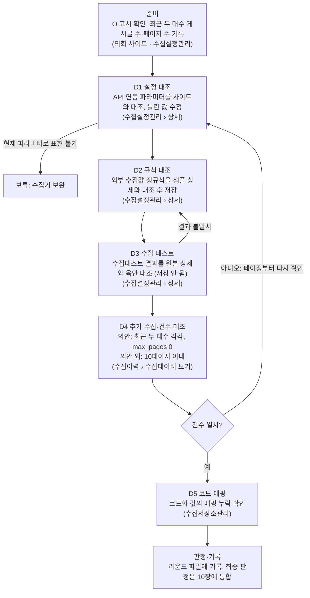

# 지방의회 수집기 설정 검증 SSOT

이 파일이 검증 기준과 기관별 최종 현황의 유일한 기준(SSOT)이다. 검증 기록은 라운드별 파일(`rounds/`)에 남기고, 라운드를 닫을 때 결과를 이 파일에 통합한다.

| 항목 | 내용 |
| --- | --- |
| 작성 | 최민규 |
| 기준일 | 2026-10-15 |
| 원본 | Claude 문서 "지방의회 수집기 설정 검증 스펙"(2026-10-15)을 옮겨 SSOT로 전환. Claude 문서는 검토용 사본이며 수정은 이 파일에서만 한다 |
| 운영 원칙 | 라운드별로 관리하고, SSOT는 통합으로 관리한다 (김경호 매니저, 2026-10-15) |

## 0. SSOT·라운드 운영 규칙

1. **SSOT는 이 파일 하나다.** 기준(1~9장), 기관별 현황(10장), 변경 이력(11장)은 여기서만 고친다.
2. **검증은 라운드 단위로 한다.** 라운드마다 `rounds/_라운드_템플릿.md`를 복사해 `Rnn_대상_목적.md`를 만들고, 대상·Depth·단계별 결과·수정 내역·이슈를 적는다.
3. **닫은 라운드 파일은 고치지 않는다.** 고칠 일이 생기면 다음 라운드에서 다룬다.
4. **라운드를 닫을 때 SSOT에 통합한다.** ① 10장 현황표에 최종 판정·건수 반영 ② 9장에 답이 나온 질문 반영(답과 라운드 번호) ③ 기준을 바꿔야 하면 1~8장 수정 ④ 11장 변경 이력에 한 줄 추가.
5. **라운드 번호는 R01부터 순서대로** 붙인다. 진행 중인 라운드는 10장 '마지막 라운드' 칸에 "R01 진행 중"처럼 적는다.

| 라운드 | 대상 | 목적 | 상태 |
| --- | --- | --- | --- |
| R01 | 원주시의회 · 지방의회_의안 | 시범: 이 SSOT 절차를 끝까지 적용해 보정, 소요 시간 측정 | 진행 전 |

## 1. 목적과 범위

개발 수집기에 이미 들어 있는 수집 설정이 실제 의회 사이트와 맞는지 이 문서 기준으로 검증하고, 빠진 데이터가 없음을 건수로 확인한 뒤 운영으로 옮긴다. 기존 테스트는 데이터가 들어오는지까지만 봐서 누락을 잡지 못했고, 이 스펙은 그 빈틈을 건수 대조(D4)로 막는다.

| 구분 | 내용 |
| --- | --- |
| 1차 대상 | 등록 기관 344개(2026-10-15 수집설정관리 기준) 중 우선순위 76개. 목록은 담당 매니저가 확정 |
| 목표 시점 | 회의 기준 이번 주 안, 수집 테이블 적재까지 |
| 수집 유형 | 지방의회_의안·지방정책정보 먼저. 지방의회_회의록·5분 자유발언은 오픈 일정에 따라 후속. 정책용역보고서는 기관 1곳뿐이라 제외 |
| 대상 항목 | 수집설정관리 목록에서 O 표시된 기관·유형만. O가 없으면 건너뜀 |
| 작업 성격 | 신규 입력이 아니라 본사 테스트 때 넣어둔 설정의 검증·수정 |
| 비범위 | 수집기 기능 개발, 수집 주기 설정(일괄 세팅 예정), 회의록 AI 커스텀 수집, 운영 DB 이관 실행 |
| 1차 완료 | 대상마다 D1~D4 통과. 의안은 최근 두 대수 각각 수집 건수 = 사이트 게시글 수, 의안 외는 지정 페이지 범위 건수 일치 (5장) |

## 2. 검증 사이클 개요

건수가 사이트와 맞아야 기관·유형 하나가 끝난다.

수집테스트 결과가 원본과 다르면 D1·D2로 돌아가 고치고, D4에서 건수가 다르면 D1의 페이징부터 다시 본다. D6(서비스 화면 비교)은 접속이 가능할 때 기록 전에 한다.

## 3. 수집 설정(API 연동 파라미터) 검증 기준

API 연동 파라미터는 목록의 페이지 이동, 검색(리스트 URL이 검색을 제공할 때), 상세 화면 이동에 쓰인다. 모든 파라미터는 실제 사이트의 목록·상세 페이지에서 도출하고, 아래 통과 기준을 모두 만족해야 D1 통과다. 셀렉터 표기(`##`, `\"`)와 페이징 방식은 수집기 해석 규칙이 확정되면 갱신한다(9장 1~4번).

| 파라미터 | 의미 | 통과 기준 | 주의 |
| --- | --- | --- | --- |
| list_url (리스트 URL) | 목록 시작 페이지 | 열면 대상 게시판 목록이 나온다 | 게시판 종류(의안·정책자료 등)가 맞는지 |
| list_class (리스트 태그 영역) | 목록 데이터 영역 | 목록 페이지에서 1개 매칭, 그 안 모든 행에서 상세 링크 추출 | 공지·상단 고정 글이 섞이는지 |
| view_url (상세 URL) | 상세 페이지 기본 주소 | view_id 값을 붙이면 상세가 열린다 | 검색 조건 파라미터 없이도 열리는지 |
| view_id_param (view_id 값) | 상세를 구분하는 파라미터 이름 | 목록 모든 행에서 값이 추출된다 | 링크가 자바스크립트 함수 호출인 사이트 |
| view_class (상세 태그 영역) | 상세 데이터 영역 | 수집할 필드가 모두 영역 안에 있다 | 여러 개 매칭되면 수집기가 어느 것을 쓰는지 |
| paging_selector (페이징 셀렉터) | 페이지 번호 영역 | 목록 페이지에서 1개 매칭 | |
| next_btn_selector (다음 버튼 셀렉터) | 다음 페이지로 넘기는 요소 | 마지막 전 모든 페이지에서 다음 페이지로 이동, 마지막 페이지에서 매칭 없음 | 페이지가 적으면 '다음' 버튼이 없는 사이트가 있다 |
| end_btn_selector (마지막 페이지 셀렉터) | 마지막 페이지 이동 요소 | 있으면 1개 매칭, 없으면 빈 값 | |
| max_pages (최대 페이지 수집수) | 수집할 최대 페이지 수 | 의안은 0 고정(무제한), 의안 외는 10페이지 이내 | 1이면 첫 페이지만 수집된다 |
| rasmbly_numpr (대수) | 수집할 대수 | 최근 두 대수를 직전→최근 순서로 각각 추가 수집해, 설정이 최근 대수로 남게 한다 | 한 번에 하나만 입력된다. 대수는 의회마다 달라 사이트에서 확인 |
| search_form_selector (검색폼 셀렉터) | 대수 검색 폼 | 1개 매칭 | |
| numpr_select_selector (대수 검색 셀렉터) | 대수 선택 요소 | 1개 매칭, 선택하면 해당 대수 목록으로 바뀐다 | 기본값이 최근 대수라 선택이 실패해도 같아 보인다. 직전 대수로 확인 |
| search_btn_selector (검색 버튼 셀렉터) | 검색 실행 버튼 | 1개 매칭 | 선택 즉시 페이지가 바뀌는 사이트가 있다 |
| timeout (페이지 수집 대기 시간) | 페이지 로딩 대기 시간(ms) | 수집 중 시간 초과가 없다 | |

## 4. 수집 규칙(정규식) 검증 기준

검증 대상은 수집설정관리 상세의 '수집 대상 및 수집 규칙 관리'에 DB 컬럼 기준으로 노출되는 외부 수집값 컬럼뿐이며, 정규식이 걸린 컬럼은 기존 값과 상관없이 모두 다시 검증한다. 내부 코드·시스템 생성 컬럼은 대상이 아니다.

- **통과 기준**: 샘플마다 후처리 결과가 원본 화면의 값과 같고, 날짜는 지정 형식(예: yyyy-MM-dd)으로 나온다.
- **샘플**: 대수별로 첫·중간·마지막 페이지에서 상세 1건씩, 최근·직전 대수를 합쳐 최소 6건.
- **값이 드문 필드**(예: 철회일자): 샘플에 값이 없으면 사이트에서 그 값이 있는 상세를 찾아 1건 이상 검증한다. 끝내 못 찾으면 같은 형식의 다른 필드 규칙에 맞춰 두고 '샘플 없음'으로 기록한다.
- **도구**: 처리유형을 '정규식'으로 고르고 우측 '선택' 버튼을 누른다. 수집 대상 엘리먼트 선택 → 정규식 생성 → 수정 후 검증 → 캡처원문·기존 후처리 결과 확인 → 처리값에 적용 → 선택한 곳에 들어갔는지 확인 순서로 하고, 컬럼을 모두 마치면 저장한다. 팝업이 첫 페이지만 불러오는지는 확인이 필요하다(9장 5번).
- **기록**: 컬럼마다 원본 값, 후처리 결과, 샘플 상세 URL을 라운드 파일에 적는다.

## 5. 검증 Depth와 통과 기준

1차 완료는 D1~D4 통과이며, 빠진 데이터는 D4 건수 대조에서 잡힌다. 검증을 맡길 때는 'D1~D4'처럼 Depth 범위로 지정한다.

| Depth | 이름 | 확인 내용 | 통과 기준 | 남길 증거 | 구분 |
| --- | --- | --- | --- | --- | --- |
| D1 | 설정 대조 | API 연동 파라미터를 실제 사이트와 대조 (3장) | 모든 셀렉터가 기대 개수로 매칭, URL이 열림 | 셀렉터별 매칭 개수, 수정 전→후 | 필수 |
| D2 | 규칙 대조 | 외부 수집값 정규식을 샘플 상세와 대조 (4장) | 샘플 전부 후처리 결과 = 원본 | 컬럼별 원본 값·후처리 결과 | 필수 |
| D3 | 수집 테스트 | 수집테스트 실행, 결과 육안 점검 | 반환 샘플의 필드 = 원본 상세 | 테스트 결과 화면 | 필수 |
| D4 | 건수 대조 | 추가 수집 후 수집이력 › 상세 › 수집데이터 보기로 확인 | 의안: 최근 두 대수 각각 수집 건수 = 사이트 게시글 수. 의안 외: 지정한 페이지 범위의 게시글 수와 일치 | 대수별 사이트 건수·수집 건수 | 필수 |
| D5 | 코드 매핑 | 코드화 컬럼의 사이트 값 목록을 수집저장소관리의 코드 변환 설정과 대조 | 매핑 누락 0, 누락은 목록으로 보고 | 누락 값 목록 | 권장 |
| D6 | 서비스 화면 | 검색 반영 후 개발 서비스 화면을 원본과 비교 | 샘플 의안이 원본과 같은 내용으로 보임 | 화면 캡처 | 선택 |

D4에서 건수가 다르면 D1의 페이징(next_btn_selector, max_pages)부터 다시 본다. D6은 개발 서비스 화면에 접속할 수 있을 때만 한다.

## 6. 기관·유형별 검증 절차

기관·유형 1건은 아래 순서로 처리하고, 단계마다 결과를 라운드 파일에 바로 적는다(기록 항목은 7장). 순서는 최신 작업 매뉴얼의 작업 순서를 따른다. 파라미터를 고치면 반드시 저장하고, 저장과 추가 수집은 되돌리기 어려우므로 확인 후 누른다.

1. **준비**: 수집설정관리 검색창에 기관명을 넣고 검색해, 점검할 유형에 O가 있는지 확인한다. 사이트에서 최근 두 대수의 게시글 수와 페이지 수를 적는다.
2. **상세 진입**: 기관의 상세 페이지에서 의정정보 탭(의안, 회의록 등)으로 점검할 유형을 연다.
3. **D1 API 연동 파라미터**: 3장 기준으로 대조하고, 틀린 값은 고쳐 전→후를 적는다.
4. **D2 수집 대상·수집 규칙**: 외부 수집값 컬럼마다 4장 순서로 정규식을 세팅·검증하고, 모두 마치면 저장한다.
5. **D3 수집테스트**: 상세 페이지에 다시 들어가 수집테스트를 누르고, 결과를 원본 상세와 육안 대조한다. 다르면 4단계부터 반복한다.
6. **D4 추가 수집(의안)**: max_pages를 0으로, 대수를 직전 대수로 저장하고 추가 수집한다. 이어서 대수를 최근 대수로 저장하고 다시 추가 수집한다. 이 순서면 설정이 최근 대수로 남는다(9장 7번).
7. **D4 추가 수집(의안 외)**: 회의록·지방정책정보·5분 자유발언은 대수 정보가 없을 수 있어, max_pages를 10 이내로 저장하고 추가 수집한다.
8. **D4 건수 확인**: 수집이력 → 상세 → 우측 상단 '수집데이터 보기'에서 수집 건수를 사이트 게시글 수와 대조한다.
9. **D5 코드 매핑**: 처리결과·의안종류 등 코드화 컬럼 값이 수집저장소관리의 코드 변환에 있는지 확인하고, 누락 값은 담당자에게 요청한다.
10. **판정·기록**: 7장 판정 값으로 결론을 적는다. D6은 접속이 가능할 때 이 단계 전에 한다. 건수가 다르면 판정 전에 D1 페이징부터 다시 확인한다.

## 7. 판정 기준과 결과 기록 양식

기관·유형마다 아래 판정 중 하나로 결론을 낸다. 단계별 기록은 라운드 파일에 남기고, 최종 판정만 10장 현황표에 통합한다.

| 판정 | 의미 |
| --- | --- |
| 통과 | 수정 없이 D1~D4 통과 |
| 수정 후 통과 | 값을 고친 뒤 D1~D4 통과, 전→후 기록 |
| 보류: 수집기 보완 | 현재 파라미터로 표현할 수 없음 (자바스크립트 함수 페이징, POST로만 열리는 상세 등) |
| 보류: 정책 결정 | 건수 통제 등 정책이 정해지지 않음 |
| 보류: 사이트 문제 | 접속 불가, 차단, 캡차 |
| 대상 아님 | O 표시 없음 |

| 기록 항목 | 적는 내용 |
| --- | --- |
| 기관·유형 | 기관명, 수집 유형, O 여부 |
| 대수 | 최근 대수, 직전 대수 |
| 사이트 건수 | 대수별 총 건수와 확인 일시 |
| 수집 건수 | 대수별 수집이력 건수 |
| Depth 결과 | D1~D6 각각 통과·실패·미실시 |
| 수정 내역 | 파라미터·컬럼별 전→후 값 |
| 판정 | 위 판정 값 중 하나 |
| 이슈·요청 | 내용과 요청 대상 |
| 검증자·일시 | 이름, 날짜 |

## 8. 작업 환경과 제약

설정 작업은 국회 인터넷망 유선 LAN PC에서 개발 수집기와 의회 사이트를 함께 띄워 하고, DB 확인은 내부망 PC에서 따로 한다.

| 항목 | 내용 |
| --- | --- |
| 서버·메뉴 | 개발 수집기 `http://10.201.38.157:8080/` → 로그인 → 사이트 이동 → 지방의정포털 수집기. 수집설정관리(수집 설정·파라미터·정규식), 수집이력(수집데이터 보기), 수집저장소관리(관계 설정·파이프라인: 코드 변환 등 후가공) |
| 작업 DB | 화면 상단 '데이터베이스 선택'이 의정포털 개발DB인지 확인한다(2026-10-15 확인). 작업 중에는 바꾸지 않는다 |
| 기관 검색 | 수집설정관리 검색창에 기관명 입력 → 검색. 주소 `M03_list_crawling.do?schStr=기관명`으로도 열린다 |
| 작업 PC | 국회 인터넷망 유선 LAN, 고정 IP(담당자 배정). 와이파이와 접속 범위가 다를 수 있어 연결 후 확인한다 |
| 접속 범위 | 개발 수집기 GUI·의회 사이트 가능, 개발 DB 불가. DB는 내부망 PC에서 `_temp` 테이블을 조회한다 |
| 로그인 | 공용 계정으로 각자 직접 로그인한다. 비밀번호는 이 문서에 적지 않는다 |
| AI 사용 | 국회망에서 AI 서비스가 막힐 수 있다(이전에 GPT 사용 불가). 2026-10-15 현재 작업 PC에서는 Claude·개발 수집기·의회 사이트가 함께 열린다. 막히면 사이트 분석은 접속되는 곳에서 해 결과표로 넘긴다 |
| 운영 이관 | 개발 DB 설정을 운영 DB로 export 또는 INSERT. 개발·운영 키 차이는 보정 쿼리로 맞춘다. 수집 데이터는 옮기지 않으므로 운영에서 대수별 추가 수집을 다시 한다 |
| 실행 주의 | 매뉴얼대로 추가 수집을 쓴다. 전체 수집은 해당 대수의 기존 데이터를 지우고 다시 넣는다. 목록 상단의 일괄 수집·일괄 대수 설정·전체 수집(첫 페이지)은 여러 기관에 한꺼번에 적용될 수 있어 쓰지 않는다. 첨부파일이 많은 기관은 수집이력에 결과가 늦게 뜬다 |
| Claude 작업 규칙 | 비밀번호는 입력하지 않는다(로그인은 사람이 한다). 설정 저장·추가 수집은 건별 확인 후 실행한다. 캡차·봇 차단은 우회하지 않는다 |

## 9. 미확정 사항

아래 질문의 답에 따라 3~6장 기준이 바뀌므로, 답이 나오기 전까지 해당 기준은 잠정이다. 답이 나오면 '답(라운드)' 칸에 적고 관련 장을 고친다.

| # | 질문 | 영향 | 확인처 | 답(라운드) |
| --- | --- | --- | --- | --- |
| 1 | `select##select_daesu`의 `##`, `form[name=\"myform\"]`의 `\"`는 수집기에서 어떤 표기인가 | D1 셀렉터 판정 | 수집기 담당 | |
| 2 | 페이지를 번호로 넘기나, '다음' 버튼으로 넘기나 | '다음' 버튼이 없는 사이트의 누락 (R01 사전 분석) | 수집기 담당 | |
| 3 | view_class가 여러 개 매칭되면 첫 번째만 쓰나 | 상세 필드 누락 (R01 사전 분석) | 수집기 담당 | |
| 4 | 대수는 option의 value와 text 중 무엇으로 고르나 | 대수 검색 실패 | 수집기 담당 | |
| 5 | 정규식 '선택' 팝업이 첫 페이지 말고 특정 상세도 불러올 수 있나 | 드문 필드 검증 방법 | 기능 개발자 | |
| 6 | '수집데이터 보기'에서 수집 건수를 바로 볼 수 있나 | D4 증거 수집 방법 | 수집기 담당 | |
| 7 | 추가 수집 후 남겨 둘 대수는 최근 대수가 맞나 (6장 6단계) | 증분 수집·운영 이관 설정값 | 담당 매니저 | |
| 8 | 의안 외 유형은 10페이지 이내 수집이므로, D4를 지정 범위 건수로 판정해도 되나 | 의안 외 D4 기준 | 담당 매니저 | |
| 9 | 작업 DB는 의정포털 개발DB가 맞나 (2026-10-15 선택값) | 저장 위치 | 담당 매니저 | |
| 10 | 76개 기관 목록과 우선순위 | 작업 배분 | 담당 매니저 | |
| 11 | 개발→운영 키 보정 쿼리 | 운영 이관 | 담당자 | |

## 10. 기관별 현황 (통합)

라운드가 닫힐 때마다 최종 판정과 건수를 이 표에 반영한다. 76개 목록이 확정되면 전부 올린다(9장 10번).

| 기관 | 코드 | 유형 | O | 대수(최근/직전) | 사이트 건수 | 수집 건수 | 최종 판정 | 마지막 라운드 |
| --- | --- | --- | --- | --- | --- | --- | --- | --- |
| 강원특별자치도 원주시의회 | 33010 | 지방의회_의안 | O | 10 / 9 | 77 / 1,161 (2026-10-15) | | 미검증 | R01 진행 전 |
| 강원특별자치도 원주시의회 | 33010 | 5분 자유발언 | O | | | | 미검증 | |

## 11. 변경 이력

| 날짜 | 라운드 | 변경 내용 |
| --- | --- | --- |
| 2026-10-15 | — | Claude 문서 초안을 SSOT로 전환. 최신 작업 매뉴얼 반영, 라운드 운영 규칙(0장)·기관별 현황(10장) 추가. 시범 계획과 원주 사전 분석은 R01 파일로 이동 |
| 2026-10-15 | — | SSOT를 이 마크다운 파일로 확정. Claude 문서는 검토용 사본으로 표시 |
