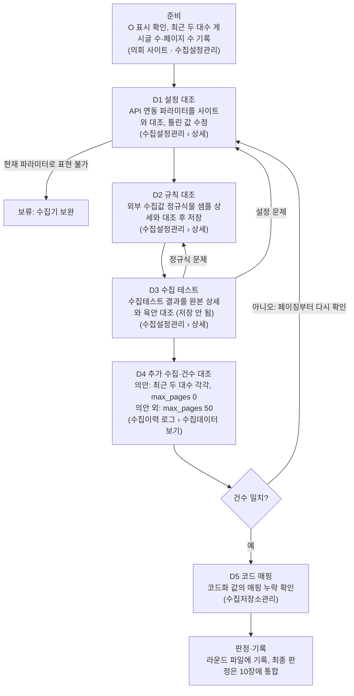

# 지방의회 수집기 설정 검증 SSOT

이 파일이 검증 기준과 기관별 최종 현황의 유일한 기준(SSOT)이다. 검증 기록은 라운드별 파일(`rounds/`)에 남기고, 라운드를 닫을 때 결과를 이 파일에 통합한다.

| 항목 | 내용 |
| --- | --- |
| 작성 | 최민규 |
| 기준일 | 2026-10-15 |
| 최종 통합 | 2026-10-15 — 9장 답 반영(R01 전, 라운드 통합 없음) |
| 저장소 | https://github.com/choimingyu99/collector (공개) · 기준 브랜치 `dev` |
| 원본 | Claude 문서 "지방의회 수집기 설정 검증 스펙"(2026-10-15)을 옮겨 SSOT로 전환. 수정은 이 파일에서만 한다 |
| 사본(정본 아님) | Claude 문서(검토용), 바탕화면 Word `지방의회 수집기 설정 검증 스펙.docx`(구버전) |
| Claude 작업 방식 | `CLAUDE.md` |
| 참조 매뉴얼 | 최신 작업 매뉴얼(사용자 전달, 2026-10-15). 원문은 저장소에 두지 않는다(계정 정보 포함). 6장에 작업 순서 3.1~3.4.7을 옮겼다 |
| 운영 원칙 | 「round별로 관리하며」 「ssot는 통합으로 관리한다 이렇게 해도 되지」 (김경호 매니저, 2026-10-15, 사용자 전달) |

## 0. SSOT·라운드 운영 규칙

1. **SSOT는 이 파일 하나다.** 기준(1~9장), 기관별 현황(10장), 변경 이력(11장), 반복 함정(12장)은 여기서만 고친다.
2. **검증은 라운드 단위로 한다.** 라운드마다 `rounds/_라운드_템플릿.md`를 복사해 `rounds/Rnn_대상_목적.md`를 만들고, 그 라운드의 기록을 모두 그 파일에 적는다.
3. **통합(dev 머지)한 라운드 파일은 고치지 않는다.** 재검증·정정은 새 번호를 받고, 머리말 '원 라운드' 칸에 `Rxx`를 적는다.
4. **통합 순서**(라운드를 dev에 머지한 직후, 통합 담당): ① 10장 판정·건수·마지막 라운드 ② 9장 답(라운드) ③ 기준을 바꿔야 하면 1~8장을 취소선으로 정정 ④ 라운드의 '새 함정 후보'를 12장에 G번호로 등록하고, 이미 통과한 기관 중 해당할 수 있는 곳을 그 항목에 적는다 ⑤ 11장 한 줄 ⑥ 0장 라운드 표 상태·지금 위치·머리말 최종 통합 ⑦ 옮겨 적은 값을 라운드 파일과 다시 대조한다.
5. **번호와 배정**: 통합 담당이 배정한다. 번호는 배정 순서일 뿐 실행·종료 순서가 아니다. 배정은 dev의 0장 라운드 표와 10장 담당 칸에 적고 push한다. 담당은 작업 전에 dev를 받아(pull) 자기 배정을 확인하고, 배정에 없는 기관의 설정은 고치지 않는다.
6. **문서 역할**: `CLAUDE.md` = Claude 작동 방식, `SSOT.md` = 기준·현황(유일한 정본), `rounds/Rnn_*.md` = 담당의 라운드 기록, `제안_문서정책_적용안.md` = 정책 도입 근거(보관용).
7. **작성 권한**: SSOT.md·CLAUDE.md·라운드 템플릿은 통합 담당(부재 시 부담당)이 dev에서만 고친다. 라운드 파일은 그 라운드 담당만 고친다. 템플릿을 바꾸면 버전을 올리고 11장에 한 줄 남긴다(12번 정책 개정 예외). 단 동결 전(v1 동결 이전)의 변경은 버전을 올리지 않고 11장에만 남긴다. 역할이 바뀌면 라운드 파일 머리말 '역할 변경' 칸에 날짜·이전→이후·지시 「…」를 적은 뒤부터 새 작성자가 잇는다.
8. **브랜치**:

   | 브랜치 | 의미 | 규칙 |
   | --- | --- | --- |
   | `main` | 초기 등록본. 운영 이관 확정용으로 남겨 둔다 | 지금은 손대지 않는다(dev → main 보류, 13번) |
   | `dev` | 통합본 | 라운드 브랜치를 머지하는 곳. SSOT.md는 dev에서 통합 담당만 고친다 |
   | `verify/r<NN>-<영문-kebab>` | 라운드 1개(담당 1명) | dev에서 분기. 자기 라운드 파일만 커밋하고 SSOT.md는 고치지 않는다 |

   브랜치 이름은 영문 kebab-case만 쓴다(예: `verify/r01-wonju-bill`). 파일명은 한글을 써도 된다. 재검증·정정 라운드도 새 번호로 새 브랜치를 딴다.
9. **dev 머지 기준** — 통합 담당이 머지 전에 확인하고, 하나라도 빠지면 머지하지 않고 담당에게 돌려보낸다.
   1. 라운드 파일에 빈칸이 없다(비면 '기록 없음' 또는 '미실시').
   2. 수집설정관리의 O 대상이 모두 진행 행이나 범위 밖 행에 있다.
   3. 건수 대조가 대수별(의안 외는 1~50페이지 범위 — 9장 8번 해석, 사람 확정 아님)로 따로 적혀 있다: 사이트 건수·사이트 실측 근거·기준 고정 시각·수집 시각·수집 건수·차이. 합산하지 않았다. 차이가 0이 아니면 사유가 있다(0이면 사유 칸은 '해당 없음').
   4. 설정 저장·추가 수집마다 실행 직전 데이터베이스 선택값, 전→후 값, 시각, 확인한 사람이 있다.
   5. 의안의 마지막 저장값이 최근 대수·max_pages 0이다(9장 7번 답). 의안 외는 max_pages가 50이다(9장 8번 답).
   6. 판정 값이 7장 목록 안에 있고, 잠정이면 '(잠정: 9장 n번)'이 붙어 있다.
   7. 라운드에서 만난 새 이슈가 '새 함정 후보'에 적혀 있다(없으면 '없음').
   8. 비밀번호·토큰·로그인 ID·개인 연락처가 없다.
   9. 라운드 브랜치가 SSOT.md를 고치지 않았고, 바뀐 파일이 그 라운드 파일 하나뿐이다(`git diff --name-only dev...<브랜치>` 결과가 그 라운드 파일 하나).
10. **이슈 축적**: 새 함정이 12장에 등록되면, 이미 통과한 기관 중 해당할 수 있는 곳을 재검증 라운드(새 번호, 새 브랜치)로 다시 확인한다. 이슈가 쌓일수록 앞서 끝난 기관에도 같은 기준이 적용된다.
11. **본 검증 시작 조건**: R01 D4 건수 대조 완료 + 라운드 템플릿 v1 동결. 동결은 통합 담당이 템플릿 머리말을 「v1 (동결 YYYY-MM-DD)」로 바꾸고 11장에 한 줄 남긴 뒤 dev에 push하는 것이다. 템플릿을 바꾸면 버전을 올리고, 이미 만든 라운드 파일은 원래 버전을 유지한다.
12. **정책 도입 예외**: 문서 정책 도입·개정은 라운드 없이 11장 '정책 도입' 행(사용자 결정 날짜, 지시 「…」)을 근거로 한다.
13. **보류**: 교차 확인(사용자 「일단은 코덱스 검증은 빼줘」, 2026-10-15), dev → main과 운영 확장(사용자 「운영 확장은 이후에 보는거고」, 2026-10-15).

| 라운드 | 대상 | 목적 | 담당 | 브랜치 | 파일 | 상태 | 종료(통합) |
| --- | --- | --- | --- | --- | --- | --- | --- |
| R01 | 강원특별자치도 원주시의회(33010) · 지방의회_의안 | 시범: 이 SSOT 절차를 끝까지 적용해 보정, 소요 시간 측정 | 최민규 | `verify/r01-wonju-bill` | `rounds/R01_원주시의회_의안_시범.md` | 진행 전 | |

**지금 위치** (스냅샷 — 통합할 때만 고친다)
- 기준 시각: 2026-10-15, 9장 답 반영(R01 전)
- 열린 라운드·막힌 것: R01 진행 전. 76개 기관 목록(9장 10번) 대기
- 통합 대기: 없음
- 물을 것: 9장 5번(정규식 팝업, 답 대기), 10번(76개 목록, 나중에 받음), 4번 해석 확인(전달 번호 5번 답을 4번 답으로 봄, R01-결4), 8번 해석 확인(의안 외 D4를 1~50페이지로 대조, R01-결6), 답한 사람(9장 답 칸은 '발언자 기록 없음'). 1번은 R01 D3·D4 1회차로 실측한다(사람 확정 아님, R01-결7). 2·11번은 보류, 나머지는 2026-10-15 답 반영(해석이 들어간 항목은 위와 같이 확인)
- R01에서 먼저 볼 것: 수집이력 로그에 건수가 어떻게 뜨는지(9장 6번 답). 같은 대수를 다시 수집하는 일이 생기면 그 회차 건수로 9장 12번 해석을 확인한다
- 새 세션이 먼저 읽을 것: `CLAUDE.md` 4절 순서(지금 열린 라운드는 R01)
- 다음 통합: R01을 dev에 머지할 때

## 1. 목적과 범위

개발 수집기에 이미 들어 있는 수집 설정이 실제 의회 사이트와 맞는지 이 문서 기준으로 검증하고, 빠진 데이터가 없음을 건수로 확인한 뒤 운영으로 옮긴다. 기존 테스트는 데이터가 들어오는지까지만 봐서 누락을 잡지 못했고, 이 스펙은 그 빈틈을 건수 대조(D4)로 막는다.

| 구분 | 내용 |
| --- | --- |
| 1차 대상 | 등록 기관 344개(2026-10-15 수집설정관리 기준) 중 우선순위 76개. 목록은 담당 매니저가 확정 |
| 목표 시점 | 회의 기준 이번 주 안, 수집 테이블 적재까지 |
| 수집 유형 | 지방의회_의안·지방정책정보 먼저. 지방의회_회의록·5분 자유발언은 오픈 일정에 따라 후속. 정책용역보고서는 기관 1곳뿐이라 제외 |
| 대상 항목 | 수집설정관리 목록에서 O 표시된 기관·유형만. O가 없으면 건너뜀 |
| 작업 성격 | 신규 입력이 아니라 본사 테스트 때 넣어둔 설정의 검증·수정 |
| 비범위 | 수집기 기능 개발, 수집 주기 설정(일괄 세팅 예정), 회의록 AI 커스텀 수집, 운영 DB 이관 실행 |
| 1차 완료 | 대상마다 D1~D4 통과. 의안은 최근 두 대수 각각 수집 건수 = 사이트 게시글 수, 의안 외는 ~~지정 페이지 범위~~ → 1~50페이지 건수 일치(2026-10-15, 9장 8번 답의 해석 — 사람 확정 아님, R01-결6) (5장) |

## 2. 검증 사이클 개요

건수가 사이트와 맞아야 기관·유형 하나가 끝난다.

수집테스트 결과가 원본과 다르면 원인에 따라 D1(설정) 또는 D2(정규식)로 돌아가 고치고, D4에서 건수가 다르면 D1의 페이징부터 다시 본다. D6(서비스 화면 비교)은 접속이 가능할 때 기록 전에 한다. 그림의 의안 외 값: ~~10페이지 이내~~ → max_pages 50(2026-10-15, 9장 8번 답).

## 3. 수집 설정(API 연동 파라미터) 검증 기준

API 연동 파라미터는 목록의 페이지 이동, 검색(리스트 URL이 검색을 제공할 때), 상세 화면 이동에 쓰인다. 모든 파라미터는 실제 사이트의 목록·상세 페이지에서 도출하고, 아래 통과 기준을 모두 만족해야 D1 통과다. ~~셀렉터 표기(`##`, `\"`)와 페이징 방식은 수집기 해석 규칙이 확정되면 갱신한다(9장 1~4번).~~ → 셀렉터 표기(`##`, `\"`)는 R01 D3 수집테스트와 D4 1회차(9대) 건수로 실측해 정한다(2026-10-15, 9장 1번 답 안 됨에 따른 대체 — 사람 확정 아님, R01-결7). 페이지 넘김 방식은 파이썬 수집 코드 쪽이라 보류하고(2026-10-15, 9장 2번 답), 누락은 D4 건수로 잡는다(사람 확정 아님).

| 파라미터 | 의미 | 통과 기준 | 주의 |
| --- | --- | --- | --- |
| list_url (리스트 URL) | 목록 시작 페이지 | 열면 대상 게시판 목록이 나온다 | 게시판 종류(의안·정책자료 등)가 맞는지 |
| list_class (리스트 태그 영역) | 목록 데이터 영역 | 목록 페이지에서 1개 매칭, 그 안 모든 행에서 상세 링크 추출 | 공지·상단 고정 글이 섞이는지 |
| view_url (상세 URL) | 상세 페이지 기본 주소 | view_id 값을 붙이면 상세가 열린다 | 검색 조건 파라미터 없이도 열리는지 |
| view_id_param (view_id 값) | 상세를 구분하는 파라미터 이름 | 목록 모든 행에서 값이 추출된다 | 링크가 자바스크립트 함수 호출인 사이트 |
| view_class (상세 태그 영역) | 상세 데이터 영역 | 수집할 필드가 모두 **첫 번째 매칭** 영역 안에 있다 | ~~여러 개 매칭되면 수집기가 어느 것을 쓰는지~~ → 수집기는 첫 번째 매칭만 쓴다(2026-10-15, 9장 3번 답). 필드가 두 번째 이후 영역에 있으면 둘을 감싸는 부모 셀렉터로 바꾸는 것이 후보다(§G2, R01 D2·D3에서 확정 — 사람 확정 아님) |
| paging_selector (페이징 셀렉터) | 페이지 번호 영역 | 목록 페이지에서 1개 매칭 | |
| next_btn_selector (다음 버튼 셀렉터) | 다음 페이지로 넘기는 요소 | 마지막 전 모든 페이지에서 다음 페이지로 이동, 마지막 페이지에서 매칭 없음 | 페이지가 적으면 '다음' 버튼이 없는 사이트가 있다. 페이지 넘김 방식은 파이썬 수집 코드 쪽이라 보류(9장 2번) — D4 건수로 누락을 확인한다(§G1) |
| end_btn_selector (마지막 페이지 셀렉터) | 마지막 페이지 이동 요소 | 있으면 1개 매칭, 없으면 빈 값 | |
| max_pages (최대 페이지 수집수) | 수집할 최대 페이지 수 | 의안은 0 고정(무제한), 의안 외는 ~~10페이지 이내~~ → 50(2026-10-15, 9장 8번 답) | 1이면 첫 페이지만 수집된다 |
| rasmbly_numpr (대수) | 수집할 대수 | 최근 두 대수를 직전→최근 순서로 각각 추가 수집해, 설정이 최근 대수로 남게 한다 | 한 번에 하나만 입력된다. 대수는 의회마다 달라 사이트에서 확인 |
| search_form_selector (검색폼 셀렉터) | 대수 검색 폼 | 1개 매칭 | |
| numpr_select_selector (대수 검색 셀렉터) | 대수 선택 요소 | 1개 매칭, 선택하면 해당 대수 목록으로 바뀐다 | 기본값이 최근 대수라 선택이 실패해도 같아 보인다. 직전 대수로 확인. 수집기는 option의 **value**로 대수를 고른다(2026-10-15, 9장 4번 답 — 번호 해석은 사람 확정 아님, §G3) |
| search_btn_selector (검색 버튼 셀렉터) | 검색 실행 버튼 | 1개 매칭 | 선택 즉시 페이지가 바뀌는 사이트가 있다 |
| timeout (페이지 수집 대기 시간) | 페이지 로딩 대기 시간(ms) | 수집 중 시간 초과가 없다 | |

## 4. 수집 규칙(정규식) 검증 기준

검증 대상은 수집설정관리 상세의 '수집 대상 및 수집 규칙 관리'에 DB 컬럼 기준으로 노출되는 외부 수집값 컬럼뿐이며, 정규식이 걸린 컬럼은 기존 값과 상관없이 모두 다시 검증한다. 내부 코드·시스템 생성 컬럼은 대상이 아니다.

- **통과 기준**: 샘플마다 후처리 결과가 원본 화면의 값과 같고, 날짜는 지정 형식(예: yyyy-MM-dd)으로 나온다.
- **샘플**: 대수별로 첫·중간·마지막 페이지에서 상세 1건씩, 최근·직전 대수를 합쳐 최소 6건. 정규식 팝업으로 열 수 없는 샘플은 D3 수집테스트 결과나 D4 뒤 '수집데이터 보기'의 값을 원본 상세와 대조하고, 그 D2 결과에 '(잠정: 9장 5번)'을 붙인다. 대체 방법도 없으면 판정을 '보류: 정책 결정'으로 둔다.
- **값이 드문 필드**(예: 철회일자): 샘플에 값이 없으면 사이트에서 그 값이 있는 상세를 찾아 1건 이상 검증한다. 끝내 못 찾으면 같은 형식의 다른 필드 규칙에 맞춰 두고 '샘플 없음'으로 기록한다.
- **도구**: 처리유형을 '정규식'으로 고르고 우측 '선택' 버튼을 누른다. 수집 대상 엘리먼트 선택 → 정규식 생성 → 수정 후 검증 → 캡처원문·기존 후처리 결과 확인 → 처리값에 적용 → 선택한 곳에 들어갔는지 확인 순서로 하고, 컬럼을 모두 마치면 저장한다. 팝업이 첫 페이지만 불러오는지는 확인이 필요하다(9장 5번).
- **기록**: 컬럼마다 원본 값, 후처리 결과, 샘플 상세 URL을 라운드 파일에 적는다.

## 5. 검증 Depth와 통과 기준

1차 완료는 D1~D4 통과이며, 빠진 데이터는 D4 건수 대조에서 잡힌다. 검증을 맡길 때는 'D1~D4'처럼 Depth 범위로 지정한다.

| Depth | 이름 | 확인 내용 | 통과 기준 | 남길 증거 | 구분 |
| --- | --- | --- | --- | --- | --- |
| D1 | 설정 대조 | API 연동 파라미터를 실제 사이트와 대조 (3장) | 모든 셀렉터가 기대 개수로 매칭, URL이 열림 | 셀렉터별 매칭 개수, 수정 전→후 | 필수 |
| D2 | 규칙 대조 | 외부 수집값 정규식을 샘플 상세와 대조 (4장) | 샘플 전부 후처리 결과 = 원본 | 컬럼별 원본 값·후처리 결과 | 필수 |
| D3 | 수집 테스트 | 수집테스트 실행, 결과 육안 점검 | 반환 샘플의 필드 = 원본 상세 | 테스트 결과 화면 | 필수 |
| D4 | 건수 대조 | 추가 수집 후 ~~수집이력 › 상세 › 수집데이터 보기로~~ → 수집이력 로그(상세 › 수집데이터 보기)로(2026-10-15, 9장 6번 답) 확인 | 의안: 최근 두 대수 각각 수집 건수 = 사이트 게시글 수. 의안 외: ~~지정한 페이지 범위의 게시글 수와 일치~~ → 1~50페이지 게시글 수와 일치(2026-10-15, 9장 8번 답의 해석 — 사람 확정 아님, R01-결6) | 대수별 사이트 건수·수집 건수 | 필수 |
| D5 | 코드 매핑 | 코드화 컬럼의 사이트 값 목록을 수집저장소관리의 코드 변환 설정과 대조 | 매핑 누락 0, 누락은 목록으로 보고 | 누락 값 목록 | 권장 |
| D6 | 서비스 화면 | 검색 반영 후 개발 서비스 화면을 원본과 비교 | 샘플 의안이 원본과 같은 내용으로 보임 | 화면 캡처 | 선택 |

D4에서 건수가 다르면 D1의 페이징(next_btn_selector, max_pages)부터 다시 본다. D6은 개발 서비스 화면에 접속할 수 있을 때만 한다.

## 6. 기관·유형별 검증 절차

기관·유형 1건은 아래 순서로 처리하고, 단계마다 결과를 라운드 파일에 바로 적는다(기록 항목은 7장). 순서는 머리말 '참조 매뉴얼'(2026-10-15)의 작업 순서를 옮긴 것이다. 파라미터를 고치면 반드시 저장하고, 저장과 추가 수집은 되돌리기 어려우므로 확인 후 누른다.

1. **준비(기준 건수 먼저 고정)**: 수집설정관리 검색창에 기관명을 넣고 검색해, 점검할 유형에 O가 있는지 확인한다. 사이트에서 최근 두 대수의 게시글 수와 페이지 수를 근거(목록 URL·대수 선택값)·기준 고정 시각과 함께 적는다. 이 값은 추가 수집 전에 적고, 수집 직전에 다시 확인한다.
2. **상세 진입**: 기관의 상세 페이지에서 의정정보 탭(의안, 회의록 등)으로 점검할 유형을 연다.
3. **D1 API 연동 파라미터**: 3장 기준으로 대조하고, 틀린 값은 고쳐 전→후를 적는다.
4. **D2 수집 대상·수집 규칙**: 외부 수집값 컬럼마다 4장 순서로 정규식을 세팅·검증하고, 모두 마치면 저장한다.
5. **D3 수집테스트**: 상세 페이지에 다시 들어가 수집테스트를 누르고, 결과를 원본 상세와 육안 대조한다. 다르면 원인에 따라 3단계(D1) 또는 4단계(D2)부터 반복한다.
6. **D4 추가 수집(의안)**: max_pages를 0으로, 대수를 직전 대수로 저장하고 추가 수집한다. 이어서 대수를 최근 대수로 저장하고 다시 추가 수집한다. 이 순서면 설정이 최근 대수로 남는다(9장 7번).
   - 1회차 수집이 끝난 것을 수집이력으로 확인한 뒤에만 대수를 바꿔 저장한다. 첨부파일이 많은 기관은 결과가 늦게 뜬다(8장 '실행 주의'). '끝났다'고 볼 표시(상태 값·종료 시각 등)는 R01에서 실측해 통합 때 여기에 적는다. 완료 표시가 없거나 판단이 안 되면 대수를 바꾸지 않고 사람에게 묻는다.
   - 어떤 재수집을 한 뒤에도 마지막 저장은 최근 대수·max_pages 0이다(9장 7번 ~~답 전까지 잠정~~ → 답 「최근 대수가 맞고」(2026-10-15)).
   - 같은 대수를 다시 수집하면 그 회차에 새로 수집하는 것으로 보고, D4는 그 회차 수집 건수로 대조한다(9장 12번 답의 해석 — R01에서 실측 확인).
   - 기관을 넘길 때 현재 저장값(대수·max_pages)을 라운드 파일에 1줄로 남긴다.
7. **D4 추가 수집(의안 외)**: 회의록·지방정책정보·5분 자유발언은 대수 정보가 없을 수 있어, max_pages를 ~~10 이내로~~ → 50으로(2026-10-15, 9장 8번 답) 저장하고 추가 수집한다. D4는 1~50페이지 게시글 수와 대조한다(9장 8번 해석 — 사람 확정 아님, R01-결6).
8. **D4 건수 확인**: ~~수집이력 → 상세 → 우측 상단 '수집데이터 보기'에서 수집 건수를 사이트 게시글 수와 대조한다. 그 화면에서 건수를 볼 수 없으면(9장 6번) 내부망 PC에서 `_temp` 테이블을 조회해 대수별 건수를 '내부망 조회 전사(조회: 이름·시각)'로 적는다. 조회 테이블·조건은 R01에서 실측해 통합 때 여기에 적는다.~~ → 수집이력 → 상세에서 로그와 우측 상단 '수집데이터 보기'로 수집 건수를 확인해 사이트 게시글 수와 대조한다. 건수는 수집이력의 로그에 뜬다(2026-10-15, 9장 6번 답 「수집이력에서 로그가 뜨니까 확인하면 돼」). 로그의 어느 줄을 건수로 볼지는 R01에서 실측해 통합 때 여기에 적는다.
9. **D5 코드 매핑**: 처리결과·의안종류 등 코드화 컬럼 값이 수집저장소관리의 코드 변환에 있는지 확인한다. 담당은 코드 변환을 직접 저장하지 않고, 누락 값 목록을 코드 매핑 관리자에게 요청한다(8장 '외부 확인처').
10. **판정·기록**: 7장 판정 값으로 결론을 적는다. D6은 접속이 가능할 때 이 단계 전에 한다. 건수가 다르면 판정 전에 D1 페이징부터 다시 확인한다.

## 7. 판정 기준과 결과 기록 양식

기관·유형마다 아래 판정 중 하나로 결론을 낸다. 단계별 기록은 라운드 파일에 남기고, 최종 판정만 10장 현황표에 통합한다.

| 판정 | 의미 |
| --- | --- |
| 통과 | 수정 없이 D1~D4 통과 |
| 수정 후 통과 | 값을 고친 뒤 D1~D4 통과, 전→후 기록 |
| 보류: 수집기 보완 | 현재 파라미터로 표현할 수 없음 (자바스크립트 함수 페이징, POST로만 열리는 상세 등) |
| 보류: 정책 결정 | 건수 통제 등 정책이 정해지지 않음 |
| 보류: 사이트 문제 | 접속 불가, 차단, 캡차 |
| 대상 아님 | O 표시 없음 |

- **미검증**은 판정 전 값이다(10장 초기값, 라운드 파일 판정 칸의 판정 전 값). 판정이 아니므로 머지 전에 위 판정 중 하나로 바꾼다.
- **잠정 판정**: 9장의 답이 아직 없는 기준에 기대어 판정했으면 판정 뒤에 '(잠정: 9장 n번)'을 붙인다. 9장 답이 1~8장 기준을 바꾸면 통합 담당이 영향받는 기관 목록을 9장 답 칸에 적고 재검증 라운드를 배정한다.
- 운영 이관 대상 조건은 운영 확장을 정할 때 함께 정한다(0장 13번).

| 기록 항목 | 적는 내용 |
| --- | --- |
| 기관·유형 | 기관명, 수집 유형, O 여부 |
| 대수 | 최근 대수, 직전 대수 |
| 사이트 건수 | 대수별 총 건수와 확인 일시 |
| 수집 건수 | 대수별 수집이력 건수 |
| Depth 결과 | 준비·D1~D6 각각 통과·수정·실패·미실시 |
| 수정 내역 | 파라미터·컬럼별 전→후 값 |
| 판정 | 위 판정 값 중 하나 |
| 이슈·요청 | 내용과 요청 대상 |
| 담당·일시 | 이름, 날짜 |

**기록 표기** — 라운드 파일과 이 문서에서 같은 뜻은 같은 말로 쓴다.

| 표기 | 쓰는 때 |
| --- | --- |
| 「…」 | 사람의 발언·지시를 그대로 옮길 때(날짜와 발언자를 함께) |
| 기록 없음 | 확인했지만 남은 기록이 없을 때 |
| 미실시 | 하지 않은 단계 |
| 해당 없음 | 적을 내용이 원래 없을 때(차이 0인 행의 사유 등) |
| 착수 전 | 라운드를 시작하기 전이라 아직 채울 수 없는 칸 |
| 요청 전 | 9장 질문을 아직 보내지 않았을 때 |
| 답 안 됨 | 질문을 보냈지만 취지가 통하지 않아 답을 받지 못했을 때 |
| 보류 | 사람 지시로 질문·기준을 당분간 다루지 않을 때(지시 「…」를 함께 적는다) |
| Rnn 전 | 라운드 시작 전에 받은 답·정정의 라운드 칸(예: R01 전) |
| 발언자 기록 없음 | 「…」를 옮겼지만 실제로 말한 사람을 모를 때 |
| 맞음 · 틀림 · 부분 | 사전 분석 예상을 실측과 대조한 결과 |
| 사후 작성(작성: 이름) | 일이 끝난 뒤 기억·로그로 채운 기록 |
| 전사(작성: 이름) | 다른 문서·화면에서 옮겨 적은 값 |
| 내부망 조회 전사(조회: 이름·시각) | 내부망 PC에서 조회해 옮긴 값 |
| 사람 확정 아님 | 담당이나 Claude가 정했고 사람이 확정하지 않은 결정 |
| (사전 분석, 미실측) | 수집 전에 사이트만 보고 예상한 내용 |
| (잠정: 9장 n번) | 9장 답이 없는 기준에 기댄 판정 |
| 답 대기(요청 시각·요청 대상) | 질문을 보냈고 답이 아직 없을 때 |
| ~~옛 서술~~ → 새 서술(날짜, Rnn, 지시자) | 1~9장·12장을 정정할 때. 10장 현황값은 덮어쓴다 |

## 8. 작업 환경과 제약

설정 작업은 국회 인터넷망 유선 LAN PC에서 개발 수집기와 의회 사이트를 함께 띄워 하고, DB 확인은 내부망 PC에서 따로 한다.

| 항목 | 내용 |
| --- | --- |
| 서버·메뉴 | 개발 수집기 `http://10.201.38.157:8080/` → 로그인 → 사이트 이동 → 지방의정포털 수집기. 수집설정관리(수집 설정·파라미터·정규식), 수집이력(수집데이터 보기), 수집저장소관리(관계 설정·파이프라인: 코드 변환 등 후가공) |
| 작업 DB | 화면 상단 '데이터베이스 선택'이 의정포털 개발DB인지 확인한다(2026-10-15 확인, 9장 9번 ~~답 전까지 잠정~~ → 답으로 확정(2026-10-15)). 작업 중에는 바꾸지 않는다. 선택값이 다르거나 판단이 안 되면 저장·수집을 멈추고 사람에게 묻는다 |
| 기관 검색 | 수집설정관리 검색창에 기관명 입력 → 검색. 주소 `M03_list_crawling.do?schStr=기관명`으로도 열린다 |
| 작업 PC | 국회 인터넷망 유선 LAN, 고정 IP(네트워크 관리 쪽에서 배정). 와이파이와 접속 범위가 다를 수 있어 연결 후 확인한다 |
| 접속 범위 | 개발 수집기 GUI·의회 사이트 가능, 개발 DB 불가. DB는 내부망 PC에서 `_temp` 테이블을 조회한다 |
| 로그인 | 공용 계정으로 각자 직접 로그인한다. 로그인 ID·비밀번호는 문서에 적지 않는다 |
| AI 사용 | 국회망에서 AI 서비스가 막힐 수 있다(이전에 GPT 사용 불가). 2026-10-15 현재 작업 PC에서는 Claude·개발 수집기·의회 사이트가 함께 열린다. 막히면 사이트 분석은 접속되는 곳에서 해 결과표로 넘긴다 |
| 운영 이관 | 개발 DB 설정을 운영 DB로 export 또는 INSERT. 개발·운영 키 차이는 보정 쿼리로 맞춘다. 수집 데이터는 옮기지 않으므로 운영에서 대수별 추가 수집을 다시 한다 |
| 실행 주의 | 매뉴얼대로 추가 수집만 쓴다. 전체 수집은 해당 대수의 기존 데이터를 지우고 다시 넣으므로, 기관 단위 전체 수집도 쓰지 않는다. 목록 상단의 일괄 수집·일괄 대수 설정·전체 수집(첫 페이지)은 여러 기관에 한꺼번에 적용될 수 있어 쓰지 않는다. 필요해 보이면 멈추고 사람에게 묻는다. 첨부파일이 많은 기관은 수집이력에 결과가 늦게 뜬다 |
| 외부 확인처 | 질문·요청을 받는 곳(라운드 역할이 아니다): 수집기 담당(수집기 동작·표기), 기능 개발자(수집기 GUI 기능), 담당 매니저(대상·정책), 코드 매핑 관리자(수집저장소관리 코드 변환), DB 담당(운영 이관 쿼리). 요청은 메신저로 하고 요청 시각을 라운드 파일 7절에 적는다. 실제 이름은 사용자에게 확인한다 |
| Claude 작업 규칙 | `CLAUDE.md` 1절을 따른다 |
| 저장소 | https://github.com/choimingyu99/collector — 공개 저장소다. 비밀번호·토큰·계정 정보는 어떤 파일에도 쓰지 않고, 화면 캡처(`evidence/`)는 올리지 않는다 |

## 9. 미확정 사항

아래 질문의 답에 따라 3~6장 기준(9~11번은 1·8·10장)이 바뀌므로, 답이 나오기 전까지 해당 기준은 잠정이다. 답이 나오면 '답(라운드)' 칸에 `Rnn · 날짜 · 「인용」` 형식으로 적고 관련 장을 고친다. 기준이 바뀌면 영향받는 기관 목록을 덧붙인다(없으면 표 아래에 한 줄로 '없음'을 적어도 된다).

| # | 질문 | 영향 | 확인처 | 답(라운드) |
| --- | --- | --- | --- | --- |
| 1 | `select##select_daesu`의 `##`, `form[name=\"myform\"]`의 `\"`는 수집기에서 어떤 표기인가 | D1 셀렉터 판정 | 수집기 담당 | 답 안 됨 · 2026-10-15 · 「정확히 너가 무슨말하는지 모르겠다」(발언자 기록 없음, 사용자 전달). 질문 취지가 이해되지 않음. 다시 묻는 대신 R01 D3 수집테스트와 D4 1회차(9대) 건수로 실측해 정한다(사람 확정 아님, R01-결7, §G5) |
| 2 | 페이지를 번호로 넘기나, '다음' 버튼으로 넘기나 | '다음' 버튼이 없는 사이트의 누락 (R01 사전 분석) | 수집기 담당 | 보류 · 2026-10-15 · 「이거는 파이썬 쪽이라 일단 냅두라」 「아마 파이썬 코드에 있을수도 있다」(발언자 기록 없음, 사용자 전달). 질문에서 뺀다. 누락은 D4 건수로 잡는다(사람 확정 아님, §G1) |
| 3 | view_class가 여러 개 매칭되면 첫 번째만 쓰나 | 상세 필드 누락 (R01 사전 분석) | 수집기 담당 | R01 전 · 2026-10-15 · 「첫번째만 쓰고」(발언자 기록 없음, 사용자 전달). 3장 view_class 정정, §G2 |
| 4 | 대수는 option의 value와 text 중 무엇으로 고르나 | 대수 검색 실패 | 수집기 담당 | R01 전 · 2026-10-15 · 「value로 쓰고」(발언자 기록 없음, 사용자 전달. 전달 번호는 5번이었으나 질문 내용상 4번 답으로 봄 — 사람 확정 아님, R01-결4). 3장 numpr_select_selector 보강, §G3 |
| 5 | 정규식 '선택' 팝업이 첫 페이지 말고 특정 상세도 불러올 수 있나 | D2 중간·마지막 페이지 샘플과 드문 필드 검증 방법 | 기능 개발자 | 답 대기(2026-10-15 전달된 '5번' 답은 4번 답으로 봄, R01-결4) |
| 6 | '수집데이터 보기'에서 수집 건수를 바로 볼 수 있나 | D4 증거 수집 방법 | 수집기 담당 | R01 전 · 2026-10-15 · 「수집이력에서 로그가 뜨니까 확인하면 돼」(발언자 기록 없음, 사용자 전달). 5장 D4·6장 8단계 정정 |
| 7 | 추가 수집 후 남겨 둘 대수는 최근 대수가 맞나 (6장 6단계) | 증분 수집·운영 이관 설정값 | 담당 매니저 | R01 전 · 2026-10-15 · 「최근 대수가 맞고」(발언자 기록 없음, 사용자 전달). 0장 9번·6장 6단계 잠정 해제 |
| 8 | 의안 외 유형은 10페이지 이내 수집이므로, D4를 지정 범위 건수로 판정해도 되나 | 의안 외 D4 기준 | 담당 매니저 | R01 전 · 2026-10-15 · 「50페이지로하고」(발언자 기록 없음, 사용자 전달). 의안 외 max_pages 50, D4는 1~50페이지 게시글 수와 대조(해석 — 사람 확정 아님, R01-결6). 0장 9번·1·2·3·5·6장 정정 |
| 9 | 작업 DB는 의정포털 개발DB가 맞나 (2026-10-15 선택값) | 저장 위치 | 담당 매니저 | R01 전 · 2026-10-15 · 「도 맞고」(발언자 기록 없음, 사용자 전달). 8장 작업 DB 확정 |
| 10 | 76개 기관 목록과 우선순위 | 작업 배분 | 담당 매니저 | 답 대기 · 2026-10-15 · 「나중에 줄거고」(발언자 기록 없음, 사용자 전달) |
| 11 | 개발→운영 키 보정 쿼리 | 운영 이관 | DB 담당 | 보류 · 2026-10-15 · 「이건 냅둬」(발언자 기록 없음, 사용자 전달) |
| 12 | 같은 대수를 다시 추가 수집하면 기존 데이터에 더하나, 중복을 거르나, 새 글만 넣나 | D4 비교 대상(회차 건수와 누적 건수 중 무엇과 비교할지) | 수집기 담당 | R01 전 · 2026-10-15 · 「새로 수집하는 형태래」(발언자 기록 없음, 사용자 전달). 해석(사람 확정 아님, R01-결5): 다시 수집하면 그 회차에 새로 수집한다 → D4는 그 회차 수집 건수로 대조. 재수집이 생기면 그 회차에서 실측으로 확인. 6장 6단계 보강 |

9장 답으로 바뀐 기준의 영향 기관: 없음(2026-10-15 현재 통과 기관 없음).

## 10. 기관별 현황 (통합)

라운드를 통합할 때마다 최종 판정과 건수를 이 표에 반영한다. 76개 목록이 확정되면 전부 올린다(9장 10번). 행은 코드×유형으로 구분하고, 기관 칸은 수집설정관리 표기 그대로 쓴다. 담당 칸은 배정 때 통합 담당이 적는다(0장 5번).

| 기관 | 코드 | 유형 | O | 담당 | 대수(최근/직전) | 사이트 건수 | 수집 건수 | 최종 판정 | 마지막 라운드 |
| --- | --- | --- | --- | --- | --- | --- | --- | --- | --- |
| 강원특별자치도 원주시의회 | 33010 | 지방의회_의안 | O | 최민규 | 10 / 9 | 77 / 1,161 (사전 분석, 미실측, 2026-10-15) | | 미검증 | R01 진행 전 |
| 강원특별자치도 원주시의회 | 33010 | 5분 자유발언 | O | 미배정 | | | | 미검증 | 후속 유형(R01 범위 밖) |

## 11. 변경 이력

| 날짜 | 라운드 | 변경 내용 |
| --- | --- | --- |
| 2026-10-15 | — | Claude 문서 초안을 SSOT로 전환. 최신 작업 매뉴얼 반영, 라운드 운영 규칙(0장)·기관별 현황(10장) 추가. 시범 계획과 원주 사전 분석은 R01 파일로 이동 |
| 2026-10-15 | — | SSOT를 이 마크다운 파일로 확정. Claude 문서는 검토용 사본으로 표시 |
| 2026-10-15 | — | **정책 도입**: history-museum 라운드 문서 정책 1단계 적용 — `CLAUDE.md` 신설, 0장(브랜치·dev 머지 기준·이슈 축적·작성 권한·보류), 6장 1·6단계 보강, 7장 잠정 판정·기록 표기, 10장 담당 칸, 12장 반복 함정 신설, 라운드 템플릿 v1. 매니저 인용을 원문으로 정정. 근거(사용자, 2026-10-15): 브랜치·이슈 축적(0장 8·10번) 「어차피 git으로 통합 관리하는게 git 각각 브랜치 파서 하는게 맞는거 아닌가?」 「그 이슈들이 다른 사이트에서 벌어지지 않나는 보장이 없으니까」, dev 머지 기준(0장 9번) 「합치는것도 우리가 정한 기준으로 잘 돌아가야하니까」, 보류 2건은 0장 13번. 원문 전체는 `제안_문서정책_적용안.md` 0절. 같은 날 문서 교차 검토(결함 32건)를 반영해 9장 12번 추가, 6장 8·9단계·8장 작업 DB·실행 주의·외부 확인처 보강. git 저장소 시작(GitHub, 공개) |
| 2026-10-15 | R01 전 | **기준**: 9장 질문 답 반영(사용자 전달). 3번 「첫번째만 쓰고」 → 3장 view_class·§G2, 4번 「value로 쓰고」(전달 번호 5번, 4번으로 봄) → 3장 numpr_select·§G3, 6번 → 5장 D4·6장 8단계(수집이력 로그), 7번 → 잠정 해제, 8번 「50페이지로하고」 → 0장 9번·1·2·3·5·6장(의안 외 max_pages 50, 해석 포함), 9번 → 8장 작업 DB 확정, 12번 → 6장 6단계(회차 건수로 대조, 해석). 1번은 질문 취지가 이해되지 않아 R01 D3·D4 1회차 실측으로 대신(사람 확정 아님), 2·11번 보류, 5·10번 답 대기. 템플릿 1·3·5·9·10절(동결 전이라 버전 유지), R01 1·3·5·6·7·10절, 0장 7번·지금 위치, 7장 기록 표기, §G1·§G2·§G3·§G5도 고쳤다. 9장 답으로 바뀐 기준의 영향 기관: 없음(통과 기관 없음). 같은 날 답 반영 검토(결함 16건)를 반영했다 |

## 12. 반복 함정

검증하다 만난 함정을 G번호로 모은다. 새 작업 전에 훑어 같은 데서 두 번 막히지 않게 한다. 번호는 통합 담당이 dev에서 발급하고 다시 쓰지 않으며, 지우지 않고 취소선으로 정정한다. 다른 문서에서는 `§G1`처럼 가리킨다.

- **반영 범위**: R01 사전 분석(G1~G5, 미실측), 2026-10-15 9장 1~4번 답 반영
- **항목 형식**: `### Gn. 제목 *(출처)*` + 증상 · 원인 · 확인법 · 해결 · 관련 · 발생 기관 · 재확인 대상(이미 통과한 기관 중 해당할 수 있는 곳)

### G1. 페이지가 10개 이하인 대수에는 '다음' 버튼이 없다 *(R01 사전 분석, 미실측)*
- **증상**: 원주 10대(8페이지)는 어느 페이지에도 '다음' 버튼이 없다. 9대(117페이지)에는 있다.
- **원인**: 사이트가 전체 페이지가 10개를 넘을 때만 '다음'을 그린다.
- **확인법**: 6장 1단계에서 대수별 페이지 수를 센다. 10페이지 이하면 D4에서 수집 건수가 첫 페이지(10건)에서 멈추지 않았는지 본다.
- **해결(후보)**: next_btn_selector를 '현재 페이지 다음 칸' 셀렉터로 바꾼다. 예: `#pagingNew li:has(> a.select) + li > a`(원주 10대·9대에서 이동과 종료를 확인). 수집기가 `:has()`를 지원하고 이 셀렉터로 페이지를 넘길 때만 쓸 수 있다. 페이지 넘김 방식은 파이썬 수집 코드 쪽이라 보류(9장 2번 답)이므로, D4 건수가 첫 페이지 10건에서 멈추면 그때 수집기 담당에게 넘긴다(사람 확정 아님).
- **관련**: 3장 next_btn_selector · 9장 2번(보류) · **발생 기관**: 33010 · **재확인 대상**: 없음(통과 기관 없음)

### G2. view_class가 여러 개 매칭된다 *(R01 사전 분석, 미실측)*
- **증상**: 원주 상세에 `ul.bill-list`가 2개다(기본정보 9항목, 위원회·본회의 처리사항 3항목).
- **원인**: ~~상세 안의 두 영역이 같은 클래스를 쓴다.~~ → 상세 안의 두 영역이 같은 클래스를 쓰고, 수집기는 첫 번째 매칭만 쓴다(2026-10-15, 9장 3번 답 「첫번째만 쓰고」). 그래서 두 번째 영역(처리사항)은 수집되지 않는다.
- **확인법**: 상세 페이지에서 view_class 매칭 개수를 센다. 2개 이상이면 D2·D3에서 두 번째 영역(처리사항) 필드가 들어오는지 본다. 이 누락은 건수 대조로는 드러나지 않는다.
- **해결(후보)**: ~~두 영역을 감싸는 부모(`div.bill-view`)로 바꾸는 안. 수집기가 여러 개 매칭을 어떻게 다루는지(9장 3번) 확인한 뒤 확정한다.~~ → 처리사항 필드가 수집 대상이면 두 영역을 감싸는 부모(`div.bill-view`)로 바꾼다. R01 D2·D3에서 확인한 뒤 확정한다(2026-10-15, 9장 3번 답 — 대응은 사람 확정 아님).
- **관련**: 3장 view_class · 9장 3번 · **발생 기관**: 33010 · **재확인 대상**: 없음

### G3. 대수 option의 value가 쿼리 문자열이고 선택 즉시 페이지가 바뀐다 *(R01 사전 분석, 미실측)*
- **증상**: 대수 select의 option value가 `9`가 아니라 `?s_daesu=9&…`이고, onchange로 바로 이동한다.
- **원인**: 사이트가 select를 검색 폼 입력이 아니라 링크처럼 쓴다.
- **확인법**: D1에서 option value 형식과 onchange 속성을 본다.
- **해결**: ~~수집기가 대수를 value와 text 중 무엇으로 고르는지(9장 4번) 확인한 뒤 정한다.~~ → 수집기는 option의 value로 대수를 고른다(2026-10-15, 9장 4번 답 「value로 쓰고」 — 번호 해석은 사람 확정 아님, R01-결4). 원주처럼 value가 쿼리 문자열인 사이트에서 rasmbly_numpr 값(예: 9)이 어떻게 맞춰지는지는 R01 D4 1회차(9대) 수집 건수가 9대 사이트 건수와 같은지로 확인한다.
- **관련**: 3장 numpr_select_selector · 9장 4번 · **발생 기관**: 33010 · **재확인 대상**: 없음

### G4. 사이트 기본값이 최근 대수라 대수 선택 실패가 가려진다 *(R01 사전 분석, 미실측)*
- **증상**: 대수 선택이 실패해도 최근 대수 목록이 나와 결과가 같아 보인다.
- **원인**: 사이트의 기본 대수가 최근 대수다.
- **확인법**: 직전 대수로 수집해 수집 건수가 직전 대수의 사이트 건수와 같은지 본다.
- **해결**: 6장 6단계 순서(직전 → 최근)로 수집하면 1회차 건수로 대수 선택이 됐는지 확인된다.
- **관련**: 3장 numpr_select_selector · **발생 기관**: 33010 · **재확인 대상**: 없음

### G5. 셀렉터에 `##`·`\"` 같은 수집기 표기가 있다 *(R01 사전 분석, 미실측)*
- **증상**: `select##select_daesu`, `form[name=\"myform\"]`처럼 표준 CSS로는 틀린 표기가 설정에 있다.
- **원인(추정)**: 수집기 내부 표기 또는 JSON 이스케이프.
- **확인법**: ~~수집이 실제로 도는지로 판단하고, 표기를 임의로 바꾸지 않는다.~~ → D3에서 반환 샘플이 설정 대수(9대) 의안인지 확인하고, D4 1회차(9대) 수집 건수 = 9대 사이트 건수일 때만 이 표기가 동작한다고 본다(§G3·§G4 — D3만으로는 대수 선택 실패가 최근 대수 기본값에 가려질 수 있다). 표기를 임의로 바꾸지 않는다(2026-10-15, 9장 1번 질문 취지가 이해되지 않아 실측으로 대체 — 사람 확정 아님, R01-결7).
- **해결**: ~~9장 1번 답이 나오면 3장에 해석 규칙을 적는다.~~ → 위 두 조건을 모두 만족하면 수집기 내부 표기로 보고 그대로 두고, 실측 결과를 3장에 적는다(2026-10-15). 그 전에는 수집기 표기 그대로 전→후를 기록한다.
- **관련**: 3장 · 9장 1번 · **발생 기관**: 33010 · **재확인 대상**: 없음
